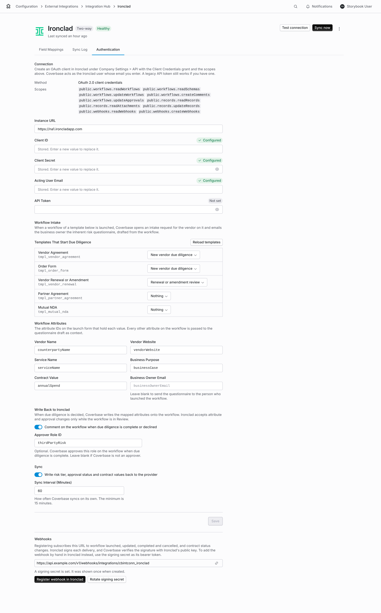
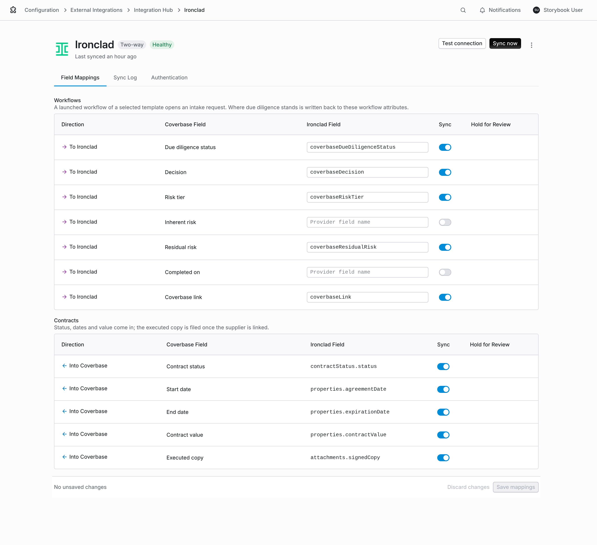
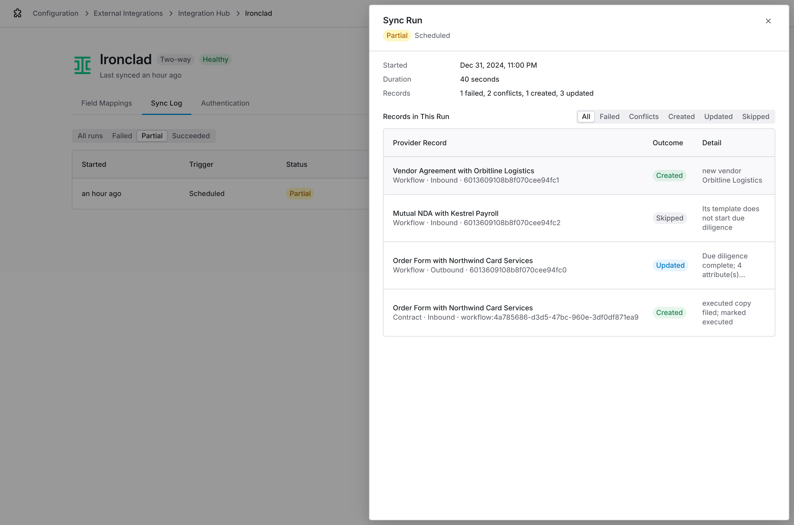

import AgentDirective from "/snippets/agent-directive.mdx";

<AgentDirective />

The Ironclad connector is part of the [Integration Hub](/products/integration-hub). It connects the two places a vendor contract lives: the Ironclad workflow where the business owner requests and negotiates it, and the Coverbase intake request and due diligence that decide whether the vendor is acceptable.

## Supported workflows

| # | When this happens | Coverbase does this |
| --- | --- | --- |
| 1 | A business owner launches a workflow in Ironclad from a template you picked, such as a vendor agreement or an order form | Opens an intake request for the vendor named on the workflow. The business owner who launched it becomes the requester, and Coverbase emails them when the inherent risk questionnaire is drafted and ready to review and submit. |
| 2 | The workflow is for a renewal or amendment of an existing vendor | Opens the same request against the existing vendor, labeled as a renewal or amendment review, so TPRM reviews the change alongside legal review. |
| 3 | Your team reviews and approves the request, and the assessment that approval launched completes | Writes the result onto the workflow: due diligence status, decision, risk tier and a link back to Coverbase. It comments on the workflow so the business owner and legal know they can move forward, and can record Coverbase's approval on an approver role. |
| 4 | The request is declined | Writes **Declined** onto the workflow and comments on it, so nobody signs with the vendor before the issue is resolved. |
| 5 | The workflow completes and the contract is signed | Reads the executed record, creates or updates the Coverbase contract under the vendor, files the signed copy, and marks the contract executed. Its dates and value come in from the record. |
| 6 | An executed record changes, expires or is terminated | Updates the contract's dates, value and status on the next sync. |

Workflows you do not pick, such as NDAs, are ignored. An NDA does not start due diligence on its own, because not every NDA turns into a vendor engagement.

Ongoing monitoring that is not tied to a contract, such as quarterly SLA reviews of critical vendors, stays in Coverbase. Your team starts it in Coverbase, not Ironclad.

## How a request flows

1. **Launch in Ironclad.** The business owner fills in the launch form for a vendor agreement. Ironclad tells Coverbase straight away through a webhook.
2. **Request opens in Coverbase.** Coverbase reads the workflow from Ironclad's API and opens an intake request. The vendor is matched to an existing vendor by website, then by name. If none matches, a new vendor record is created. Nothing is approved by this step.
3. **Questionnaire drafted.** Coverbase drafts the inherent risk questionnaire from the workflow: the vendor, service, business purpose and contract value, plus up to 60 other attributes on the launch form (those with a value, in alphabetical order, each up to 500 characters). The business owner gets an email to review the draft, correct it and submit it.
4. **Review and due diligence.** Your TPRM team reviews the request as usual. Approving it can launch an assessment, depending on your [intake approval settings](/user-guides/front-door-triage).
5. **Result back in Ironclad.** When due diligence completes, or the request is declined, Coverbase updates the workflow and comments on it. When due diligence completes, and you set an approver role, it also approves that role. A declined request never approves it.
6. **Executed contract filed.** When the workflow completes, the executed record and its signed copy file under the vendor in Coverbase.

## Before you start

You need:

- The Ironclad **API add-on**, and an Ironclad admin who can create an OAuth client under **Company Settings → API**.
- An Ironclad user for Coverbase to act as, for example `coverbase-integration@yourcompany.com`. Every API call runs with that user's permissions, so the user needs access to the workflows and records Coverbase reads and writes.
- A Coverbase admin with permission to manage integrations. The Integration Hub is part of the third-party lifecycle features, which your Coverbase representative turns on.
- Business owners who launch workflows should have a Coverbase login. A business owner without one cannot receive the questionnaire; the request goes to the Coverbase admin who connected Ironclad instead.

## Step 1: Create the OAuth client in Ironclad

1. In Ironclad, open **Company Settings → API** and create a new client application.
2. Under **Grant Types**, select **Client Credentials**.
3. Select these scopes:

| Scope | Why Coverbase needs it |
| --- | --- |
| `public.workflows.readWorkflows` | Read launched workflows and their attributes |
| `public.workflows.readSchemas` | List your workflow templates so you can pick them in Coverbase |
| `public.workflows.updateWorkflows` | Write the due diligence result onto workflow attributes |
| `public.workflows.createComments` | Comment on the workflow when due diligence finishes |
| `public.workflows.updateApprovals` | Approve an approver role, if you use that option |
| `public.records.readRecords` | Read executed records |
| `public.records.readAttachments` | Download the signed copy |
| `public.records.updateRecords` | Write the vendor's risk rating onto records |
| `public.webhooks.readWebhooks` | Find an earlier webhook registration for Coverbase |
| `public.webhooks.createWebhooks` | Register Coverbase's webhook |

4. Copy the **Client ID** and **Client Secret**. Ironclad shows the secret once.

## Step 2: Add the write-back fields to your templates

Coverbase writes its result into workflow attributes, so each template you pick needs a field for each value you want back. Ask your Ironclad admin to add these to the launch form as text fields that are not required, and note each field's ID:

| Suggested field | Holds |
| --- | --- |
| `coverbaseDueDiligenceStatus` | Awaiting business owner, Intake in review, Due diligence in progress, Due diligence complete or Declined |
| `coverbaseRiskTier` | The vendor's risk tier |
| `coverbaseLink` | A link to the request in Coverbase |
| `coverbaseDecision` (optional) | Approved or Declined |
| `coverbaseResidualRisk` (optional) | The vendor's residual risk |

<Note>
  Ironclad accepts attribute and approval changes only while a workflow is in the **Review** step. If the workflow is not in Review when due diligence finishes, Coverbase still comments on it, and writes the fields and approval on a later sync once the workflow is in Review.
</Note>

If you want Coverbase to be an approver, add an approver role such as **Third-Party Risk** to the template's approval flow and note its role ID.

## Step 3: Connect Ironclad in Coverbase

1. Open **Configuration → External Integrations** and click **Ironclad**, or open **Integration Hub** and click **Ironclad**.
2. On **Authentication**, enter:
   - **Instance URL**: the address you sign in to Ironclad at, such as `https://na1.ironcladapp.com` or `https://eu1.ironcladapp.com`.
   - **Client ID** and **Client Secret** from step 1.
   - **Acting User Email**: the Ironclad user Coverbase acts as.
3. Click **Connect**, then **Test connection**. A failed test names what Ironclad refused, usually a missing scope.

<Tip>
  If your organization already uses an Ironclad API token, you can enter it in **API Token** instead of the OAuth client. OAuth is recommended because its tokens expire every six hours.
</Tip>

## Step 4: Choose the templates that start due diligence

1. On **Authentication**, under **Workflow Intake**, click **Load templates from Ironclad**.
2. For each template, choose what it starts:
   - **New vendor due diligence** for new vendor agreements, order forms and partner agreements.
   - **Renewal or amendment review** for renewals and amendments of an existing vendor.
   - **Nothing** for templates that should not involve TPRM, such as NDAs.
3. Under **Workflow Attributes**, enter the field ID that holds each value on the launch form. **Vendor Name** is required. **Vendor Website** improves vendor matching, and **Service Name**, **Business Purpose** and **Contract Value** give the questionnaire draft more to work from. Leave **Business Owner Email** blank to send the questionnaire to whoever launched the workflow.
4. Click **Save**.

<Frame caption="The Authentication tab with templates, workflow attributes, write-back options and the webhook.">
  
</Frame>

Only workflows launched after you connect Ironclad open requests. Coverbase does not open requests for older workflows.

## Step 5: Choose what Coverbase writes back

1. Under **Write Back to Ironclad** on **Authentication**:
   - Leave **Comment on the workflow when due diligence is complete or declined** on to post a comment that mentions the business owner.
   - Enter the **Approver Role ID** if Coverbase should approve a role when due diligence completes. Leave it blank if Coverbase is not an approver.
2. Open **Field Mappings**. Under **Workflows**, enter the field ID from step 2 for each value you want written back, and switch off the rest.
3. Under **Contracts**, check the outbound rows if you also want the vendor's risk rating, required clause pack and blocking issues written onto executed records.
4. Click **Save mappings**.

<Frame caption="Workflow write-back mappings on the Field Mappings tab.">
  
</Frame>

## Step 6: Register the webhook

1. On **Authentication**, under **Webhooks**, click **Register webhook in Ironclad**.

Coverbase registers its URL in Ironclad for these events: workflow launched, updated, completed and cancelled, and contract status changed. Ironclad signs every delivery, and Coverbase checks the signature with Ironclad's public key before it acts on one. Each delivery only tells Coverbase what changed; Coverbase always reads the workflow or record back from Ironclad's API.

To add the webhook by hand in Ironclad instead, click **Create signing secret**, copy the URL and secret, and in Ironclad set the webhook's authentication to **Bearer token** with the secret as the token.

Without a webhook, Coverbase still picks up launched workflows and executed records on each scheduled sync. Set **Sync Interval (Minutes)** under **Sync** to how quickly you need them, with a minimum of 15 minutes.

## Step 7: Test it end to end

1. In Ironclad, launch a workflow from a template you picked, with a test vendor name.
2. In Coverbase, open the Ironclad connection's **Sync Log**. The workflow appears as **Created** with the vendor it was matched to. A template you did not pick appears as **Skipped**, with the reason.
3. Check that the business owner received the questionnaire email, then submit the request and approve it.
4. Click **Sync now** or wait for the next sync. The Sync Log shows an outbound **Workflows** row, and the workflow in Ironclad shows the written fields and Coverbase's comment.
5. Complete the workflow in Ironclad. The executed record appears in the Sync Log as a **Contract** row, and the contract with its signed copy appears under the vendor in Coverbase.

## What the sync log tells you

<Frame caption="A sync run with a request opened, an NDA skipped, a result written back and an executed contract filed.">
  
</Frame>

| Row | Meaning |
| --- | --- |
| Workflow, **Created** | A request opened. The message says whether the vendor was matched or created, and names a business owner who is not a Coverbase user. |
| Workflow, **Skipped** | The template does not start due diligence, or the workflow was cancelled, completed or launched before the connection. |
| Workflow, **Failed** | The workflow has no value in the vendor name field you named, or vendor intake is not set up. |
| Workflow outbound, **Updated** | What Coverbase wrote: the status, how many attributes, whether it commented and approved, and anything Ironclad did not accept because the workflow was past Review. |
| Contract, **Created** or **Updated** | An executed record synced. The message says when the signed copy was filed and the contract marked executed. |

## Troubleshooting

| Symptom | What to check |
| --- | --- |
| **Test connection** fails with a scope error | The OAuth client is missing a scope from step 1. Add it in Ironclad and test again. |
| No request opens when a workflow is launched | The template is set to **Nothing**, the webhook is not registered, or the workflow was launched before you connected. Check the Sync Log for a **Skipped** row. |
| The request went to the admin instead of the business owner | The business owner is not a Coverbase user. Invite them as a requester. |
| The request matched several vendors | Coverbase opens a request without a vendor and the business owner picks the right one when they open it. Add **Vendor Website** to the attributes to match by domain. |
| The workflow was not updated | The write-back fields are not on the template, the field IDs in **Field Mappings** do not match, or the workflow is not in Review. Coverbase retries skipped fields and approvals on each sync until the workflow is in Review, without posting the comment again. The Sync Log names what was skipped. |
| The signed copy did not file | The record has no `signedCopy` attachment, or the scope `public.records.readAttachments` is missing. |

## Onboarding checklist

1. The Ironclad API add-on and an OAuth client with the scopes in step 1.
2. An Ironclad user for Coverbase to act as.
3. The templates that start due diligence, and which are renewals.
4. The launch form field IDs for vendor name and, ideally, vendor website, service, business purpose and contract value.
5. Write-back fields on those templates, and an approver role if Coverbase approves.
6. Business owners set up as Coverbase requesters.

## Related

<CardGroup cols={2}>
  <Card title="Integration Hub guide" icon="book-open" href="/user-guides/integration-hub">
    Field mappings, the sync log and webhooks.
  </Card>
  <Card title="Requesting a vendor" icon="clipboard-list" href="/user-guides/requesting-a-vendor">
    What the business owner sees when they complete the request.
  </Card>
  <Card title="Front Door triage" icon="door-open" href="/user-guides/front-door-triage">
    How TPRM reviews and approves the request.
  </Card>
  <Card title="Contract intake and approval" icon="clipboard-check" href="/user-guides/contract-intake-and-approval">
    What happens when a contract is executed.
  </Card>
</CardGroup>
