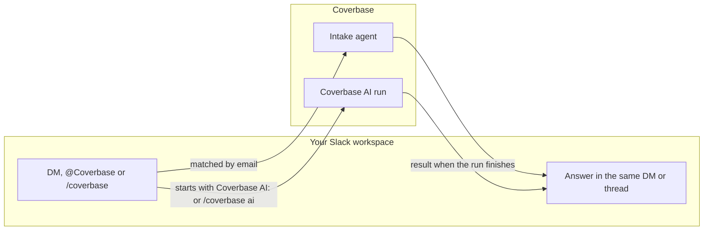

import AgentDirective from "/snippets/agent-directive.mdx";

<AgentDirective />

Coverbase ships a Slack app that installs into your workspace through Slack's own authorization flow. Once it is connected, people in your workspace can request a vendor and ask Coverbase AI without leaving Slack, and Coverbase answers in the same direct message or thread.

<Note>
  Coverbase notifications (assignments, reviews, alerts) are delivered in the app and by email. The Slack app answers requests and Coverbase AI, sends a run's questions to the person who started it, and sends the test message below. To get Coverbase events into Slack channels, use [webhooks](#channel-based-patterns).
</Note>

## Set it up

Open **Configuration → External Integrations** and click **Slack**. The dialog is a checklist that checks each step for you:

1. **Connect your workspace.** Click **Connect to Slack**. Slack asks a workspace admin to approve the app. You type no credentials into Coverbase.
2. **Choose what people can use.** Turn on **Vendor requests**, **Coverbase AI**, or both. Each is off until you turn it on.
3. **Your Slack account.** Coverbase checks that your Coverbase email has an account in the workspace, because email is how Coverbase finds everyone. If it warns, change the email on your Slack profile or your Coverbase profile so they match. **Send test message** sends you a DM from the app.
4. **Try it in Slack.** Click **Open Slack** and send the app a message. The step checks off within a few seconds of the message arriving, and the dialog shows **Slack is live**.

Once Slack is live, the dialog shows what people can type, how many requests and runs came from Slack in the last 30 days, and **Copy announcement**, a ready-to-post message for your channels. **Test connection** asks Slack to confirm the workspace, and **Disconnect** removes the connection.

## What people type

| Typed | What happens | Where the answer goes |
|---|---|---|
| A direct message to the app | Opens a vendor request. The intake agent asks for anything missing. | The DM |
| `@Coverbase` and a request, in a channel | Same as a DM | The thread. Mention `@Coverbase` again to answer it. |
| `/coverbase we need Figma for the design team` | Opens a vendor request | A short reply only you see, then the DM |
| `Coverbase AI:` and an instruction, in a DM | Starts a Coverbase AI run as you | The DM: a link when it starts, the result when it finishes |
| `/coverbase ai` or `/ai` and an instruction | Starts a Coverbase AI run as you | A short reply only you see, then the result by DM |
| `/coverbase help` | Lists the commands your organization turned on | Only you see it |

Coverbase AI runs with your own Coverbase permissions. When a run needs a decision, you get a DM with a button for each answer. When it finishes, the summary and a link to the report are posted where you asked.

Coverbase answers only people whose confirmed Slack email belongs to an active member of your organization. Anyone else gets a reply saying their account could not be matched, and nothing is recorded.

## Permissions

The app asks Slack to read direct messages to it, mentions of it, and its slash commands, and to look people up by email. An app installed before these were available shows **Needs reinstall**. **Reinstall** keeps the connection and adds them. If DMs work but `/coverbase` does nothing, the install lacks the commands permission, and the first step offers **Reinstall**.

## Channel-based patterns

For channel notifications and richer routing (a #vendor-risk feed, per-team channels), pair Coverbase [webhooks](/integrations/webhooks) with a Slack workflow or a small handler you control. The webhook carries the event type and affected object, so the routing logic stays yours.

## Rollout checklist

1. A workspace admin connects the Coverbase app from **Configuration → External Integrations → Slack**.
2. Turn on **Vendor requests** and, if your organization has Coverbase AI, **Coverbase AI**.
3. Make sure people's Coverbase emails match their Slack emails. The dialog checks yours.
4. Send the app a message and wait for **Slack is live**.
5. Post the text from **Copy announcement** where your team will see it.
