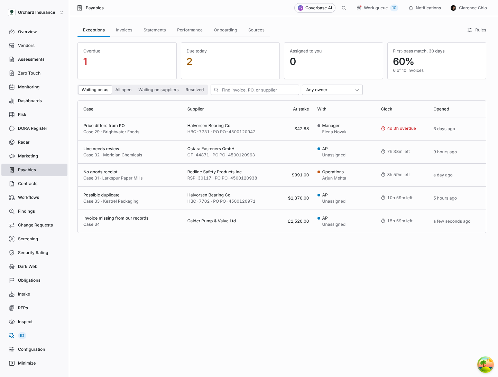

import AgentDirective from "/snippets/agent-directive.mdx";

<AgentDirective />

<Note>
  Your Coverbase representative turns on Payables for your organization.
</Note>

Payables sits between your procurement system, where purchase orders and goods receipts live, and your ERP or AP ledger, where invoices are booked and paid. It reads both, checks every supplier invoice against the PO it bills and the goods recorded against that PO, and turns each difference into a case with one owner and a response clock. Suppliers see the same invoices in their portal, with the reason one is on hold and a button to fix it.

Coverbase never pays an invoice, never approves one for payment and never writes to your ledger. When your AP team accepts an invoice in Coverbase, Coverbase records that a person accepted the match. Your AP team still approves and pays in your own system. If you turn on the outbound decision, Coverbase sends that acceptance to your ledger as a note for it to act on, and records that it was sent, not that the invoice was paid.

<Frame caption="The Exceptions tab: every open case from every intake channel, with what is at stake, who has it and how long they have left.">
  
</Frame>

## What it does

<CardGroup cols={2}>
  <Card title="One exceptions queue" icon="inbox">
    Invoices booked in your ledger, forwarded by email, sent as EDI or through the intake API, and submitted in the supplier portal all land in one queue. A difference on any of them becomes a case, routed by your rules to AP, procurement, operations, a manager or the supplier.
  </Card>
  <Card title="2-way and 3-way matching" icon="scale-balanced">
    Each invoice line is mapped to a PO line and checked for part number, unit price within your tolerance, quantity against what was ordered and, when you require a receipt, against what was received. Tax, freight, currency and the invoice total are checked too. Only deterministic checks can call an invoice matched.
  </Card>
  <Card title="AI reading of emails and PDFs" icon="envelope-open-text">
    Invoices forwarded to your intake address, or uploaded as PDFs, are read by AI into a structured invoice. What it reads is then put through the same checks against the PO and receipt as any other invoice, and every field it was unsure of is listed with its confidence.
  </Card>
  <Card title="Owned cases with clocks" icon="stopwatch">
    Every case has an owner role, a person when one is set, and a response clock in business or calendar hours. Clocks pause while the supplier owes the next step, send a reminder at 75% by default and escalate when they run out. Time with each owner is measured from the case history, not estimated.
  </Card>
  <Card title="Supplier statements" icon="file-lines">
    Each month every supplier gets a statement of the invoices you have recorded from them, per currency and billing entity. They confirm it, flag a line whose amount or status is wrong, or add an invoice you never received. Each difference opens a case for AP.
  </Card>
  <Card title="Performance and scorecards" icon="chart-line">
    Your team's view shows where cases wait, how many clocks were met and how fast suppliers reply. Each supplier has an invoice scorecard of first-pass match, mismatches, duplicates and corrections, with the invoices behind every figure. Suppliers can see theirs and dispute a figure.
  </Card>
  <Card title="Supplier onboarding waves" icon="users-rectangle">
    Upload a client's supplier list, see every row checked for missing fields and existing suppliers before anyone is invited, then send the invitations. Each supplier is asked only for the requirements your rules attach to their risk tier, country and spend.
  </Card>
  <Card title="Supplier portal" icon="door-open">
    Suppliers see their invoices and why one is on hold, the POs you issued them, their statements and their scorecard. They send corrected invoices, reply on a mismatch, answer a statement and, if you allow it, submit invoices against a PO.
  </Card>
</CardGroup>

## How an invoice moves

1. **It arrives.** From your ledger, the supplier email inbox, EDI, the intake API or the supplier portal. Every delivery is stored once, so a source that sends the same event twice changes nothing the second time.
2. **It is identified.** Coverbase finds the supplier by its supplier ID, then by exact legal name. Two vendors with the same name are never guessed between: the invoice waits for a person.
3. **It is checked.** Against its PO and, for 3-way matching, the goods receipts on that PO. An invoice that names a PO you have not received yet waits, and is checked when the PO arrives.
4. **A difference becomes a case.** One case per reason, routed by your rules, with a clock. A case the next check no longer finds (a receipt arrived, a corrected invoice fixed the price) resolves itself.
5. **A person decides.** AP accepts the invoice, asks the supplier for a corrected one, or hands the case to whoever can fix it. Your ledger stays the system that approves and pays.

See [How Payables works](/user-guides/payables-overview) for who does what at each step, and [How matching works](/user-guides/payables-matching) for every check.

## What the AI does, and what it does not

AI is used in two places, and in neither does it decide anything.

- **Reading invoices.** An invoice forwarded by email or uploaded as a PDF is read into fields and lines. The model is told to copy numbers as printed, to leave a field empty rather than guess, and never to guess a PO number. An invoice with no invoice number is refused. What it reads is then checked against the PO and receipt like an invoice from your ledger, so a misread price or quantity fails a check and opens a case for a person. The fields it was unsure of are listed in the invoice drawer with its stated confidence. An emailed invoice is not booked: it waits for your ledger to book it, and Coverbase links the two.
- **Explaining a mismatch.** When an invoice does not match, Coverbase AI can write a short explanation of what differs and suggest which PO line an unplaced invoice line bills. A suggestion is shown as a suggestion. It can move an invoice to **Likely a match** at most, never to **Matched**, and a person confirms it.

Neither can approve an invoice, and you can turn the explanation off on the **Payables rules** page.

## Limits

- Coverbase never pays, schedules or approves an invoice for payment, and never changes a record in your ledger or procurement system. Finance statuses, payment dates and payments are shown only as your ledger reported them.
- Coverbase does not convert currencies. An invoice in a different currency from its PO always opens a case.
- A statement is a reconciliation aid built from what you had recorded when it was generated. It is not a promise of payment, and an unanswered line is never taken as agreement.
- Clock history starts when Coverbase opened the case. Time spent on an invoice before it reached Coverbase is not reconstructed.
- A figure built on fewer than 5 invoices or replies shows as **Too few** rather than a number.

## Where to go next

<CardGroup cols={2}>
  <Card title="How Payables works" icon="diagram-project" href="/user-guides/payables-overview">
    The flow from PO to settled invoice, and who does what.
  </Card>
  <Card title="Setting up Payables" icon="sliders" href="/user-guides/payables-setup">
    Sources, field mappings and the rules every case runs on.
  </Card>
  <Card title="How matching works" icon="scale-balanced" href="/user-guides/payables-matching">
    Every check, every exception reason and who it goes to.
  </Card>
  <Card title="Working exceptions" icon="inbox" href="/user-guides/payables-exceptions">
    The queue, a case and every action on it.
  </Card>
  <Card title="Invoices and statements" icon="file-lines" href="/user-guides/payables-invoices-and-statements">
    The invoice list and drawer, and monthly supplier statements.
  </Card>
  <Card title="Performance and scorecards" icon="chart-line" href="/user-guides/payables-performance">
    Team metrics, supplier scorecards and metric disputes.
  </Card>
  <Card title="Supplier onboarding" icon="users-rectangle" href="/user-guides/payables-supplier-onboarding">
    Waves, validation and onboarding one supplier.
  </Card>
  <Card title="Invoices in the supplier portal" icon="user" href="/user-guides/supplier-portal-invoices">
    The guide to share with your suppliers.
  </Card>
</CardGroup>
