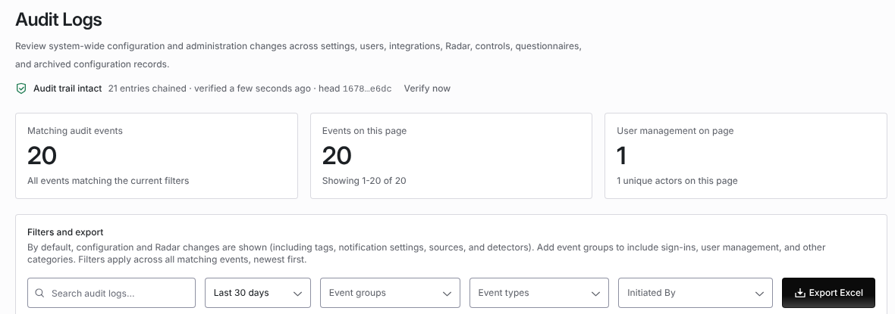

import AgentDirective from "/snippets/agent-directive.mdx";

<AgentDirective />

Coverbase records what happened, who did it, and when, across the dashboard, the public API, and AI assistants. You can review it in the UI and pull it programmatically through the audit API, so it can flow into your SIEM, your GRC platform, or your own evidence packages.

## Two audit surfaces

Coverbase keeps audit data on two complementary surfaces, backed by the same underlying activity store:

<CardGroup cols={2}>
  <Card title="System-wide audit log" icon="building-shield">
    Administration and configuration changes across the whole organization: sign-ins, user management, settings, integrations, controls, questionnaires, and Radar configuration. Reviewed under **Configuration → Audit Logs**, exportable to Excel, and readable via `GET /v1/system_audit_log`.
  </Card>

  <Card title="Per-object activity trails" icon="list-check">
    The change history of an individual record: a vendor, assessment, finding, contract, and so on. Shown on each record's activity feed in the dashboard, readable via `GET /v1/activity`, and queryable by AI assistants through the MCP server.
  </Card>
</CardGroup>

Both surfaces are scoped to your organization. No audit data crosses organization boundaries.

## What is captured

<CardGroup cols={2}>
  <Card title="Sign-ins and sign-outs" icon="key">
    Session lifecycle events from the identity provider are recorded per organization, including the user's email, client IP address, user agent, and browser.
  </Card>

  <Card title="User management" icon="users-gear">
    User creation, invitations (sent, accepted, revoked), profile updates, role changes, deactivation, and deletion.
  </Card>

  <Card title="Configuration changes" icon="sliders">
    Creates, updates, and archives across organization settings, statuses, tags, templates, scales, risk domains, custom fields, departments, terminology, notification settings, workflows, intake configuration, sanctions screening configuration, and import/export runs.
  </Card>

  <Card title="Controls, questionnaires, and Radar" icon="file-shield">
    Control and control-set changes, questionnaire question lifecycle, and Radar source, detector, and alert configuration changes.
  </Card>

  <Card title="Public-API calls" icon="code">
    Every authenticated `/v1/*` call is recorded as an `external_api_call`, capturing the method, route, status, and the key that made it. See [Public-API audit records](#public-api-audit-records).
  </Card>

  <Card title="Integration and key lifecycle" icon="plug">
    API keys, MCP API keys, external integrations, and API sources: added, updated, and deactivated.
  </Card>
</CardGroup>

<Note>
  **Exporting the audit log is itself audited.** Every Excel export from the audit log page is recorded as an `audit_log_exported` event, including the number of rows exported, so reviewing the trail leaves a trail.
</Note>

## Event groups and event types

Every system audit event carries a machine-readable **event type** and rolls up into one of eight **event groups**, which drive the filters in the dashboard and the API:

| Event group | Event types |
| --- | --- |
| **Access** | `app_login`, `app_logout` |
| **User management** | `user_created`, `user_invited`, `user_invitation_accepted`, `user_updated`, `user_role_changed` |
| **Configuration** | `config_created`, `config_updated`, `notification_updated`, `audit_log_exported`, `report_exported` |
| **Radar** | `radar_alert_updated`, `radar_source_created`, `radar_source_updated`, `radar_detector_created`, `radar_detector_updated` |
| **Integrations** | `integration_added`, `integration_updated` (covers API keys, MCP keys, external integrations, and public-API calls) |
| **Controls** | `control_created`, `control_updated` |
| **Questionnaires** | `question_created`, `question_updated`, `question_deleted` |
| **Archive** | `user_invitation_revoked`, `user_deactivated`, `user_deleted`, `config_archived`, `integration_deactivated`, `control_archived` |

The **Archive** group collects every deactivation, archival, and deletion event across all categories, so destructive changes can be reviewed in one place.

`GET /v1/system_audit_log/metadata` returns this taxonomy programmatically. Use it to populate filter pickers or keep an export pipeline in sync as new event types are added.

## What each record contains

Every audit record includes:

| Field | Description |
| --- | --- |
| `created_at` | Unix timestamp of the event. |
| `actor` | The acting user (ID, name, email, avatar). System-generated events have no actor and display as **System**. |
| `event_type` / `event_group` | The classification described above. |
| `target_type` / `target_id` | What kind of object was affected and which one (for example, a specific control, user, or tag). |
| `summary` | A human-readable one-line description of the event. |
| `data` | Structured detail: field-level diffs for updates (field name, old value, new value) and the initial values for creations. |

Two details worth knowing about the `data` payload:

- **Updates are recorded as field-level diffs**: you can see exactly which fields changed and their before/after values, not only that "something was updated."
- **Sign-in events carry session forensics**: the user's email, client IP address, user agent, and browser, sourced from the identity provider's session events.

## Reviewing the audit log in the dashboard

The system-wide audit log lives at **Configuration → Audit Logs**. By default it shows **all event groups** for the **last 30 days**, newest first; nothing is hidden by default.

<Steps>
  <Step title="Filter">
    Narrow by time range (last 24 hours, 7/30/90 days, all time, or a custom date range), by one or more event groups, by specific event types, or with free-text search. Search matches actor names, event summaries, and understands terms like "created", "updated", "exported", "system", and group names. Filters apply across **all** matching events, not only the visible page.
  </Step>
  <Step title="Inspect">
    Each row shows the time, actor, event badge, target, and a details column with the field-level diff or creation values.
  </Step>
  <Step title="Export">
    **Export Excel** downloads every event matching the current filters (not only the current page) as a spreadsheet with timestamp, actor, event group, event type, target, summary, and details columns. The export is recorded in the log as `audit_log_exported`.
  </Step>
</Steps>

Results are paginated (25-250 rows per page, 50 by default), with summary cards showing the total number of matching events.

### Who can see it

Access to the audit log is governed by your organization's roles. For organizations using custom roles, the **Audit trail** resource carries `read` and `export` permissions and is always organization-wide; it cannot be scoped to assigned records. Headless access uses an `ak_*` API key carrying the `audit:read` scope (see below).

## Tamper evidence

The activity log is sealed into a hash chain, so an entry edited, removed, reordered or replaced after sealing shows up as a broken link.

- **Sealing.** Every minute, Coverbase appends your organization's new entries to the chain in order. Each entry gets a sequence number, shown as `#20` in the **Details** column, and a SHA-256 hash of its content and the hash of the entry before it.
- **Guard.** The database refuses any change to a sealed entry's recorded content and any removal of it. Entries not yet sealed are written normally and sealed within a minute.
- **Exempt entries.** Public API request records and dark web audit events are never sealed, because a retention purge removes them on its own schedule.

Under the page title, the integrity line shows **Audit trail intact**, how many entries are chained, when it was verified, and the head hash (the hash of the latest sealed entry). **Sealing new entries** means every link verifies and some entries are waiting for the next seal. **Integrity check failed at entry #N** names the first entry that is missing, does not link to the one before it, or no longer matches its hash. Click **Verify now** to walk the whole chain again.

<Frame caption="The Audit Logs page with the integrity line and the Initiated By filter.">
  
</Frame>

The chain lives in the same database it protects. Someone able to bypass the database guard could also rewrite every link after an edit. To catch that, keep a copy of the head hash outside Coverbase, for example in your scheduled export, and compare it later.

`GET /v1/system_audit_log/integrity` runs the same check and returns `status` (`verified`, `broken` or `sealing_pending`), `sealed_count`, `unsealed_count`, `last_sealed_at`, `head_hash`, `first_broken_seq` and `verified_at`. It accepts the same credentials as the other audit read endpoints.

## Who initiated a change

Every entry says what set the change in motion, in the **Initiated By** column: **User** (a person, named below the badge), **Automation** (a workflow rule, with the rule's step and workflow), **Coverbase AI** (an AI tool call) or **System** (the platform itself). Filter the log with **Initiated By**, or pass `initiated_by` (`user`, `automation`, `agent`, `system`, repeatable) to `GET /v1/system_audit_log`.

To be alerted when something other than a person changes a key field, build a workflow on the record's update trigger that watches those fields, and add the **Change made by** condition. Pick **An automation**, **Coverbase AI** and **Coverbase (system)**. The workflow then runs only when one of those made the change, and its action (an email, a work item) is the alert. A change whose maker is unknown is ignored. See [Building a workflow](/user-guides/building-a-workflow).

## Reading the audit log through the API

For SIEM ingestion and scheduled exports, read the system audit log programmatically:

```bash
curl "https://api.coverbase.app/v1/system_audit_log?start_ts=1748736000&event_groups=access&event_groups=user_management&limit=500" \
  -H "Authorization: Bearer ak_live_xxx"   # key must carry the audit:read scope
```

### `GET /v1/system_audit_log`

| Parameter | Description |
| --- | --- |
| `start_ts` / `end_ts` | Unix timestamps (seconds) bounding the window. |
| `event_groups` | Repeatable: one or more of the groups above. |
| `event_types` | Repeatable: one or more specific event types. |
| `search` | Free-text search, same semantics as the dashboard search box. |
| `limit` | Page size, 1-500 (default 100). |
| `offset` | Pagination offset (default 0). |

Responses are ordered newest first and include `X-Total-Count` and `Content-Range` headers for paging through the full result set.

### Companion endpoints

- **`GET /v1/system_audit_log/metadata`**: the event group and event type taxonomy with display labels.
- **`POST /v1/system_audit_log/export_ack`**: records an `audit_log_exported` event; the dashboard calls this after every Excel export. If you build your own export tooling, call it too so exports stay visible in the trail.

### Authentication for the audit API

The audit read endpoints accept **either** of:

- a **dashboard session JWT**, subject to your organization's role permissions, or
- an **`ak_*` API key carrying the [`audit:read` scope](/conventions#api-key-scopes)**, for headless export pipelines.

<Tip>
  Mint a dedicated, scope-limited key for your log-export pipeline. A key that only needs to read the audit log should carry **only** `audit:read` and nothing else, following least privilege. See [API key scopes](/conventions#api-key-scopes).
</Tip>

## Per-object activity trails

Separate from the system-wide log, every major record keeps its own activity trail: creations, field updates, notes, exports, and submissions against that specific object, each attributed to the acting user (or **System** for automated changes).

- **In the dashboard**: shown on the record's activity feed (for example, a vendor's or assessment's activity tab).
- **Through the API**: `GET /v1/activity` with `target_type` and `target_id` query parameters returns the trail for one object; `related_activity=true` pulls in activity from related records (for example, an assessment's findings).
- **Through AI assistants**: the Coverbase [MCP server](/mcp/overview) exposes the trail via `query_platform` with `kind: "audit_trail"` for vendors, assessments, assessment reviews, contracts, findings, services, obligations, follow-ups, portals, vendor documents, work queue items, and evals. The built-in `who_changed_this` prompt scripts a full audit investigation for one object.

## Public-API audit records

Each authenticated public-API request is recorded in your organization's activity log as `type=external_api_call` with `target_type=external_api_request`. Every record captures:

- the HTTP method, request path, and matched route template
- the response status code and duration in milliseconds
- the names of the query parameters used (values are **not** recorded)
- the `ak_*` key ID and human-readable name that authenticated the request
- the client IP and a per-request correlation ID

Audit records are written after the response is sent, so auditing never delays or fails your API calls.

<Note>
  Request and response **bodies are never persisted** in the audit log, only metadata about the call. This keeps the trail useful for forensics without itself becoming a sensitive data store.
</Note>

## AI assistant (MCP) activity

AI assistant activity is covered at two layers:

- **Changes made through MCP appear in the audit surfaces.** MCP tool calls run as the connected user, so writes land in the same per-object activity trails (and, for configuration surfaces like controls, custom fields, and Radar detectors, the system-wide audit log), attributed to that user, exactly as if they had made the change in the dashboard. MCP API key creation and revocation appear in the **Integrations** group.
- **Tool invocations are logged server-side.** Every MCP tool call (including reads) is recorded in Coverbase's security logs with the user identity, organization, tool name, sanitized parameters, and outcome, for security monitoring and incident response. Credentials and high-risk PII are redacted before logging. See [MCP security and privacy](/mcp/security) for details.

## Retention

Audit records are retained in line with the retention periods described in our agreements and privacy policy. An **Audit log** rule on your [records retention schedule](/user-guides/records-retention) keeps entries longer, and an organization-wide legal hold on the audit log stops the purge. For long-term retention beyond that window, export the log on a recurring schedule into your own system of record.

## Build a defensible evidence trail

<Steps>
  <Step title="Provision a scoped export key">
    Have an admin mint an `ak_*` key with the `audit:read` scope for your export job.
  </Step>
  <Step title="Pull on a schedule">
    Poll `GET /v1/system_audit_log` on a fixed cadence with a `start_ts` watermark, paging through results via `limit`/`offset` and the `X-Total-Count` header. See [pagination](/conventions#pagination).
  </Step>
  <Step title="Ship to your system of record">
    Forward records into your SIEM or GRC platform so your auditors see Coverbase activity alongside the rest of your environment.
  </Step>
</Steps>
