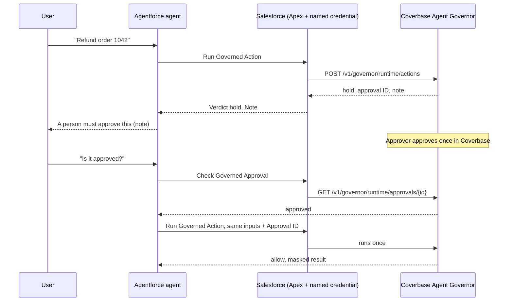
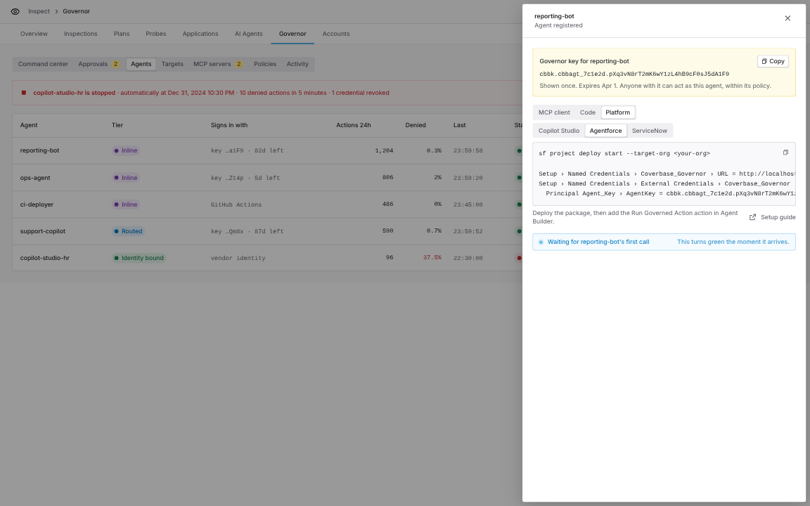
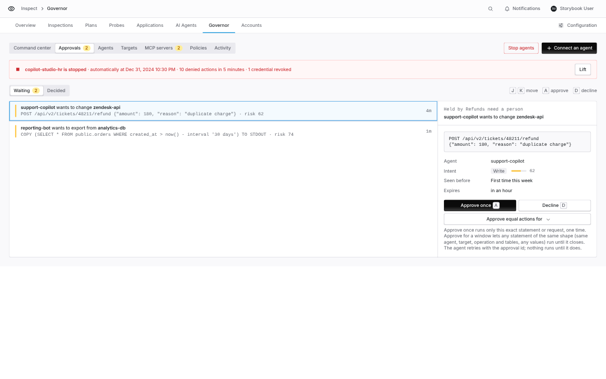
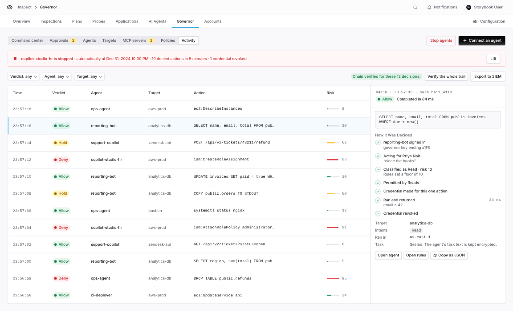

import AgentDirective from "/snippets/agent-directive.mdx";

<AgentDirective />

<Info>
  This guide is part of the [User Guides](/user-guides/overview) collection. It covers the Coverbase Agent Governor package for Salesforce Agentforce. For all three platforms at a glance, see [Governor platforms](/products/agent-governor-platforms).
</Info>

<Note>
  The package is in early access and is not yet on AppExchange. Your Coverbase representative gives you the Salesforce DX project to deploy with the Salesforce CLI.
</Note>

The package gives Agentforce agents three actions backed by the governor. The agent asks the governor before it reads a company database or calls an API. The governor decides, runs the action with a credential scoped to it, masks the result and records the decision. The key lives in a Salesforce external credential, never in Apex, a field or a log.

| Agent action | What it does |
| --- | --- |
| **Run Governed Action** | Runs one SQL statement or API request on a company system. The governor allows it, holds it for a person, or denies it. |
| **Check Governed Approval** | Says whether a person approved a held action. |
| **List Governed Targets** | Lists the systems the agent may act on, with the ID to pass to Run Governed Action. |

The package also carries a topic, **Governed Company Data**, that holds the three actions and instructions for each verdict.



## Set up the agent in Coverbase

1. In **Inspect › Governor › Agents**, select **Register agent** and name it after the Salesforce org or agent, for example `agentforce-service`.
2. Copy the key from the **Connect an agent** panel. Under **Platform › Agentforce**, the panel shows the deploy command, the named credential URL for your Coverbase environment and where the key goes.
3. In **Policies**, give the agent a baseline on the targets it should reach.

<Frame caption="Connect an agent, Platform group, Agentforce.">
  
</Frame>

## Deploy the package

```bash
sf org login web --alias governor-org
```

```bash
sf project deploy start --target-org governor-org --test-level RunSpecifiedTests --tests CoverbaseGovernorTest
```

The deployment runs the package's Apex tests. The topic and agent actions deploy only to an org with Agentforce turned on.

The named credential `Coverbase_Governor` points at `https://api.coverbase.app`. To use another Coverbase environment, change its URL in **Setup › Named Credentials** to the value the Connect panel shows.

## Set the key

Deployment never carries the key. Add it after you deploy:

1. In Salesforce **Setup › Named Credentials › External Credentials**, open **Coverbase Agent Governor**.
2. Open the `Agent_Key` principal and add an authentication parameter named `AgentKey`. Its value is the key, `cbbk.<agent_id>.<secret>`, without `Bearer`. The credential adds the header itself.
3. Assign the **Coverbase Agent Governor User** permission set to the agent's running user and to anyone who runs the actions in an employee agent.

## Add the topic to your agent

1. In **Agent Builder**, open your agent and select **Topics › Add from Asset Library**.
2. Add **Governed Company Data**.
3. Activate the agent.

To use the actions in a topic you already have, add **Run Governed Action**, **Check Governed Approval** and **List Governed Targets** from **Asset Library › Actions**, and add these instructions to the topic:

```text
Always use List Governed Targets before acting on a system you have not used in this
conversation. When Run Governed Action returns hold, tell the user a person must approve it and
give them the note. When they ask again, run Check Governed Approval, and once it is approved run
the same action again with the same inputs and the approval ID. When it returns deny, do not
retry, and do not rephrase the action to get a different answer.
```

## Run Governed Action inputs and outputs

| Input | Use |
| --- | --- |
| **Target ID** | The `cbbtgt_` ID from List Governed Targets. |
| **Kind** | `sql` for a database target, `http` for an API target. |
| **SQL Statement**, **Maximum Rows** | For `sql`. |
| **HTTP Method**, **HTTP Path**, **HTTP Body**, **HTTP Headers JSON** | For `http`. Headers are a JSON object, for example `{"Content-Type": "application/json"}`. |
| **Approval ID** | Set only when retrying a held action after approval. |
| **Delegation ID** | Act on behalf of a person who delegated to this agent. |
| **User Request** | The user's request, sealed into the audit trail. |

| Output | Meaning |
| --- | --- |
| **Verdict** | `allow`, `hold`, `deny` or `error`. |
| **Note** | A sentence for the user. |
| **Reason** | Why it was held or denied. |
| **Approval ID** | Set on a hold. |
| **Result JSON** | The masked result. |
| **Failed** | Policy allowed it, but the target returned an error. |
| **Risk Band** | The governor's risk band for the action. |

## Held actions

An Apex action cannot wait, so a held action is handled in the conversation. The agent tells the user, and runs the same action with the approval ID once **Check Governed Approval** returns `approved`. **Approve once** runs only the exact statement it was given for; a different statement is held again with a new approval ID.

For unattended work, a scheduled or record-triggered flow can call **Check Governed Approval** and resume when it reads `approved`.

<Frame caption="Inspect › Governor › Approvals: the approver sees the exact statement the Agentforce agent asked to run.">
  
</Frame>

## Act for many people

- **One agent, a delegation per person.** Pass the person's delegation in **Delegation ID**, for example from a field on the User record. The governor records the person beside the agent and limits the agent to that person's delegated targets.
- **A key per person.** Assign the **Coverbase Governor Per User** permission set instead. Each person opens **Settings › External Credentials › Coverbase Agent Governor** and stores their own key in an `AgentKey` parameter on the `Per_User` principal. A person without a stored key gets an authentication error instead of acting as the shared agent.

## Check the results in Coverbase

Every call appears in **Inspect › Governor › Activity** under the governor agent you created.

<Frame caption="Inspect › Governor › Activity.">
  
</Frame>

## Troubleshooting

| You see | Do this |
| --- | --- |
| Verdict `error` with an authentication note | Set `AgentKey` on the `Agent_Key` principal, or on your `Per_User` principal if you use a key per person. |
| The topic is missing from Asset Library | The org does not have Agentforce turned on, or the deployment skipped the GenAi metadata. |
| Verdict `deny` with `no_baseline` | Add a baseline for this agent on the target in **Policies**. |
| A retried action is held again | The retry changed an input. Send exactly the same inputs with the approval ID. |
