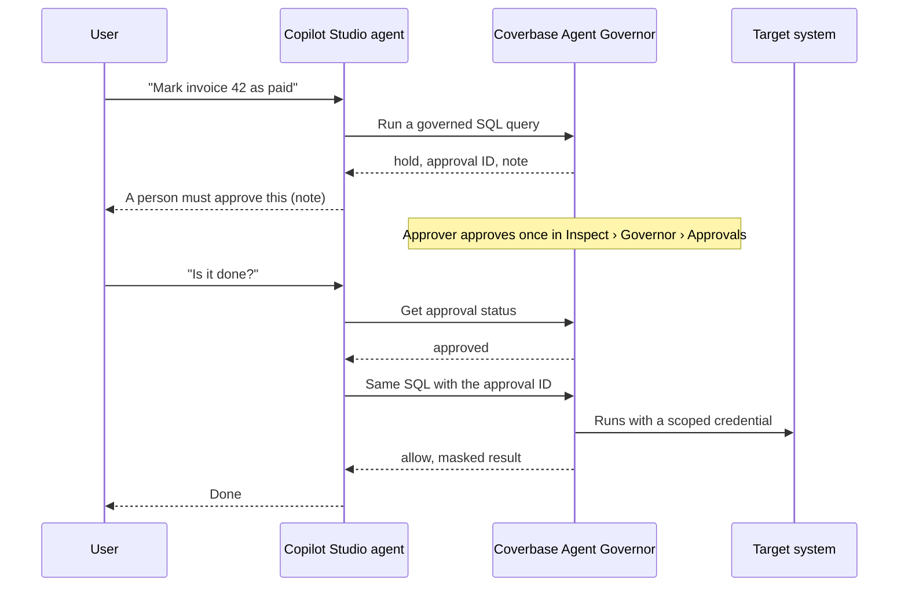
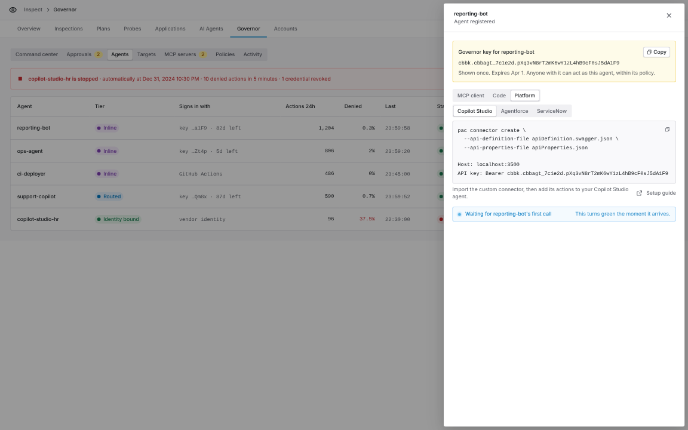
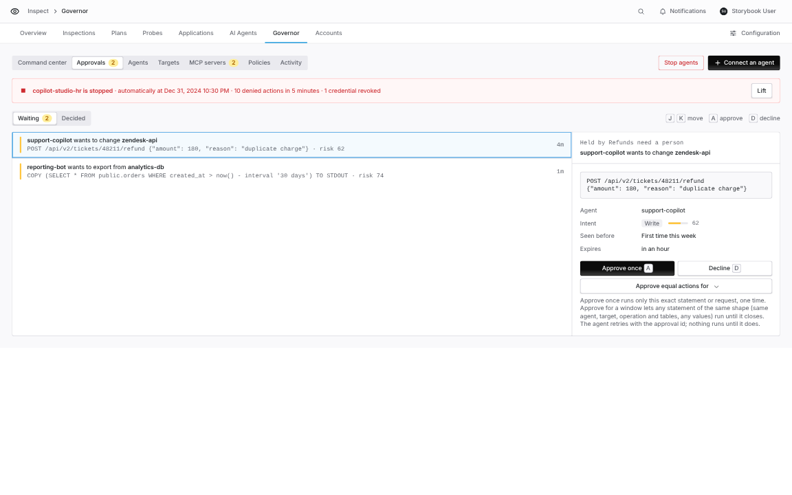
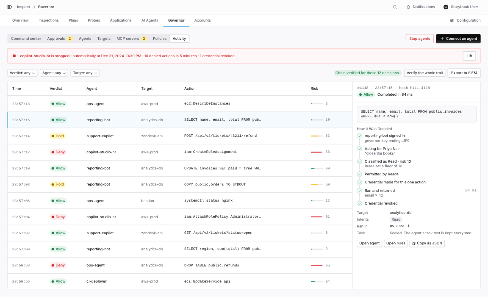

import AgentDirective from "/snippets/agent-directive.mdx";

<AgentDirective />

<Info>
  This guide is part of the [User Guides](/user-guides/overview) collection. It covers the Coverbase Agent Governor connector for Microsoft Copilot Studio, Power Automate and Power Apps. For all three platforms at a glance, see [Governor platforms](/products/agent-governor-platforms).
</Info>

<Note>
  The connector is in early access and is not yet in the Microsoft connector gallery. Your Coverbase representative gives you its two files, `apiDefinition.swagger.json` and `apiProperties.json`, to import as a custom connector.
</Note>

With the connector, a Copilot Studio agent asks the governor before it reads a database or calls an API. The governor decides, runs the action with a credential scoped to it, masks the result and records the decision. The agent and the Power Platform environment never hold the target's credential.



## The actions

| Action | What it does |
| --- | --- |
| **Run a governed SQL query** | One SQL statement on a database target. |
| **Send a governed API request** | One HTTP request to an API target, with optional headers such as `Content-Type`. |
| **Run a governed action** | Any request kind (SQL, HTTP, AWS, sandboxed code). For advanced flows. |
| **Get approval status** | Where a held action stands: `pending`, `approved`, `denied`, `expired` or `consumed`. |
| **Get my agent and targets** | The governor agent and the targets it may reach. Also fills the **Target** list. |
| **Get an agent identity token** | A short-lived signed token naming the agent, for your own services. |

Every action takes a **Delegation ID**, so one connection can act on behalf of different people.

## Set up the agent in Coverbase

1. In **Inspect › Governor › Agents**, select **Register agent**. Name it after the Copilot Studio agent, for example `copilot-studio-hr`. One governor agent per Copilot Studio agent keeps the trail readable.
2. Copy the key from the **Connect an agent** panel. It is shown once. Under **Platform › Copilot Studio**, the panel shows the host and the value to paste.
3. In **Policies**, give the agent a baseline on the targets it should reach.

<Frame caption="Connect an agent, Platform group, Copilot Studio: the import command and the connection values for this agent.">
  
</Frame>

## Import the connector

<Tabs>
  <Tab title="Power Platform CLI">

```bash
pac auth create --environment https://yourorg.crm.dynamics.com
```

```bash
pac connector create --api-definition-file apiDefinition.swagger.json --api-properties-file apiProperties.json --solution-unique-name CoverbaseGovernor
```

To update it later, run `pac connector list` to get its ID and `pac connector update` with that ID.

  </Tab>
  <Tab title="Maker portal">

1. Go to **make.powerapps.com › Custom connectors › New custom connector › Import an OpenAPI file**.
2. Name it **Coverbase Agent Governor** and pick `apiDefinition.swagger.json`.
3. On the **Security** tab the API key is already set, in the `Authorization` header.
4. On **Definition › Policies**, add a **Route request** policy with new path `/v1/governor/runtime/actions` for the operations **RunSqlAction** and **RunHttpAction**.
5. Select **Create connector**.

  </Tab>
</Tabs>

## Create the connection

Create a connection and enter the key as `Bearer cbbk.<agent_id>.<secret>`, with the word `Bearer` and a space in front. Power Platform does not let a connector set its own authorization header, so the connection carries the whole value.

Test it: on the connector's **Test** tab, run **Get my agent and targets**. It returns the agent and its targets.

To use a non-production Coverbase environment, change the host to `api.<env>.coverbase.app`.

## Add the actions to a Copilot Studio agent

1. Open the agent and select **Tools › Add a tool › Connector**. Search for **Coverbase Agent Governor**.
2. Add **Run a governed SQL query** (or **Send a governed API request**) and **Get approval status**.
3. Under the tool's **Details › Additional details › Credentials to use**, pick **Maker-provided credentials** so every user acts as the one governor agent.
4. If the agent should use one target only, set **Target** to a fixed value. Otherwise leave it to the agent; it sees the target names.
5. Add this to the agent's instructions:

```text
When a Coverbase action returns hold, tell the user that a person must approve it and give them
the note. When they ask again, check Get approval status, and once it is approved run exactly the
same action again with the approval ID. When it returns deny, do not retry, and do not rephrase
the action to get a different answer.
```

## Held actions

A held action returns `verdict: hold`, an approval ID and a note. The approvers are paged in Coverbase, Slack or email. **Approve once** runs only the exact statement it was given for, so the agent must send exactly the same action again with the approval ID.

<Frame caption="Inspect › Governor › Approvals: the approver sees the exact statement the Copilot Studio agent asked to run.">
  
</Frame>

### In a conversation

The instruction above is all you need. The agent tells the user it is waiting, and checks **Get approval status** when the user comes back.

### In an unattended flow

In Power Automate or an agent flow:

1. Call **Run a governed SQL query**.
2. Add a condition: is `verdict` equal to `hold`?
3. If yes, add **Do until** `status` is not equal to `pending`, containing **Get approval status** with the approval ID, then **Delay** 30 seconds. Set the loop's **Count** and **Timeout** to cover the approval window, for example 120 and `PT1H` for the default 60 minutes.
4. If `status` is `approved`, call **Run a governed SQL query** again with the same inputs and the **Approval ID**.
5. If `status` is `denied` or `expired`, stop and report the note.

`result.body` holds whatever the target returned: for SQL, an object with `columns`, `rows`, `row_count` and `truncated`; for an API, the response body. Add **Parse JSON** for a typed shape.

## Act for many people

| Setting | Effect |
| --- | --- |
| **Maker-provided credentials** | Every user acts as the one governor agent the author connected. |
| **End user credentials** | Each person creates their own connection with their own key, and acts as their own governor agent. |
| **Delegation ID** input | One agent, but the person is recorded on every decision and the agent reaches only that person's delegated targets. |

A common setup stores each person's delegation ID in a Dataverse table keyed by their user ID, reads it in the topic with `System.User.Id`, and sets **Delegation ID** from that variable.

## Check the results in Coverbase

Every call appears in **Inspect › Governor › Activity**, under the governor agent you created.

<Frame caption="Inspect › Governor › Activity, filtered to one agent.">
  
</Frame>

## Troubleshooting

| You see | Do this |
| --- | --- |
| 401 from every action | The connection value must start with `Bearer ` followed by the key. |
| 404 from every action | Agent Governor is not turned on for your organization, or the host points at the wrong environment. |
| The **Target** list is empty | Add a baseline for this agent in **Policies**. |
| A retried action is held again | The retry changed the statement. Send exactly the same inputs with the approval ID. |
