import AgentDirective from "/snippets/agent-directive.mdx";

<AgentDirective />

<Info>
  This guide is part of the [User Guides](/user-guides/overview) collection. It covers the `coverbase-governor` Python package. For what the governor decides and why, see the [Governor](/products/agent-governor) product page. For the TypeScript package, see the [TypeScript SDK](/user-guides/agent-governor-typescript) guide.
</Info>

<Note>
  The package is in early access. Until it is on PyPI, your Coverbase representative gives you the wheel to install. The import paths and calls on this page do not change when it is published.
</Note>

The SDK sends each action your agent takes to the governor before it touches a database, an API, AWS or a sandbox. The governor decides, runs the action with a credential scoped to it, masks the result and records the decision. Your agent never holds the target's credential.

## Before you start

1. In **Inspect › Governor › Targets**, add the systems the agent may reach. Each one is a target, for example `prod-db` for a Postgres database or `billing-api` for an HTTP API.
2. In **Policies**, make sure a baseline lets the agent reach those targets. An agent can see and act on only the targets a baseline lets it reach.
3. In **Agents**, select **Register agent**, name it after your agent and select **Register**. The **Connect an agent** panel shows the key once. Copy it.

<Frame caption="Register agent: name the agent, choose how it signs in, and save.">
  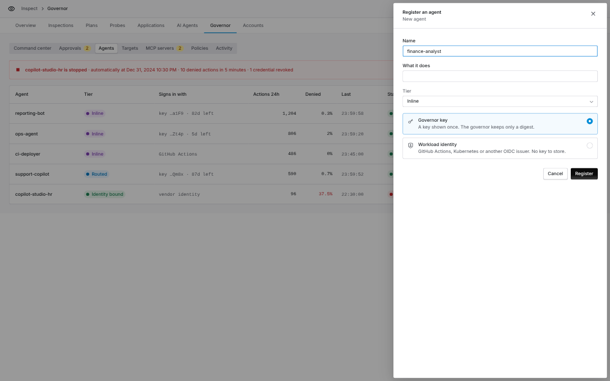
</Frame>

<Frame caption="Connect an agent, Code group, Python SDK: the install command and a first query for this agent.">
  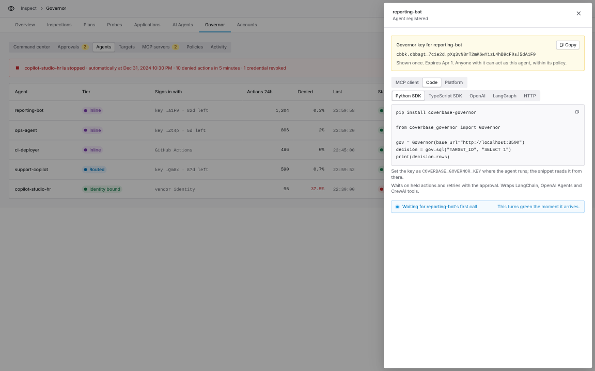
</Frame>

## Install

```bash
pip install coverbase-governor
```

The package needs Python 3.10 or later and depends only on `httpx`. Install an extra for each framework you use:

| Extra | Adds |
| --- | --- |
| `coverbase-governor[langchain]` | LangChain and LangGraph tools |
| `coverbase-governor[openai-agents]` | OpenAI Agents SDK tools |
| `coverbase-governor[crewai]` | CrewAI tools |
| `coverbase-governor[psycopg]` | Quoting for the Postgres drop-in |
| `coverbase-governor[requests]` | The `requests` drop-in |

## Configure

Set the key where the agent runs. The SDK reads it from the environment, so it never lands in your source.

```bash
export COVERBASE_GOVERNOR_KEY="cbbk.cbbagt_xxxxxx.your-secret"
export COVERBASE_GOVERNOR_URL="https://api.coverbase.app"
```

`COVERBASE_GOVERNOR_URL` defaults to `https://api.coverbase.app`. A key created before the governor was renamed also works as `COVERBASE_BROKER_KEY`.

You can also pass everything to the client:

```python
from coverbase_governor import Governor

gov = Governor(
    key="cbbk.cbbagt_xxxxxx.your-secret",
    base_url="https://api.coverbase.app",
    timeout=30.0,
    approval_timeout=600.0,
)
```

## Your first governed query

```python
from coverbase_governor import ActionDenied, Governor

gov = Governor()

for target in gov.targets():
    print(target.name, target.kind, target.modes)

decision = gov.sql("prod-db", "SELECT id, email, total FROM invoices LIMIT 5")
for row in decision.rows:
    print(row)
print("masked:", decision.masked)

try:
    gov.sql("prod-db", "DROP TABLE invoices")
except ActionDenied as exc:
    print("denied:", exc)
```

<Frame caption="The agent lists its targets, reads invoices with emails masked, and is refused a DROP.">
  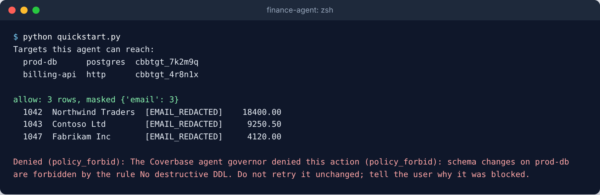
</Frame>

<Accordion title="The script behind this screenshot">

```python quickstart.py
from coverbase_governor import ActionDenied, Governor

gov = Governor()
print("Targets this agent can reach:")
for target in gov.targets():
    print(f"  {target.name:<12} {target.protocol:<9} {target.id}")

decision = gov.sql("prod-db", "SELECT id, customer, email, total FROM invoices WHERE paid = false")
print(f"\n{decision.verdict}: {len(decision.rows)} rows, masked {decision.masked}")
for row in decision.rows:
    print(f"  {row['id']}  {row['customer']:<18} {row['email']:<18} {row['total']:>9.2f}")

try:
    gov.sql("prod-db", "DROP TABLE invoices")
except ActionDenied as exc:
    print(f"\nDenied ({exc.reason}): {exc}")
```

</Accordion>

A target is named by its name or its id (`cbbtgt_...`). The SDK looks names up once through `whoami` and caches them. An exact name wins; a name that differs only in letter case resolves only when one target matches.

`sql`, `http`, `aws` and `code` cover the four request kinds:

```python
gov.sql("prod-db", "SELECT * FROM orders WHERE status = 'open'", max_rows=100)
gov.http("billing-api", "GET", "/v1/invoices", query={"status": "unpaid"})
gov.http("billing-api", "POST", "/v1/refunds", json={"order": "ord_42", "amount": 500})
gov.aws("aws-prod", "s3", "ListObjectsV2", {"Bucket": "reports"}, region="us-east-1")
gov.code("sandbox", "python", "print(sum(range(10)))", timeout_seconds=30)
```

Each returns a `Decision` with `verdict`, `note`, `risk_score`, `intents`, `result`, `masked` and `audit_seq`. `decision.rows` holds SQL rows as dictionaries.

## Held actions

A policy can hold an action until a person approves it in **Inspect › Governor › Approvals**. The SDK handles the wait:

1. It calls `on_hold` with the held decision, so you can tell your user.
2. It checks the approval until a person decides.
3. When the person approves, it sends the identical request again with the approval and returns the result.

```python
from coverbase_governor import ApprovalDenied, ApprovalExpired, ApprovalTimeout, Governor

gov = Governor()

def tell_user(decision):
    print(f"Waiting for approval {decision.approval_id}: {decision.note}")

try:
    decision = gov.sql(
        "prod-db",
        "UPDATE invoices SET status = 'paid' WHERE id = 42",
        prompt="Mark invoice 42 as paid",
        on_hold=tell_user,
        timeout=900,
    )
    print("ran:", decision.result.body)
except ApprovalDenied as exc:
    print("a person declined:", exc)
except ApprovalExpired as exc:
    print("nobody decided in time:", exc)
except ApprovalTimeout as exc:
    print("still waiting; resume later with", exc.approval_id)
```

<Frame caption="The update is held, the agent waits, and it runs once a person approves.">
  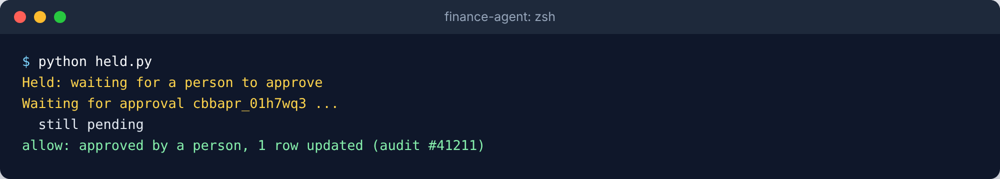
</Frame>

<Accordion title="The script behind this screenshot">

```python held.py
from coverbase_governor import Governor

gov = Governor(poll_interval=1)

decision = gov.sql(
    "prod-db",
    "UPDATE invoices SET paid = true WHERE id = 1042",
    prompt="Mark invoice 1042 as paid",
    on_hold=lambda held: print(f"Held: {held.note}\nWaiting for approval {held.approval_id} ..."),
    on_pending=lambda approval: print(f"  still {approval.status}"),
)
print(f"{decision.verdict}: {decision.note}, {decision.result.body['row_count']} row updated (audit #{decision.audit_seq})")
```

</Accordion>

<Frame caption="Inspect › Governor › Approvals: the person sees the exact statement. Approve once runs only that statement.">
  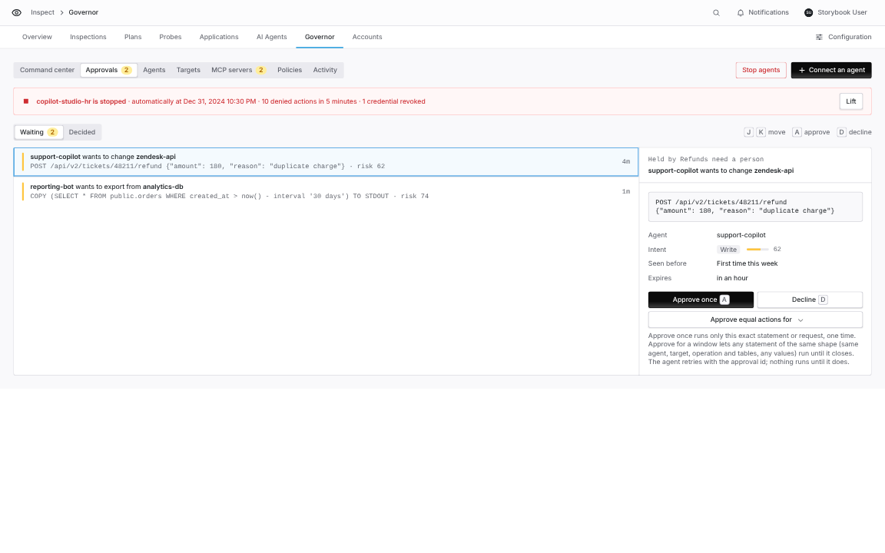
</Frame>

**Approve once** covers only the exact call that was held, for the same person the agent acted for. The SDK keeps a copy of the request and sends exactly that copy again, so a change to your own data while it waits does not change what runs. **Approve equal actions for** a window covers any statement of the same shape until it closes.

To return at once instead of waiting, pass `wait=False`. The SDK raises `ApprovalPending` with the approval id. Pass the id back later to resume:

```python
from coverbase_governor import ApprovalPending

try:
    gov.sql("prod-db", "DELETE FROM sessions WHERE expired", wait=False)
except ApprovalPending as exc:
    saved = exc.approval_id

decision = gov.sql("prod-db", "DELETE FROM sessions WHERE expired", approval_id=saved)
```

## Errors

Every error's message is written so a model can pass it to its user.

| Error | When |
| --- | --- |
| `ActionDenied` | Policy denied the action. `reason` and `note` say why. |
| `ApprovalPending` | The action is held and you passed `wait=False`. Carries `approval_id`. |
| `ApprovalTimeout` | Your wait ran out while the approval was still pending. Carries `approval_id`. |
| `ApprovalDenied` | A person declined. |
| `ApprovalExpired` | Nobody decided before the approval expired. |
| `ActionFailed` | Policy allowed it, but the target returned an error. |
| `AuthError` | The key is missing, wrong or expired. |
| `Forbidden` | The request is not allowed, for example an identity token for a delegation you do not hold. |
| `NotFound` | The target does not exist or this agent cannot reach it. |
| `NotEnabled` | Agent Governor is not turned on for your organization. |
| `RequestRejected` | The request does not fit the target, for example SQL sent to an HTTP target. |

## Govern your agent's tools

### Every target as a tool

`governor_tools` builds one tool for each target the agent can reach, with the same names and arguments as the governor's MCP tools, plus `governor_identity_token`. A governed tool never raises for a policy outcome. It returns the status (allowed, held, denied or failed) and a message, so the model sees why and can tell the user.

<Tabs>
  <Tab title="LangGraph">

```python
import os

from langgraph.prebuilt import create_react_agent

from coverbase_governor import Governor
from coverbase_governor.adapters.langchain import governor_tools

tools = governor_tools(Governor())
agent = create_react_agent(os.environ["AGENT_MODEL"], tools)

result = agent.invoke({"messages": [("user", "List the five largest unpaid invoices")]})
print(result["messages"][-1].content)
```

  </Tab>
  <Tab title="OpenAI Agents SDK">

```python
import asyncio
import os

from agents import Agent, Runner

from coverbase_governor import AsyncGovernor
from coverbase_governor.adapters.openai_agents import governor_tools


async def main() -> None:
    tools = await governor_tools(AsyncGovernor())
    agent = Agent(name="analyst", model=os.environ["AGENT_MODEL"], tools=tools)
    result = await Runner.run(agent, "List the five largest unpaid invoices")
    print(result.final_output)


asyncio.run(main())
```

  </Tab>
  <Tab title="CrewAI">

```python
from crewai import Agent, Crew, Task

from coverbase_governor.adapters.crewai import governor_tools

analyst = Agent(
    role="Billing analyst",
    goal="Answer questions about invoices",
    backstory="You read the billing database through the governor.",
    tools=governor_tools(),
)
task = Task(description="List the five largest unpaid invoices", expected_output="A table", agent=analyst)
print(Crew(agents=[analyst], tasks=[task]).kickoff())
```

CrewAI caches tool results by default. Governed tools turn that cache off, so every call reaches the governor.

  </Tab>
</Tabs>

<Frame caption="governor_tools: one tool per target this agent can reach, plus the identity token tool.">
  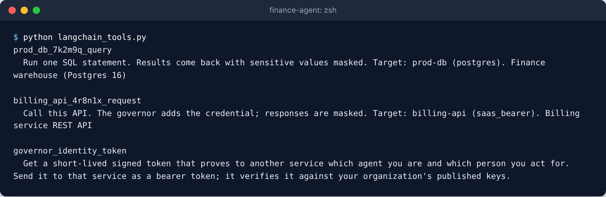
</Frame>

<Accordion title="The script behind this screenshot">

```python langchain_tools.py
from coverbase_governor import Governor
from coverbase_governor.adapters.langchain import governor_tools

for tool in governor_tools(Governor()):
    print(f"{tool.name}\n  {tool.description}\n")
```

</Accordion>

<Frame caption="The same tools for the OpenAI Agents SDK.">
  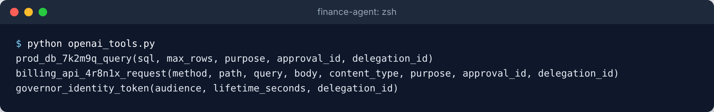
</Frame>

<Accordion title="The script behind this screenshot">

```python openai_tools.py
import asyncio

from coverbase_governor import AsyncGovernor
from coverbase_governor.adapters.openai_agents import governor_tools


async def main() -> None:
    for tool in await governor_tools(AsyncGovernor()):
        params = ", ".join(tool.params_json_schema["properties"])
        print(f"{tool.name}({params})")


asyncio.run(main())
```

</Accordion>

### Wrap a tool you already have

`governed_tool` wraps a function that builds an action. It keeps the function's name, docstring and signature, so each framework reads the tool's schema from it.

```python
from coverbase_governor import HttpRequest, governed_tool
from coverbase_governor.adapters.langchain import to_langchain


@governed_tool(target="billing-api")
def refund(order_id: str, amount_cents: int) -> HttpRequest:
    """Refund part of an order."""
    return HttpRequest.with_json("POST", "/v1/refunds", {"order": order_id, "amount": amount_cents})


query_db = governed_tool(target="prod-db", kind="sql", name="query_db")

tools = [to_langchain(refund), to_langchain(query_db)]
```

`to_openai_agents` and `to_crewai` do the same for the other frameworks.

By default a held tool waits for the person. With `on_hold="return"`, it returns `{"status": "waiting_for_approval", "approval_id": ...}` at once, and the model can tell the user. When the model calls the tool again with the same arguments, the SDK sends the request it built the first time, with the approval, so the approved call runs.

```python
@governed_tool(target="billing-api", on_hold="return")
def refund(order_id: str, amount_cents: int) -> HttpRequest:
    """Refund part of an order. A person may need to approve it."""
    return HttpRequest.with_json("POST", "/v1/refunds", {"order": order_id, "amount": amount_cents})
```

## Drop-in clients

To route existing code through the governor, change the line that opens the connection.

### Postgres

```python
from coverbase_governor.dropin import postgres

conn = postgres.connect("prod-db")
cur = conn.cursor()
cur.execute("SELECT id, total FROM invoices WHERE customer = %s AND total > %s", ("acme", 1000))
for row in cur.fetchall():
    print(row)
print(cur.description, cur.rowcount)
```

<Frame caption="The Postgres drop-in: a DB-API cursor whose statements go through the governor.">
  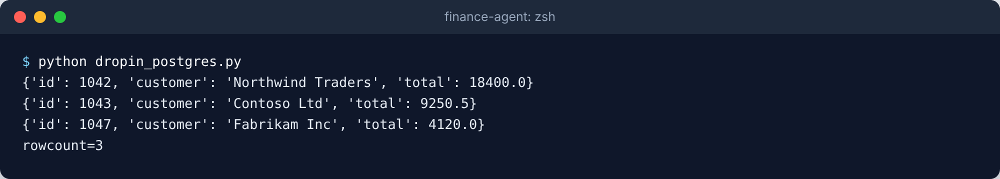
</Frame>

<Accordion title="The script behind this screenshot">

```python dropin_postgres.py
from coverbase_governor.dropin import postgres

conn = postgres.connect("prod-db", row_factory="dict")
cur = conn.cursor()
cur.execute("SELECT id, customer, total FROM invoices WHERE paid = %s ORDER BY total DESC", (False,))
for row in cur.fetchall():
    print(row)
print(f"rowcount={cur.rowcount}")
```

</Accordion>

The governor approves and records the exact statement, so the drop-in puts each parameter into the statement as a quoted literal instead of sending it separately. It uses psycopg's quoting when psycopg is installed. Each statement is its own action, so there are no transactions across statements, and `rollback()` is not supported. Use `dialect="mysql"` for a MySQL target.

### HTTP with httpx or requests

```python
import httpx
import requests

from coverbase_governor.dropin.http import GovernedAdapter, GovernedTransport

client = httpx.Client(base_url="https://billing.governed", transport=GovernedTransport("billing-api"))
response = client.post("/v1/refunds", json={"order": "ord_42", "amount": 500})
print(response.status_code, response.json())
print(response.extensions["governor_decision"].verdict)

session = requests.Session()
session.mount("https://billing.governed/", GovernedAdapter("billing-api"))
print(session.get("https://billing.governed/v1/invoices", params={"status": "unpaid"}).json())
```

<Frame caption="The httpx transport: the refund is held, approved, and the response comes back as a normal httpx response.">
  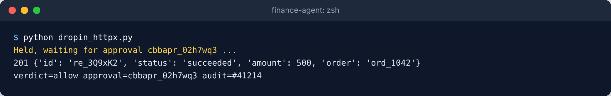
</Frame>

<Accordion title="The script behind this screenshot">

```python dropin_httpx.py
import httpx

from coverbase_governor import Governor
from coverbase_governor.dropin.http import GovernedTransport

transport = GovernedTransport(
    "billing-api",
    governor=Governor(poll_interval=1),
    on_hold=lambda held: print(f"Held, waiting for approval {held.approval_id} ..."),
)
client = httpx.Client(base_url="https://billing.governed", transport=transport)

response = client.post("/v1/refunds", json={"order": "ord_1042", "amount": 500})
decision = response.extensions["governor_decision"]
print(response.status_code, response.json())
print(f"verdict={decision.verdict} approval={decision.approval_id} audit=#{decision.audit_seq}")
```

</Accordion>

The host in your URL is ignored. The governor calls the target's own address with its own credential, and your code's `Authorization` and `Cookie` headers are dropped. `AsyncGovernedTransport` does the same for `httpx.AsyncClient`.

## Act on behalf of a person

When a person delegates a task to the agent, pass the delegation. Rules that need a delegation then apply, the agent can reach only the targets that person delegated, and the person is recorded on every decision.

```python
gov = Governor(delegation_id="cbbdel_xxxxxx")
gov.sql("prod-db", "SELECT * FROM my_tickets")
gov.sql("prod-db", "SELECT 1", delegation_id="cbbdel_other")
```

A one-time approval is tied to the delegation it was asked under.

## Identity tokens for your own services

An agent can get a short-lived signed token that names it, and the person it acts for, for a service that checks your organization's published keys. See [Agents as an identity provider](/products/agent-governor#agents-as-an-identity-provider).

```python
token = gov.identity_token("https://payments.internal", lifetime_seconds=300)
httpx.get("https://payments.internal/me", headers={"Authorization": token.authorization})
```

<Frame caption="An identity token for one audience, valid for five minutes.">
  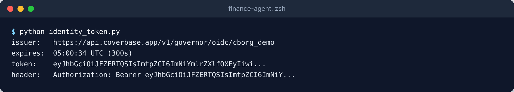
</Frame>

<Accordion title="The script behind this screenshot">

```python identity_token.py
import datetime

from coverbase_governor import Governor

token = Governor().identity_token("https://payments.internal", lifetime_seconds=300)
expires = datetime.datetime.fromtimestamp(token.expires_at, datetime.timezone.utc)
print(f"issuer:   {token.issuer}")
print(f"expires:  {expires:%H:%M:%S} UTC ({token.expires_in}s)")
print(f"token:    {token.identity_token[:48]}...")
print(f"header:   Authorization: {token.authorization[:40]}...")
```

</Accordion>

## Sign in with a workload identity

An agent running in GitHub Actions, Kubernetes or another OIDC issuer can sign in with its workload token instead of a key. Set up the agent's federation rule in **Inspect › Governor › Agents**, then pass a function that returns a fresh token and the agent's id:

```python
from pathlib import Path


def read_token() -> str:
    return Path("/var/run/secrets/tokens/coverbase").read_text().strip()


gov = Governor(token_provider=read_token, agent_id="cbbagt_xxxxxx")
```

## Async

`AsyncGovernor` has the same methods as coroutines:

```python
import asyncio

from coverbase_governor import AsyncGovernor


async def main() -> None:
    async with AsyncGovernor() as gov:
        decision = await gov.sql("prod-db", "SELECT count(*) FROM invoices")
        print(decision.rows)


asyncio.run(main())
```

## Check the results in Coverbase

Every call appears in **Inspect › Governor › Activity** with its verdict, the rule that matched, the risk and the masked fields. Open a decision to see each step of the decision path.

<Frame caption="Inspect › Governor › Activity: each decision the SDK caused, with the steps the governor took.">
  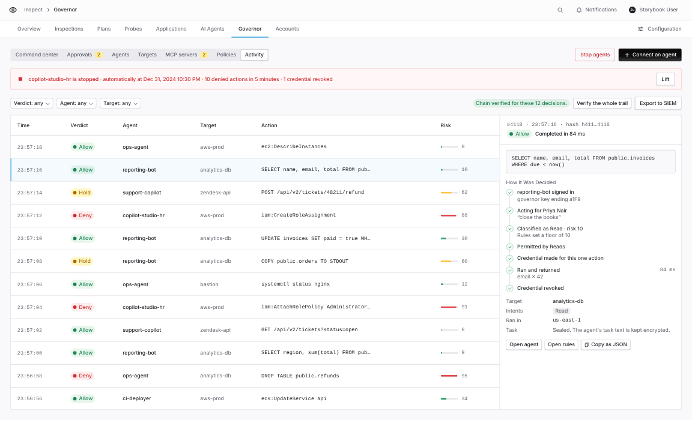
</Frame>

## Troubleshooting

| You see | Do this |
| --- | --- |
| `AuthError` | Check `COVERBASE_GOVERNOR_KEY`. A key is shown once; open the agent and select **Rotate key** if it is lost. |
| `NotEnabled` | Ask your Coverbase representative to turn on Agent Governor. |
| `NotFound` for a target you can see in Coverbase | Add a baseline that lets this agent reach the target in **Policies**. |
| `RequestRejected` | The request does not fit the target. Send SQL to a database target and HTTP to an API target. |
| Every action is held | A hold rule or an organization threshold matches. Check **Policies** and **Configuration › Agent Governor**. |
