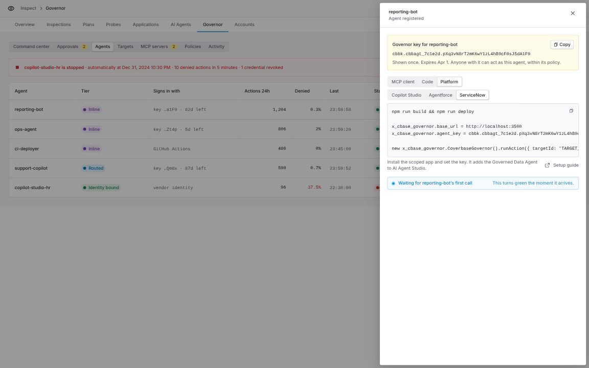
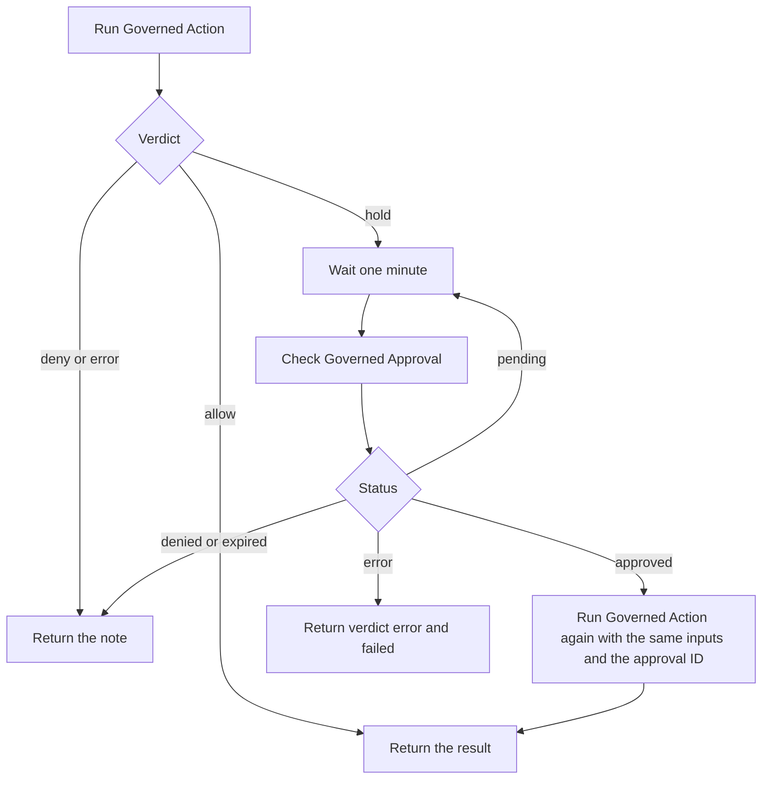
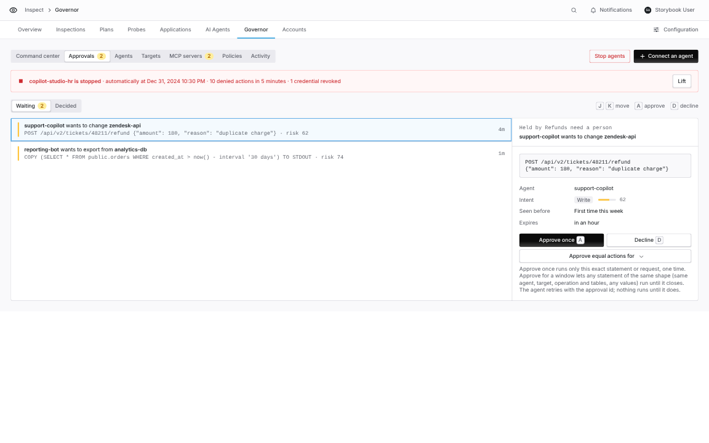
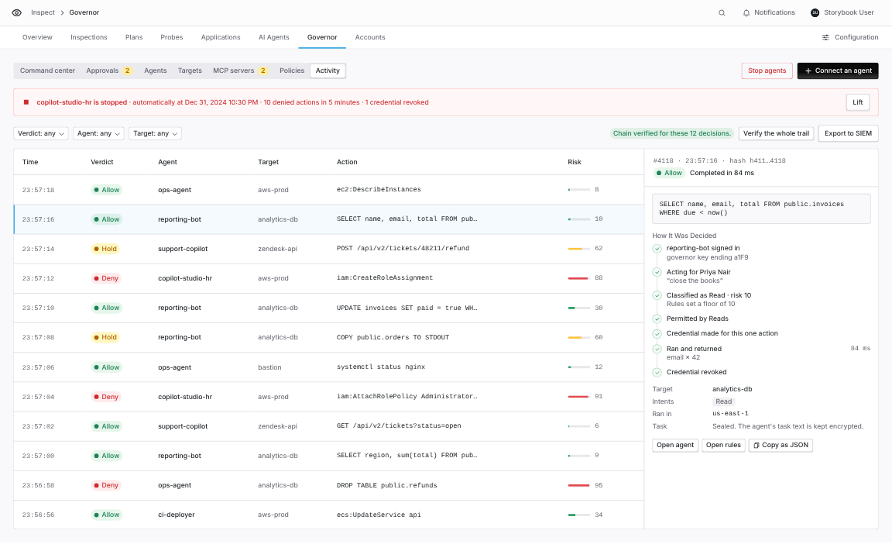

import AgentDirective from "/snippets/agent-directive.mdx";

<AgentDirective />

<Info>
  This guide is part of the [User Guides](/user-guides/overview) collection. It covers the Coverbase Agent Governor scoped app for ServiceNow. For all three platforms at a glance, see [Governor platforms](/products/agent-governor-platforms).
</Info>

<Note>
  The app is in early access and is not yet on the ServiceNow Store. Your Coverbase representative gives you the app source to install with the ServiceNow SDK.
</Note>

The app lets Now Assist AI agents, flows and scripts act on company systems through the governor. The governor decides each action, runs it with a credential scoped to it, masks the result and records the decision.

| Part | What it is |
| --- | --- |
| **Governed Data Agent** | An AI agent in AI Agent Studio with three tools: run a governed action, check an approval, list targets. |
| **Run Governed Action** | A Flow Designer action that runs one SQL statement or API request. |
| **Check Governed Approval** | A Flow Designer action that reads an approval's status. |
| **Run Governed Action and Wait for Approval** | A subflow that runs the action, waits for a person when it is held, and runs it again once approved. |
| `CoverbaseGovernor` | The script include behind all of them, for your own scripts. |

## Set up the agent in Coverbase

1. In **Inspect › Governor › Agents**, select **Register agent** and name it after the instance, for example `servicenow-prod`.
2. Copy the key from the **Connect an agent** panel. Under **Platform › ServiceNow**, the panel shows the build command, the properties to set and a script call.
3. In **Policies**, give the agent a baseline on the targets it should reach.

<Frame caption="Connect an agent, Platform group, ServiceNow.">
  
</Frame>

## Install the app

From the app source:

```bash
npm install
npm run build
npx now-sdk auth --add https://yourinstance.service-now.com --type basic
npm run deploy
```

`npm run build` compiles and checks the app. `npm run deploy` installs it on the instance you added.

## Store the key

Use a credential alias, which ServiceNow recommends:

1. Open **Connections & Credentials › Connection & Credential Aliases** and create a credential alias in the app's scope.
2. Create an **API Key** credential, paste the key, and point it at the alias.
3. Set the system property `x_cbase_governor.credential_alias` to the alias's sys_id.

Or set the encrypted property `x_cbase_governor.agent_key` to the key.

Then grant the `x_cbase_governor.user` role to the people who use the agent and to the agent's run-as user.

| Property | Default | Meaning |
| --- | --- | --- |
| `x_cbase_governor.base_url` | `https://api.coverbase.app` | The Coverbase API. Change it for another Coverbase environment. |
| `x_cbase_governor.credential_alias` | empty | sys_id of the alias holding the key. Takes precedence over the key property. |
| `x_cbase_governor.agent_key` | empty | The key, stored encrypted. |
| `x_cbase_governor.timeout_ms` | `120000` | How long to wait for the governor to decide and run an action. |
| `x_cbase_governor.per_user_credentials` | false | Each caller uses their own key. See [Act for many people](#act-for-many-people). |
| `x_cbase_governor.use_user_delegation` | false | Each call acts on behalf of the caller. See [Act for many people](#act-for-many-people). |

## Use the Governed Data Agent

Open **AI Agent Studio › Create and manage › AI agents › Governed Data Agent**. It comes with three tools and instructions for each verdict:

- **Run governed action** asks a person in the conversation to confirm each call before it runs.
- **Check governed approval** and **List governed targets** run on their own.

To give the tools to an agent you already have, open that agent, select **Add tools and information › Add tool › Flow action**, and pick **Run Governed Action** or **Check Governed Approval**.

## Use it in Flow Designer

The actions and the subflow are in the **Coverbase Agent Governor** category of the action picker.

**Run Governed Action**

| Input | Use |
| --- | --- |
| **Target ID** | The `cbbtgt_` ID of the target. Required. |
| **Kind** | `sql` (default) or `http`. |
| **SQL**, **Max Rows** | For `sql`. |
| **HTTP Method**, **HTTP Path**, **HTTP Body**, **HTTP Headers JSON** | For `http`. Headers are a JSON object, for example `{"Content-Type": "application/json"}`. |
| **Approval ID** | Set only when retrying a held action after approval. |
| **Delegation ID** | Act on behalf of a person who delegated to this agent. |
| **User Request** | The request that started the work, sealed into the audit trail. |

Outputs: **Verdict** (`allow`, `hold`, `deny` or `error`), **Reason**, **Note**, **Approval ID**, **Failed** and **Result JSON**. For SQL, Result JSON holds `columns`, `rows`, `row_count` and `truncated`.

**Check Governed Approval** takes an **Approval ID** and returns **Status**, **Approved** and **Message**.

### Wait for an approval in a flow

Use **Run Governed Action and Wait for Approval** when a flow should continue on its own once a person decides:



It returns **Verdict**, **Note**, **Approval ID**, **Approval Status**, **Failed** and **Result JSON**. A pending approval expires when its window closes (60 minutes by default), so the loop always ends. If the retry is held again, the subflow returns the new approval ID.

## Use it from a script

```javascript
var governor = new x_cbase_governor.CoverbaseGovernor();
var outcome = governor.runAction({
    targetId: 'cbbtgt_xxxxxx',
    kind: 'sql',
    sql: 'SELECT id, total FROM invoices WHERE paid = false',
    prompt: current.short_description
});

if (outcome.verdict === 'allow') {
    var rows = outcome.result.body.rows;
} else if (outcome.verdict === 'hold') {
    current.work_notes = 'Waiting for approval ' + outcome.approvalId + ': ' + outcome.note;
}
```

For an API target, pass `kind: 'http'`, `httpMethod`, `httpPath`, `httpBody` and, if the target needs them, `httpHeaders`. To retry after approval, call `runAction` again with the same inputs and `approvalId`.

## Held actions

**Approve once** runs only the exact statement it was given for, so a retry must send exactly the same inputs with the approval ID. A different statement is held again with a new approval ID.

<Frame caption="Inspect › Governor › Approvals: the approver sees the exact statement the ServiceNow agent asked to run.">
  
</Frame>

## Act for many people

By default every caller acts as the one governor agent whose key the app holds. Two properties change that:

- `x_cbase_governor.use_user_delegation`: a call that names no delegation acts on behalf of the caller, using the delegation ID in their `x_cbase_governor.delegation_id` user preference. A caller with no delegation is refused instead of acting as the shared agent. An explicit **Delegation ID** always works.
- `x_cbase_governor.per_user_credentials`: each caller uses the key in their own credential alias, named by their `x_cbase_governor.credential_alias` user preference. A caller with no alias is refused.

The wait-for-approval subflow runs as the system user. With `use_user_delegation` on, pass **Delegation ID** to it explicitly.

## Check the results in Coverbase

Every call appears in **Inspect › Governor › Activity** under the governor agent you created.

<Frame caption="Inspect › Governor › Activity.">
  
</Frame>

## Troubleshooting

| You see | Do this |
| --- | --- |
| Verdict `error` with "No Coverbase agent key" | Set `x_cbase_governor.credential_alias` or `x_cbase_governor.agent_key`. |
| Verdict `error` saying you have no delegation | `use_user_delegation` is on and the caller has no `x_cbase_governor.delegation_id` preference. Set it, or pass Delegation ID. |
| Verdict `deny` with `no_baseline` | Add a baseline for this agent on the target in **Policies**. |
| Every call times out | Check that the instance can reach the Coverbase API, and raise `x_cbase_governor.timeout_ms`. |
