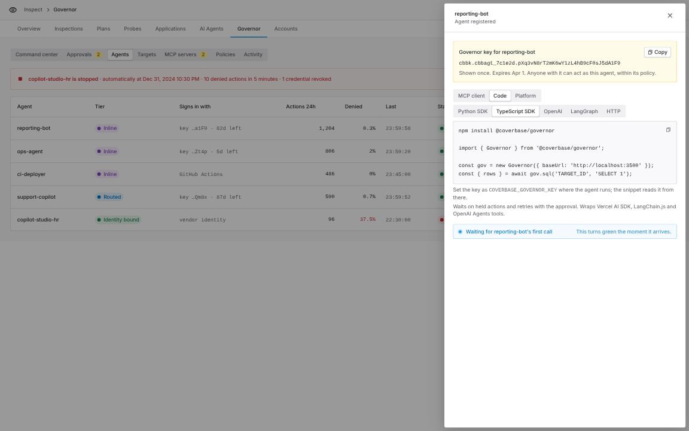
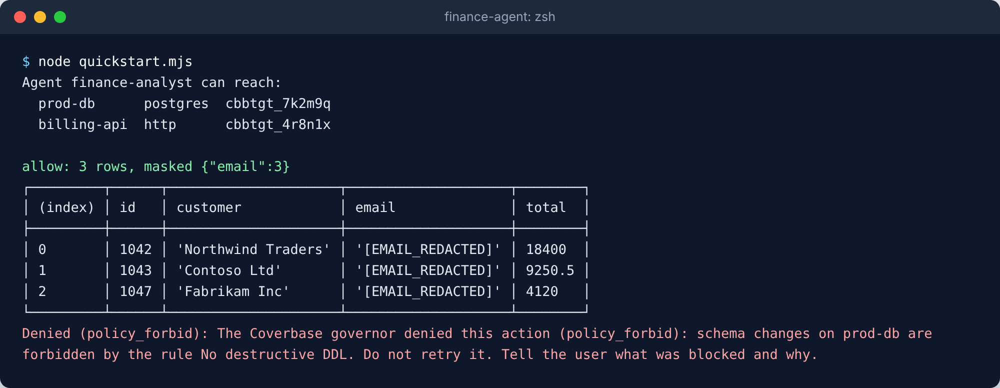
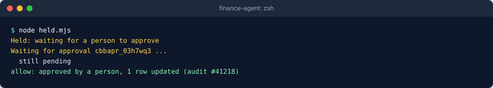
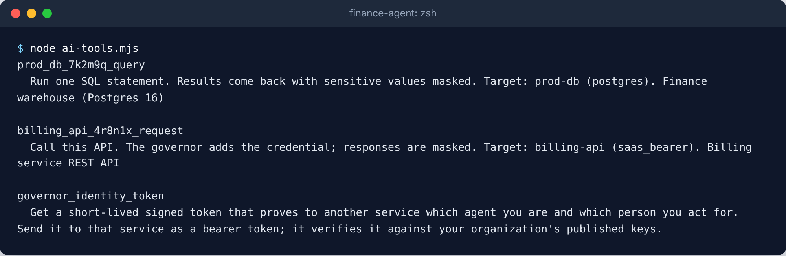
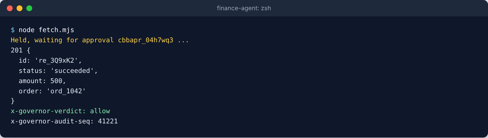
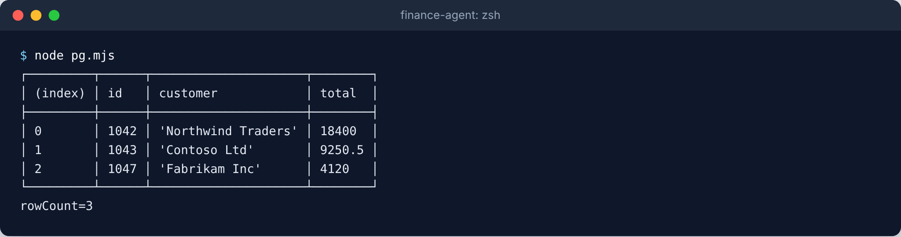

import AgentDirective from "/snippets/agent-directive.mdx";

<AgentDirective />

<Info>
  This guide is part of the [User Guides](/user-guides/overview) collection. It covers the `@coverbase/governor` npm package. For what the governor decides and why, see the [Governor](/products/agent-governor) product page. For Python, see the [Python SDK](/user-guides/agent-governor-python) guide.
</Info>

<Note>
  The package is in early access. Until it is on npm, your Coverbase representative gives you the package to install. The imports and calls on this page do not change when it is published.
</Note>

The SDK sends each action your agent takes to the governor before it touches a database, an API, AWS or a sandbox. The governor decides, runs the action with a credential scoped to it, masks the result and records the decision. Your agent never holds the target's credential.

## Before you start

1. In **Inspect › Governor › Targets**, add the systems the agent may reach.
2. In **Policies**, make sure a baseline lets the agent reach those targets.
3. In **Agents**, select **Register agent**, select **Register**, and copy the key from the **Connect an agent** panel. It is shown once.

<Frame caption="Connect an agent, Code group, TypeScript SDK.">
  
</Frame>

## Install

```bash
npm install @coverbase/governor
```

The package has no runtime dependencies. It runs on Node 18 or later and on edge runtimes that have a global `fetch`. Install a framework only for the adapter you use: `ai` for the Vercel AI SDK, `@langchain/core` for LangChain.js, `@openai/agents` for the OpenAI Agents SDK.

## Configure

```bash
export COVERBASE_GOVERNOR_KEY="cbbk.cbbagt_xxxxxx.your-secret"
export COVERBASE_GOVERNOR_URL="https://api.coverbase.app"
```

Or pass options to the client:

```ts
import { Governor } from '@coverbase/governor';

const gov = new Governor({
  key: process.env.COVERBASE_GOVERNOR_KEY,
  baseUrl: 'https://api.coverbase.app',
  timeoutMs: 30_000,
  approvalTimeoutMs: 15 * 60_000,
});
```

On an edge runtime without `process.env`, pass `key` and `baseUrl` directly.

## Your first governed query

```ts
import { ActionDenied, Governor } from '@coverbase/governor';

const gov = new Governor();

const me = await gov.whoami();
for (const target of me.targets) console.log(target.name, target.kind, target.modes);

const { rows, masked } = await gov.sql('prod-db', 'SELECT id, email, total FROM invoices LIMIT 5');
console.table(rows);
console.log('masked:', masked);

try {
  await gov.sql('prod-db', 'DROP TABLE invoices');
} catch (error) {
  if (error instanceof ActionDenied) console.log('denied:', error.message);
  else throw error;
}
```

<Frame caption="The agent lists its targets, reads invoices with emails masked, and is refused a DROP.">
  
</Frame>

<Accordion title="The script behind this screenshot">

```js quickstart.mjs
import { ActionDenied, Governor } from '@coverbase/governor';

const gov = new Governor();
const me = await gov.whoami();
console.log(`Agent ${me.name} can reach:`);
for (const t of me.targets) console.log(`  ${t.name.padEnd(12)} ${t.protocol.padEnd(9)} ${t.id}`);

const { rows, masked } = await gov.sql('prod-db', 'SELECT id, customer, email, total FROM invoices WHERE paid = false');
console.log(`\nallow: ${rows.length} rows, masked ${JSON.stringify(masked)}`);
console.table(rows);

try {
  await gov.sql('prod-db', 'DROP TABLE invoices');
} catch (error) {
  if (error instanceof ActionDenied) console.log(`Denied (${error.reason}): ${error.message}`);
  else throw error;
}
```

</Accordion>

The other request kinds:

```ts
await gov.http('billing-api', { method: 'GET', path: '/v1/invoices', query: { status: 'unpaid' } });
await gov.http('billing-api', {
  method: 'POST',
  path: '/v1/refunds',
  headers: { 'content-type': 'application/json' },
  body: JSON.stringify({ order: 'ord_42', amount: 500 }),
});
await gov.aws('aws-prod', { service: 's3', action: 'ListObjectsV2', params: { Bucket: 'reports' } });
await gov.code('sandbox', { language: 'python', code: 'print(sum(range(10)))', timeout_seconds: 30 });
```

## Held actions

`run` and its shortcuts wait for a person when a policy holds the action, then send the identical request again with the approval:

```ts
import { ApprovalDenied, ApprovalExpired, ApprovalTimeout, Governor } from '@coverbase/governor';

const gov = new Governor();

try {
  const decision = await gov.run(
    'prod-db',
    { kind: 'sql', sql: "UPDATE invoices SET status = 'paid' WHERE id = 42" },
    {
      prompt: 'Mark invoice 42 as paid',
      onHold: held => console.log(`Waiting for approval ${held.approvalId}: ${held.note}`),
      timeoutMs: 15 * 60_000,
    },
  );
  console.log('ran:', decision.result?.body);
} catch (error) {
  if (error instanceof ApprovalDenied) console.log('a person declined');
  else if (error instanceof ApprovalExpired) console.log('nobody decided in time');
  else if (error instanceof ApprovalTimeout) console.log('resume later with', error.approvalId);
  else throw error;
}
```

<Frame caption="The update is held, the agent waits, and it runs once a person approves.">
  
</Frame>

<Accordion title="The script behind this screenshot">

```js held.mjs
import { Governor } from '@coverbase/governor';

const gov = new Governor({ pollMs: 1000 });
const { rowCount, decision } = await gov.sql('prod-db', 'UPDATE invoices SET paid = true WHERE id = 1042', {
  prompt: 'Mark invoice 1042 as paid',
  onHold: held => console.log(`Held: ${held.note}\nWaiting for approval ${held.approvalId} ...`),
  onPending: approval => console.log(`  still ${approval.status}`),
});
console.log(`${decision.verdict}: ${decision.note}, ${rowCount} row updated (audit #${decision.auditSeq})`);
```

</Accordion>

To return at once instead of waiting, pass `wait: false`. The SDK throws `ActionHeld` with `approvalId`; pass it back as `approvalId` later. Pass an `AbortSignal` as `signal` to stop waiting; an aborted signal sends nothing.

| Error | When |
| --- | --- |
| `ActionDenied` | Policy denied the action. |
| `ActionHeld` | The action is held and you passed `wait: false`. Carries `approvalId`. |
| `ApprovalTimeout` | Your wait ran out while the approval was pending. Carries `approvalId`. |
| `ApprovalDenied` | A person declined. |
| `ApprovalExpired` | Nobody decided before the approval expired. |
| `ActionFailed` | Policy allowed it, but the target returned an error. |
| `AuthError` | The key is missing, wrong or expired. |
| `NotFound` | The target does not exist, this agent cannot reach it, or Agent Governor is off. |
| `RequestRejected` | The request does not fit the target. |

## Govern your agent's tools

`governorTools(gov)` builds one tool per target the agent can reach, named and shaped like the governor's MCP tools, plus `governor_identity_token`. A governed tool never throws for a policy outcome. It returns `{ status, message, ... }` with status `allowed`, `held`, `denied` or `failed`, so the model sees why.

<Tabs>
  <Tab title="Vercel AI SDK">

```ts
import { generateText } from 'ai';
import { Governor } from '@coverbase/governor';
import { governorTools } from '@coverbase/governor/ai';

const gov = new Governor();
const { text } = await generateText({
  model: process.env.AGENT_MODEL!,
  tools: await governorTools(gov),
  maxSteps: 5,
  prompt: 'List the five largest unpaid invoices',
});
console.log(text);
```

  </Tab>
  <Tab title="LangChain.js and LangGraph">

```ts
import { createReactAgent } from '@langchain/langgraph/prebuilt';
import { Governor } from '@coverbase/governor';
import { governorTools } from '@coverbase/governor/langchain';

const tools = await governorTools(new Governor());
const agent = createReactAgent({ llm, tools });
const result = await agent.invoke({ messages: [{ role: 'user', content: 'List the five largest unpaid invoices' }] });
```

  </Tab>
  <Tab title="OpenAI Agents SDK">

```ts
import { Agent, run } from '@openai/agents';
import { Governor } from '@coverbase/governor';
import { governorTools } from '@coverbase/governor/openai-agents';

const agent = new Agent({
  name: 'analyst',
  model: process.env.AGENT_MODEL,
  tools: await governorTools(new Governor()),
});
const result = await run(agent, 'List the five largest unpaid invoices');
console.log(result.finalOutput);
```

  </Tab>
</Tabs>

<Frame caption="governorTools for the Vercel AI SDK: one tool per reachable target.">
  
</Frame>

<Accordion title="The script behind this screenshot">

```js ai-tools.mjs
import { Governor } from '@coverbase/governor';
import { governorTools } from '@coverbase/governor/ai';

const tools = await governorTools(new Governor());
for (const [name, tool] of Object.entries(tools)) {
  console.log(`${name}\n  ${tool.description}\n`);
}
```

</Accordion>

### Wrap a tool you already have

Each adapter exports `governedTool`. Give it your own arguments with `parameters` and `build`, or the governor's standard arguments with `kind`:

```ts
import { Governor } from '@coverbase/governor';
import { governedTool } from '@coverbase/governor/ai';

const gov = new Governor();

const refund = governedTool({
  governor: gov,
  name: 'refund',
  description: 'Refund one order. A person may need to approve it.',
  target: 'billing-api',
  onHold: 'return',
  parameters: {
    type: 'object',
    properties: { order_id: { type: 'string' }, amount_cents: { type: 'integer' } },
    required: ['order_id', 'amount_cents'],
  },
  build: ({ order_id, amount_cents }) => ({
    kind: 'http',
    method: 'POST',
    path: '/v1/refunds',
    headers: { 'content-type': 'application/json' },
    body: JSON.stringify({ order: order_id, amount: amount_cents }),
  }),
});

const queryDb = governedTool({ governor: gov, name: 'query_db', description: 'Read the billing database', target: 'prod-db', kind: 'sql' });
```

Every governed tool also takes `purpose`, `approval_id` and `delegation_id` arguments, like the MCP tools. With `onHold: 'return'`, a held tool returns at once and the model calls it again with `approval_id` once a person approves.

## Drop-in clients

### fetch

```ts
import { Governor, governedFetch } from '@coverbase/governor';

const fetch = governedFetch({ governor: new Governor(), target: 'billing-api' });
const response = await fetch('/v1/refunds', {
  method: 'POST',
  headers: { 'content-type': 'application/json' },
  body: JSON.stringify({ order: 'ord_42', amount: 500 }),
});
console.log(response.status, response.headers.get('x-governor-verdict'), await response.json());
```

<Frame caption="governedFetch returns a real Response with the governor's verdict in its headers.">
  
</Frame>

<Accordion title="The script behind this screenshot">

```js fetch.mjs
import { Governor, governedFetch } from '@coverbase/governor';

const fetch = governedFetch({
  governor: new Governor({ pollMs: 1000 }),
  target: 'billing-api',
  onHold: held => console.log(`Held, waiting for approval ${held.approvalId} ...`),
});

const response = await fetch('/v1/refunds', {
  method: 'POST',
  headers: { 'content-type': 'application/json' },
  body: JSON.stringify({ order: 'ord_1042', amount: 500 }),
});
console.log(response.status, await response.json());
console.log(`x-governor-verdict: ${response.headers.get('x-governor-verdict')}`);
console.log(`x-governor-audit-seq: ${response.headers.get('x-governor-audit-seq')}`);
```

</Accordion>

Only the path, query and body are sent. The target's address and credential live in the governor, and your `Authorization` and `Cookie` headers are dropped. A repeated query key is refused, because the governor's request carries one value per key. Pass the function to any client that accepts a custom `fetch`.

### Postgres (`pg`)

```ts
import { Governor, GovernedPool } from '@coverbase/governor';

const pool = new GovernedPool({ governor: new Governor(), target: 'prod-db' });
const { rows, rowCount } = await pool.query('SELECT id, total FROM invoices WHERE customer_id = $1 AND total > $2', [
  'cus_42',
  1000,
]);
```

<Frame caption="GovernedPool: the pg query API, with each statement governed.">
  
</Frame>

<Accordion title="The script behind this screenshot">

```js pg.mjs
import { Governor, GovernedPool } from '@coverbase/governor';

const pool = new GovernedPool({ governor: new Governor(), target: 'prod-db' });
const { rows, rowCount } = await pool.query(
  'SELECT id, customer, total FROM invoices WHERE paid = $1 ORDER BY total DESC',
  [false],
);
console.table(rows);
console.log(`rowCount=${rowCount}`);
```

</Accordion>

The governor approves and records the exact statement, so `$1` values become quoted literals in the statement. Strings, numbers, bigints, booleans, `null`, `Date`, `Uint8Array`, arrays and plain objects (as `jsonb`) are supported, and negative numbers are wrapped in parentheses. Each statement is its own action, so there are no transactions across calls.

## Act on behalf of a person

```ts
const gov = new Governor({ delegationId: 'cbbdel_xxxxxx' });
await gov.sql('prod-db', 'SELECT * FROM my_tickets');
await gov.sql('prod-db', 'SELECT 1', { delegationId: 'cbbdel_other' });
```

## Identity tokens

```ts
const token = await gov.identityToken({ audience: 'https://payments.internal', lifetimeSeconds: 300 });
await fetch('https://payments.internal/me', { headers: { authorization: `Bearer ${token.identityToken}` } });
```

## Sign in with a workload identity

```ts
import { readFile } from 'node:fs/promises';

const gov = new Governor({
  agentId: 'cbbagt_xxxxxx',
  workloadToken: async () => (await readFile('/var/run/secrets/tokens/coverbase', 'utf8')).trim(),
});
```

## Troubleshooting

| You see | Do this |
| --- | --- |
| `AuthError` | Check `COVERBASE_GOVERNOR_KEY`, or pass `key`. |
| `NotFound` | Add a baseline for this agent on the target in **Policies**, or ask your Coverbase representative to turn on Agent Governor. |
| `RequestRejected` | Send SQL to a database target and HTTP to an API target. |
| A repeated query key error from `governedFetch` | Combine the values into one parameter, for example `status=open,paid`. |
