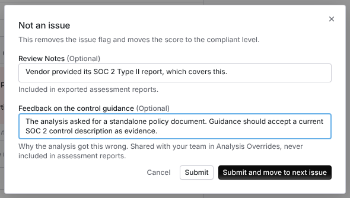
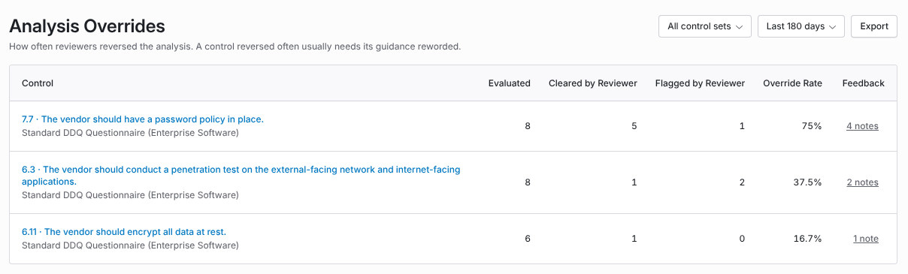
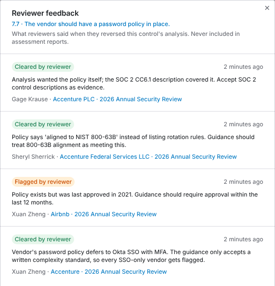

import AgentDirective from "/snippets/agent-directive.mdx";

<AgentDirective />

<Info>
  This guide is part of the [User Guides](/user-guides/overview) collection. It covers **Configuration → Analysis Overrides** and the feedback field reviewers fill in when they reverse a result. Fixing one control on the spot is [Correct the AI](/user-guides/analyst-reviewer#step-4-correct-the-ai) in the analyst guide. Where control guidance lives is [per-control tuning](/user-guides/admin-setup#per-control-tuning) in the admin guide.
</Info>

When a reviewer disagrees with the analysis on a control, they change its result. Analysis Overrides counts those reversals per control across every assessment, so you can see which controls the analysis gets wrong most often. Reviewers can also leave a short note on each reversal explaining why, and those notes are collected on the same report.

The most common mistake is reading a high override rate as a vendor problem. A control that reviewers reverse on a third of its assessments almost always has guidance that is too strict, too loose, or missing a case. The fix is to edit the control, not to keep reversing it.

## The short version

<CardGroup cols={3}>
  <Card title="Reviewers reverse a result" icon="arrow-right-arrow-left">
    Marking a flagged control **Not an issue**, or flagging a control the analysis cleared, is an override.
  </Card>

  <Card title="They say why" icon="comment">
    The confirmation has an optional **Feedback on the control guidance** field. It never appears in assessment reports or exports of the assessment.
  </Card>

  <Card title="You fix the guidance" icon="pen-to-square">
    **Configuration → Analysis Overrides** ranks controls by override rate and shows every note left on each one.
  </Card>
</CardGroup>

## What counts as an override

An override is a reviewer moving a result across the issue line: from an issue to not an issue, or the other way.

| Reviewer action | Counted as | Why |
| --- | --- | --- |
| Marks a flagged control **Not an issue** | **Cleared by Reviewer** | The analysis found an issue and the reviewer disagreed. |
| Marks a cleared control as an issue | **Flagged by Reviewer** | The analysis found no issue and the reviewer disagreed. |
| Changes a score so the control's issue status flips | Cleared or flagged, by direction | The score change moved the result across the issue line. |
| Accepts risk or marks an issue mitigated | Not counted | The reviewer agreed the issue was real. They closed it, they did not reverse it. |
| Reverses a result, then changes it back | Not counted | The result ended where the analysis put it. |
| Reruns the control and the analysis changes its own verdict | Not counted | No reviewer reversed anything. |

The two directions point to different fixes. A control reviewers keep **clearing** usually has guidance that is too strict or does not accept evidence your team accepts. A control reviewers keep **flagging** usually has guidance that misses a condition your team checks for.

## Leave feedback when you reverse a result

Feedback is optional, and it takes one sentence. Write it for whoever maintains the control, not for the vendor.

1. On the issue, choose **Not an issue** (or **Mark as issue** on a control the analysis cleared).
2. Fill in **Review Notes** as usual if you want the reasoning in the assessment report.
3. In **Feedback on the control guidance**, say what the guidance got wrong. For example: "The vendor uses Okta SSO with MFA. The guidance only accepts a written password complexity standard."
4. Choose **Submit**.

<Frame caption="The Not an issue confirmation. Review Notes go into the assessment report. Feedback on the control guidance goes only to Analysis Overrides.">
  
</Frame>

The field also appears when you change a score and the new score flips the control's issue status. It saves with **Change score and clear issue** or **Change score and mark as issue**. **Change score only** is turned off while the feedback field has text, because a score change that keeps the issue status is not an override.

<Note>
  Review Notes and guidance feedback are kept apart on purpose. **Review Notes** are part of the result and appear in exported assessment reports. **Feedback on the control guidance** is stored separately and never appears in assessment reports, report templates, or the due diligence file.
</Note>

Write feedback that names the condition, not the outcome:

| Less useful | More useful |
| --- | --- |
| "Wrong, this is fine." | "SOC 2 CC6.1 covers this. The guidance asks for a standalone policy document." |
| "Too strict." | "The policy says it follows NIST 800-63B instead of listing rotation rules. That should pass." |
| "Should be flagged." | "The penetration test was an automated vulnerability scan. The guidance should say a scan does not count." |

## Read the report

Open **Configuration → Analysis Overrides**. Each row is one control.

<Frame caption="Analysis Overrides. Controls are ranked by override rate, and the Feedback column opens the notes reviewers left.">
  
</Frame>

| Column | What it shows |
| --- | --- |
| **Control** | The control's reference and expectation, and its control set. Select it to open the control and edit its guidance. |
| **Evaluated** | How many times the control was evaluated in the window. |
| **Cleared by Reviewer** | Results the analysis flagged and a reviewer cleared. |
| **Flagged by Reviewer** | Results the analysis cleared and a reviewer flagged. |
| **Override Rate** | Cleared plus flagged, as a share of evaluated. The table is sorted by this column. |
| **Feedback** | How many feedback notes reviewers left on this control's results in the window. Select the count to read them. |

Use the filters at the top to narrow it down:

- **All control sets** limits the report to one control set.
- **Last 180 days** sets the window to 90, 180 or 365 days. The window applies to when the control was evaluated, so a result from 200 days ago that a reviewer reversed last week is outside a 180 day window.
- **Export** downloads the rows on screen as an Excel file, including the feedback count. The export does not include the feedback text.

A control appears only after it has been evaluated at least 5 times in the window. A rate over one or two assessments is not worth acting on.

## Read the feedback for a control

Select the count in the **Feedback** column. A panel opens with every note left on that control's results in the window, newest first.

<Frame caption="Reviewer feedback for one control, across every assessment. Each note shows its direction, who wrote it, and the vendor and assessment it came from.">
  
</Frame>

Each note shows:

- **Cleared by reviewer** or **Flagged by reviewer**, the direction of the reversal
- the note itself
- who wrote it and when
- the vendor and assessment, linked to the result

If you can't open an assessment, its note still shows, but the vendor and assessment are replaced with **Assessment you can't access**. The note is about the control, and anyone who can read the control can read it.

The panel shows the newest 200 notes for a control. When there are more, a line at the bottom says how many it is showing.

## Turn feedback into better guidance

1. Sort by **Override Rate** and start at the top. Look at the split between **Cleared by Reviewer** and **Flagged by Reviewer** to see which way the guidance is off.
2. Open the feedback and look for the same reason repeated across vendors. Three notes that each mention SSO are one missing condition.
3. Select the control name to open it, and add the condition to its guidance. Be specific: "accept SSO with MFA as meeting this control" rather than relaxing the control in general.
4. Check the control's override rate again after the next few assessments. Overrides on earlier results stay in the window until they age out, so the rate falls gradually.

For a single result you are reviewing right now, [Correct the AI](/user-guides/analyst-reviewer#step-4-correct-the-ai) edits the guidance and reruns the control in one step. Analysis Overrides is for finding the controls worth fixing that way.

## Troubleshooting

| What you see | What is happening |
| --- | --- |
| **No overrides to report yet** | No control was evaluated at least 5 times in the window. Widen the window to 365 days, or come back after more assessments have run. |
| A control you know reviewers reversed is missing. | It has fewer than 5 evaluations in the window, or the report is filtered to a different control set. |
| The feedback field doesn't appear on **Not an issue**. | The result is not currently an issue, so marking it is not a reversal. The field appears only when the action moves the result across the issue line. |
| **Change score only** is grayed out. | The feedback field has text. Clear it to change only the score, or use the button that changes the issue status. |
| A control has feedback but a low override rate. | Feedback is kept when a reviewer later changes a result back, but the result then no longer counts as an override. |
| A note says **Assessment you can't access**. | Your role can't open that assessment. Ask an admin if you need the vendor and assessment. |
| A note says **Former user**. | The person who wrote it no longer has an account in your organization. |
| A line under the table says some evaluations are left out. | Those results predate the history the report needs to tell a reviewer's reversal from other changes. They are left out of every rate rather than counted as agreements. |
| You want to change or delete a note. | Notes can't be edited or deleted in the dashboard. Contact support. |

## Related

<CardGroup cols={2}>
  <Card title="Analyst and reviewer guide" icon="user-check" href="/user-guides/analyst-reviewer">
    Reviewing results, reversing them, and fixing a control on the spot with Correct the AI.
  </Card>

  <Card title="Admin and setup guide" icon="sliders" href="/user-guides/admin-setup#per-control-tuning">
    Control sets, guidance, and the rest of the configuration the analysis reads.
  </Card>

  <Card title="Evidence quality and source credibility" icon="shield-check" href="/user-guides/evidence-quality">
    The other half of a wrong result: what evidence the analysis was allowed to read.
  </Card>

  <Card title="How to run an assessment" icon="list-check" href="/user-guides/running-an-assessment">
    Where results come from, and the issues reviewers work through.
  </Card>
</CardGroup>
