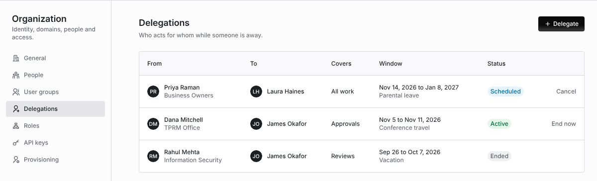
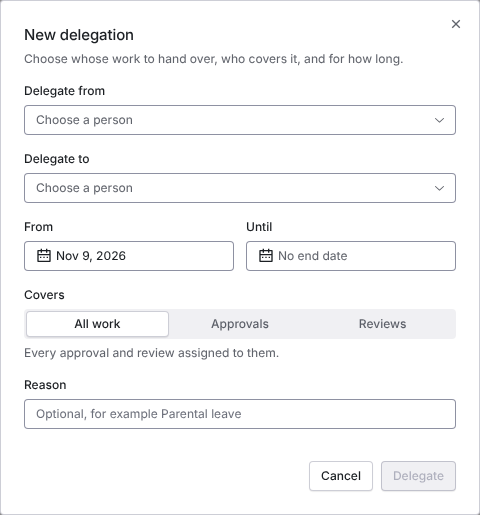
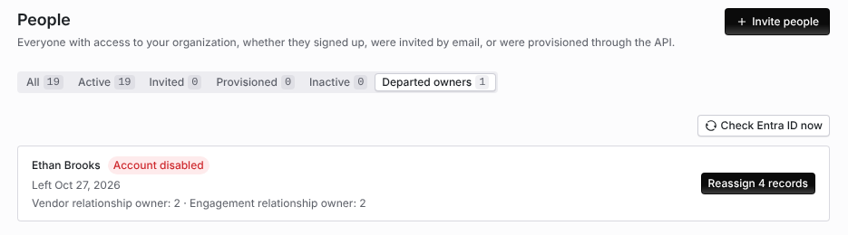
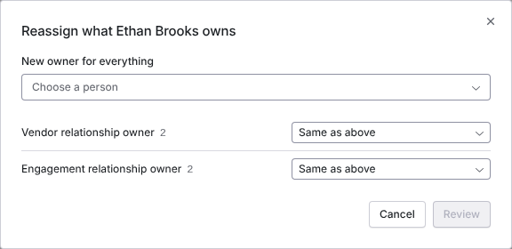

import AgentDirective from "/snippets/agent-directive.mdx";

<AgentDirective />

<Info>
  This guide is part of the [User Guides](/user-guides/overview) collection. It is for admins who own routing. For what the work itself is, see [Reviews, approvals and gates](/user-guides/reviews-and-approvals). For what a person is allowed to do once it reaches them, see [Permissions and roles](/user-guides/permissions-and-roles).
</Info>

A gate assigned to one person stops when that person is on leave. Coverbase can route work to a **user group** rather than a named individual, so it survives someone's holiday. It records both the group that was asked and the individual who ended up accountable.

## User groups

A user group is an org-scoped set of people with shared routing rules, managed under **Configuration → Organization → User groups** (create one with **New User Group**). Anywhere Coverbase accepts an assignee, it accepts a group: review gates, work queue items, questionnaire submission reviewers, risk domain reviewers, findings, follow-ups, watchers, and `@`-mentions in notes.

Each group carries:

| Setting | What it does |
| --- | --- |
| **Assignment strategy** | `Assign to all` or `Round robin`. See below. |
| **Group lead** | The named point of contact, badged in the member list. |
| **Members** | Each with an `Active` / `Inactive` status, a place in the rotation, and an optional out-of-office window. |

### Two strategies

<CardGroup cols={2}>
  <Card title="Assign to all" icon="users">
    The item is added to **every** eligible member's work queue and everyone is notified. The group is collectively accountable and there is no single individual assignee. Use it for a committee, or for a queue where whoever is free picks it up.
  </Card>
  <Card title="Round robin" icon="rotate">
    **One** member is picked from the rotation at assignment time. Both the group and that person are recorded, so the work has an individual owner while the record still shows it was handed to the team. Use it for balanced case load across a review desk.
  </Card>
</CardGroup>

The rotation is deterministic and ordered, so the next assignee is predictable rather than random, and the interface can show who is up next before an assignment is made.

## Out of office

Each member of a group has an **Out of office** window: a **From** date and a **To** date, set from the member row. Coverbase enforces it at routing time.

<Steps>
  <Step title="Set the window">
    On the group's member list, choose **Set out of office** and pick the dates. Members can also be marked `Inactive` indefinitely, which is the same thing without an end date, for a leave of absence or a secondment.
  </Step>
  <Step title="Routing skips them automatically">
    Anyone inside their window is excluded from the eligible set before the strategy runs. A round-robin rotation steps over them to the next available member rather than parking work in an empty inbox; an assign-to-all group notifies everyone except them.
  </Step>
  <Step title="They return without an admin touching anything">
    The window expires on its own. No one has to re-enable the member when they return.
  </Step>
  <Step title="Nothing is silently dropped">
    If every member of a group is out or inactive, the routing outcome is recorded as `no eligible members` rather than passing quietly. That is a visible state you can alert on, not an assignment that never happened.
  </Step>
</Steps>

<Warning>
  Out of office governs **new** assignments. Work already sitting on someone's queue when their window opens stays there. Move it with the reassignment step below, or route the queue to a group so the next round lands on someone present.
</Warning>

## Delegation and reassignment

Coverbase treats delegation as an explicit, attributed hand-off rather than an impersonation.

- **Reassign in place.** Every group carries an **Assignments** tab listing the open work across its members, with filters for member, item type and status, and a **Reassign to** action. Reassigning cancels the previous holder's pending item rather than completing it, because they never did the work, and mints a fresh one for the new holder. The completed / canceled distinction keeps throughput reporting accurate.
- **Reassign a single gate.** A review's or a submission's reviewer picker takes an individual, a group, or nothing. A group assignment is re-resolved against **current** membership when the work arrives, not against the roster as it stood when the item was first sent. A personnel change between send and response therefore routes to the person who is there now.
- **Escalate to the lead.** The group lead is a named, queryable field, which gives a workflow somewhere to send an item that has aged past its target.
- **Nobody inherits authority.** Delegation moves the item, never the permission. A delegate acts under their own role, and the decision is recorded under their own name. See [Permissions and roles](/user-guides/permissions-and-roles).

## Delegate while you are away

A delegation hands one person's approvals, reviews or both to a colleague for a date window. While it is active, new work for that person goes to the delegate, and the delegate can act on work still assigned to them. Out of office skips a group member; a delegation covers work assigned to the person by name.

Open **Organization → Delegations**. The table lists each delegation with **From**, **To**, what it **Covers**, the **Window** and reason, and its **Status**: **Scheduled**, **Active**, **Ended** or **Revoked**. A member sees the delegations they gave or receive. An admin sees everyone's.

<Frame caption="Organization → Delegations with a scheduled, an active and an ended delegation.">
  
</Frame>

<Steps>
  <Step title="Open the dialog">
    Click **Delegate**, or choose **Delegate my work** from your user menu.
  </Step>
  <Step title="Choose the people">
    Pick **Delegate from** (an admin can pick anyone; a member delegates only their own work) and **Delegate to**. Both must be active members.
  </Step>
  <Step title="Set the window">
    Set **From** and, optionally, **Until**. With **No end date** the delegation runs until someone ends it.
  </Step>
  <Step title="Choose what it covers">
    **All work**, **Approvals** (contract approvals, change requests and finding acceptances) or **Reviews** (assessment, intake and contract reviews, and other non-approval tasks). Add an optional **Reason**, for example "Parental leave".
  </Step>
  <Step title="Move open items now (optional)">
    For a delegation that starts today, tick **Move ... open items to ... now** to hand over the person's pending items at once. Otherwise only new work routes to the delegate. Click **Delegate**.
  </Step>
</Steps>

<Frame caption="The New delegation dialog.">
  
</Frame>

The delegate is notified in Coverbase and by email when the delegation is created.

What a delegation does:

- **New work goes to the delegate.** A work queue item for the person goes to the delegate instead, including assessment and domain reviews, contract approvals and Front Door sign-offs. The work queue labels it **On behalf of** the person. A user group item stays with its group, and a round-robin rotation is not changed.
- **Both can act.** The person keeps their own access. The delegate can decide contract approval steps, change requests, Front Door sign-offs, finding acceptance steps and assessment domain reviews still assigned to the person. The decision is recorded under the delegate's name, on behalf of the person.
- **The rules still hold.** The two Front Door sign-offs must still come from two different people, and nobody approves their own change request through a delegate.
- **No chains.** A person has one live delegation per kind of work at a time. Coverbase refuses a delegation to someone who has delegated the same work for that window, or from someone who is standing in for another person.

**End now** ends an active delegation, and new work goes back to the person. **Cancel** withdraws a scheduled one. Only the person who delegated, or an admin, can change a delegation. When a delegation ends, the delegate's open items for the person go back to the person on the next sync.

## Reassign what a departed owner owns

When Microsoft Entra ID says someone has left while they still own records, Coverbase lists them under **Departed owners** so you can hand everything to someone else in one step. This needs your organization's Microsoft Entra ID connection.

Coverbase checks Entra ID once a day. It matches each member to a directory person by email address and treats them as departed when the account is disabled (**Account disabled**), deleted (**Account deleted**) or past its leave date (**Leave date passed**). A member Entra ID has never listed, such as a guest, is left alone. To check now, click **Check Entra ID now**.

Each newly departed person who still owns something also raises one work queue item for the person who looks after the Entra ID connection. It completes itself once nothing is left, and is canceled if the person comes back.

<Steps>
  <Step title="Open the list">
    Open **Organization → People** and choose **Departed owners**. Each person shows when they left and what they own, by type: relationship owner of a vendor, engagement or service, contract owner, assignee of an engagement, assessment or finding, risk owner, work queue items and approval steps.

    <Frame caption="Departed owners on the People page.">
      
    </Frame>
  </Step>
  <Step title="Pick the new owners">
    Click **Reassign N records**. Choose a **New owner for everything**, or a different person per type in place of **Same as above**.
  </Step>
  <Step title="Review and apply">
    Click **Review** to see what moves to whom, then **Reassign**.
  </Step>
</Steps>

<Frame caption="Departed owners, with the reassignment dialog for a person whose account was disabled.">
  
</Frame>

Reassigning needs permission to assign users. Three ownership rules are off until an admin turns them on through `PUT /v1/ownership-policy`: a newly named Business Owner must be an active member, a newly named Business Owner must be an employee according to Entra ID, and a Business Owner cannot edit the business unit or cost center.

## The assignment log

Every group-driven routing decision writes its own log row, independent of the object it acted on. Each row records:

| Field | Example |
| --- | --- |
| Group | Financial Crime Review |
| Trigger | Assignee, watcher, or mention |
| Strategy applied | Round robin, as configured at that moment |
| Outcome | Assigned round robin / assigned all / no eligible members |
| Assigned to | The individual picked, for round robin |
| Notified | Every member notified, for assign to all |
| Triggered by | The person or workflow that caused it |
| Target | The object it happened on, and when |

It answers "who was supposed to approve this, and why did it land on them" months later. It survives a member leaving the group, and it records the strategy that was in force at the time rather than the one configured today.

Group routing decisions also surface in the [organization audit trail](/security/audit-trails) alongside the object changes they caused.

## A worked pattern

A common financial-services arrangement:

1. **Second-line reviews** route to a `Risk Committee` group on **Assign to all**, because the whole committee is meant to see the item.
2. **Domain SME reviews** route to per-domain groups (`InfoSec Review`, `Financial Crime`, `Legal`, `Privacy`) on **Round robin**, so each domain has one accountable person per assessment and the load spreads across the desk.
3. **Every SME sets their own out-of-office window** at the start of leave. The rotation steps over them for the duration, with no admin ticket and no gate waiting on an empty desk.
4. **The `no eligible members` outcome is alerted on**, so a domain that is entirely out during a holiday period surfaces as an operational problem rather than as a quiet backlog.

## Manage assignments from MCP or the API

You can manage user groups and route work from an MCP client or with an API key, as well as in the dashboard. An MCP client reads with `query_platform(kind="departments")`, `query_platform(kind="department_detail")`, `query_platform(kind="work_queue")` and `query_platform(kind="work_queue_item")`. It changes user groups with `mutate(entity="department", action=...)` (`create`, `update`, `archive`, `add_member`, `update_member`, `remove_member`) and work with `mutate(entity="work_queue_item", action=...)` (`create`, `update`, `complete`, `bulk_reassign` and the rest). An out-of-office window is an `update_member` change.

The API routes sit under `/v1/departments` and `/v1/work-queue-items`. See [Departments](/api-reference/vendor-administration#departments) and [Work queue items](/api-reference/risk#work-queue-items).

Before an MCP client sends a write, it shows you the change and waits for you to confirm it. The [MCP tool reference](/mcp/tool-reference#platform-settings) lists every field.

An API key cannot archive a user group or remove a member from one. The assignment log, `query_platform(kind="work_queue_routing_events")` or `GET /v1/work-queue-items/{work_queue_item_id}/routing-events`, needs `org_settings:read:org`, which API keys do not hold.

## Troubleshooting

| What you see | Cause | Fix |
| --- | --- | --- |
| **This person already delegates this work for part of that window** | The person has a delegation of an overlapping scope whose window meets this one. | End or cancel the other delegation, or change the window or scope. |
| The delegation is refused because the work would pass on again | The delegate delegated their own work for that window, or the person is standing in for someone else. | Pick another delegate or window. |
| The move open items option is not offered | The delegation starts later. | Expected. New work routes to the delegate when it starts. |
| A group item did not go to the delegate | User group items stay with their group. | Set the member out of office, or reassign the item. |
| **Departed owners** is empty though someone left | Entra ID is not connected, it has not checked since they left, or Entra ID never listed their email address. | Click **Check Entra ID now**. Reassign a person Entra ID does not list by hand. |

## Related

<CardGroup cols={2}>
  <Card title="Reviews, approvals and gates" icon="gavel" href="/user-guides/reviews-and-approvals">
    Gate outcomes, parallel domain reviews, multi-approver logic and rework loops.
  </Card>
  <Card title="Permissions and roles" icon="lock-keyhole" href="/user-guides/permissions-and-roles">
    What a delegate is allowed to do once the work reaches them.
  </Card>
  <Card title="Email notifications" icon="envelope" href="/user-guides/email-notifications">
    What each assignment and reminder sends, and how to tune it.
  </Card>
  <Card title="Audit trails" icon="list-timeline" href="/security/audit-trails">
    Where routing decisions land in the organization-wide record.
  </Card>
</CardGroup>
