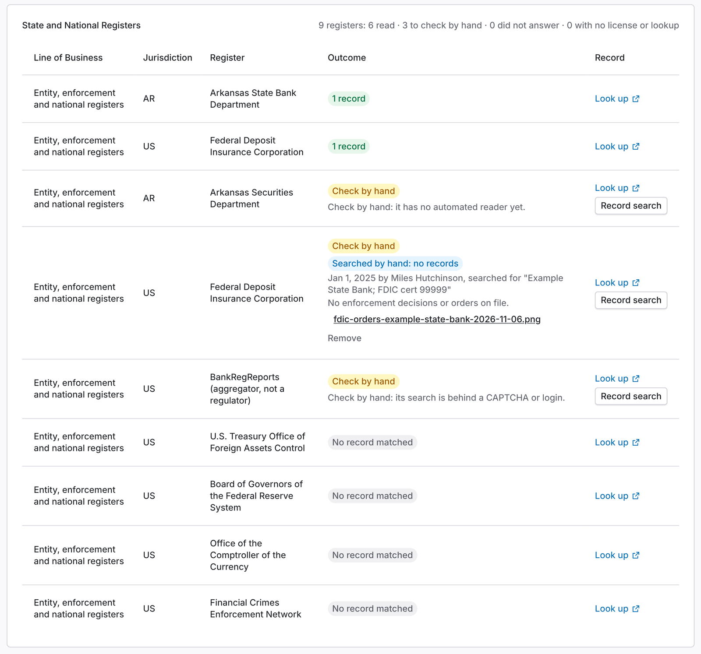
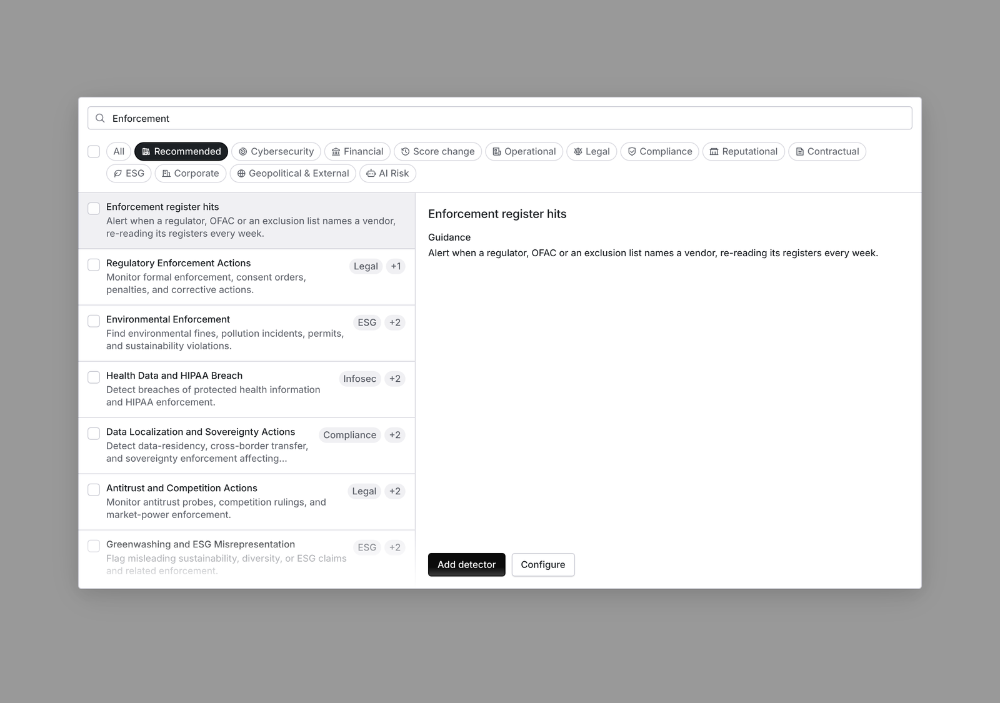
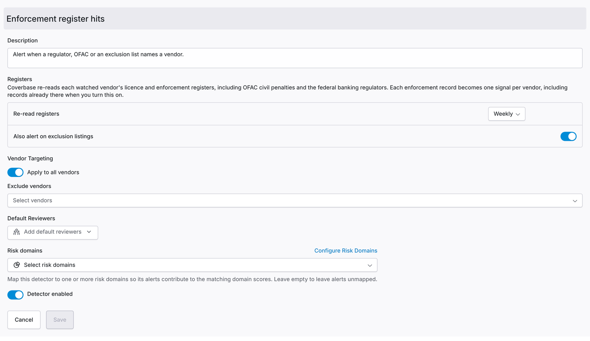
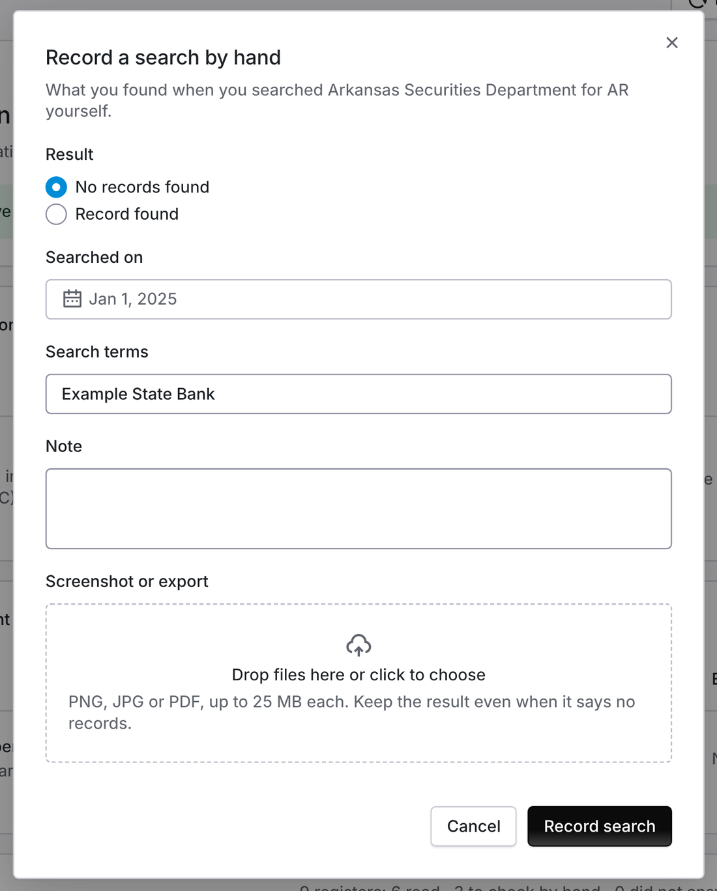

import AgentDirective from "/snippets/agent-directive.mdx";

<AgentDirective />

<Info>
  This guide is part of the [User Guides](/user-guides/overview) collection. It covers the enforcement rows of the **Licenses** tab under **Vendor Intelligence**. For the legal entity behind a vendor, see the [Corporate registrations guide](/user-guides/corporate-registrations).
</Info>

When you onboard a partner bank, your BSA team needs to know whether a regulator or OFAC has taken action against it. Coverbase reads the public enforcement registers it can read for you. It lists the rest on the same page with a link, so a reviewer can see what was searched and what still needs a search by hand.

The mistake people most often make is reading "No record matched" as a clean bill of health from every regulator. It covers only the registers marked as read. A row marked **Check by hand** has not been searched.

## What is read for a financial vendor

A vendor whose line of business is financial (a bank charter, mortgage lending, money transmission and similar) gets these enforcement registers on its ledger:

| Register | Outcome on the ledger |
| --- | --- |
| OFAC civil penalties and enforcement information | Read |
| Federal Reserve enforcement actions | Read |
| OCC enforcement actions | Read |
| FinCEN enforcement actions | Read |
| CFPB enforcement actions | Read |
| SEC administrative proceedings and litigation releases | Read |
| FDIC enforcement decisions and orders | Check by hand: the FDIC search blocks automated requests |
| BankRegReports enforcement actions | Check by hand: full search needs an account |
| The enforcement list of each state the vendor works in | Read where Coverbase has a reader, otherwise check by hand |

OFAC civil penalties are also read for every US vendor with a headquarters state, not only financial ones.

<Frame caption="The State and National Registers table for a state-chartered bank. Read registers show their outcome. Check by hand rows carry a Record search button, and the latest recorded search sits under its row.">
  
</Frame>

<Tip>
  To see a complete ledger before you onboard a real partner bank, add **Bell Bank** (website bell.bank, headquartered in North Dakota) as a vendor and refresh its **Licenses** tab: it should show its FDIC and North Dakota charters, a read outcome for each federal register, and the Check by hand rows. To see an enforcement record, add a firm exactly as OFAC's civil penalties page names it, such as **Bank of America, N.A.**
</Tip>

<Note>
  For a state-chartered bank whose primary federal regulator is the FDIC, the FDIC search is the one that matters most. Search it by the bank's name and FDIC certificate number on every review until it shows as read.
</Note>

## How a record is tied to the vendor

An enforcement record binds to the vendor only when its name matches the vendor's name exactly, legal form included. "Example State Bank" binds to "Example State Bank". It does not bind to "Example State Holdings" or to an article that mentions "Bank". A namesake on an enforcement list is never treated as the vendor.

Case, punctuation and a leading "The" do not matter. A national bank's legal form counts as one form however it is written: "Wells Fargo Bank, N.A." and "Wells Fargo Bank, National Association" are the same name, so the OCC's records and CFPB's records both reach the vendor whichever way you entered it.

Each OFAC row links to the enforcement release, which is the narrative of the penalty. When one release names several firms ("X Inc. and Y LLC"), each firm is checked on its own.

Adverse media works differently. It searches news for the vendor's full name in quotes, and a model then discards results about other companies with a different website, registration or home. See the [Adverse media guide](/user-guides/adverse-media).

## Get a Radar signal when a register names a vendor

Register monitoring runs through Radar. An **Enforcement register hits** detector re-reads each watched vendor's licence and enforcement registers on a schedule, and turns every enforcement record it finds into a Radar signal with an alert.

<Steps>
  <Step title="Add the detector">
    Go to **Configuration**, then **Radar**, then **Detectors**, choose **Add detector**, then **From library**, and pick **Enforcement register hits** under **Compliance**. It needs no source: it reads the registers on each vendor's **Licenses** tab.

    <Frame caption="The Enforcement register hits template in the detector library.">
      
    </Frame>
  </Step>
  <Step title="Choose how often">
    Under **Re-read registers**, pick daily to quarterly. Weekly is the default. When several of these detectors are on, the most frequent one sets the pace.
  </Step>
  <Step title="Choose what counts">
    Every enforcement record alerts. Leave **Also alert on exclusion listings** on to include exclusion lists such as state Medicaid exclusions as well.
  </Step>
  <Step title="Choose who hears and which vendors">
    Add your BSA reviewers under **Default Reviewers**, and use **Vendor targeting** to watch every vendor or only, say, vendors tagged as partner banks. Only the vendors a detector targets are re-read, and only its own reviewers are alerted. To send alerts to a shared BSA mailbox, add the mailbox as a user and pick it as a reviewer.

    <Frame caption="The detector's settings: how often registers are re-read, whether exclusion listings alert, which vendors are watched, and who is alerted.">
      
    </Frame>
  </Step>
</Steps>

Each signal names the register, the record as the register words it, and the link to the record itself, and it shows on the vendor's **Radar** tab with your other signals. The alert email is Radar's own **Radar detector alert**. A record signals once per vendor, however many times the register is re-read. Records already on a vendor's ledger when you turn the detector on signal on its first pass, so expect a first batch for vendors already named.

An alert is a lead, not a verdict. Read the record before you take it to your committee, and keep searching the registers marked **Check by hand** yourself, because a scheduled re-read cannot search them either.

## Record a check by hand

Every row marked **Check by hand**, and every register that did not answer, has a **Record search** button on the **Licenses** tab.

1. Open the register from the **Look up** link on its row, and search by the bank's legal name and, where the register takes one, its FDIC certificate number.
2. Choose **Record search**, then pick **No records found** or **Record found**, the day you searched, and the terms you used. Add a note if it helps the committee.
3. Attach the screenshot or export of the result as PNG, JPG or PDF. Keep it even when the result says no records.

<Frame caption="Recording a search made by hand, with its result, date, terms, note and evidence.">
  
</Frame>

The latest search then shows on the row: the result, who searched, when, and what for, with the evidence to download. It also prints in the **Licenses** PDF export. Earlier searches are kept, and **Remove** takes back a search entered by mistake. You need permission to update the vendor to record or remove a search.
