import AgentDirective from "/snippets/agent-directive.mdx";

<AgentDirective />

<Info>
  This guide is part of the [User Guides](/user-guides/overview) collection. It covers the **Front Door** tab of an intake request and the **Configuration → Front Door** settings. It sits beside [Requesting a new vendor](/user-guides/requesting-a-vendor), which covers the requester's side, and [The engagement record](/user-guides/engagement-record), which picks up once due diligence starts. For what the module is, see [Front Door](/products/front-door).
</Info>

The Front Door is where the TPRM Office decides what an intake request needs before anyone sends a questionnaire. You answer four questions on one tab: is this a new vendor, can earlier due diligence be reused, is an inherent risk questionnaire (IRQ) required, and is the vendor on the Do Not Use list. The answers become a disposition that two people sign off.

Your Coverbase representative turns on the third-party lifecycle features for your organization.

The mistake people make most often is signing off a disposition and then revising it to fix a typo in the rationale. Revising clears both sign-offs, so both signers have to sign again.

## Before you start

You need the Admin role, or a role that can change organization settings, to change the Front Door settings. Triage itself needs permission to review intake requests.

Decide three things with your team first:

- Which user group is the **TPRM Office** and which is **Supply Chain**. Each disposition needs one sign-off from each, by two different people.
- How old a completed assessment can be and still be reused. The default is 12 months.
- Whether an IRQ is required by default, and which intake answers should change that.

## Step 1: Configure the Front Door

Open **Configuration** and choose **Front Door**.

<Frame caption="Configuration → Front Door, with the reuse window, the two sign-off groups and the IRQ scoping rules.">
  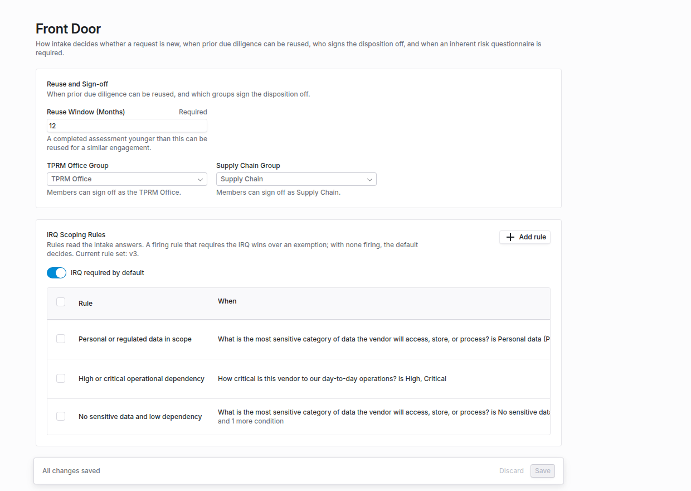
</Frame>

<Steps>
  <Step title="Reuse and Sign-off">
    Set **Reuse Window (Months)**. A completed assessment younger than this can be proposed for reuse on a similar engagement. Choose the **TPRM Office Group** and the **Supply Chain Group**. Left on **Any reviewer**, anyone who can review the request may sign for that role, but the two sign-offs must still come from different people.
  </Step>
  <Step title="IRQ Scoping Rules">
    Choose whether **IRQ required by default** is on. Then click **Add rule** for each exception. In the rule dialog, give a **Rule Name** (for example, "processes consumer personal data") and add **Conditions**: each picks a **Questionnaire** and a **Question** from your intake and holds **When the Answer** **is any of** or **is none of** the **Answers** you choose. Every condition must hold for the rule to fire; **Add condition** adds another. The **Outcome** is **Require the IRQ**, with the **IRQ Templates** to send (with none chosen, the standard IRQ is sent), or **No IRQ needed**. Click **Update rule** to put it in the table.
  </Step>
  <Step title="Save">
    Rules are listed in a table with their conditions, outcome and **Enabled** switch. Select several to **Enable**, **Disable** or **Remove** them together. Click **Save**; until you do, the page shows **You have unsaved changes**. Saving rules that differ from the last saved set increases the rule set version shown in the description. Each disposition records the version and the rules that fired when it was decided, so later edits do not rewrite past decisions.
  </Step>
</Steps>

How rules combine: a firing rule that requires the IRQ wins over a firing exemption. With no rule firing, **IRQ required by default** decides.

## Step 2: Mark vendors you must not use

Open the vendor, find the **Do Not Use** card on the overview, and click **Mark Do Not Use**. Give a **Reason**, then click **Add to Do Not Use**.

To take the vendor off the list, click **Remove from Do Not Use**. The confirmation asks for a **Reason for removing**, and Coverbase refuses the removal without one. Both reasons are capped at 2,000 characters, and a counter under the field shows how many you have used. Every change, on or off, is recorded in the vendor's activity with who made it and why.

A Do Not Use vendor can still be requested. The requester is warned that a reviewer must approve an exception, and approving the request needs an override rationale (step 6).

## Step 3: Open a request

Open **Intake** in the left navigation and choose the request. The request opens on the **Front Door** tab. **Submission** shows the requester's answers.

If the request started as a purchase requisition in a connected procurement system, a **Started From Procurement** card shows the **Source**, **Value**, **Category** and when it was **Synced**. See [Integration Hub](/user-guides/integration-hub).

## Step 4: Is this new?

The **Is This New?** card compares the request with your vendors.

| Badge | Meaning |
| --- | --- |
| **Tax ID exact**, **D-U-N-S exact**, **LEI exact** | A registry identifier matched. Shown as **Deterministic match**, with how many of the three identifiers agree. |
| **Domain exact**, **Name similar** | Only the website or the name matched. Shown as **Probabilistic match**. Check the vendor before you treat it as the same company. |
| **Linked** | The request was already linked to this vendor. |

If the requester did not give identifiers, enter the **Tax ID**, **D-U-N-S** (9 digits) or **LEI** (20 letters and digits) yourself and click **Check identifiers**. A stored tax ID is shown only as its last four characters.

For an existing vendor, the card then finds the most similar engagement, ranked by shared services and tags, and tells you whether its due diligence is **inside** or **outside** the reuse window. **Choose the engagement to compare** picks a different one. The comparison lists the services the two share and the attributes they differ on.

## Check the IRQ answers

The **IRQ answer check** flags each inherent risk questionnaire answer that the request itself contradicts, so a wrong answer does not lower the tier. Coverbase runs it in the background when the request is submitted. The card sits on the request's **Summary** tab, above **Suggested Inherent Risk Profile**, and the Front Door review shows a count such as **2 to review** that opens it.

The check reads the request's description, use case, products and services, intake context, answers to follow-up questions and the descriptions of the services in scope. It compares them with every answer picked from a list on the request's IRQs. It flags an answer only when a source states a fact that makes the answer wrong. A source that says nothing about a question is not evidence.

<Frame caption="The IRQ answer check with two flagged answers. The first raises the Cybersecurity tier; the second leaves the tier unchanged.">
  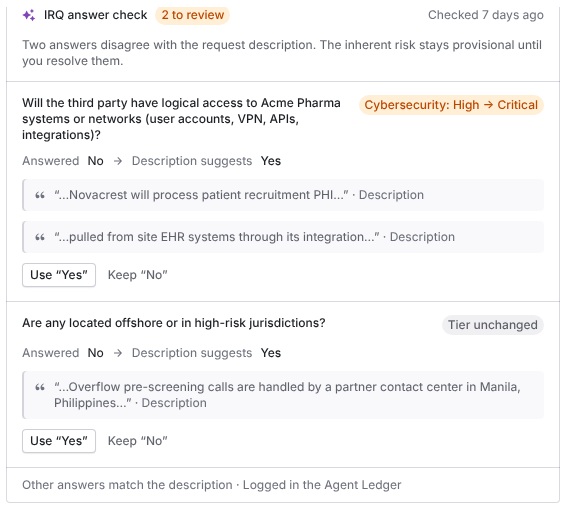
</Frame>

Each flag shows:

- The question, what was **Answered** and what the **Description suggests**.
- One or more quotes, each with the source it came from. Coverbase discards a flag whose quote is not word for word in its source.
- The effect on the tier, for example **Cybersecurity: High → Critical**, or **Tier unchanged**.

A flag is high severity when the answer understates data access, data sensitivity, regulated data, criticality or system access, so the tier would likely be too low.

To resolve a flag, choose one:

- **Use "Yes"** (the suggested answer) changes the answer. The IRQ is scored again, and the tier impact of the other open flags on that questionnaire is worked out again.
- **Keep "No"** (the given answer) asks **Why keep "No"?**. Write what the description gets wrong, or why the answer still holds, and click **Confirm**. The reason is required.

The flag then reads **Changed to** or **Kept** with the answer. Each decision goes on the request's **Audit Trail**.

While a high-severity flag is open, the card says the inherent risk stays provisional, and **Suggested Inherent Risk Profile** shows **Provisional**. Recording a disposition or approving the request then opens **Go ahead with open answer flags?**. Write the **Reason** and click **Go ahead**. The reason is kept on the audit trail.

**Run check again** runs a fresh check, which replaces the earlier one. Only the latest check can be resolved. Each run is one entry in the [Agent Ledger](/user-guides/agent-ledger), which records your decisions once every flag is answered. Questions in a risk domain whose **AI features** are turned off are not checked. See [Turn AI off or restrict a domain](/user-guides/risk-methodology#turn-ai-off-or-restrict-a-domain).

## Step 5: Decide reuse and record the disposition

When a similar engagement has completed due diligence, **Proposed Reuse by Domain** lists each risk domain with its **Prior Result** and a **Proposal**: **Reuse prior due diligence**, **Abbreviated review** or **New due diligence**. Change any proposal you disagree with.

Then pick the **Disposition**:

- **Add as new engagement, reuse due diligence** reuses the domains you marked for reuse.
- **Extend the existing engagement** treats the request as an amendment. No new engagement is created.
- **Full new due diligence** ignores prior results.

Write the **Rationale**, which is required, kept in the audit trail and shown to both sign-off groups, and click **Record disposition**. The card then shows **Awaiting sign-off**. Each signer clicks **Sign off as** their role, or **Approve triage** at the top of the request, which signs off the recorded disposition for their group. The disposition is **Decided** when the second, different person signs.

<Frame caption="A recorded disposition awaiting sign-off. The TPRM Office has signed, and Decline sits beside Approve triage for the Supply Chain group.">
  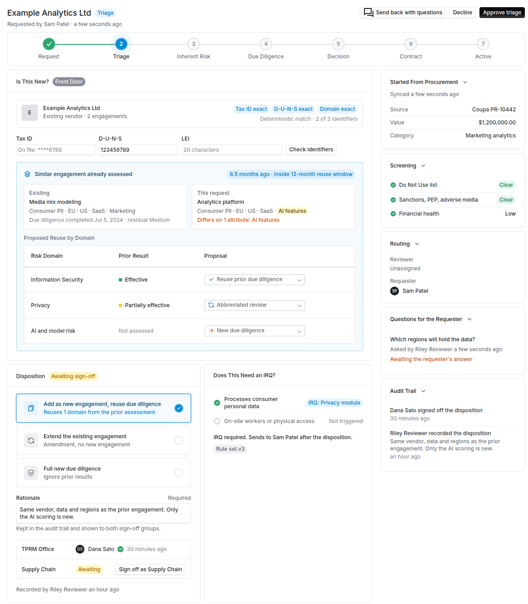
</Frame>

<Warning>
  **Revise disposition** asks you to confirm, then clears both sign-offs. Once an assessment has launched from the disposition, it is locked and can no longer be revised.
</Warning>

### Decline a disposition

To send a disposition back instead of signing it, click **Decline** beside **Approve triage**. Only a member of a sign-off group that has not signed yet can decline, and only before the disposition is decided. Write the **Reason** (what needs to change before your group can sign off) and click **Decline and send back**. The reason is required.

What a decline does:

- The disposition goes back to the TPRM Office as a draft, labeled **Back with the TPRM Office**. Any sign-off already given is cleared.
- The disposition shows who declined, for which group, and why. The **Audit Trail** records the same.
- The TPRM Office and whoever recorded the disposition are notified with the reason. The requester is told that the TPRM Office is revising the decision.
- Nobody can sign off or decline until the disposition is recorded again.

To ask both groups again, the TPRM Office revises the disposition and clicks **Record again**. That clears the decline, and both groups sign off afresh.

<Frame caption="A declined disposition, back with the TPRM Office, with the decline in the audit trail.">
  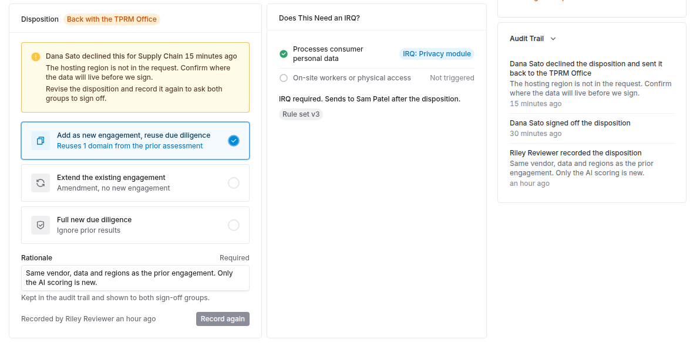
</Frame>

### Decide from Microsoft Teams

With [Teams approvals](/integrations/guides/microsoft-teams#register-the-bot) on, Coverbase posts one card for both sign-off groups, and each group can sign off or decline from it. Declining from Teams does the same as **Decline** in Coverbase. A card for a disposition that has since been revised is refused, so nobody signs a decision they did not see.

A sign-off or decline made in Coverbase also updates the Teams card. The card then shows who signed and which group is still waiting, the decided disposition, or who declined and why, and it cannot record a second decision.

### What happens when it is decided

- **The IRQ is sent once.** If an IRQ is required, the templates go to the requester as soon as the second sign-off lands. If the request has no vendor or requester yet, the card says **Required but not sent yet**; click **Send IRQ** once it does.
- **Reuse waits for the next assessment.** The vendor's next assessment launched from an assessment plan drops the control sets for reused domains and copies the prior scores for them, labeled with their source. Zero Touch assessments do not use it.

## Step 6: Handle a Do Not Use vendor

When the vendor is on the list, a banner names it and shows the reason. Enter an **Override rationale** and click **Record override** before approving the request. Approval without one is refused. The override applies to this request only, and is kept in the audit trail.

<Note>
  A workflow that approves intakes automatically skips a request whose vendor is on the Do Not Use list, because no one is there to give a rationale.
</Note>

## Step 7: Ask the requester

Click **Send back with questions**, write one or more questions, and **Send**. The requester is notified and answers inside their request, including an anonymous requester on a public portal. Questions and answers stay under **Questions for the Requester** and in the **Audit Trail**.

## Budget and material change

Two more cards appear when the requester filled in the matching intake steps.

- **Budget.** Shows the request amount, its amortization and **First year's draw** against the synced budget line's remaining balance, with **Within budget** or **Exceeds budget**. Coverbase works this out from the synced line, not from figures the requester typed. A line the procurement system reports no committed figure for shows **Unknown**. If the requester asked for a budget exception, **Approve exception** or **Decline exception**, with an optional **Decision rationale**.
- **Material Change.** For an existing vendor, lists what the requester flagged as changed, such as a new offshore location, a new AI use case or a new subprocessor, with **Needs IRQ refresh**. **Refresh IRQ** opens an IRQ refresh on the engagement's monitoring plan for its Transaction Owner to answer. See [IRQ refresh](/user-guides/monitoring-plans#step-5-refresh-an-irq).

## Close requests that do not meet your criteria

A Front Door rule can close a request as **Closed: Criteria Not Met** the moment it is submitted, before anyone reviews it. Use it for requests that belong in another process, for example small purchases that go through a purchasing card.

To add one, open **Configuration → Front Door**, click **New rule**, and add the **Conditions** as for any IRQ scoping rule. Set the **Outcome** to **Close: Criteria Not Met** and write the **Reason the requester sees**. The reason is required, because the requester reads it. Click **Update rule**, then **Save**.

<Frame caption="An IRQ scoping rule with the Close: Criteria Not Met outcome, listed with the rules that require the IRQ.">
  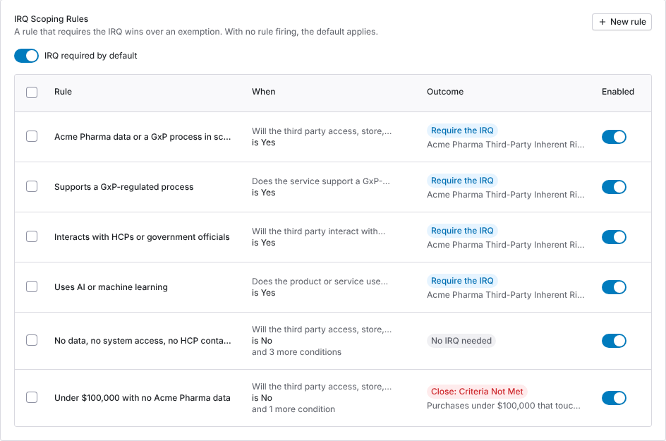
</Frame>

When a request is submitted, Coverbase checks the enabled closing rules in table order. The first rule whose conditions all hold closes the request. Then:

- The request's status is **Closed: Criteria Not Met**. The **Front Door** tab shows the reason and **Closed by the rule** with the rule's name.
- The requester is notified with the reason. A requester who filed through a public portal without signing in gets it by email.
- The request is still screened (see [Screen for countries of concern and free email domains](#screen-for-countries-of-concern-and-free-email-domains)), but no review stage starts and no extra reviewer gets a task while it is closed.
- The **Audit Trail** records the close with the rule and the reason.

<Frame caption="A request a closing rule closed, with the reason the requester sees and the Reopen button.">
  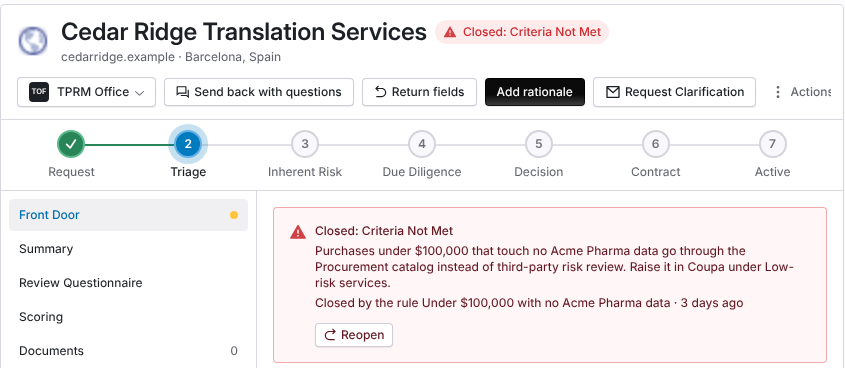
</Frame>

### Reopen a closed request

To put a closed request back into review, click **Reopen** on the callout. Give a **Reason for reopening** if you want one (it is optional), then click **Reopen request**. You need permission to update intake requests across the organization. Admins have it.

<Frame caption="The reopen confirmation. The reason is optional and goes into the audit trail.">
  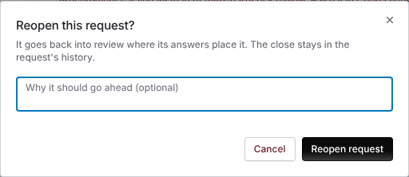
</Frame>

Reopening runs the steps the close held back:

- The portal's configured review stages start, or resume where an earlier submission left them, so the request still needs every sign-off.
- If the screening found a country of concern, the extra reviewer group gets its review task and notification.
- When the Front Door is turned on for your organization, the IRQ answer check is queued.

The close stays in the request's **Audit Trail**, next to who reopened it and why. If two people reopen the same request at once, the second reopen is refused, so nothing runs twice.

## Screen for countries of concern and free email domains

Coverbase screens every submitted request against your organization's reference lists. It flags a vendor, data location or entity in a country of concern, and a contact on a free email domain. The requester sees the same notice while filling in the form, and can still submit.

To set it up, open **Configuration → Front Door** and go to **Screening**.

<Frame caption="Screening settings: the country list and extra reviewer, the location questions, and the free email list.">
  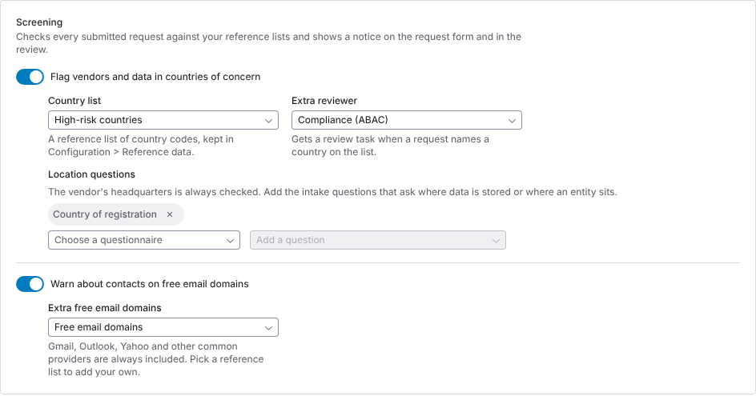
</Frame>

| Setting | What it does |
| --- | --- |
| **Flag vendors and data in countries of concern** | Turns country screening on. |
| **Country list** | The reference list of country codes to screen against. You keep it in **Configuration → Reference data**. |
| **Extra reviewer** | The user group that gets a review task when a request names a country on the list. **No extra reviewer** sends no task. |
| **Location questions** | The vendor's headquarters is always checked. Choose a questionnaire and add the intake questions that ask where data is stored or where an entity sits. |
| **Warn about contacts on free email domains** | Turns free email screening on. It checks the requester's vendor contact and every vendor contact on the request. |
| **Extra free email domains** | Gmail, Outlook, Yahoo and other common providers are always included. Pick a reference list to add your own domains. **Built-in list only** adds none. |

Click **Save** at the foot of the page.

Reference lists are versioned. A screen uses the version of each list in effect when it runs, and records the list's name and version on the request. A later edit to a list does not change a screen already recorded.

### What reviewers see

On a flagged request, the **Front Door** tab opens with a notice that names each country and where it was found, the list it matched, and the group asked to review it. That group gets a work queue task, **Country of concern review**, once per request.

<Frame caption="A country of concern notice, routed to the extra reviewer group.">
  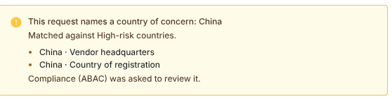
</Frame>

The **Screening** card lists **Country of concern** and **Free email domain** beside the **Do Not Use list**, with each flagged contact and whether it is the vendor contact on the request or another vendor contact. **Screen again** screens the request against today's lists. A new hit is added to the **Audit Trail** as **Screening flagged the request**.

<Frame caption="The Screening card on a flagged request.">
  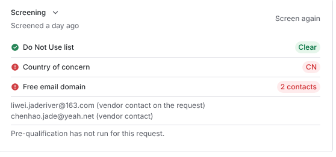
</Frame>

## Return fields to the requester

To ask the requester to correct specific answers, return those fields instead of sending a question. The requester edits only the fields you mark, and you see each value before and after.

1. On the request, click **Return fields**.
2. Under **Request details** and **Intake answers**, tick each field that needs to change. You can return up to 30 fields at once.
3. For each field, write **What needs to change**. A comment is required on every field.
4. Click **Return to requester**.

<Frame caption="Return fields to the requester. Request details are listed above the intake answers, each with its current value.">
  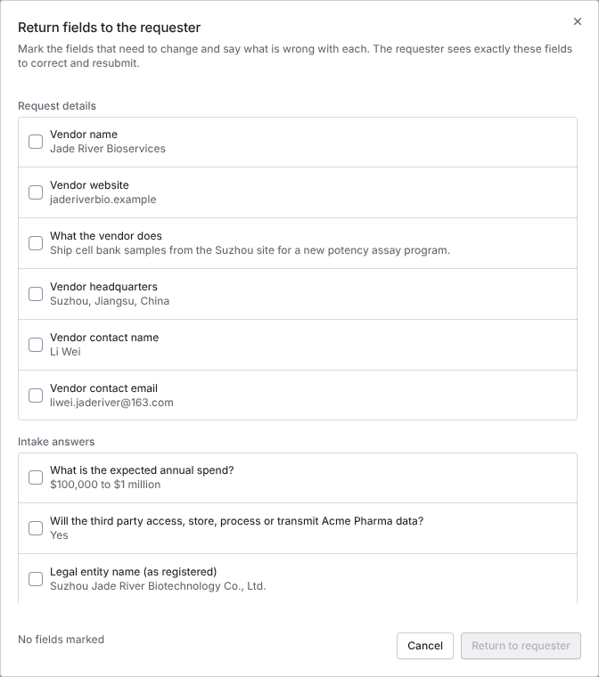
</Frame>

The returnable request details are **Vendor name**, **Vendor website**, **What the vendor does**, **Vendor headquarters**, **Vendor contact name** and **Vendor contact email**, plus any answer to the intake questions.

The requester is notified, including a requester who filed through a public portal without signing in, who gets an email. They correct the fields and click **Resubmit**. Under **Questions for the Requester**, each returned field shows your comment, **Waiting for the requester to resubmit** until they do, and then the old value struck through beside the new one. The **Audit Trail** records the return and the resubmission.

<Frame caption="Two returned fields after the requester resubmitted, with each value before and after.">
  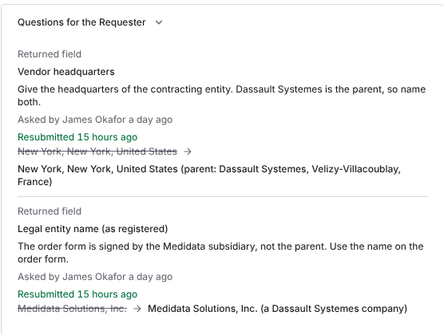
</Frame>

<Warning>
  A request cannot be accepted while a returned field is waiting for the requester. Accept it after they resubmit, or deny it. Once the request is decided, its fields can no longer be returned or changed.
</Warning>

## Run the Front Door from MCP

You can work the Front Door from an MCP client, as well as in the dashboard. An MCP client reads with `query_questionnaires(kind="intake_triage")` and `query_questionnaires(kind="intake_triage_config")`. It writes with `mutate(entity="intake_triage", action=...)` (`set_identifiers`, `set_disposition`, `sign_off`, `decline_signoff`, `override_block`, `send_irqs` and the rest) and `mutate(entity="intake_triage_config", action="update")`.

Before an MCP client sends a write, it shows you the change and waits for you to confirm it. The [MCP tool reference](/mcp/tool-reference#questionnaires-portals-and-intake) lists every field.

The public API has no Front Door routes, so an API key cannot do any of this.

## Troubleshooting

| What you see | Cause | Fix |
| --- | --- | --- |
| No **Front Door** tab on the request | The third-party lifecycle features are not turned on for your organization. | Ask your Coverbase representative. |
| **Probabilistic match** on a vendor you know is the same | Only the name or website matched. | Enter a tax ID, D-U-N-S or LEI and click **Check identifiers**. |
| A request was **Closed: Criteria Not Met** that should go ahead | A closing rule's conditions all held for its answers. | Click **Reopen**. If the rule closes requests it should not, change its conditions. |
| **Reopen** is not shown | You lack permission to update intake requests across the organization, or the request is not closed. | Ask an Admin. |
| A country of concern was flagged but nobody got a task | **Extra reviewer** is **No extra reviewer**, or the request was closed by a rule and not yet reopened. | Choose a group under **Screening**, or reopen the request. |
| Screening missed a country the requester gave | The answer is in a question not listed under **Location questions**, or the country is not on the list version in effect. | Add the question, update the reference list, then click **Screen again**. |
| Accepting the request returns an error about returned fields | The requester has not resubmitted the fields you returned. | Wait for the resubmission, or deny the request. |
| **Return fields** is refused | The request is already decided, or it has no requester or contact email to send it back to. | Return fields before the decision, on a request with a requester. |
| **Approve triage** is unavailable | No disposition is recorded, there are unsaved disposition changes, you already signed, or you are in neither sign-off group. | Follow the reason shown on the button. |
| **Sign off** does nothing for the second signer | The same person tried to sign both roles, or is not in the role's group. | A different member of the other group signs. |
| Both sign-offs disappeared | Someone clicked **Revise disposition**, or a sign-off group declined. | Both signers sign the revised disposition. After a decline, the TPRM Office clicks **Record again** first. |
| **Decline** is not shown | Your group already signed, you are in neither sign-off group, or the disposition is already decided or already declined. | Ask a member of the group still waiting. |
| **Back with the TPRM Office** and nobody can sign | A sign-off group declined the disposition. | Read the reason, revise the disposition, and click **Record again**. |
| **Remove from Do Not Use** does nothing | The **Reason for removing** is empty. | Write a reason, up to 2,000 characters. |
| **Required but not sent yet** | The request had no vendor or requester when it was decided. | Link the vendor, then click **Send IRQ**. |
| Approving the request returns an error about the Do Not Use list | No override rationale was recorded. | Record an override rationale, then approve. |
| The new assessment did not reuse anything | It was a Zero Touch assessment, or not launched from an assessment plan, or the reuse was already applied to an earlier one. | Launch from an assessment plan. Check the **Audit Trail** for **Disposition applied to the launched assessment**. |
| The budget card says **Unknown** | The procurement system has no committed figure for that budget line. | Check the line in your procurement system, then sync again. |
| **Go ahead with open answer flags?** opens when you record or approve | A high-severity IRQ answer flag is still open. | Resolve the flag on the **Summary** tab, or give a reason to go ahead. |
| A flag cannot be resolved | A newer check replaced the one you opened. | Reload the request and resolve the latest check's flags. |
| The IRQ answer check skipped some questions | Their section's risk domain has **AI features** turned off. | Expected. Review those answers by hand. |
| **Refresh IRQ** says there is nothing to refresh | The vendor has no engagement under an active monitoring plan. | Generate a monitoring plan for the engagement first. |

## Related

<CardGroup cols={2}>
  <Card title="Requesting a new vendor" icon="cart-shopping" href="/user-guides/requesting-a-vendor">
    What the requester sees, including Front Door notices.
  </Card>
  <Card title="The engagement record" icon="route" href="/user-guides/engagement-record">
    Linked and reused diligence, and the Risk Summary.
  </Card>
  <Card title="Risk methodology" icon="scale-balanced" href="/user-guides/risk-methodology">
    How the IRQ is scored and who reviews each domain.
  </Card>
  <Card title="Front Door" icon="door-open" href="/products/front-door">
    What the module does and does not do.
  </Card>
</CardGroup>
