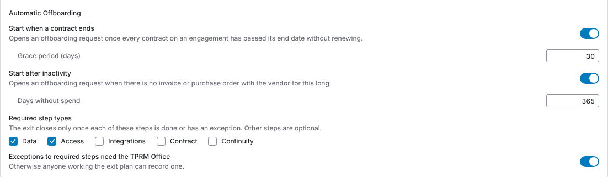
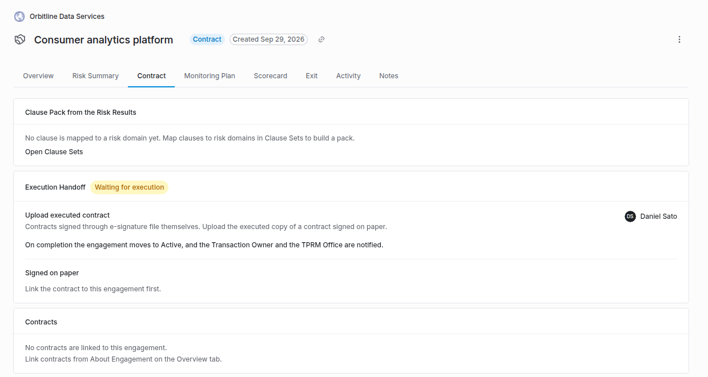
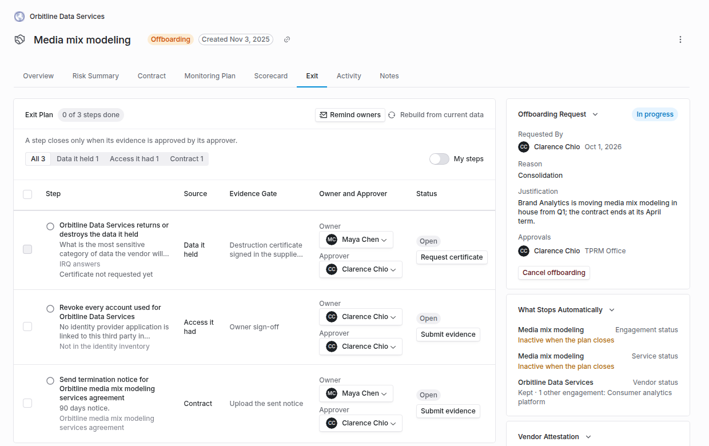
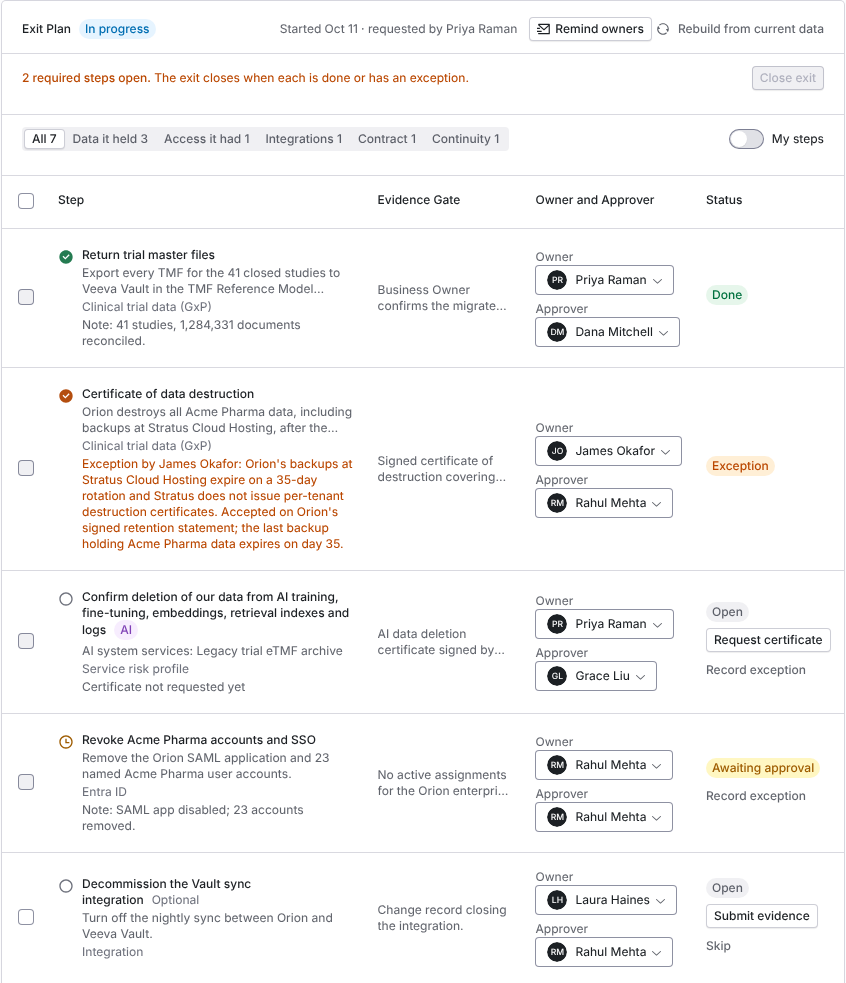

import AgentDirective from "/snippets/agent-directive.mdx";

<AgentDirective />

<Info>
  This guide is part of the [User Guides](/user-guides/overview) collection. It covers an engagement's **Contract** and **Exit** tabs. It sits beside [The engagement record](/user-guides/engagement-record) and [Monitoring plans](/user-guides/monitoring-plans), whose owner attestation is the usual start of an offboarding. For what the module is, see [Offboarding and continuity](/products/offboarding-and-continuity).
</Info>

This guide covers the engagement's life after due diligence: filing the executed contract, planning for the day the vendor is gone, and ending the relationship with evidence that each exit step was done.

Your Coverbase representative turns on the third-party lifecycle features for your organization.

The mistake people make most often is approving an exit plan step on a note that says "done". A step closes only when its evidence is submitted and its approver approves it, and the data step needs the vendor's signed destruction certificate, not a note.

## Step 1: Set lifecycle routing

Open **Configuration**, choose **Communications**, and under **Lifecycle Routing and Reminders** choose the **TPRM Office** and **Supply Chain** user groups. Offboarding approvals and the executed contract task go to these groups, each following the group's own assignment rule (round robin gives one person the task, assign to all gives everyone one).

- With no TPRM Office group, offboarding approval goes to the vendor's first risk analyst, then the requester.
- Supply Chain approval is required only once its group is named. Left unset, the TPRM Office approves offboarding alone.
- The approvals a request needs are fixed when it is filed. Changing routing later does not change requests already filed.

### Start offboarding automatically

Under **Automatic Offboarding** on the same page, Coverbase can file an offboarding request for you. A daily check files the request; the approvals in step 3 still apply.

<Frame caption="Automatic Offboarding under Lifecycle Routing and Reminders.">
  
</Frame>

| Setting | What it does |
| --- | --- |
| **Start when a contract ends**, with a **Grace period (days)** | Files a request once every contract linked to an engagement has ended, at least one by passing its end date more than the grace period ago. A contract that renews automatically, has a renewal, or has no end date keeps the engagement open. |
| **Start after inactivity**, with **Days without spend** | Files a request for a started engagement when the vendor has spend on record but no invoice or purchase order in that many days, and nobody edited the engagement in that time. A vendor with no invoices or purchase orders at all is never treated as inactive. |
| **Required step types** | Which kinds of exit plan step must be done or excepted before the exit can close: **Data**, **Access**, **Integrations**, **Contract** and **Continuity**. Data and Access are ticked by default. Other steps are optional. |
| **Exceptions to required steps need the TPRM Office** | On by default. Only a TPRM Office member or an admin can record an exception for a required step. Turned off, anyone working the exit plan can. |

An engagement with an open request is skipped. A canceled contract-end request is not filed again, and a canceled inactivity request waits a full window before Coverbase offers it again.

## Complete the contract handoff

The **Contract** tab lists the engagement's **Contracts** and its **Execution Handoff**.

<Frame caption="The Contract tab with an execution handoff waiting for the executed contract.">
  
</Frame>

A handoff opens by itself when an assessment completes for an engagement that has not started, or when the Transaction Owner chooses **Proceed to contracting** on the Risk Summary. To start one by hand, when due diligence was decided elsewhere, click **Start handoff**. Supply Chain (or the TPRM Office) gets an **Upload executed contract** task.

- **Signed through e-signature:** nothing to do. The handoff completes when the envelope is executed.
- **Signed on paper:** under **Signed on paper**, choose the **Contract**, drop the executed copy, and click **File executed contract**. If the contract is not listed, link it from **About Engagement** on the **Overview** tab first.

On completion the engagement moves to its active status, and the Transaction Owner and the TPRM Office are notified.

## Write a continuity plan

An engagement whose inherent risk is the highest level of its scale is critical, whatever you call that level. When it reaches that level, a draft **Third-Party Continuity Plan** opens on the **Exit** tab and its Transaction Owner gets a task. Any other engagement can have a plan too.

Fill in the **Owner**, **Backup Suppliers** (with readiness notes), the **Exit Strategy**, the **Recovery Time Objective (Hours)**, **Resiliency Notes** and **Transition Steps**, one per line. **Save draft** keeps your work. **Submit plan** needs an exit strategy and a recovery time objective. **Reopen plan** makes a submitted plan editable again.

If the engagement is offboarded, each transition step becomes an exit plan step.

## Step 2: Request offboarding

On the **Exit** tab, under **Request Offboarding**, choose a **Reason** (**Consolidation**, **Contract ending**, **No longer needed**, **Performance**, **Risk**, **Cost** or **Other**), write the **Business Justification**, optionally pick a **Requested Date**, and click **Request offboarding**.

An engagement has at most one open request. One also opens automatically when:

- an owner answers **Start offboarding** on a monitoring plan attestation, or
- someone marks the engagement not in use (a canceled status, or a status labeled Inactive or Not in use), or marks every service it uses not in use, or
- a contract end date or a period without spend triggers it (see [Start offboarding automatically](#start-offboarding-automatically)).

The exit plan's first line says when it started and why, for example **requested by** a person, **contract ended** or **no recent spend**.

## Step 3: Approve it

The **Offboarding Request** card shows **Waiting for TPRM Office** and, if required, **Waiting for Supply Chain**. A member of each group, or an admin, clicks **Approve**. The last approval starts the request: Coverbase generates the exit plan and runs the start of the cascade.

From the moment the request is filed, the engagement's tracker shows **Exit** as the current stage, reading **Exit under way**. See [The engagement record](/user-guides/engagement-record#step-2-open-the-engagement).

**Cancel offboarding**, with a **Cancel Reason**, closes every open step and task, and the tracker goes back to **Active**. Anything already stopped stays stopped.

## Step 4: Work the exit plan

<Frame caption="The Exit tab with the exit plan, the offboarding request and what stops automatically.">
  
</Frame>

**Exit Plan** lists the steps built from what the engagement had, grouped by source: **Data it held**, **Access it had**, **Integrations**, **Contract** and **Continuity**. Each step has an **Owner** (the Transaction Owner for data, contract and continuity, the requester for access and integrations) and an **Approver** (the TPRM approver).

<Steps>
  <Step title="Submit evidence">
    The owner clicks **Submit evidence**. A document step needs a file, a sign-off step a note. The step moves to **Awaiting approval**.
  </Step>
  <Step title="Approve or return">
    The approver clicks **Approve**, or **Return** with what needs to change. A returned step goes back to its owner with the note.
  </Step>
</Steps>

The plan lists a page of steps at a time. Filter by **Source**, or choose **My steps** to see only what waits on you.

To work several steps at once, select them:

- **Submit evidence for N steps** sends one file, one note or both to every selected step. Each step still has to pass its own gate, so a document step without a file or a sign-off step without a note is listed with what it needs, and the rest go through. A certificate step goes through only once the vendor has signed.
- **Approve N steps** approves the selected steps that wait on you. Each closes with the evidence it has; a step you cannot approve is skipped and listed with the reason.

**Remind owners** emails every owner of a step waiting on evidence and every approver of a step waiting on a decision, except you. It can be used once a day per request.

**Rebuild from current data** refreshes the plan from the record. It adds new steps and updates text without duplicating a step or losing what someone already did on it.

### Required steps, exceptions and closing the exit

A step is required when its kind is one of your **Required step types**, and the AI data deletion step is always required. Every other step shows **Optional**. While any required step is open, the plan says how many are open and **Close exit** is unavailable.

<Frame caption="An exit plan with two required steps open. One required step closed with an exception; optional steps are labeled.">
  
</Frame>

- **Record exception** closes a required step without its evidence. Write **Why this step will not be done** and click **Record exception**. The step shows **Exception** and **Exception by** the person, with the reason. With **Exceptions to required steps need the TPRM Office** on, only a TPRM Office member or an admin can do this.
- **Skip** takes an optional step off the plan. The step shows **Skipped**. A required step cannot be skipped.
- **Close exit** closes the exit once every required step is done or has an exception. Optional steps still open are skipped, and everything under **What Stops Automatically** takes effect. If a required step is still open, Coverbase names it and refuses.

The exit also closes on its own when its last open step is approved.

### AI data deletion

When the engagement brings AI in, the plan adds a required data step: **Confirm deletion of our data from AI training, fine-tuning, embeddings, retrieval indexes and logs**, labeled **AI**. Coverbase adds it when a service on the engagement is marked as an AI system, the vendor's AI bill of materials lists a machine-learning model, or a fourth party is recorded as an AI model provider.

Its evidence is a second certificate the vendor signs, requested the same way as the destruction certificate below. It asks what entered training, fine-tuning, embeddings, retrieval indexes and logs, whether any model still retains the data, and ends with an attestation that covers the vendor's AI model providers.

## Get the vendor's destruction certificate

The data step closes on a certificate the vendor signs. Click **Request certificate** on the step. The vendor gets an informational request in the supplier portal with a data destruction certificate to sign; **Copy portal link** gives you the link to send. When they sign, the step shows **Signed by**, with their title and the date, and **Vendor Attestation** shows a digest of the certificate.

Submitting the step records that digest. If the signed certificate changes afterwards, approval is refused, so the approver always approves the certificate they saw.

If the engagement held no data on record, the data step is instead an owner sign-off that no data is held.

## What stops automatically

**What Stops Automatically** lists what the offboarding will change, and keeps a line for anything another live engagement still needs (**Kept**).

| When | What | Rule |
| --- | --- | --- |
| On approval | In-flight due diligence | Canceled when scoped to a service no other live engagement uses, or all of the vendor's when no other engagement remains |
| On approval | A pending executed contract task | Canceled |
| When the plan closes | The engagement | Set to your inactive engagement status |
| When the plan closes | Its services | Inactive, unless another live engagement uses them |
| When the plan closes | The vendor | Inactive only when no other live engagement remains, which also stops its reassessments |
| When the plan closes | Radar monitoring | Stopped only when the vendor goes inactive |
| When the plan closes | The open monitoring record | Closed only when the vendor goes inactive |

Closing the exit, or approving its last open step, completes the request, and the requester, the Transaction Owner and the TPRM approver are notified. The card then reads **Offboarded**, and the tracker's **Exit** stage reads **Exited** with the date. An exited engagement leaves the figures in [Program Insights](/user-guides/program-insights).

## Work offboarding from MCP or the API

You can file offboarding, write continuity plans and work the exit plan from an MCP client, and file and plan with an API key. An MCP client reads with `query_engagements_contracts(kind="engagement_lifecycle")`. It writes with `mutate(entity="offboarding", action=...)` (`file`, `approve`, `cancel`, `regenerate`, `remind`), `mutate(entity="exit_item", action=...)`, `mutate(entity="continuity_plan", action="save")` and `mutate(entity="contract_handoff", action="update")`.

With an API key, use `GET` and `POST /v1/engagement-records/{engagement_id}/offboarding` and the `/v1/engagement-records/{engagement_id}/continuity-plan` routes. See [Read and file offboarding](/api-reference/contract-administration#read-and-file-offboarding) and [Continuity plan](/api-reference/contract-administration#continuity-plan).

Before an MCP client sends a write, it shows you the change and waits for you to confirm it. The [MCP tool reference](/mcp/tool-reference#contracts-engagements-and-procurement) lists every field.

The API has no route to approve offboarding or work exit steps. Those approvals are decisions for the people they route to.

## Troubleshooting

| What you see | Cause | Fix |
| --- | --- | --- |
| No **Exit** or **Contract** tab | The third-party lifecycle features are not turned on for your organization. | Ask your Coverbase representative. |
| **Link the contract to this engagement first.** | No contract is linked to the engagement. | Link it from **About Engagement** on the engagement's **Overview** tab. |
| The paper-signed contract still reads as not executed in its signature workflow | Only e-signature sets that state. | Expected. The handoff, the engagement status and the notices are the same. |
| **Request offboarding** is refused | The engagement already has an open request. | Work or cancel the open request. |
| Supply Chain approval is not asked for | No Supply Chain group was named when the request was filed. | Expected for that request. Name the group for future requests. |
| **Submit plan** is refused | The exit strategy or recovery time objective is empty. | Fill both in. |
| Approving the data step is refused | The vendor's signed certificate changed after the step was submitted. | **Return** the step so its owner submits it again with the current certificate. |
| **Close exit** is unavailable | A required step is neither done nor excepted. | Finish the step, or record an exception with a reason. |
| **Only the TPRM Office can record an exception for a required step.** | **Exceptions to required steps need the TPRM Office** is on. | Ask a TPRM Office member or an admin. |
| An offboarding request opened by itself | A contract ended or the vendor had no spend for the set period. | Approve it, or cancel it with a reason. |
| A service stayed active after offboarding | Another live engagement uses it. | Expected. It shows as **Kept**. |

## Related

<CardGroup cols={2}>
  <Card title="Monitoring plans" icon="calendar-check" href="/user-guides/monitoring-plans">
    Owner attestation and Start offboarding.
  </Card>
  <Card title="The engagement record" icon="route" href="/user-guides/engagement-record">
    The Risk Summary decision that opens a handoff.
  </Card>
  <Card title="Contract intake and approval" icon="clipboard-check" href="/user-guides/contract-intake-and-approval">
    Approval chains and sending for signature.
  </Card>
  <Card title="Assignment, delegation and out of office" icon="user-clock" href="/user-guides/assignment-and-delegation">
    How a group assigns its tasks.
  </Card>
</CardGroup>
