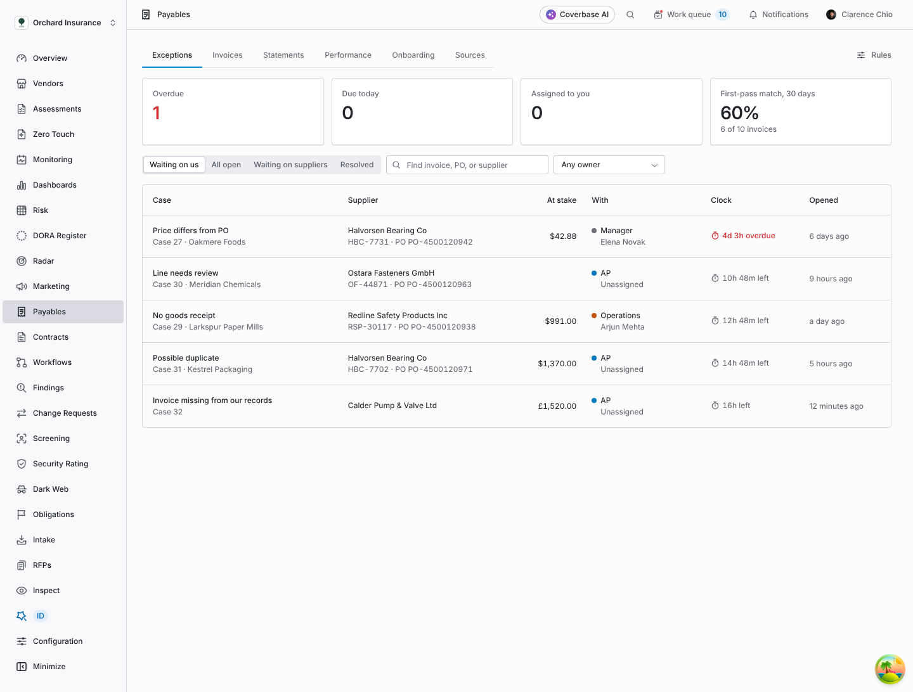
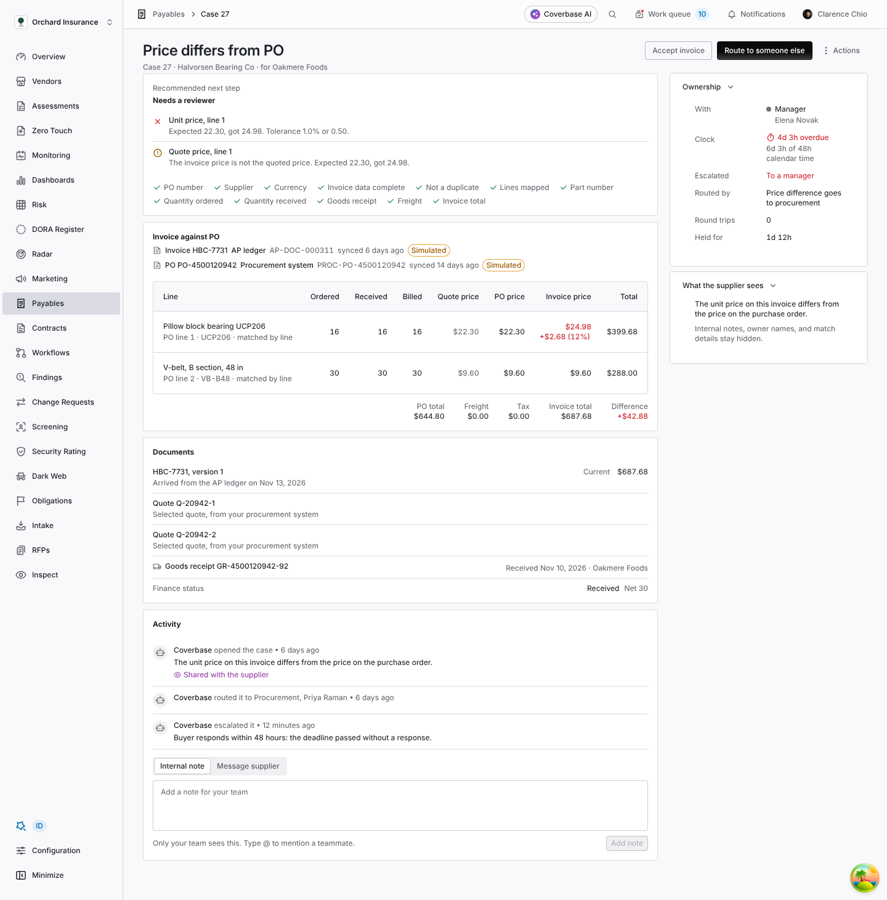
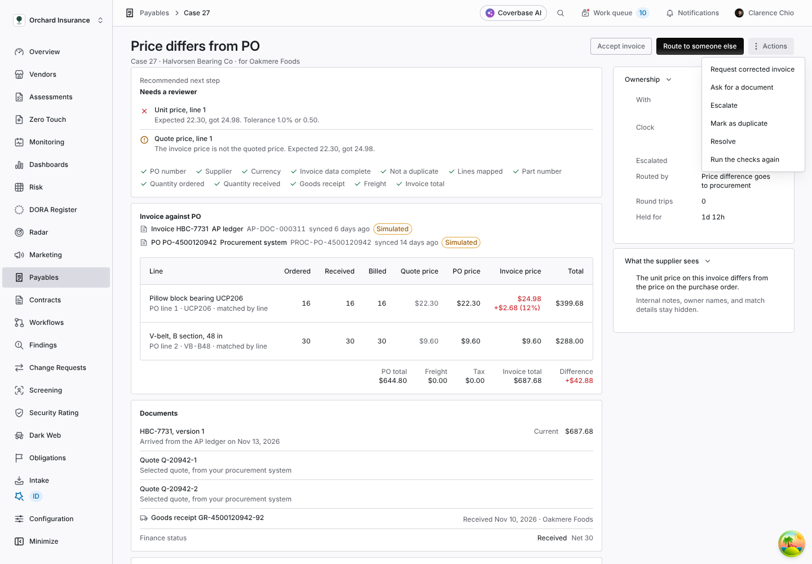
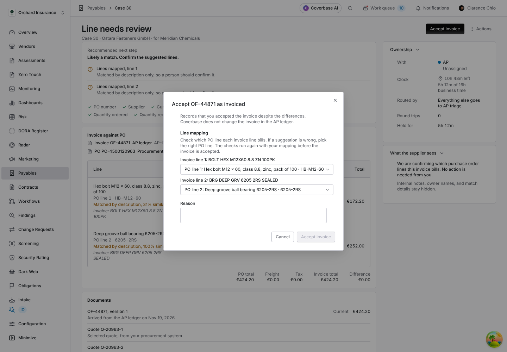
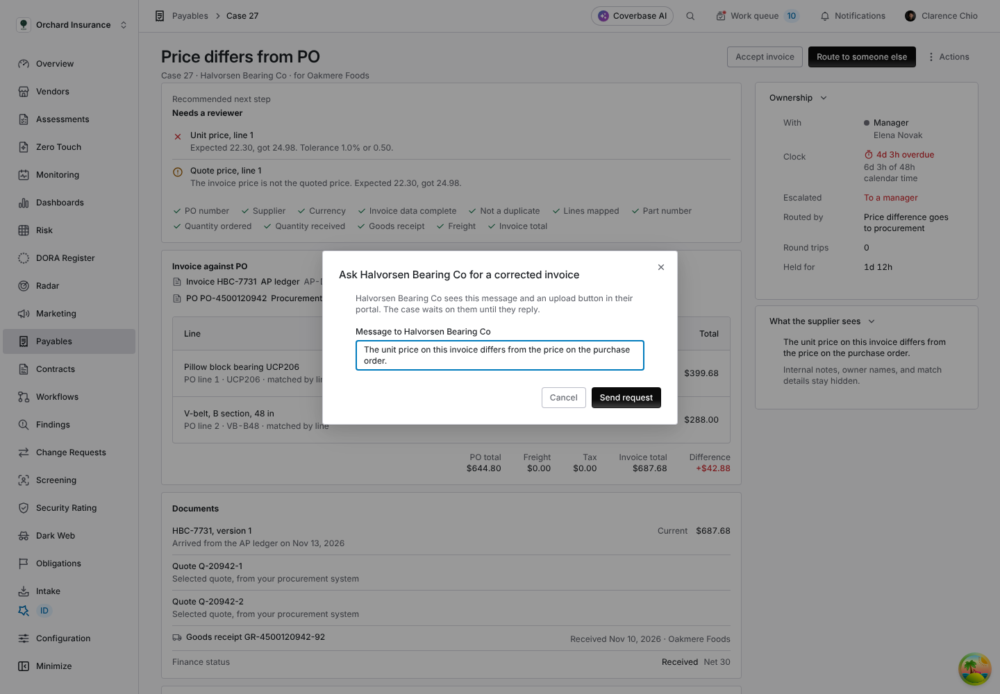
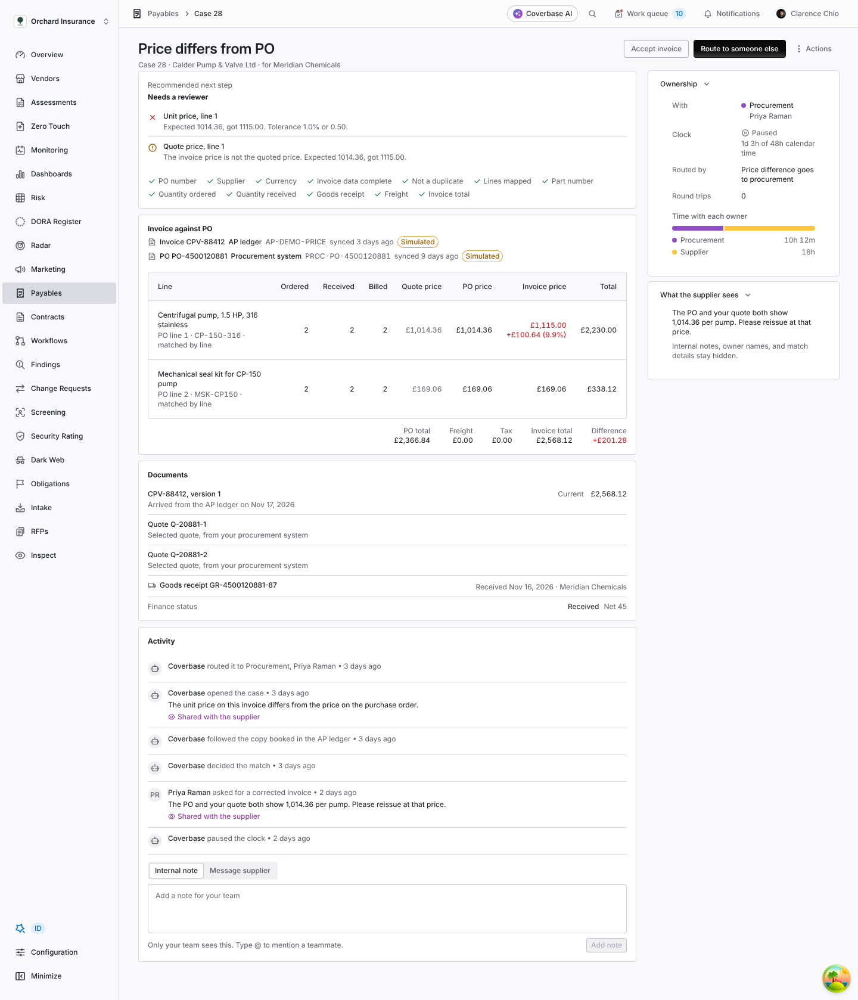
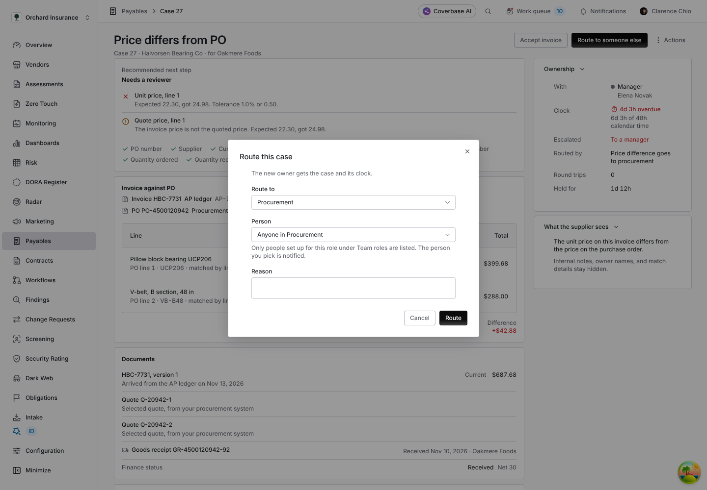
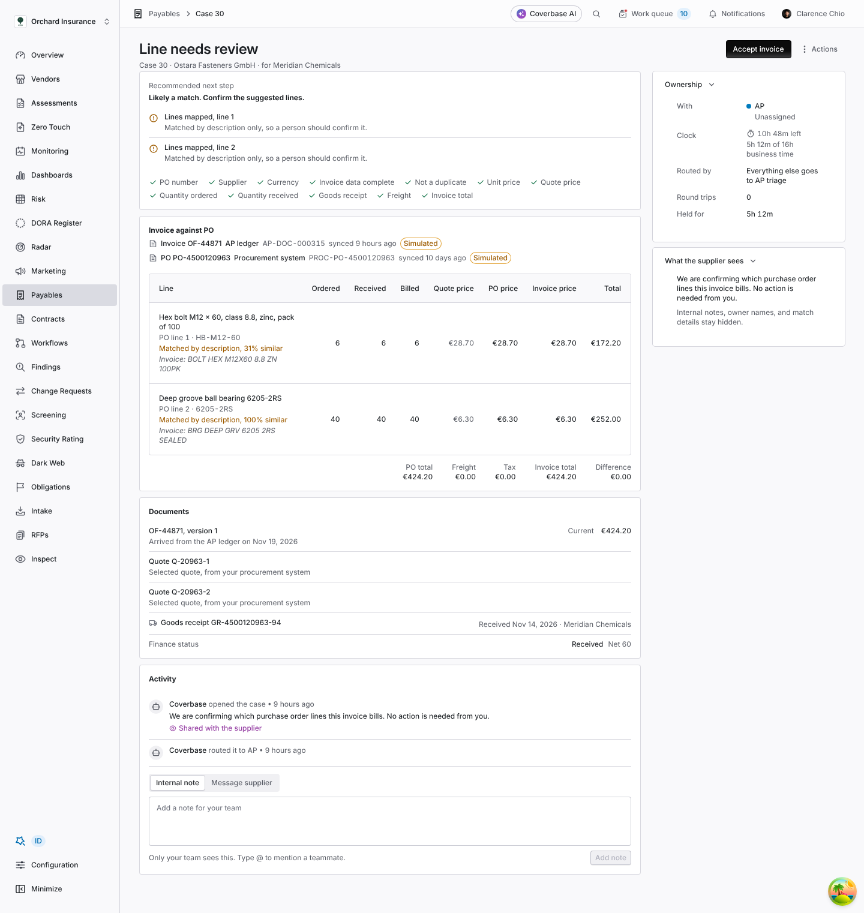

import AgentDirective from "/snippets/agent-directive.mdx";

<AgentDirective />

<Info>
  This guide is part of the [User Guides](/user-guides/overview) collection. For why a case opened, see [How matching works](/user-guides/payables-matching). For the rules that route cases and set clocks, see [Setting up Payables](/user-guides/payables-setup). For the invoices behind the cases, see [Invoices and statements](/user-guides/payables-invoices-and-statements).
</Info>

A case is one difference on one invoice, or one question from a supplier, with one owner and one clock. The **Exceptions** tab lists them. A case page shows the evidence and every action you can take.

The mistake people make most often is messaging the supplier when the invoice is actually waiting on your own team. Read **With** and the recommendation first. A missing goods receipt is your operations team's to fix, and the supplier has already been told no action is needed from them.

## The queue

Open **Payables**. The **Exceptions** tab opens first.

<Frame caption="The Exceptions tab, filtered to cases that wait on your team.">
  
</Frame>

The tiles count **Overdue** cases, cases **Due today**, cases **Assigned to you**, and the **First-pass match, 30 days** rate with the invoices behind it.

| View | Shows |
| --- | --- |
| **Waiting on us** | Open cases an internal owner owes the next step on. |
| **All open** | Every open case. |
| **Waiting on suppliers** | Open cases where the supplier owes the next step. |
| **Resolved** | Closed cases, with how each was resolved. |

Narrow the list with **Find invoice, PO, or supplier** and the **Owner** filter. Each row shows the reason and case number, the supplier with its invoice and PO, **At stake**, **With** (the owner role and the person), **Clock** and **Opened**. The clock reads the time left, the time overdue in red, **Paused**, or **No clock** when the owner has no clock in your rules.

A link from a metric on the **Performance** tab opens the queue filtered to the cases behind it. **Show all cases** clears that filter.

## A case

Click a row to open the case.

<Frame caption="A price difference past its deadline, escalated to a manager.">
  
</Frame>

From top to bottom:

- **Recommended next step.** What Coverbase suggests, then each failed or warning check with what was expected and what was invoiced, then the checks that passed. See [the checks](/user-guides/payables-matching#the-checks).
- **Coverbase AI reading.** When Coverbase AI explained the mismatch, its explanation and the fields it read. A suggestion, not a decision.
- **Invoice against PO.** The invoice and the PO, each with the system it came from and when it synced. The lines table compares **Ordered**, **Received**, **Billed**, **Quote price**, **PO price** and **Invoice price** per line, with how each line was matched. Under it: **PO total**, **Freight**, **Tax**, **Invoice total** and **Difference**.
- **Documents.** Every version of the invoice (**Current** or **Replaced**) and the channel it came by, the quotes and goods receipts on the PO, and the finance status your ledger reported.
- **Activity.** Every event on the case. Entries the supplier can read say **Shared with the supplier**.
- **Ownership.** **With**, **Clock** and how much of its target is used, **Escalated**, **Routed by** (the rule that chose the owner), **Round trips** to the supplier and back, and **Time with each owner**.
- **What the supplier sees.** The sentence on the supplier's portal for this invoice. Internal notes, owner names and match details stay hidden.

## Actions

The buttons at the top depend on the recommendation. **Ask the supplier for a corrected invoice** puts **Request corrected invoice** first. **Likely a match** puts **Accept invoice** first. Otherwise **Route to someone else** is first and **Accept invoice** sits beside it. Everything else is under **Actions**, including **Request corrected invoice** on every open case that has an invoice, and **Run the checks again**.

<Frame caption="The Actions menu on an open case.">
  
</Frame>

Each action opens a dialog that names its effect and says who will read your note: the supplier, or only your team.

### Accept invoice

Records that you accepted the invoice despite the differences. Write a reason, then click **Accept invoice**.

Under **Line mapping**, the dialog lists each invoice line with the PO line it was matched to. If a suggestion is wrong, pick the right PO line from the list. The checks run again with your mapping before the invoice is accepted, so a line you move is checked for price and quantity against the PO line you chose. The activity records each change, such as "Invoice line ... moved from PO line ... to PO line ...", and the line then shows **mapped by reviewer**.

<Frame caption="Accepting an invoice as invoiced. A reason is required.">
  
</Frame>

Accepting:

- Marks the invoice **Matched** and every mapped line verified.
- Resolves every open match case on the invoice: **Price accepted** for a price difference, **Match accepted** for the rest. The supplier sees "Resolved. The invoice was accepted against the purchase order."
- Teaches Coverbase the lines you confirmed. See [Description mappings](/user-guides/payables-matching#description-mappings).
- Sends the decision to your ledger, if **Send match decisions** is on. The activity then shows that the decision was sent to finance.

It does not change the invoice in your ledger, approve it for payment or pay it.

When your rules require a second person above an amount, the case shows "Accepted. A second person signs off before it goes to finance." Someone else with authority clicks **Sign off**. The person who accepted cannot. You can accept only up to the limit your role has under **Who may accept a match**. Above it you see "You can accept matches up to ... Route this one to a manager."

### Request corrected invoice

Asks the supplier to reissue the invoice. It is the main button when the recommendation is **Ask the supplier for a corrected invoice**, and it is under **Actions** on every other open case that has an invoice. A price difference can be the supplier's error even when the checks suggest otherwise. The message starts with the sentence the supplier already sees. Edit it to say exactly what to fix, then **Send request**.

<Frame caption="Requesting a corrected invoice from the Actions menu. The message is what the supplier reads.">
  
</Frame>

<Frame caption="A price difference where procurement asked for a corrected invoice. The clock is paused while the supplier owes the next step.">
  
</Frame>

The supplier sees your message and an upload button in their portal, and their portal members are emailed. The case waits on them, and its clock pauses if your rules say so. When they send a corrected invoice, it becomes a new version, the checks run on it, and a difference it fixed resolves itself. When they reply instead, the case comes back to its owner and the clock resumes.

### Ask for a document

The same as a correction request, for a document instead: a proof of delivery, a signed quote, a credit note. The supplier uploads it in their portal.

### Message supplier and internal notes

Under **Activity**, **Internal note** is for your team only. Type `@` to mention a teammate. **Message supplier** goes to the supplier's portal. The box says which one you are writing.

### Send a note to the procurement system

The action reads **Send a note to** followed by your procurement system's name, as set under **Source names**. On a **No goods receipt** case, when your rules turn on case notes to the procurement system, this adds your note to the PO there for operations to see. It does not record a receipt or change the PO. Operations records the receipt in the procurement system, and when it arrives, the case resolves itself.

### Route to someone else

Hands the case to another owner role: AP, Operations, Procurement, Supplier or Manager. The new owner gets a new clock. Time with the previous owner stays in the history.

For an internal role, **Person** picks someone in it, or **Anyone in** the role. Only people set up for that role under **Team roles** are listed, and the person you pick is notified. With **Anyone in** the role and one person in it, the case is assigned to them. When nobody is set up for the role, the dialog says so and the case goes to the role.

<Frame caption="Routing a case to Procurement, with a Person picker for the people set up in that role.">
  
</Frame>

### Escalate

Sends the case to the escalation role of its clock (a manager by default) and keeps the clock running. Escalating does not reset the deadline, so an overdue case stays overdue until someone acts.

### Mark as duplicate

The invoice stays on record and is left out of matching. Open cases on it resolve as **Duplicate voided**. The supplier sees its status as **Duplicate**. Void it in your ledger too.

### Resolve and Reopen

**Resolve** stops the clock with a **Resolution**: **Supplier sent a corrected invoice**, **Goods receipt recorded**, **Invoice price accepted**, **PO amended**, **Credit note issued**, **Duplicate voided**, **Match accepted**, **Statement confirmed**, **Scorecard figure corrected**, **Scorecard figure upheld** or **No action needed**. Use it when the fix happened outside Coverbase.

**Reopen** brings a resolved case back to its owner with a fresh clock. A reason is required. The earlier resolution stays in the history.

### Run the checks again

Reruns matching on the invoice with the latest PO, receipts and rules. Use it after changing a tolerance. Reasons that no longer apply resolve their cases.

## Line review and Coverbase AI

A **Line needs review** case means every check passed but at least one line was matched only by its description, or suggested by Coverbase AI. The lines table shows, for each such line, the PO line, the invoice's own wording under **Invoice:**, and the similarity or **Suggested by Coverbase AI**.

<Frame caption="A line review: each line shows the PO description, the supplier's own wording and how similar they are.">
  
</Frame>

Compare part numbers, units and quantities. When Coverbase AI explained the case, read its panel: it names the lines and the words or numbers it relied on. If the lines are right, click **Accept invoice**. Coverbase remembers the mapping for the next invoice from this supplier. If a line is wrong, pick the right PO line under **Line mapping** in the same dialog. If no PO line fits, ask the supplier for a corrected invoice that quotes the PO line or part number.

An **Invoice reading to check** case means AI read an emailed or uploaded invoice and was unsure of a field that matching uses. The **Invoice read with confidence** check lists the fields. Open the invoice drawer, compare those fields under **Source record** with **Open PDF**, then accept the invoice if the reading is right. If it is wrong, ask the supplier for a corrected invoice or a clearer copy. See [Reading emails and PDFs with AI](/user-guides/payables-matching#reading-emails-and-pdfs-with-ai).

## Clocks, pauses and escalation

<Steps>
  <Step title="The clock starts">
    When a case opens or is routed to a new owner, it gets that owner's clock from your rules, counted in business hours on your calendar or in calendar hours. The **Clock** column's tooltip says which, such as "Counted in business hours.", and **Ownership** shows the time used against the target in business time or calendar time.
  </Step>
  <Step title="It pauses while the supplier owes the next step">
    When you request a correction or a document, an internal owner's clock pauses if its rule says **Pause while waiting on the supplier**. The activity shows "paused the clock". It resumes, with the time it had left, when the supplier replies.
  </Step>
  <Step title="The supplier's own clock never pauses">
    A case routed to the supplier runs the supplier's clock. When they reply or send a correction, the case returns to AP with a new AP clock, for AP to review what they sent.
  </Step>
  <Step title="It reminds">
    At the rule's **Remind at (% used)**, 75% by default, the assignee is notified, or everyone in the owner role when nobody is assigned. A supplier who owns the case is emailed and sees a reminder in their portal, and is reminded once more when the clock runs out.
  </Step>
  <Step title="It escalates">
    When the clock runs out, the case escalates once to the rule's **Escalate to** role: a manager for internal owners, AP for the supplier. The activity records it with the rule's name. The original deadline stays.
  </Step>
  <Step title="It stops">
    Resolving a case stops its clock.
  </Step>
</Steps>

Each running stretch is stored, so **Time with each owner** is measured, not estimated. Cases without a clock are left out of clock metrics, and the **Performance** tab says how many.

## Troubleshooting

| Problem | What to check |
| --- | --- |
| The person I want is not in the **Person** list | Only people set up for that role under **Team roles** are listed. Add them there first. |
| There is no **Accept invoice** button | The invoice was replaced by a newer version, so decide on the current one, or your role may not accept matches. |
| "Your role may not accept matches" | Your organization named who may accept under **Who may accept a match**. Route the case to AP or a manager. |
| "A newer version of this invoice replaced it" | The supplier sent a corrected invoice. The case moved to it. Reload the case. |
| "A decision is already recorded on this match" | Someone decided already. **Run the checks again** to decide afresh. |
| The supplier says they never got the request | Their portal members are emailed only when the **Invoices and statements** portal section is on. Check their team in the portal. |
| A case went to the supplier but nobody emailed them | A case that opens routed to the supplier emails their portal members once, when it opens. Nothing is sent when the **Invoices and statements** portal section is off. Use **Request corrected invoice** to email them again with your own message. |
| A case closed by itself | A rerun no longer found the difference: a receipt arrived or a corrected invoice fixed it. The activity says so. |
| The clock still shows overdue after escalating | Escalation keeps the deadline. Act on the case, or route it. |

## Related

<CardGroup cols={2}>
  <Card title="How matching works" icon="scale-balanced" href="/user-guides/payables-matching">
    Why each case opened.
  </Card>
  <Card title="Setting up Payables" icon="sliders" href="/user-guides/payables-setup">
    Routing, team roles and clocks.
  </Card>
  <Card title="Performance and scorecards" icon="chart-line" href="/user-guides/payables-performance">
    Where cases wait and how clocks are met.
  </Card>
  <Card title="Invoices in the supplier portal" icon="user" href="/user-guides/supplier-portal-invoices">
    What the supplier sees when you ask them.
  </Card>
</CardGroup>
