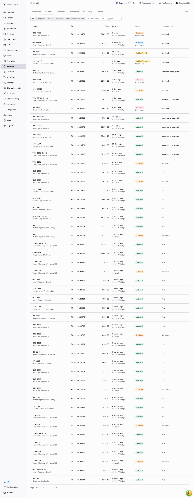
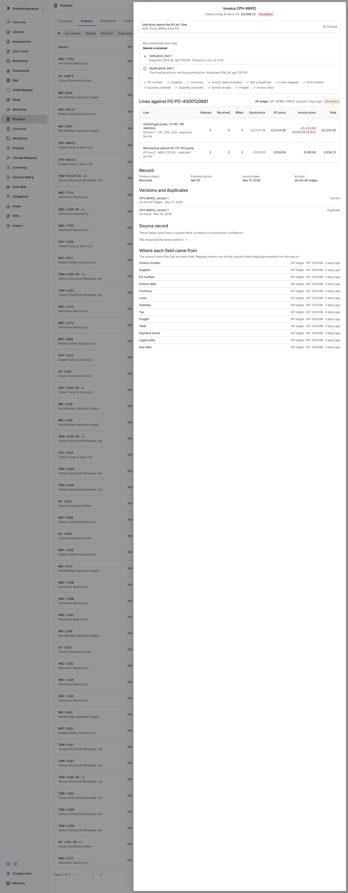
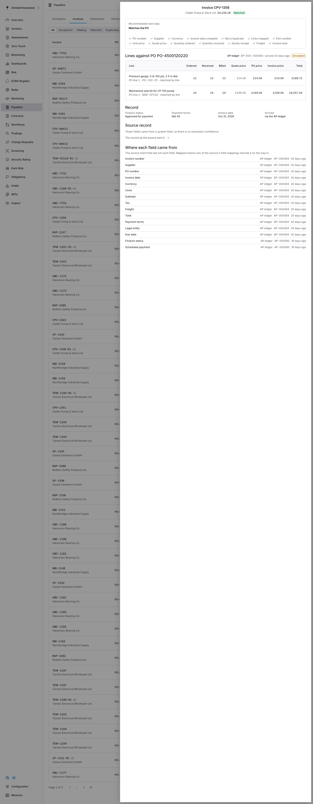
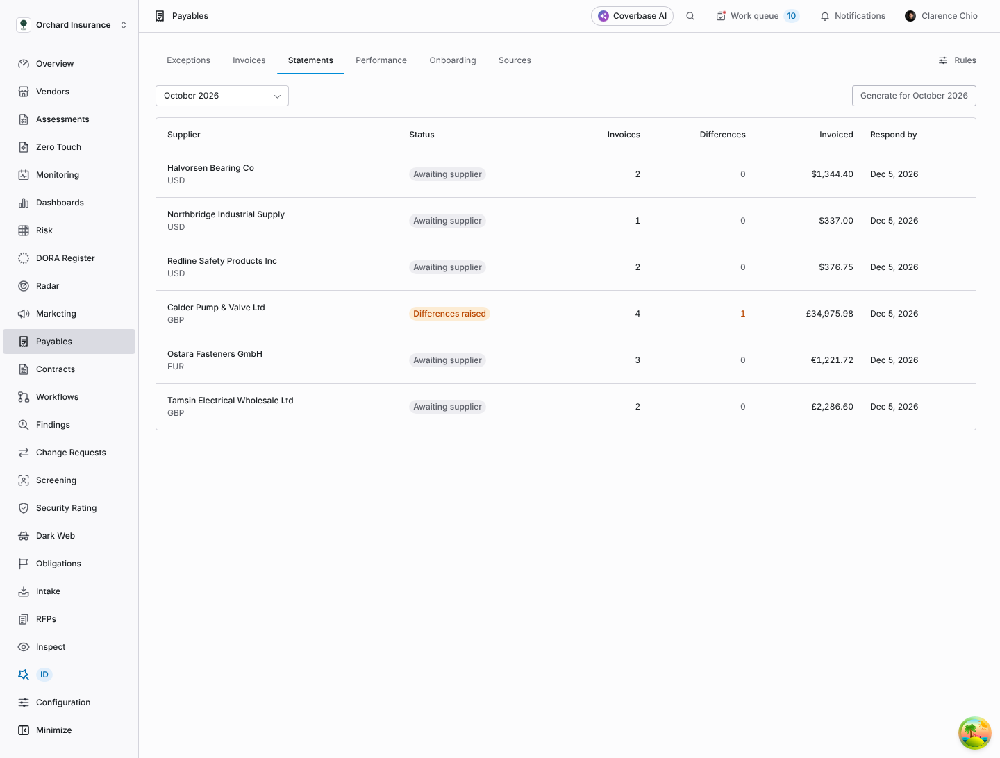
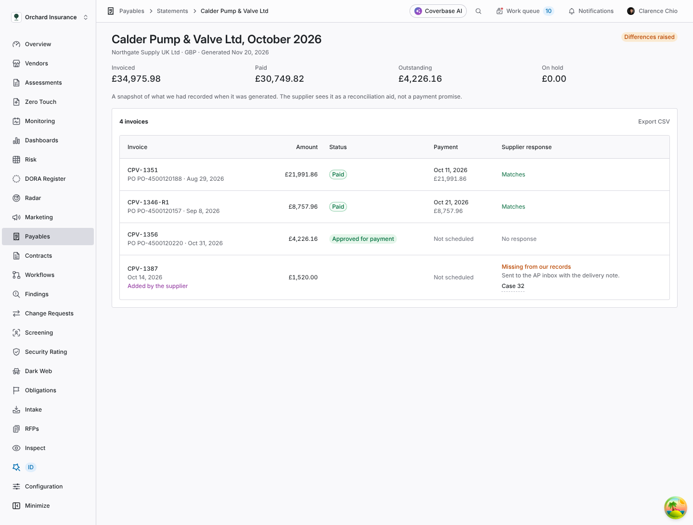
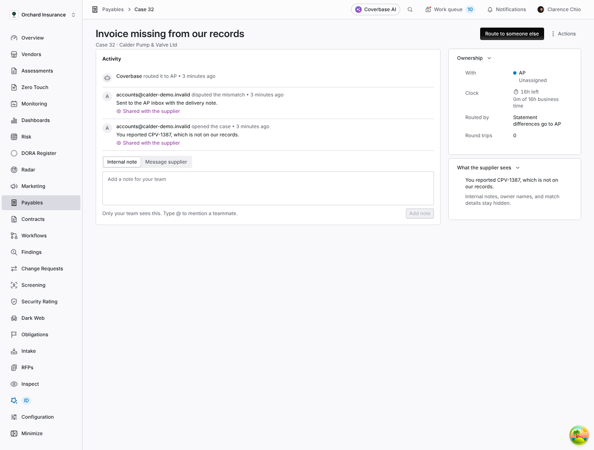

import AgentDirective from "/snippets/agent-directive.mdx";

<AgentDirective />

<Info>
  This guide is part of the [User Guides](/user-guides/overview) collection. For cases opened by a mismatch, see [Working exceptions](/user-guides/payables-exceptions). For what suppliers do on their side of a statement, see [Invoices in the supplier portal](/user-guides/supplier-portal-invoices#checking-your-monthly-statement).
</Info>

The **Invoices** tab lists every invoice from every channel, one row per copy. The **Statements** tab holds the monthly statement each supplier checks against their own records.

The mistake people make most often is reading the **Match** column as payment status. **Match** is Coverbase's check against the PO. **Finance status** is what your ledger reported, and it is the only place payment shows.

## Invoices

Open **Payables › Invoices**.

<Frame caption="The Invoices tab: every invoice from every channel, with its match state and finance status.">
  
</Frame>

Filter with **All**, **Exceptions**, **Waiting**, **Matched** and **Duplicates and replaced**, or search with **Find invoice, PO, or supplier**. Each row shows the invoice number and supplier, a version tag such as **v2** on a corrected invoice, the PO, the total, when and how it arrived (for example **via email**), its match state with a count of open cases, and its finance status.

| Match state | Meaning |
| --- | --- |
| **Not matched yet** | Checks have not run. |
| **Waiting for PO** | The PO it names has not arrived from your procurement system. After 72 hours by default, a **PO not found** case opens. |
| **Waiting for receipt** | The only differences are a missing or short goods receipt (**No goods receipt** or **Billed more than received**). |
| **Matched** | Every check passed, or a person accepted it. |
| **In review** | Checks passed but a line needs a person to confirm it. |
| **Exception** | A check failed and a case is open. |
| **Replaced by correction** | A newer version replaced it. |
| **Duplicate** | Another copy is the invoice. The supplier also sees it as **Duplicate**. |

The finance status is copied from your ledger as sent: received, in matching, on hold, approved for payment, payment scheduled, paid, partly paid, rejected or voided. An invoice your ledger has not booked yet, such as an emailed copy or a portal submission, says it is not booked. Coverbase never works out a finance status itself.

## The invoice drawer

Click an invoice to open its drawer.

<Frame caption="The drawer of an invoice with an open case.">
  
</Frame>

| Section | What it shows |
| --- | --- |
| Open cases | Each open case on the invoice, with its reason and clock. Click one to open it. |
| Recommended next step | The checks, as on the case. |
| **Lines against PO** | Each line with **Ordered**, **Received**, **Billed**, **Quote price**, **PO price**, **Invoice price** and **Total**, and how it was matched. **Not on the PO** and **No PO line found** mark a line that matched nothing. |
| **Record** | **Finance status**, **Payment terms**, **Invoice date** and **Arrived**. |
| **Versions and duplicates** | Every version and copy of the invoice, each marked **Current**, **Replaced** or **Duplicate**, with how and when it arrived. |
| **Source record** | For an invoice read by AI, how sure the reading was of each field it flagged, and **Open PDF**. A field matching uses that was read below 0.8 opens an **Invoice reading to check** case. **The record as the source sent it** shows the raw record, when your rules allow staff to see it. |
| **Where each field came from** | For each field, the source event that last set it and when. **Mapped** means one of the source's field mappings rewrote it on the way in. |

<Frame caption="The drawer of an invoice with no open case.">
  
</Frame>

When your retention rules remove the raw record, the drawer says when it was removed. The fields themselves stay.

## Statements

A statement lists the invoices you have recorded from one supplier for one month, so the supplier can check them against their own records. It is a reconciliation aid, not a promise of payment.

### How statements are generated

- **When.** Every month on the day set under **Monthly statements** (day 1 by default), for the month before. **Generate for** on the **Statements** tab generates the chosen month now. A supplier who already has one gets an amended version only if something on it changed.
- **Per what.** One statement per supplier, per currency, per billing entity. A supplier who bills two of your legal entities in two currencies can get four.
- **Which invoices.** Invoices your organization has recorded and dated in the month, plus, depending on your rules, invoices paid in the month and invoices still open from earlier months. A portal submission or an emailed copy your ledger has not booked is the supplier's document, not yours, and is left out. A corrected invoice replaces the one it corrects once your ledger has booked it.
- **Each line.** Invoice number, PO, date, amount, the status the supplier sees, payment (paid date and amount, an **Expected** date when you show scheduled dates, or **Not scheduled**) and, when you show it, why it is on hold. Credit notes are their own lines.
- **Totals.** **Invoiced**, **Paid**, **Outstanding** and **On hold**, and the credit notes total.

The supplier's portal members are emailed when a statement is issued.

### Amendments

A statement never changes once issued. If something it covers changes while the supplier can still answer (a late invoice, a payment, a credit), Coverbase writes an amended version the next day. It shows as **amended (v2)** with **Amended:** and a sentence on what changed. The earlier version stays as it was sent, and the supplier's answers carry over to lines that did not change. The supplier is emailed again.

### Reading the Statements tab

Open **Payables › Statements** and pick the month. Statements are listed 50 to a page.

<Frame caption="The Statements tab for one month: each supplier's statement, its status and its differences.">
  
</Frame>

| Status | Meaning |
| --- | --- |
| **Awaiting supplier** | Issued. The supplier has not confirmed it or raised a difference. |
| **Confirmed** | The supplier agreed with every line and raised no difference. |
| **Differences raised** | At least one difference is open. |
| **Closed** | Every difference was resolved, or the response window passed. |

Click a row to open the statement. **Export CSV** downloads it as the supplier received it, with their responses.

<Frame caption="A statement with a difference raised: an invoice the supplier says is missing from your records.">
  
</Frame>

### Supplier responses

Suppliers answer line by line in their portal, until **Respond by**.

| Supplier response | What happens |
| --- | --- |
| **Matches** | Nothing. A later **Matches** on a line closes the case an earlier difference on that line opened. |
| **Amount differs** | Opens a **Supplier disputes an amount** case for AP, with the amount in their records. |
| **Status differs** | Opens a **Supplier disputes a status** case for AP, for example when they say they were already paid. |
| **Not their invoice** | Opens a case for AP. |
| **Missing from our records** | The supplier added an invoice the statement lacks. It shows as **Added by the supplier**, and an **Invoice missing from our records** case opens for AP. |

A supplier can also confirm the whole statement, which agrees with every line they did not dispute. When the window closes, unanswered lines stay unanswered. They are never taken as agreement.

### Missing invoice claims

A supplier who sent an invoice you have no record of adds it to the statement with its number, PO, date, amount, how and when they sent it, and optionally the file. Look for it in the email intake, in your ledger and on the **Invoices** tab.

<Frame caption="A missing invoice claim, as a case for AP.">
  
</Frame>

Reply with **Message supplier** on the case. When the invoice is found and booked, resolve the case with **Statement confirmed**, or with what actually happened. The supplier sees "Accounts payable is looking for it" on the line until then.

## Troubleshooting

| Problem | What to check |
| --- | --- |
| An invoice shows **Matched** and not paid | Matching is not payment. Check **Finance status**. |
| A supplier has two statements for one month | They bill in two currencies, or two of your legal entities. |
| An invoice is missing from a statement | It was not booked by your ledger yet, its date is outside the month, or it is settled from an earlier month. Check its finance status and invoice date. |
| **Generate for** created nothing | Every supplier with activity already has a statement for that month, and nothing changed. |
| A statement changed after it was sent | It did not. An amended version was issued alongside it. Both are kept. |
| A supplier says they confirmed but the status is **Differences raised** | A difference they raised on another line is still open. |

## Related

<CardGroup cols={2}>
  <Card title="Working exceptions" icon="inbox" href="/user-guides/payables-exceptions">
    Statement differences are cases too.
  </Card>
  <Card title="How matching works" icon="scale-balanced" href="/user-guides/payables-matching">
    Match states, versions and duplicates.
  </Card>
  <Card title="Setting up Payables" icon="sliders" href="/user-guides/payables-setup#monthly-statements">
    Statement day, response window and what suppliers see.
  </Card>
  <Card title="Invoices in the supplier portal" icon="user" href="/user-guides/supplier-portal-invoices">
    The supplier's side of a statement.
  </Card>
</CardGroup>
