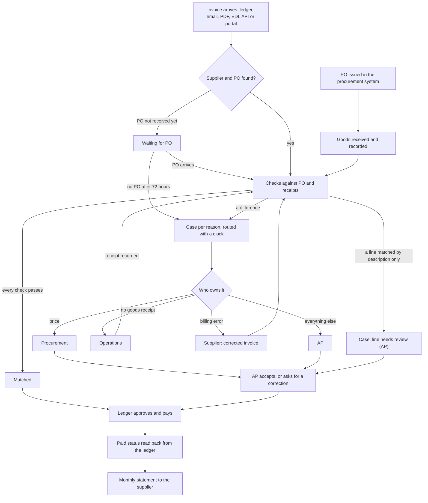

import AgentDirective from "/snippets/agent-directive.mdx";

<AgentDirective />

<Info>
  This guide is part of the [User Guides](/user-guides/overview) collection. It is the first of the Payables guides. Next, [set up Payables](/user-guides/payables-setup), then read [how matching works](/user-guides/payables-matching) and [how to work exceptions](/user-guides/payables-exceptions). The product page is [Payables](/products/payables).
</Info>

Payables follows one supplier invoice from the PO it bills to the moment your ledger reports it paid. Coverbase owns the part in the middle: checking the invoice, turning each difference into an owned case, and keeping the supplier informed. Your procurement system still issues POs and records receipts, and your ERP or AP ledger still books, approves and pays.

The mistake people make most often is treating **Accept invoice** as approval for payment. It records that a person in Coverbase accepted the match. The invoice is approved and paid in your ledger, by your AP team, as before.

## Where each record comes from

| Record | Comes from | What Coverbase does with it |
| --- | --- | --- |
| Purchase orders and PO lines | Your procurement system | Reads them. Never writes back. |
| Goods receipts | Your procurement system | Reads them. Never writes back. |
| Booked invoices, finance status, payment dates, payments | Your ERP or AP ledger | Reads them. Never initiates a payment or edits a financial record. |
| Invoices forwarded by email or uploaded as a PDF | Your intake address, or the intake API | Reads them with AI, then checks them like any invoice. They wait for your ledger to book them. |
| Invoices sent as EDI or JSON | The intake API | Checks them like any invoice. They wait for your ledger to book them. |
| Invoices and corrected invoices from suppliers | The supplier portal | Checks them at once, so the supplier and AP see whether they would pass. They wait for your ledger to book them. |
| Match results, cases, clocks, statements, scorecards, onboarding waves | Coverbase | Owns them. |

Every synced field keeps its source and when it was last synced. The screens print the source beside the value, so you can tell a figure your ledger sent from one Coverbase worked out.

## The flow

Those are the default owners. Your routing rules decide them, and the overdue path sends a case to a manager. See [Routing](/user-guides/payables-setup#who-owns-each-exception).

## Who does what

<CardGroup cols={2}>
  <Card title="AP" icon="calculator">
    Works the **Exceptions** tab. Accepts invoices that are right despite a difference, asks suppliers for corrected invoices, decides possible duplicates and confirms lines matched by description. Answers statement differences and scorecard disputes. Approves and pays in your ledger.
  </Card>
  <Card title="Procurement" icon="cart-shopping">
    Owns price differences by default. Decides whether the invoiced price was agreed, or asks the supplier to reissue at the PO price. Amends the PO in your procurement system when the PO was wrong.
  </Card>
  <Card title="Operations" icon="truck-ramp-box">
    Owns missing goods receipts by default. Records the receipt in your procurement system. When it arrives, Coverbase checks the invoice again and closes the case by itself.
  </Card>
  <Card title="Manager" icon="user-tie">
    Receives cases whose clock ran out, and cases above an amount if your rules say so. May accept matches above AP's limit, and can be the second person who signs off when your rules require one. Reads the **Performance** tab.
  </Card>
  <Card title="Supplier" icon="building">
    Sees their invoices and why one is on hold in the supplier portal. Sends corrected invoices, replies on a mismatch, checks the monthly statement and can dispute a scorecard figure. Never sees internal notes, owner names or match details.
  </Card>
  <Card title="Admin" icon="sliders">
    Connects sources, maps fields, names your procurement system and AP ledger under **Source names**, and sets tolerances, routing, clocks, what suppliers see and onboarding requirements on the **Payables rules** page.
  </Card>
</CardGroup>

The people behind each role are set under **Team roles** on the **Payables rules** page. A case sent to a role with one person goes straight to them. With several, it waits for one of them to pick it up.

## The tabs

Open **Payables** in the left navigation. **Rules**, at the top right, opens the **Payables rules** page.

| Tab | What it is for | Guide |
| --- | --- | --- |
| **Exceptions** | Every case, filtered to what waits on your team, on suppliers, or is resolved. | [Working exceptions](/user-guides/payables-exceptions) |
| **Invoices** | Every invoice from every channel, with its match state and finance status. | [Invoices and statements](/user-guides/payables-invoices-and-statements) |
| **Statements** | Monthly supplier statements and their responses. | [Invoices and statements](/user-guides/payables-invoices-and-statements#statements) |
| **Performance** | Team metrics and supplier scorecards. | [Performance and scorecards](/user-guides/payables-performance) |
| **Onboarding** | Supplier onboarding waves. | [Supplier onboarding](/user-guides/payables-supplier-onboarding) |
| **Sources** | Where data comes from, its health, field mappings and every inbound and outbound event. | [Setting up Payables](/user-guides/payables-setup) |

## What people are told, and when

Notifications go to the person who owes the next step, never to a whole team, and never to the person who just acted.

| Notification | Who receives it | When |
| --- | --- | --- |
| A case was assigned to you | The new assignee | A case opens, is routed or is assigned to them |
| A clock is running out | The assignee, or everyone in the owner role when nobody is assigned | The clock passes its reminder point (75% by default) |
| A case escalated | The new assignee, the clock's escalation people, and everyone in the escalation role | The clock runs out, or someone escalates by hand |
| A supplier responded | The assignee | The supplier replies, disputes or sends a corrected invoice |

Suppliers receive an email, addressed to their portal's members, once when a case opens with them as its owner, when you ask for a corrected invoice or a document, when their own clock reaches its reminder point and again when it runs out, and when a statement or an amended statement is issued. Each email carries only what the portal already shows them and a link to it. Nothing is emailed to suppliers unless the **Invoices and statements** section of your supplier portal is on.

## Troubleshooting

| Problem | What to check |
| --- | --- |
| An invoice shows **Matched** but the supplier says it is not paid | Matching is Coverbase's check. Payment is your ledger's. Look at **Finance status** on the invoice. |
| An emailed invoice shows **Duplicate** | Expected once your ledger books the same invoice. The booked copy becomes the invoice and the emailed copy is linked to it. See [Duplicates](/user-guides/payables-matching#duplicates-credit-notes-and-corrected-invoices). |
| An invoice sits on **Waiting for PO** | The PO it names has not arrived from your procurement system. It is checked as soon as it does. After 72 hours by default, a **PO not found** case opens for AP. |
| A case went to the wrong team | Your routing rules decide owners, first match wins. See [Who owns each exception](/user-guides/payables-setup#who-owns-each-exception). |
| Nobody was notified about a new case | The owner role has several people or none, so nobody is assigned. Set one person under **Team roles**, or pick the case up from the queue. |

## Related

<CardGroup cols={2}>
  <Card title="Payables" icon="file-invoice-dollar" href="/products/payables">
    The product page: what Payables does and its limits.
  </Card>
  <Card title="Setting up Payables" icon="sliders" href="/user-guides/payables-setup">
    Sources, mappings and rules.
  </Card>
  <Card title="How matching works" icon="scale-balanced" href="/user-guides/payables-matching">
    Every check and every exception reason.
  </Card>
  <Card title="Invoices in the supplier portal" icon="user" href="/user-guides/supplier-portal-invoices">
    What your suppliers see.
  </Card>
</CardGroup>
