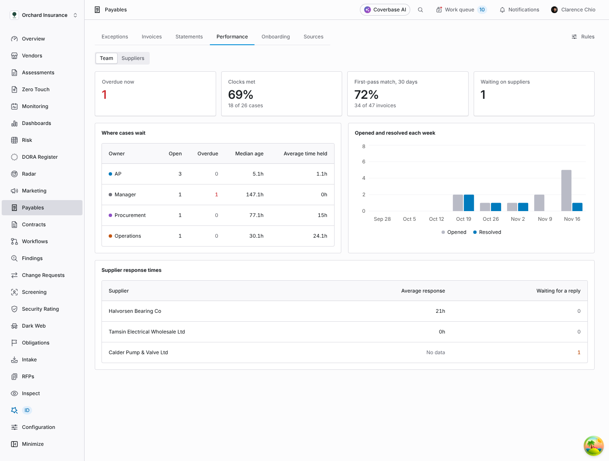
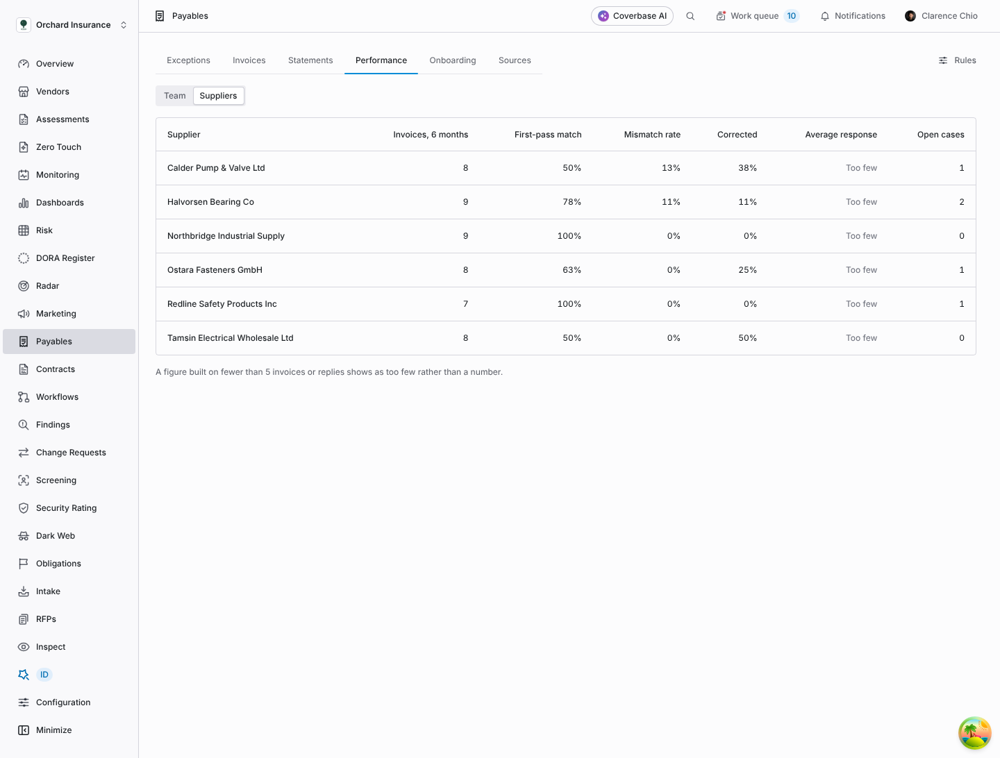
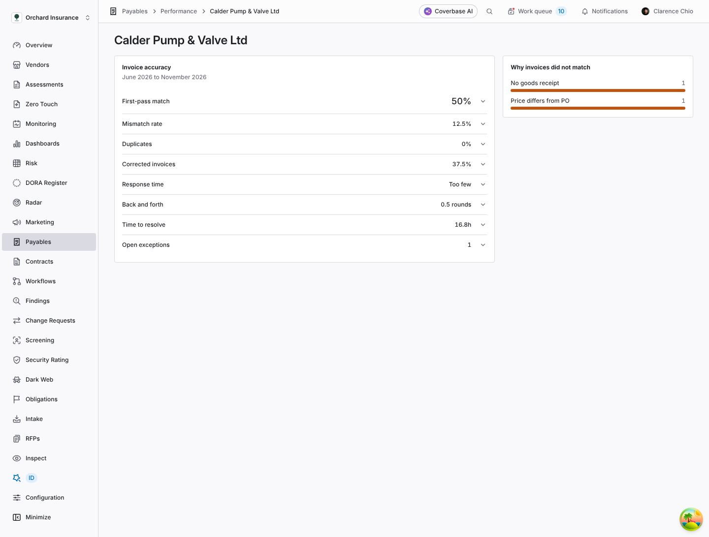

import AgentDirective from "/snippets/agent-directive.mdx";

<AgentDirective />

<Info>
  This guide is part of the [User Guides](/user-guides/overview) collection. For the cases behind these figures, see [Working exceptions](/user-guides/payables-exceptions). For how an invoice passes or fails, see [How matching works](/user-guides/payables-matching).
</Info>

The **Performance** tab answers two questions: where your own team's cases wait, and how accurately each supplier invoices. Every figure is built from recorded invoices and case history, and every figure opens onto the records behind it.

The mistake people make most often is holding a supplier to a figure that was not theirs. A missing goods receipt and an invoice that arrived before its PO are your side's delay, so neither counts against the supplier's first-pass match.

## Team

Open **Payables › Performance**. **Team** opens first.

<Frame caption="The team view: what is overdue, how many clocks were met, where cases wait and how fast suppliers reply.">
  
</Frame>

| Figure | What it counts |
| --- | --- |
| **Overdue now** | Open cases past their clock. Click to open them in the queue. |
| **Clocks met** | Resolved invoice exceptions whose clock stayed within its target, out of resolved invoice exceptions that had a clock. A case handed to a new owner is judged on the clock it was resolved under. |
| **First-pass match, 30 days** | Invoices that matched their PO on the first check, out of invoices checked in the last 30 days. Click to see them. |
| **Waiting on suppliers** | Open cases where the supplier owes the next step. Click to open them. |
| **Where cases wait** | Per owner role: **Open**, **Overdue**, **Median age** and **Average time held**. Click a row to open that owner's cases. |
| **Opened and resolved each week** | Cases opened and cases resolved, week by week. |
| **Supplier response times** | Per supplier: **Average response** to requests sent through Coverbase, and how many are **Waiting for a reply**. |

Clock figures count only cases Coverbase put a clock on. When some cases are left out, a note under the figures says how many, so you know the size of what was measured.

## Suppliers

**Suppliers** lists every supplier with invoices.

<Frame caption="The suppliers view: invoice accuracy per supplier over six months.">
  
</Frame>

Columns are **Invoices, 6 months**, **First-pass match**, **Mismatch rate**, **Corrected**, **Average response** and **Open cases**. A figure built on fewer than 5 invoices or replies shows **Too few** rather than a number. Click a supplier to open their scorecard.

## A supplier's scorecard

The scorecard covers the last six months. Each figure opens to show its definition, its monthly trend, the count it is built on, and **Show the invoices** for the records behind it.

<Frame caption="One supplier's invoice scorecard, with why their invoices did not match.">
  
</Frame>

### Metric definitions

| Metric | Definition | Left out |
| --- | --- | --- |
| **First-pass match** | Invoices that matched their PO on the first check, out of invoices checked. | Invoices waiting for a PO or a goods receipt are counted once that arrives, and a missing receipt does not count as a miss. A corrected invoice is judged by the original it replaced. Duplicates and invoices under dispute. |
| **Mismatch rate** | Invoices that opened an exception, out of invoices checked. | Exceptions that are not the supplier's error, such as a missing goods receipt or a PO you have not sent. Duplicates and invoices under dispute. |
| **Duplicates** | Invoices received more than once, by any channel, out of invoices received. | Invoices under dispute. |
| **Corrected invoices** | Invoices replaced by a corrected version, out of invoices received. | Invoices under dispute. |
| **Response time** | Median business hours from a request to the supplier to their reply. | Requests not sent through Coverbase. |
| **Back and forth** | Average number of times a resolved case went to the supplier and back. | Open cases. |
| **Time to resolve** | Median business hours from a case opening to its resolution. | Open cases. |
| **Open exceptions** | Cases still open for this supplier's invoices. | |

**Why invoices did not match** counts invoices per exception reason. It lists every reason, including ones that do not count against the supplier, so you can see your own side's share too.

**Delivery performance** (on time, in full, quality) appears when your procurement system sends the supplier's delivery scorecard. Coverbase shows it as sent, labeled with its source, and does not calculate or change it.

Suppliers see the same scorecard in their portal when **Show the invoice scorecard** is on, with a link to dispute each figure. They never see other suppliers.

## Disputes of a metric

A supplier who thinks a figure is wrong disputes it from their portal for one month. They say why, can name the invoices they think were counted wrongly, and can attach files.

- A **Scorecard dispute** case opens for AP by default.
- The invoices they named leave every figure on their scorecard until the case is resolved.
- That month's figure shows "Some invoices are under review after a dispute", on your scorecard and theirs.
- A metric can have one open dispute per month.

Work the case like any other. Resolve it with **Scorecard figure corrected** when the figure was wrong and you fixed the record behind it, or **Scorecard figure upheld** when it stands. Reply to the supplier with **Message supplier** so they see why. Their **Your challenges** list shows the dispute as **In review**, then **Answered**.

## Troubleshooting

| Problem | What to check |
| --- | --- |
| A figure shows **Too few** | It is built on fewer than 5 invoices or replies. |
| **Clocks met** looks low after go-live | Only cases with a clock are measured. Early cases routed to a role with no clock are left out. |
| A supplier's first-pass match dropped after a missing receipt | It should not. A missing receipt is not counted as a miss. Open the figure and **Show the invoices** to see which invoices counted. |
| A figure changed after a dispute | The invoices the supplier named are left out until the case is resolved. |
| Delivery performance is missing | Your procurement system has not sent a delivery scorecard for that supplier. |

## Related

<CardGroup cols={2}>
  <Card title="Working exceptions" icon="inbox" href="/user-guides/payables-exceptions">
    The cases behind the team figures.
  </Card>
  <Card title="How matching works" icon="scale-balanced" href="/user-guides/payables-matching">
    What counts as a first-pass match.
  </Card>
  <Card title="Setting up Payables" icon="sliders" href="/user-guides/payables-setup#response-clocks">
    The clocks behind clocks met.
  </Card>
  <Card title="Invoices in the supplier portal" icon="user" href="/user-guides/supplier-portal-invoices#your-invoice-scorecard">
    The supplier's view of the scorecard.
  </Card>
</CardGroup>
