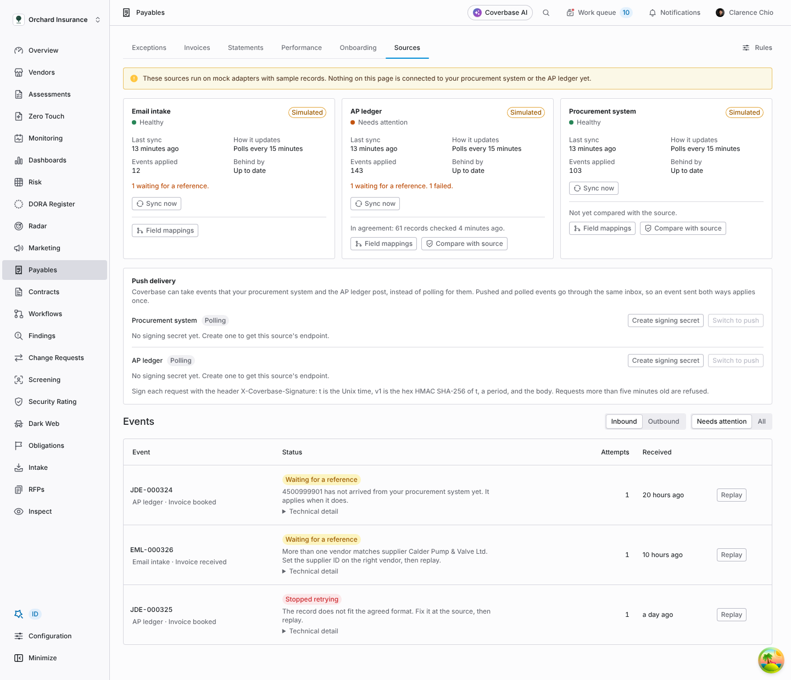
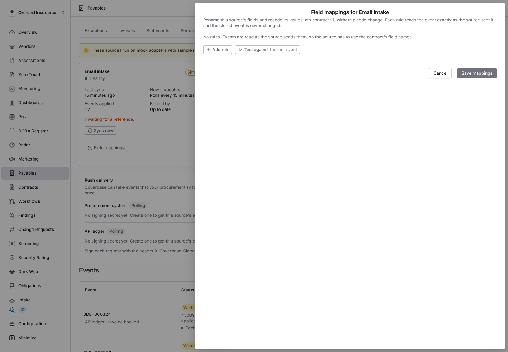
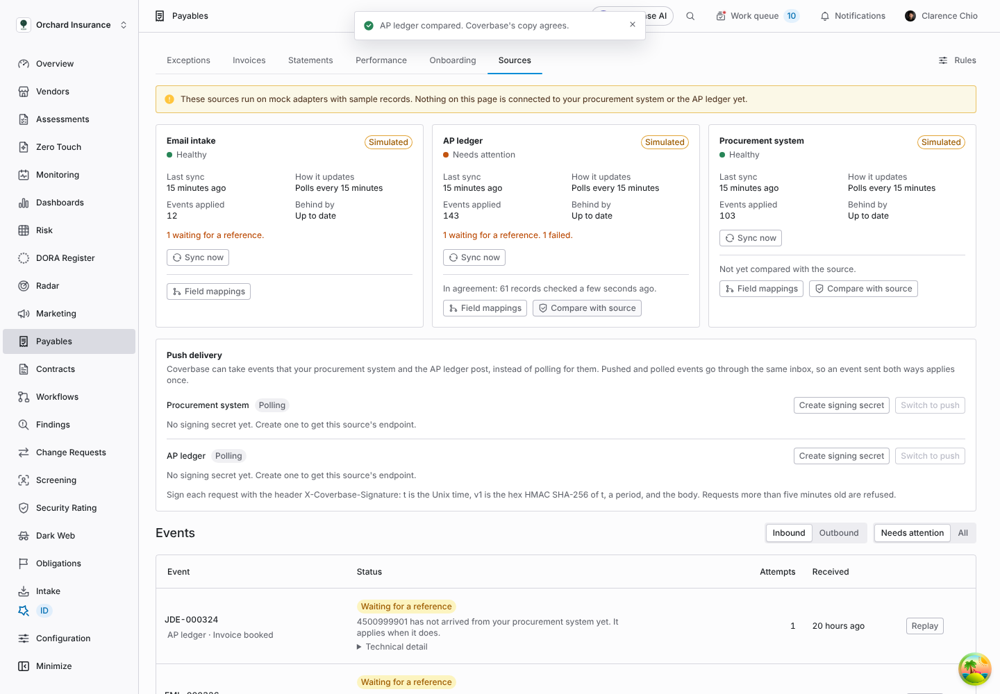
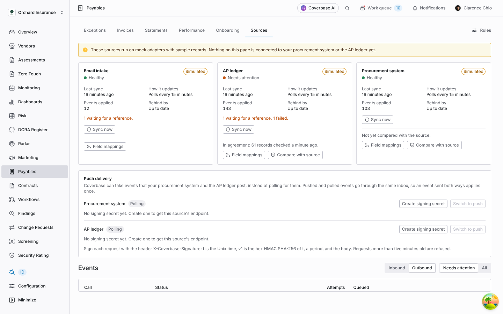
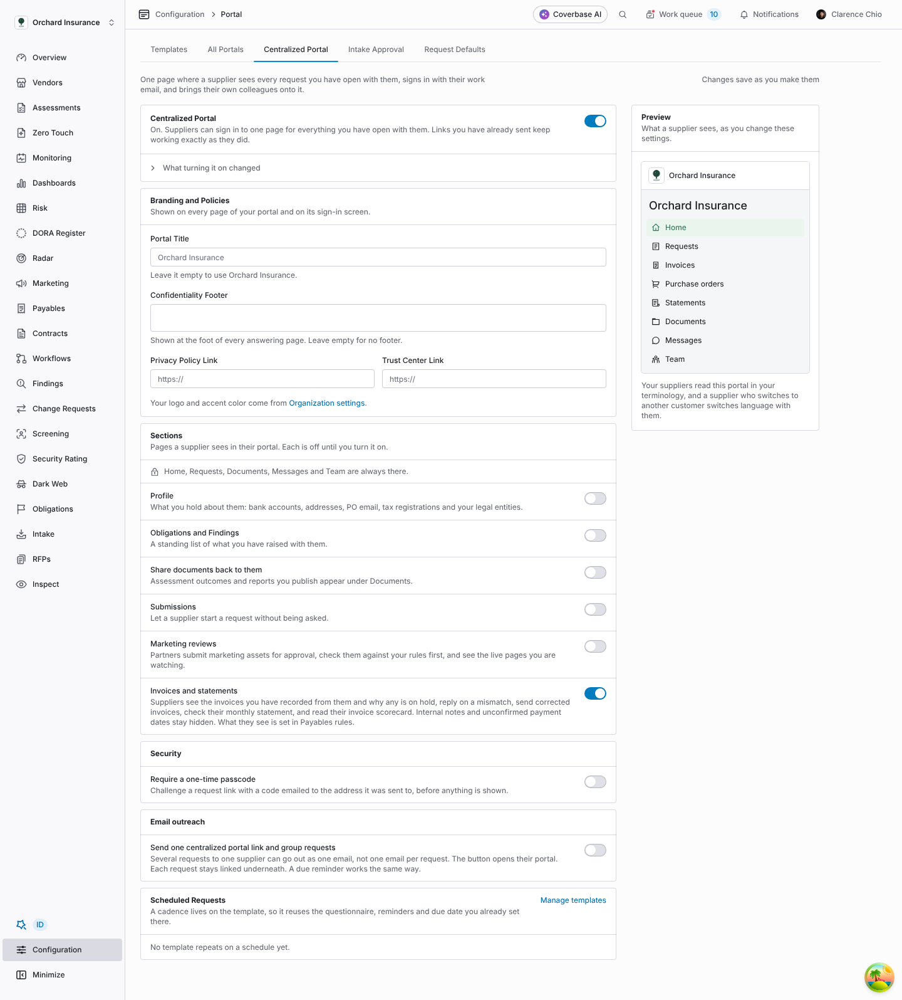
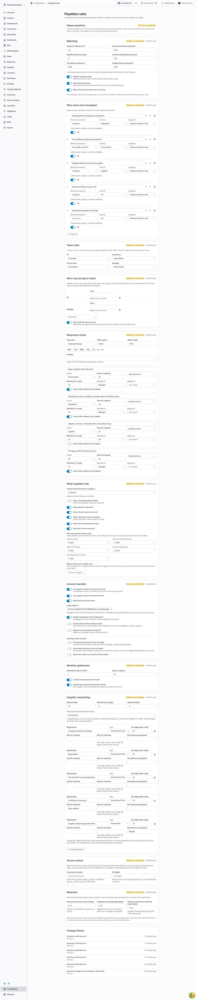
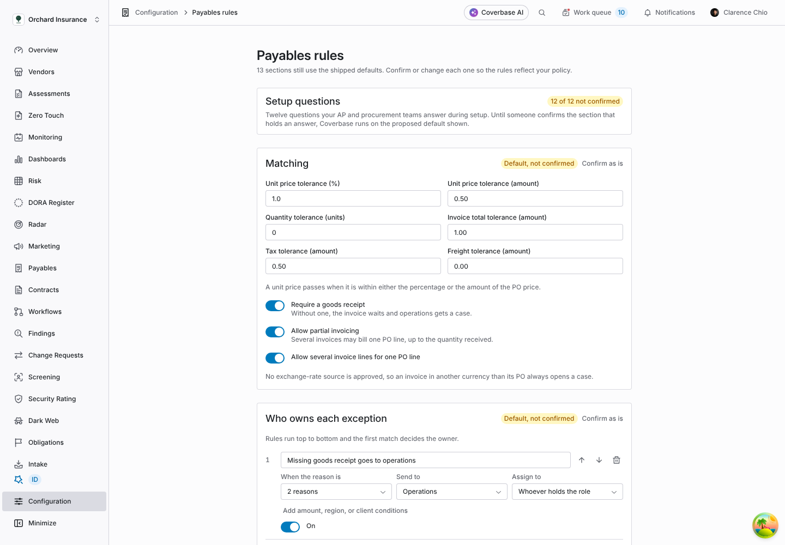
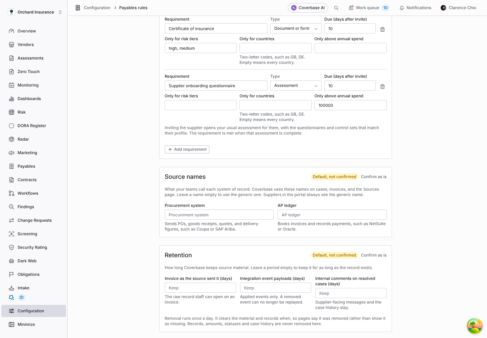

import AgentDirective from "/snippets/agent-directive.mdx";

<AgentDirective />

<Info>
  This guide is part of the [User Guides](/user-guides/overview) collection. Read [How Payables works](/user-guides/payables-overview) first. After setup, see [How matching works](/user-guides/payables-matching) for what your tolerances do, and [Supplier onboarding](/user-guides/payables-supplier-onboarding) to bring suppliers in.
</Info>

Setup has two halves. The **Sources** tab says where invoices, POs and receipts come from and whether each feed is healthy. The **Payables rules** page sets how Coverbase checks invoices and who owns each difference. Changing the rules needs permission to change organization settings.

The mistake people make most often is going live on the shipped defaults. Every section of the rules page starts with values Coverbase picked as a reasonable starting point, marked **Default, not confirmed**. They are not your policy until someone confirms or changes them.

## Sources

Open **Payables › Sources**. Each source has a card with its health, when it last synced, how it updates, how many events it has applied and how far behind it is. **How it updates** reads **Polls every** followed by that source's own interval in minutes, or **Sends events** for a source that pushes. Cards and events use the names your teams set under [Source names](#source-names).

<Frame caption="The Sources tab: one card per source, push delivery settings, and every event received.">
  
</Frame>

| Source | What it sends | How it arrives |
| --- | --- | --- |
| Your procurement system | Issued, revised and closed POs with their lines, goods receipts, and the supplier's delivery scorecard (on time, in full, quality) | Polled, or pushed to Coverbase |
| Your ERP or AP ledger | Booked and revised invoices, finance status changes, scheduled payment dates and payments | Polled, or pushed to Coverbase |
| Email intake | Invoices that suppliers or your AP team forward to your intake address | Read by AI from the email and its attachments |
| Intake API | Invoices as JSON, X12 810 EDI documents, or PDF documents | Posted by an integrator or a service account |
| Supplier portal | Invoices and corrected invoices that suppliers submit | Sent from the portal |

Your Coverbase team connects the procurement system and the ledger with you. Once connected, each appears here as a card.

### Simulated and connected sources

A card marked **Simulated** runs on sample records from a test adapter. It is not connected to your live system, and a banner at the top of the tab says so. Use a simulated source to try your rules, routing and clocks before go-live. Data from a simulated source is labeled **Simulated** wherever it appears, including on cases. A connected source has no badge.

### Health and events

A card reads **Healthy**, **Behind**, **Failing**, **Off**, **Not started** or **Needs attention**. Under it, a line counts the events waiting for a reference and the events that failed. **Sync now** pulls from the source straight away. Polled sources are also pulled on their own schedule.

The **Events** table lists every event, inbound or outbound, 50 to a page. **Needs attention** shows only the ones that did not apply. Each row says why in plain words, with the raw error under **Technical detail**:

| Status | What it means | What to do |
| --- | --- | --- |
| **Applied** | Written to Coverbase. | Nothing. |
| **Already received** | The same event arrived twice. It was recorded once. | Nothing. |
| **Older than our copy** | Coverbase already holds a newer update of the record. The event was stored and skipped. | Nothing. |
| **Waiting for a reference** | It names a supplier, PO or invoice that has not arrived yet. It applies when it does. | Usually nothing. If it names a supplier, link the supplier ID to the right vendor. |
| **Waiting for a reference**, with "More than one vendor matches" | Two vendors share the name. Coverbase never picks one. | Set the supplier ID on the right vendor, then **Replay**. |
| **Failed, will retry** | The source did not answer. Coverbase retries with growing gaps. | Nothing, unless it keeps failing. |
| **Waiting for a reference**, with "It conflicts with a record we already hold" | The event would overwrite a record Coverbase holds, such as a booked invoice changed without being sent as a revision. | Check the source, then **Replay**. |
| **Stopped retrying** | The event does not fit the agreed format, or the source failed to answer five times. | Fix it at the source, then **Replay**. |

Click an event to see the record it wrote, the fields it set, and the event exactly as the source sent it.

### Field mappings

Your systems will not name their fields the way Coverbase expects. **Field mappings** on a source card opens the rules that rename its fields and recode its values, without a code change.

<Frame caption="Field mappings for one source. With no rules, events are read as the source sends them.">
  
</Frame>

<Steps>
  <Step title="Add a rule">
    Click **Add rule**. **Read from** is a dot path in the event as sent, such as `Header.InvNo`. Put `[]` after a list, as in `Lines[].UOM`. Leave it empty to recode the field in place. **Write to** is the Coverbase field the value goes into.
  </Step>
  <Step title="Recode values">
    **Value map** takes one conversion per line, written `code = value`, such as `EA = each`. Supplier aliases work the same way, which is how you map a ledger's supplier number to the supplier ID your procurement system uses. A value with no line passes through unchanged. **Default when empty** fills a missing value.
  </Step>
  <Step title="Limit and enforce">
    **Applies to** limits a rule to some event types. **Refuse the event when this field is empty** stops an event with no value and sends it to **Stopped retrying** with the rule named.
  </Step>
  <Step title="Test, then save">
    **Test against the last event** shows the last stored event as sent and as Coverbase would read it, and lists anything ingestion would refuse. Nothing is saved or applied. **Save mappings** applies the rules to new events and to any event you replay.
  </Step>
</Steps>

Every rule reads the event as the source sent it, so rules never see each other's output. The stored event is never changed.

### Comparing with the source

A missed event leaves Coverbase's copy quietly wrong. **Compare with source** asks the procurement system or the ledger for its records as they stand and compares them field by field. It only reads the source.

<Frame caption="After a comparison, the card says whether Coverbase's copy agrees with the source.">
  
</Frame>

Differences are listed as **Missing in Coverbase**, **Missing at the source** or **Fields differ**. **Re-pull** fetches a drifted record's events again through the same inbox, so it is applied and audited like any delivery. A record missing at the source is never deleted in Coverbase: look it up in the source.

### Push delivery

Your procurement system and ledger can post events to Coverbase instead of waiting to be polled. Pushed and polled events go through the same inbox, so an event sent both ways applies once.

1. Click **Create signing secret** for the source. Copy the secret and the endpoint and give them to the team that runs the source. Coverbase shows the secret once.
2. That team signs each request with the `X-Coverbase-Signature` header: `t` is the Unix time, `v1` is the hex HMAC SHA-256 of `t`, a period, and the body. Requests more than five minutes old are refused. A request can carry one event or up to 500.
3. Click **Switch to push**. **Switch to polling** goes back.

**Rotate secret** issues a new secret. Requests signed with the old one are refused at once, and the endpoint stays the same.

### Outbound calls

Coverbase sends three things to other systems, each off until you turn it on under **Invoice channels**: a match decision to your ledger, a case note to the PO in your procurement system, and portal invoices handed to your ledger to book. None writes a field the target owns.

<Frame caption="Outbound calls, with their delivery status.">
  
</Frame>

Each call is queued in the same step as the decision it reports, so a decision that did not save is never sent, and the same decision is sent once. A failed call retries with growing gaps for up to six attempts, then shows **Stopped retrying** with a **Replay** button. A call whose channel you turned off after it was queued shows **Not sent**. A delivered decision adds an entry to the case's activity. A portal invoice handed to the ledger counts as booked only when the ledger sends it back as booked.

### Email intake

Turn on **Read invoices sent by email** under **Invoice channels**, then save the rules once to get your **Intake address**. Coverbase assigns it, and reads only mail sent to it. Suppliers or your AP team forward invoices there.

Each message and the text of its attachments are stored first, keyed by the message, so a message delivered twice is read once. AI then reads the invoice into fields and lines and passes it through the same checks as any invoice. If the reading fails three times, the message shows **Stopped retrying** in the events table, under the email intake source. **Replay** hands it back for another try. See [Reading emails and PDFs](/user-guides/payables-matching#reading-emails-and-pdfs-with-ai) for what the reading does and how its output is checked.

### The intake API

Integrators and service accounts can send invoices straight to Coverbase:

- `POST /v1/supplier-invoices/intake/invoices` with `Content-Type: application/json` and a list of invoices, each with your own event ID. The event ID makes a resend harmless.
- The same address with `Content-Type: application/edi-x12` takes an X12 810 interchange. Each transaction set is one invoice. A document whose line count or segment count does not add up is refused rather than read partly.
- `POST /v1/supplier-invoices/intake/documents` takes a PDF. It is kept as evidence and read by the same AI as forwarded email. The same file uploaded twice is read once.

None of these books an invoice. Each waits for your ledger to book it, and Coverbase links the two copies.

### The supplier portal

Suppliers see Payables in their portal once you turn on **Invoices and statements** under **Configuration › Portal › Centralized Portal › Sections**. Without it, they see none of it and are emailed nothing about invoices.

<Frame caption="The Invoices and statements section in the centralized portal settings.">
  
</Frame>

What suppliers see inside it, and what they may send, is set under **What suppliers see** on the rules page. See [Centralized supplier portal](/user-guides/centralized-supplier-portal) for the portal itself.

## The Payables rules page

Click **Rules** at the top right of **Payables**, or go to **Configuration › Payables rules**. Each section saves with **Save rules** at the foot of the page. A section still on the shipped defaults shows **Default, not confirmed**. **Confirm as is** marks it as your policy without changing it. **Change history** at the end lists who saved or confirmed which section, by version.

<Frame caption="The Payables rules page, every section on one page.">
  
</Frame>

### The setup checklist

**Setup questions** at the top of the page lists twelve questions your AP and procurement teams answer during setup, such as how invoices reach your AP ledger, which statuses suppliers may see, and your matching tolerances. The questions name your own systems, using the names under [Source names](#source-names). Each shows the default Coverbase runs on and **Set in** the section that holds it. It carries a **Proposed default** badge until someone confirms that section, then **Confirmed by your team**. The count at the top reads "... of 12 not confirmed" until every section holding an answer is confirmed.

<Frame caption="The setup checklist: each open decision, the default in use and where to set it.">
  
</Frame>

Work down the list with your AP lead. A question marked "Not a setting. Answered by connecting each source on the Sources page." is answered on the **Sources** tab.

### Source names

**Source names** sets what your teams call each system of record, so cases, invoices and the **Sources** tab use your words:

| Field | Default name | What it names |
| --- | --- | --- |
| **Procurement system** | Procurement system | The system that sends POs, goods receipts, quotes and delivery figures, such as Coupa or SAP Ariba. |
| **AP ledger** | AP ledger | The system that books invoices and records payments, such as NetSuite or Oracle. |

Use 60 characters or fewer. Leave a name empty to use the generic one. Suppliers in the portal always see the generic name.

<Frame caption="Source names on the Payables rules page.">
  
</Frame>

### Matching

| Setting | Default | What it does |
| --- | --- | --- |
| **Unit price tolerance (%)** and **Unit price tolerance (amount)** | 1% and 0.50 | A unit price passes when it is within the percentage of the PO price, or when the difference across the whole line (difference times quantity billed) is within the amount. |
| **Quantity tolerance (units)** | 0 | Units an invoice may bill beyond what was ordered or received. |
| **Invoice total tolerance (amount)** | 1.00 | How far the invoice total may be from its lines plus tax and freight. |
| **Tax tolerance (amount)** | 0.50 | How far tax may be from the tax rate on the PO. |
| **Freight tolerance (amount)** | 0.00 | How much freight may exceed the PO's freight allowance. |
| **Require a goods receipt** | On | On is 3-way matching: the invoice waits for a receipt and operations gets a case. Off is 2-way matching against the PO alone. |
| **Allow partial invoicing** | On | Several invoices may bill one PO line, up to the quantity ordered. Off means each invoice bills the full quantity. |
| **Allow several invoice lines for one PO line** | On | Off sends a second invoice line on the same PO line to a reviewer. |

No exchange-rate source is approved, so an invoice in a different currency from its PO always opens a case, and prices in different currencies are never compared.

Two values are not on this page. An invoice that cites a PO waits 72 hours for it before a **PO not found** case opens. A field read by AI with a confidence below 0.8 holds the invoice for AP. See [How matching works](/user-guides/payables-matching#the-po-is-found).

### Who owns each exception

Routing rules run top to bottom, and the first rule that matches decides the owner. A rule matches on **When the reason is**, and optionally on amount, region or client under **Add amount, region, or client conditions**. **Send to** picks the owner role. **Assign to** picks a person, or **Whoever holds the role**. Switch a rule off with **On** rather than deleting it.

| Default rule | Reasons | Owner |
| --- | --- | --- |
| Missing goods receipt goes to operations | **No goods receipt**, **Billed more than received** | Operations |
| Price difference goes to procurement | **Price differs from PO** | Procurement |
| Supplier billing errors go to the supplier | **Billed against the wrong PO**, **Billed more than ordered**, **Part differs from PO**, **Currency differs from PO**, **Tax or freight differs** | Supplier |
| Statement differences go to AP | **Invoice missing from our records**, **Supplier disputes an amount**, **Supplier disputes a status**, **Scorecard dispute** | AP |
| Everything else goes to AP triage | Any reason | AP |

The last rule catches **PO not found**, **No PO number on the invoice**, **PO is closed**, **Invoice data incomplete**, **Invoice reading to check**, **Line needs review** and **Possible duplicate**. Keep a rule with no reasons at the bottom. Without one, a reason no rule names goes to AP anyway.

A case that opens routed to the supplier emails the supplier's portal members once, when it opens, with the sentence they see on the invoice.

### Team roles

**Team roles** says who holds AP, Operations, Procurement and Manager. A case sent to a role with one person is assigned to them and they are notified. With several people, the case waits for one of them to pick it up, and clock reminders go to all of them.

### Who may accept a match

People in the roles listed here may click **Accept invoice**, each up to the amount under **Up to**. Blank means no limit. The defaults are AP and Manager with no limit. Until anyone is named under **Team roles**, the permission to edit vendors alone decides who may accept. Once roles are set, someone outside them sees **Your role may not accept matches**.

**Show staff the source record** lets reviewers open each invoice exactly as the ledger or the email reading produced it.

### Response clocks

Set your office hours first: **Time zone**, **Office opens**, **Office closes**, **Working days** and **Holidays** (dates as `YYYY-MM-DD`, separated by commas). Then each clock:

| Field | What it does |
| --- | --- |
| **Owner** | The role the clock applies to. A case uses the first clock for its owner whose **Applies to** includes its reason, else that owner's clock with no reasons listed. |
| **Hours to respond** | The target. |
| **Counts** | **Business hours** on your calendar, or **Calendar hours**, where nights and weekends count. |
| **Remind at (% used)** | When the owner is reminded. |
| **Escalate to** | Where the case goes when the clock runs out. |
| **Pause while waiting on the supplier** | Stops the clock while the supplier owes the next step. |

| Default clock | Owner | Target | Escalates to |
| --- | --- | --- | --- |
| Buyer responds within 48 hours | Procurement | 48 calendar hours | Manager |
| Operations records or explains a receipt within 24 business hours | Operations | 24 business hours | Manager |
| Supplier corrects or responds within 72 business hours | Supplier | 72 business hours, never paused | AP |
| AP triages within 16 business hours | AP | 16 business hours | Manager |

The default office hours are Monday to Friday, 08:00 to 17:00 Central time. A role with no clock shows **No clock** on its cases. See [Clocks](/user-guides/payables-exceptions#clocks-pauses-and-escalation) for how a clock runs.

### What suppliers see

| Setting | Default |
| --- | --- |
| **Finance statuses shown to suppliers** | Received, approved for payment, paid, partly paid and rejected. A status left out shows as **In review**. |
| **Show scheduled payment dates** | Off. When on, a date shows as **Expected**, never as a promise. |
| **Show payment references** | On |
| **Show why an invoice is on hold** | On |
| **Show which team owns a question** | On. Shows the team, never a person's name. |
| **Show PO lines beside the invoice** | On |
| **Show the invoice scorecard** | On |
| **What each portal role may send** | Owners and contributors may both send invoices, send corrected invoices, reply on invoices, answer statements and challenge the scorecard. A role left out does not see the action. |
| **Billing entities each supplier sees** | No limits. Limit a supplier to the legal entities they bill. Records with no entity stay visible. |

Internal notes, owner names and match details never reach a supplier, whatever you set here.

### Invoice channels

| Setting | Default | What it does |
| --- | --- | --- |
| **Let suppliers submit invoices in the portal** | Off | A submitted invoice is checked, then waits for your ledger to book it. |
| **Let suppliers upload corrected invoices** | On | |
| **Read invoices sent by email** and **Intake address** | On | See [Email intake](#email-intake). |
| **Explain mismatches with Coverbase AI** | On | A suggestion for the reviewer. It never approves an invoice. |
| **Accept clean matches without review** | Off | Only when every check passes within tolerance and every line was matched by line number, part number or a reviewer. Each is logged as a policy decision. |
| **Require a second person to sign off** and **Only above amount** | Off | An accepted match waits for a second person before it is sent to your ledger. The person who accepted cannot sign off. |
| **Forward portal invoices to** your AP ledger | Off | Hands portal invoices and corrections to your ledger to book. Leave it off until the connection is approved and tested. |
| **Send match decisions to** your AP ledger | Off | Sends each acceptance as a note for your ledger to act on. Coverbase never changes a payment. |
| **Send case notes to** your procurement system | Off | Lets a case owner add a note to the PO in your procurement system. |

The last three labels end with the names set under [Source names](#source-names).

### Monthly statements

**Generate on day of month** (default 1) and **Days to respond** (default 15). **Include invoices paid in the month** and **Include open invoices from earlier months** decide which older invoices appear, so a supplier sees everything still unpaid. See [Statements](/user-guides/payables-invoices-and-statements#statements).

### Supplier onboarding

**Days to finish**, **Remind every (days)**, **Most reminders**, who approves what suppliers send, and the requirements themselves. See [Supplier onboarding](/user-guides/payables-supplier-onboarding#setting-the-requirements).

### Retention

How many days to keep the invoice as the source sent it, integration event payloads, and internal comments on resolved cases. Leave a period empty to keep it as long as the record. Removal runs once a day and records when it happened, so pages say the material was removed rather than show it as missing. A removed event can no longer be replayed. Records, amounts, statuses and case history are never removed.

## Troubleshooting

| Problem | What to check |
| --- | --- |
| Many events show **Waiting for a reference** for suppliers | The supplier IDs in your sources are not on your vendors. Add them, or map aliases with a **Value map**. |
| An event shows **Stopped retrying** with "does not fit the agreed format" | A field the event needs is missing or named differently. Add a field mapping, **Test against the last event**, save, then **Replay**. |
| There is no **Intake address** | Save the rules once with **Read invoices sent by email** on. |
| **The rules could not be saved** | Someone else saved since you opened the page. Reload and make your change again. |
| Nobody can accept a match after you set team roles | The roles under **Who may accept a match** have nobody in them. Add people under **Team roles**, or add a role. |
| A supplier cannot see their invoices | **Invoices and statements** is off in the centralized portal sections. |
| Cases say "your procurement system" or "the AP ledger" instead of your system's name | Nobody set **Source names**. Enter the names your teams use and save the rules. |

## Related

<CardGroup cols={2}>
  <Card title="How matching works" icon="scale-balanced" href="/user-guides/payables-matching">
    What each tolerance does to an invoice.
  </Card>
  <Card title="Working exceptions" icon="inbox" href="/user-guides/payables-exceptions">
    What routing and clocks look like on a case.
  </Card>
  <Card title="Centralized supplier portal" icon="door-open" href="/user-guides/centralized-supplier-portal">
    The portal your suppliers sign in to.
  </Card>
  <Card title="Integration Hub" icon="plug" href="/products/integration-hub">
    Other procure-to-pay connections Coverbase makes.
  </Card>
</CardGroup>
