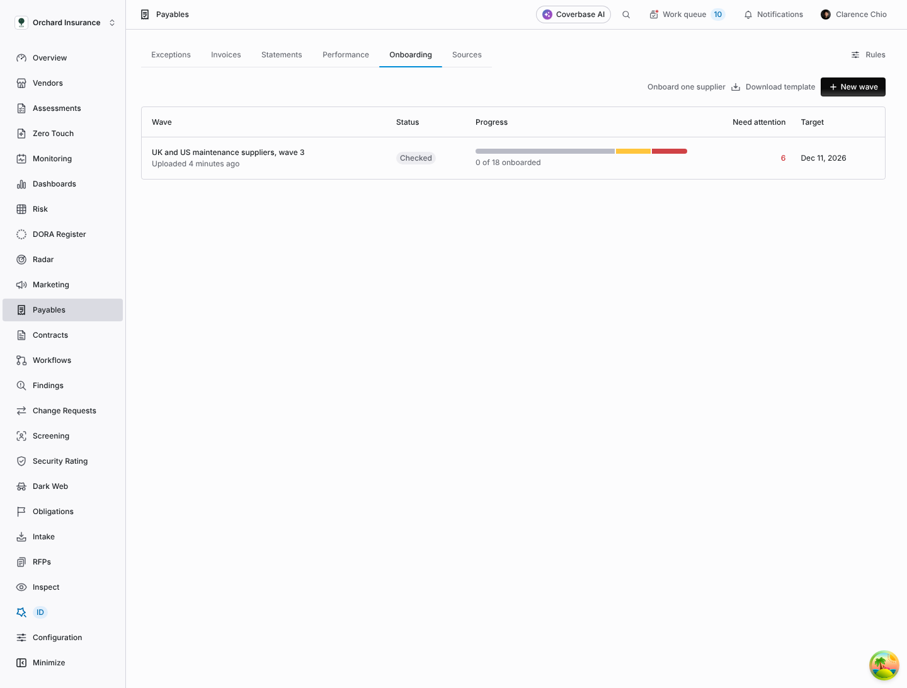
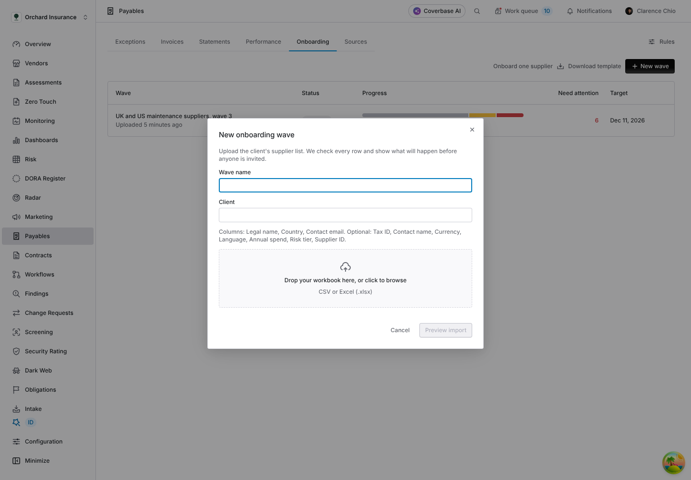
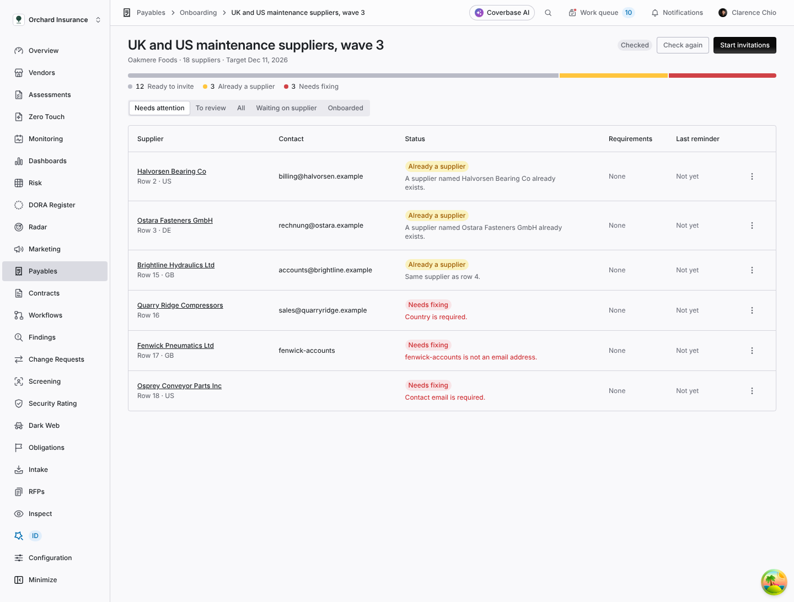
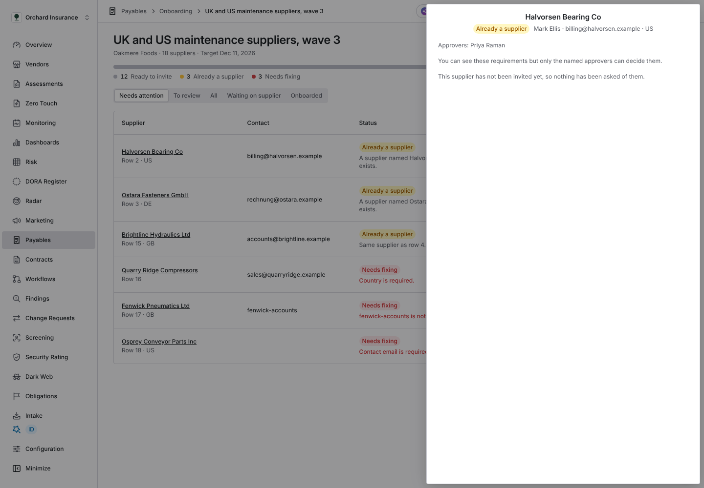
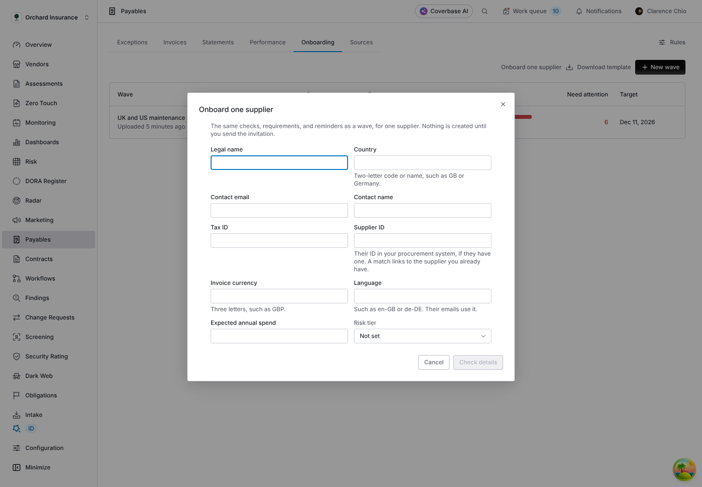

import AgentDirective from "/snippets/agent-directive.mdx";

<AgentDirective />

<Info>
  This guide is part of the [User Guides](/user-guides/overview) collection. Onboarded suppliers use the supplier portal described in [Invoices in the supplier portal](/user-guides/supplier-portal-invoices). The requirements themselves are set on the [Payables rules](/user-guides/payables-setup#supplier-onboarding) page.
</Info>

A wave is one batch of suppliers, usually the supplier list a new client hands you at go-live. Coverbase checks every row first and shows what will happen. Nothing is created and nobody is invited until you click **Start invitations**.

The mistake people make most often is treating **Already a supplier** as an error to skip. It means the row looks like a supplier you already have. Decide whether to link the row to that supplier or create a new one. Skipping it leaves that supplier out of the wave.

## Setting the requirements

Under **Supplier onboarding** on the **Payables rules** page:

| Setting | Default |
| --- | --- |
| **Days to finish** | 14 |
| **Remind every (days)** | 3 |
| **Most reminders** | 4 |
| **Who approves what suppliers send** | Procurement |

Each requirement has a name, a **Type** (**Document or form**, or **Assessment**), **Due (days after invite)**, and optional conditions: **Only for risk tiers**, **Only for countries** and **Only above annual spend**. A supplier is asked only for the requirements whose conditions they meet.

| Default requirement | Type | Applies to |
| --- | --- | --- |
| Company profile and contacts | Document or form | Every supplier |
| Bank details | Document or form | Every supplier |
| Tax form (W-9 or local equivalent) | Document or form | Every supplier |
| Certificate of insurance | Document or form | Medium and high risk tiers |
| Supplier onboarding questionnaire | Assessment | Above 100,000 annual spend |

An **Assessment** requirement opens your usual assessment for the supplier when the invitation goes out, with the questionnaires and control sets that match their profile. It is met when that assessment is complete.

With approvers set, a requirement counts only once someone in those roles approves it. With **No approval step**, anything a supplier sends counts as done straight away. A role with nobody in it under **Team roles** falls back to anyone who can edit suppliers.

## Starting a wave

Open **Payables › Onboarding**. Waves are listed 50 to a page.

<Frame caption="The Onboarding tab: each wave with its status, progress and rows needing attention.">
  
</Frame>

<Steps>
  <Step title="Prepare the list">
    Click **Download template** for the column headers. **Legal name**, **Country** and **Contact email** are required. **Tax ID**, **Contact name**, **Currency**, **Language**, **Annual spend**, **Risk tier** and **Supplier ID** are optional. A wave holds up to 5,000 suppliers.
  </Step>
  <Step title="Upload it">
    Click **New wave**. Give it a **Wave name** and, if it is for a client, the **Client**. Drop in the supplier list as a CSV or Excel (.xlsx) file, then click **Preview import**. From an Excel workbook, Coverbase reads the first visible sheet.
  </Step>
  <Step title="Read the preview">
    The preview says how many rows are ready and lists the rows with problems. Nothing is kept yet.
  </Step>
  <Step title="Keep the wave">
    Click **Create wave with N suppliers**, where N is the number of supplier rows the wave will hold. The wave opens with the status **Checked**, and the confirmation says "Nobody is invited until you start invitations."
  </Step>
</Steps>

<Frame caption="New onboarding wave: name it, name the client, and upload the supplier list.">
  
</Frame>

## What the checks look for

Every row is checked before anything happens:

| Check | Row status | Message |
| --- | --- | --- |
| Legal name present | **Needs fixing** | "Legal name is required." |
| Contact email present and valid | **Needs fixing** | "Contact email is required." or "... is not an email address." |
| Country present, as a two-letter code or a country name | **Needs fixing** | "Country is required." or "... is not an ISO country code." |
| Currency, when given, is an ISO currency code | **Needs fixing** | "... is not an ISO currency code." |
| Language, when given, is supported | **Needs fixing** | "... is not a supported language." |
| Annual spend, when given, is an amount | **Needs fixing** | "... is not an amount." |
| Risk tier, when given, is low, medium or high | **Needs fixing** | "Risk tier is low, medium, or high." |
| Same tax ID, or same name and country, as an earlier row | **Already a supplier** | "Same supplier as row ..." |
| Same name as a supplier you already have | **Already a supplier** | "A supplier named ... already exists." |
| Supplier ID matches a supplier you already have | **Ready to invite** | Linked to that supplier, never duplicated. |

Everything else is **Ready to invite**. A row with no language uses the wave's default.

## Reviewing a wave

<Frame caption="A checked wave: ready rows, rows that match existing suppliers, and rows that need fixing.">
  
</Frame>

The filters are **Needs attention**, **To review**, **All**, **Waiting on supplier** and **Onboarded**. Rows are listed 50 to a page. Each row's menu offers what fits its status:

- **Link to the existing supplier** for a row that matches one you have. The supplier is onboarded as the record you already hold.
- **Create as a new supplier** when the match is a different company with the same name.
- **Skip this supplier** to leave the row out.
- **Retry** for a row that failed while being invited.
- **Send a reminder now** for a supplier mid-way.

A row that needs fixing cannot be edited in the wave. Skip it and onboard that supplier with **Onboard one supplier**, or fix the file and upload it as a new wave. **Check again** reruns the checks, for example after you add a supplier ID to an existing vendor.

## Starting the invitations

Click **Start invitations**. The wave shows **Inviting** while it works through the ready rows in batches. For each supplier, Coverbase links or creates the supplier record, opens their supplier portal, makes the contact its owner, lists the requirements your rules call for with their due dates, and sends the invitation in the supplier's language. Each step is written to the activity log.

A row that fails shows **Failed** with its error, and the wave moves on. **Pause invitations** stops after the current batch, and **Resume invitations** carries on where it stopped. A finished wave is **Complete**, or **Complete, some failed**.

Suppliers are reminded on your cadence until they finish or reach the reminder limit. Before each reminder, Coverbase credits requirements their own records already satisfy (a profile address, an active bank account, a tax registration or W-9, an insurance document, a completed assessment), so nobody is chased for something they sent. A status a person set is never downgraded.

A supplier is **Onboarded** once every requirement is received, approved or waived, depending on whether you require approval. Onboarding is separate from invoices: an open requirement does not hold up an invoice.

## Reviewing what a supplier sent

Click a supplier in the wave to open its review drawer.

<Frame caption="A row's review drawer: its status, its contact, who may approve, and its requirements.">
  
</Frame>

The drawer names the approvers and lists each requirement with its type, status, due date and the files the supplier sent. A requirement satisfied from the supplier's own records says "Found on the supplier's record." For each one:

- **Approve** accepts it.
- **Send back** returns it with **What needs fixing**. The supplier sees your note in their portal and can send a new file.
- **Waive** marks it not needed.

An **Assessment** requirement links to the assessment with **Open the assessment**. If you are not a named approver, you can read the requirements but not decide them. **To review** on the wave lists every row with something waiting for a decision.

## Onboarding one supplier

**Onboard one supplier** runs the same checks, requirements and reminders as a wave, for one supplier. Nothing is created until you send the invitation.

<Frame caption="Onboard one supplier: the same fields as a wave row.">
  
</Frame>

<Steps>
  <Step title="Fill in the supplier">
    **Legal name**, **Country** and **Contact email** are required. **Supplier ID** is their ID in your procurement system, if they have one; a match links to the supplier you already have. **Language** decides the language of their emails.
  </Step>
  <Step title="Check details">
    Click **Check details**. If a supplier with that name exists, answer "... is already a supplier. Is this the same company?" with **Yes, onboard the supplier we already have** or **No, create a new supplier**.
  </Step>
  <Step title="Send the invitation">
    **They will be asked for** lists the requirements that apply. Click **Send invitation**.
  </Step>
</Steps>

## Troubleshooting

| Problem | What to check |
| --- | --- |
| The upload is refused | The file must be CSV or Excel (.xlsx), with the **Legal name**, **Country** and **Contact email** columns and at least one supplier row. |
| Many rows say **Already a supplier** | Your vendors already carry those names. Link the rows, or add the **Supplier ID** column so matches link on ID. |
| A supplier was not asked for anything | No requirement's conditions matched their risk tier, country or spend. The drawer says "Your onboarding rules ask nothing of this supplier." |
| Nobody can approve a requirement | The approver roles have nobody in them, so anyone who can edit suppliers can approve. Name people under **Team roles**. |
| A row shows **Failed** | Open its menu and **Retry**. The error is on the row. |
| Reminders stopped | The supplier reached **Most reminders**. Use **Send a reminder now**. |

## Related

<CardGroup cols={2}>
  <Card title="Setting up Payables" icon="sliders" href="/user-guides/payables-setup">
    Requirements, approvers and team roles.
  </Card>
  <Card title="Invoices in the supplier portal" icon="user" href="/user-guides/supplier-portal-invoices#onboarding">
    What an invited supplier sees.
  </Card>
  <Card title="Centralized supplier portal" icon="door-open" href="/user-guides/centralized-supplier-portal">
    The portal suppliers are invited to.
  </Card>
  <Card title="Supplier information" icon="id-card" href="/user-guides/supplier-information">
    Bank details, addresses and tax registrations suppliers keep current.
  </Card>
</CardGroup>
