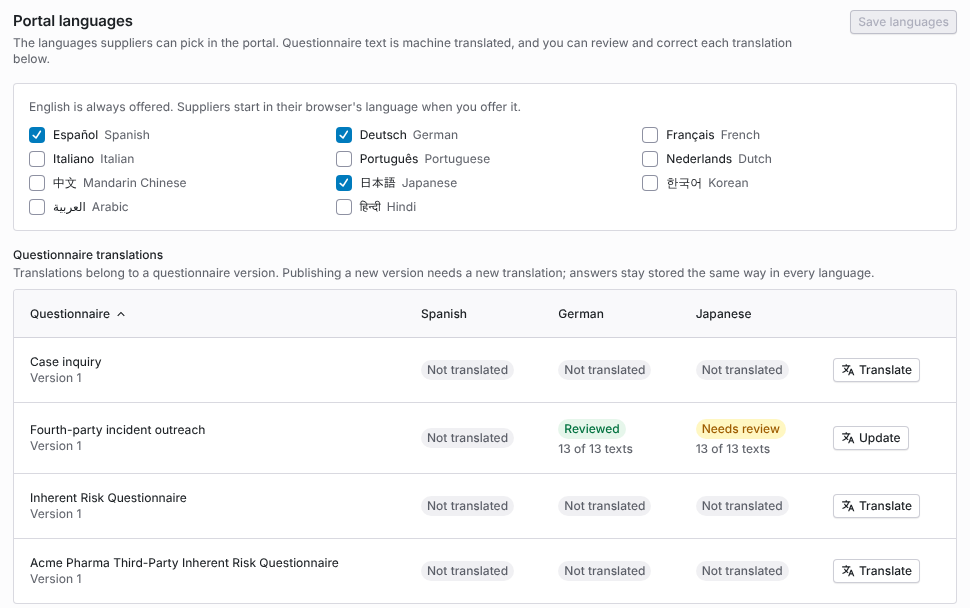
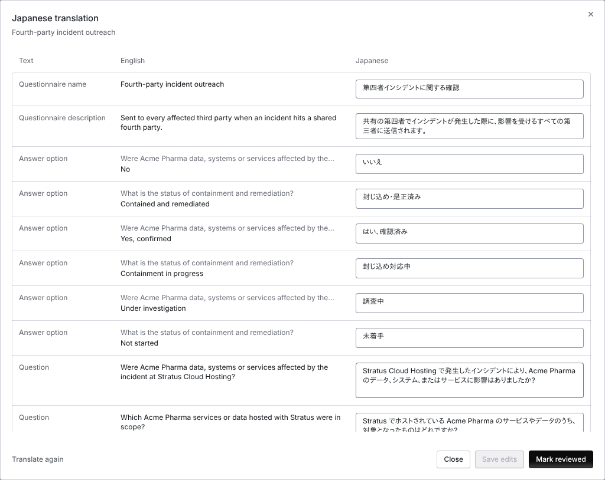
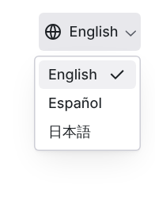
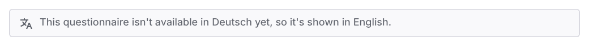
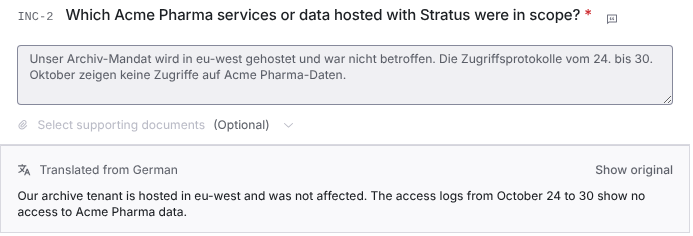

import AgentDirective from "/snippets/agent-directive.mdx";

<AgentDirective />

<Info>
  This guide is part of the [User Guides](/user-guides/overview) collection. It covers the **Portal languages** section of **Configuration → Supplier Portal Controls**. It sits beside [The supplier portal, for suppliers](/user-guides/supplier-portal-for-suppliers), which is what the supplier sees, and [Questionnaires](/user-guides/questionnaires), which covers building the questionnaires that get translated.
</Info>

Suppliers can use the portal in the languages your organization offers, including the questionnaire text. Coverbase machine translates each questionnaire version, and your team can correct each translation and mark it reviewed. Answers are stored the same way whatever language the supplier used, and your reviewers read free-text answers in English.

The mistake people make most often is publishing a new questionnaire version and forgetting to translate it. A translation belongs to one version. Until you translate the new version, suppliers who chose another language see it in English, with a notice that says so.

## Before you start

You need permission to change organization settings to choose languages and edit translations. English is always offered and cannot be turned off.

## Step 1: Choose the languages

Open **Configuration → Supplier Portal Controls** and go to **Portal languages**. Tick each language suppliers can pick, then click **Save languages**.

The languages you can offer are Spanish, German, French, Italian, Portuguese, Dutch, Mandarin Chinese, Japanese, Korean, Arabic and Hindi.

<Frame caption="Portal languages with Spanish, German and Japanese offered, and the translation status of each questionnaire in each language.">
  
</Frame>

## Step 2: Translate each questionnaire

The **Questionnaire translations** table lists each questionnaire version with a column for every language you offer. To machine translate a questionnaire into all of them, click **Translate** on its row. On a questionnaire that already has a translation, the button reads **Update** and translates only the text that is missing or has changed.

Each cell shows the translation's status and how many of the questionnaire's texts are translated, for example **13 of 13 texts**.

| Status | Meaning |
| --- | --- |
| **Not translated** | No translation into this language yet. |
| **Queued**, **Translating** | The machine translation is running. The cell updates on its own. |
| **Needs review** | The machine translation finished and nobody has marked it reviewed. Suppliers already see it. |
| **Reviewed** | A person marked it reviewed. |
| **Out of date** | The questionnaire changed after it was translated. Changed texts show in English until they are translated again. |
| **Failed** | The translation did not finish. Run it again to fill in the missing texts. |

The questionnaire name and description, section names and descriptions, questions, instructions, guidance, answer options and the **Other** option label are translated. Questionnaires built from a control set are translated the same way.

## Step 3: Review and correct a translation

To check a translation, click its status in the table. The dialog lists every text, its English source and the translation beside it.

<Frame caption="The review dialog for a Japanese translation. Each text has its English source and an editable translation.">
  
</Frame>

- To correct a translation, edit the text and click **Save edits**. An edited text is labeled **Edited by a person**, and your edit always wins over the machine translation.
- To go back to the machine translation for one text, click **Use the machine translation**.
- To mark the whole translation checked, click **Mark reviewed**. The dialog then shows who reviewed it.
- To translate texts that changed after the last run, click **Translate again**.

If the English wording of a text changes after you edited its translation, the text shows **Your edit was for older wording**. Update your edit so it matches the new wording.

## What suppliers see

A supplier picks a language from the language menu at the top right of the portal or the public request form. The menu lists English and the languages your organization offers. A supplier whose browser language you offer starts in that language.

<Frame caption="The language menu in the portal, limited to the languages the organization offers.">
  
</Frame>

The portal shows a questionnaire in the supplier's language only where a current translation exists:

- A text whose English source changed after it was translated is shown in English, so a supplier never sees a translation of old wording.
- When a questionnaire is not translated into the supplier's language, it is shown in English with the notice **This questionnaire isn't available in** the language **yet, so it's shown in English.**
- When only parts are translated, the notice says those parts are shown in English.

<Frame caption="The notice a supplier sees when a questionnaire has no translation in their language.">
  
</Frame>

## Reading answers in another language

Answers are stored the same way in every language. A choice is stored as the option the supplier picked, whatever language it was shown in. A free-text answer keeps exactly what the supplier wrote.

When a supplier writes a free-text answer in another language, Coverbase adds an English translation for reviewers. On the submission, the answer shows **Translated from** the language with the English text. **Show original** switches to what the supplier wrote, and **Show translation** switches back. Long answers are translated in parts.

<Frame caption="A free-text answer written in German, shown to the reviewer in English.">
  
</Frame>

Until the translation arrives, the answer reads **Answered in** the language, **The English translation is on its way.** If the supplier changes the answer after it was translated, the panel says **The answer changed after it was translated**, and a new translation follows.

## Troubleshooting

| What you see | Cause | Fix |
| --- | --- | --- |
| A supplier sees a questionnaire in English after picking another language | The questionnaire's current version has no translation into that language. | Click **Translate** or **Update** on its row. |
| A cell shows **Out of date** | The questionnaire changed after it was translated. | Click **Update**, or open the translation and click **Translate again**. |
| A cell shows **Failed** | The machine translation did not finish. | Open the translation and click **Translate again**. |
| Your correction is not shown to suppliers | The English wording changed after you edited the translation. The edit shows **Your edit was for older wording**. | Edit the translation to match the new wording and click **Save edits**. |
| A language is missing from the supplier's menu | It is not ticked under **Portal languages**, or you did not click **Save languages**. | Tick it and save. |
| A free-text answer has no English translation | The supplier answered in English, or the translation is still on its way. | Wait for **Translated from** to appear. |

## Related

<CardGroup cols={2}>
  <Card title="The supplier portal, for suppliers" icon="building" href="/user-guides/supplier-portal-for-suppliers">
    What the supplier sees and does in the portal.
  </Card>
  <Card title="Questionnaires" icon="clipboard-question" href="/user-guides/questionnaires">
    Building and versioning the questionnaires that get translated.
  </Card>
  <Card title="Centralized supplier portal" icon="door-open" href="/user-guides/centralized-supplier-portal">
    One portal per supplier, with its people and requests.
  </Card>
  <Card title="Due diligence methods and the portal" icon="list-check" href="/user-guides/due-diligence-methods-and-portal">
    How a request reaches the supplier.
  </Card>
</CardGroup>
