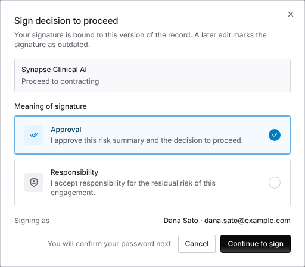

import AgentDirective from "/snippets/agent-directive.mdx";

<AgentDirective />

<Info>
  This guide is part of the [User Guides](/user-guides/overview) collection. It covers signatures that people in your organization put on TPRM records. It sits beside [The engagement record](/user-guides/engagement-record), whose Risk Summary decision is the usual record signed, and [Audit trails](/security/audit-trails), the organization-wide record of changes. To collect signatures from people outside your organization on a contract, see [E-signature overview](/user-guides/signature-overview) instead.
</Info>

With electronic signatures on, a decision on a TPRM record is recorded only once the person deciding signs it. A signature binds the signer's printed name, its meaning and the time to a digest of the record as it stood when it was signed, after the signer confirms their password.

The mistake people make most often is editing a record after it is signed and expecting the signature to follow the edit. A signature belongs to the version it was signed on. A later edit marks it **Record changed since signing**, and the record needs a new signature.

## Before you start

Electronic signatures are off by default, and there is no settings screen for them yet. An admin turns them on with `PUT /v1/record_signature/settings`, or asks your Coverbase representative. The settings are:

| Setting | Default | What it does |
| --- | --- | --- |
| `part11_signatures_enabled` | Off | Turns signatures on for the organization. |
| `signature_required_record_types` | Assessment reports and engagement Risk Summaries | The record types whose decision cannot be recorded without a signature. Intake dispositions and finding acceptance decisions can be added. |
| `reauth_window_minutes` | 5 | How recently, from 1 to 60 minutes, the signer must have confirmed their identity. |
| `reauth_level` | `first_factor` | What the signer confirms: `first_factor` (the password), `second_factor` or `multi_factor`. A signer with no second factor enrolled is asked for their password. |

Reading the settings needs organization settings read permission; changing them needs update permission.

## Sign a Risk Summary decision

<Steps>
  <Step title="Decide">
    On the engagement's **Risk Summary** tab, under **Decision**, choose **Proceed to contracting** or **Don't proceed**. With signatures on, **Sign decision to proceed** (or **Sign decision not to proceed**) opens instead of recording the decision at once.
  </Step>
  <Step title="Choose the meaning">
    The dialog shows the record you are signing and, under **Meaning of signature**, the meanings it can carry with their statements. For a Risk Summary these are **Approval** ("I approve this risk summary and the decision to proceed.") and **Responsibility** ("I accept responsibility for the residual risk of this engagement."). **Signing as** shows your printed name and email address.
  </Step>
  <Step title="Confirm your password">
    Click **Continue to sign**. If you have not confirmed your identity within the window, Coverbase asks for your password (or the factor your organization requires). The signature and the decision are then recorded together.
  </Step>
</Steps>

<Frame caption="Signing a decision to proceed. The signer picks the meaning, then confirms their password.">
  
</Frame>

If you close the password prompt, Coverbase shows **Signing canceled. Nothing was recorded.** and the decision is not saved.

## Sign an assessment acknowledgement

When a relationship owner acknowledges an assessment's results on its **Summary** tab, **Sign acknowledgement** opens with the meaning **Acknowledgement**: "I have read this assessment report and acknowledge its findings and residual risk." It continues the same way. Only a relationship owner who acknowledged the results can sign the acknowledgement, and only a completed assessment's report can be signed.

An assessment report can also be signed with **Review**, **Approval** or **Authorship** by its assignee or a reviewer, and an intake disposition or a finding acceptance decision by the people who decided it. These are signed through `POST /v1/record_signature`.

## Read a signature

Under the decision, **Electronic signature** shows each signature on the record:

- the signer's printed name, the meaning and its statement, and the time;
- **Re-authenticated**, with the last eight characters of the signature ID;
- the record's state: **Record unchanged**, **Record changed since signing** when a material field of the record changed after signing, or **Signature failed verification** when the stored signature no longer checks out;
- **N earlier signatures** when the record was signed more than once.

Signatures are never edited. Each one links to the one before it on the same record, so a signature altered or removed outside Coverbase breaks the check for every signature after it. Fields that later workflow steps write, such as a second reviewer's sign-off or an email delivery, are left out of the digest, so they do not mark an earlier signature as changed.

## Troubleshooting

| What you see | Cause | Fix |
| --- | --- | --- |
| No signature dialog when you decide | Signatures are off, or the record type is not in `signature_required_record_types`. | Ask an admin to change the settings. |
| You are asked for your password every time | Your last confirmation is older than the organization's window. | Expected. The window is `reauth_window_minutes`. |
| **Signing canceled. Nothing was recorded.** | The password prompt was closed. | Decide again and confirm your password. |
| **Only a relationship owner who acknowledged these results can sign the acknowledgement.** | You did not acknowledge the assessment's results. | Acknowledge them first, or ask the relationship owner who did. |
| **Record changed since signing** | Someone edited the record after it was signed. | Review the change. Sign again if the decision still stands. |
| **Signature failed verification** | The stored signature or a signature before it was altered outside Coverbase. | Contact Coverbase support, and check the [audit trail](/security/audit-trails#tamper-evidence). |

## Related

<CardGroup cols={2}>
  <Card title="The engagement record" icon="route" href="/user-guides/engagement-record">
    The Risk Summary and its decision.
  </Card>
  <Card title="Audit trails" icon="list-timeline" href="/security/audit-trails">
    The hash-chained activity log and who initiated each change.
  </Card>
  <Card title="Front Door triage" icon="door-open" href="/user-guides/front-door-triage">
    Intake dispositions and their two sign-offs.
  </Card>
  <Card title="Records retention and legal hold" icon="box-archive" href="/user-guides/records-retention">
    How long signed records are kept.
  </Card>
</CardGroup>
