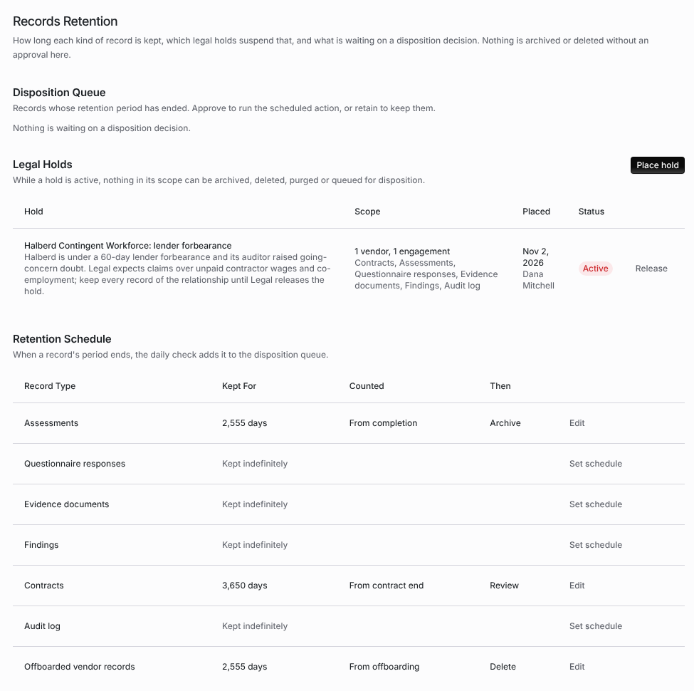

import AgentDirective from "/snippets/agent-directive.mdx";

<AgentDirective />

<Info>
  This guide is part of the [User Guides](/user-guides/overview) collection. It covers **Configuration → Records Retention**. It sits beside [Audit trails](/security/audit-trails), whose purge follows the audit log rule set here, and [Offboarding and continuity](/user-guides/offboarding-and-continuity), which starts the clock for offboarded vendor records.
</Info>

**Records Retention** sets how long each kind of record is kept, which legal holds suspend that, and what is waiting on a disposition decision. Nothing is archived or deleted without an approval on this page.

The mistake people make most often is expecting a record to disappear when its retention period ends. The daily check only adds it to the **Disposition Queue**. A person has to approve it there.

## Before you start

Viewing the page needs organization settings read permission. Changing the schedule, placing or releasing a hold, and deciding the queue need organization settings update permission.

<Frame caption="Configuration → Records Retention, with an active legal hold and a schedule for four record types.">
  
</Frame>

## Step 1: Set the retention schedule

**Retention Schedule** lists each **Record Type**: **Assessments**, **Questionnaire responses**, **Evidence documents**, **Findings**, **Contracts**, **Audit log** and **Offboarded vendor records**. A type with no rule reads **Kept indefinitely**.

To set a rule, click **Set schedule** (or **Edit**) on the row and fill in:

| Field | What it means |
| --- | --- |
| **Days Kept** | How long the record is kept. |
| **Counted From** | **From completion**, **From offboarding** or **From contract end**. |
| **When the Period Ends** | **Archive** or **Delete** take the record out of every list once approved. **Review** records the decision and keeps the record. |

Click **Save**. **Keep indefinitely** removes the rule.

Records past their period are queued for a decision, not removed. An approved **Archive** or **Delete** archives the record: it leaves every list, and Coverbase support can still restore it.

The **Audit log** rule works differently. Audit log entries are not queued. A rule for them keeps entries for at least that many days, longer than Coverbase's own purge would. See [Audit trails](/security/audit-trails#retention).

## Step 2: Place a legal hold

While a hold is active, nothing in its scope can be archived, deleted, purged or queued for disposition.

<Steps>
  <Step title="Open the dialog">
    Under **Legal Holds**, click **Place hold**.
  </Step>
  <Step title="Name it and say why">
    Enter the **Name** and the **Reason**.
  </Step>
  <Step title="Choose the scope">
    Add **Vendors** to hold every record that belongs to them. Leave vendors empty to hold the whole organization. Under **Record Types**, tick the types to hold, or leave all unchecked to hold every type.
  </Step>
  <Step title="Place it">
    Click **Place hold**. The hold shows **Active** with its scope, when it was placed and by whom.
  </Step>
</Steps>

What a hold does:

- Deleting or archiving an assessment, contract, finding or vendor document it covers is refused with **This record is on legal hold and cannot be archived or deleted.**
- The daily check does not queue a record it covers.
- An item already in the queue is not changed when someone approves it. It is counted as on legal hold instead.
- An organization-wide hold on the **Audit log** stops the audit log purge.

A hold placed through the API can also name engagements: it then covers assessments linked to those engagements.

To end a hold, click **Release** and give the **Reason for release**. The hold shows **Released** with the date, and the records it held become subject to the retention schedule again.

## Step 3: Decide the disposition queue

Once a day, Coverbase adds every record whose retention period has ended to the **Disposition Queue**, with the **Record** and the date it was **Due**. The heading says how many records are due.

Select records and choose:

- **Approve N records** runs each record's scheduled action. A record a hold now covers is not changed, and the page says how many were on legal hold.
- **Retain** keeps the selected records, and records the decision.

When nothing is due, the queue reads **Nothing is waiting on a disposition decision.**

## Troubleshooting

| What you see | Cause | Fix |
| --- | --- | --- |
| A record past its period is still in every list | The daily check queues it; it does not remove it. | Approve it in the **Disposition Queue**. |
| A record never reached the queue | A legal hold covers it, or its type is **Kept indefinitely**. | Check **Legal Holds** and the schedule. |
| **This record is on legal hold and cannot be archived or deleted.** | An active hold covers the record. | Release the hold if it no longer applies. |
| Approving left some records unchanged | A hold was placed after they were queued. | Expected. Release the hold, or retain them. |
| An archived record needs to come back | Archive and delete both archive the record. | Contact Coverbase support. |

## Related

<CardGroup cols={2}>
  <Card title="Audit trails" icon="list-timeline" href="/security/audit-trails">
    The audit log, its hash chain and its retention.
  </Card>
  <Card title="Offboarding and continuity" icon="right-from-bracket" href="/user-guides/offboarding-and-continuity">
    Offboarding, which starts the clock for offboarded vendor records.
  </Card>
  <Card title="Electronic signatures on records" icon="signature" href="/user-guides/record-signatures">
    Signed decisions on TPRM records.
  </Card>
  <Card title="Permissions and roles" icon="lock-keyhole" href="/user-guides/permissions-and-roles">
    The organization settings permissions this page needs.
  </Card>
</CardGroup>
