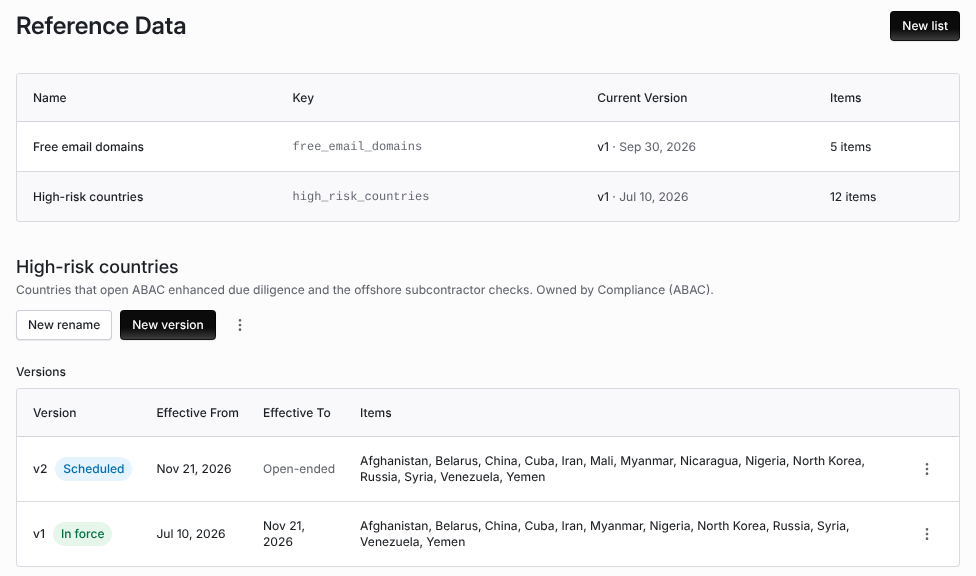

import AgentDirective from "/snippets/agent-directive.mdx";

<AgentDirective />

<Info>
  This guide is part of the [User Guides](/user-guides/overview) collection. It covers **Configuration → Reference Data**. It sits beside [Risk methodology](/user-guides/risk-methodology), which sets how risk is scored, and [Zero Touch assessments](/user-guides/zero-touch-assessments), whose country risk check reads your high-risk countries.
</Info>

A reference list is a named list your organization keeps, such as its high-risk countries. Its items change only through dated versions, so you can always tell which list applied on a past day.

The mistake people make most often is editing a list to fix today's entries and expecting past results to change. A version's items never change. Publish a new version with its own **Effective From** date; earlier versions stay as they were.

## Before you start

Viewing reference data needs organization settings read permission. Creating lists and versions needs organization settings update permission.

Coverbase reads one list by its key today: `high_risk_countries`. A Zero Touch assessment's country risk check treats a country on the version in force on the run date as high risk, and cites the list and version. Any other key is your organization's own list.

## Read a list

Open **Configuration** and choose **Reference Data**. The table lists each list's **Name**, **Key**, **Current Version** (with the date it took effect, or **None in force**) and **Items**. Click a list to open it.

<Frame caption="High-risk countries with a version in force and a scheduled version that adds two countries.">
  
</Frame>

**Versions** lists each **Version** with its status (**In force**, **Scheduled** or **Not in force**), **Effective From**, **Effective To** (or **Open-ended**) and **Items**. On any date, the version in force is the one that covers the date and starts latest, so a new version takes over from its start date without rewriting the one before.

## Create a list

Click **New list**. Give the **Key** (lowercase letters, digits and underscores, for example `high_risk_countries`), the **Name** and an optional **Description**, and click **Create**.

## Publish a new version

<Steps>
  <Step title="Start the version">
    Open the list and click **New version**. The items start from the version in force today.
  </Step>
  <Step title="Set the dates">
    Set **Effective From** and, optionally, **Effective To**. Dates apply as whole UTC days. A version must end after it starts.
  </Step>
  <Step title="Edit the items">
    For high-risk countries, add or remove **Countries**. Each is stored as its ISO 3166-1 two-letter code. For other lists, each item has a **Code** and a **Label**; **Add item** adds one and every code must be unique. Add **Notes** on why the version changed.
  </Step>
  <Step title="Save">
    Click **Save**. A version with a future start date reads **Scheduled** until that day.
  </Step>
</Steps>

To stop a version applying, choose **Set end date** from its row menu. Its items still never change.

## Rename a label

**Label Renames** lets a record created under an old label display under today's label. Click **New rename** and give the **Old Label**, the **New Label** and the **Effective From** date. **Archive rename** removes one.

## Archive a list

**Archive list**, from the list's menu, stops it applying everywhere it is used. Its versions are kept.

## Troubleshooting

| What you see | Cause | Fix |
| --- | --- | --- |
| **None in force** | No version covers today: the only version is scheduled, or every version has ended. | Publish a version that starts today or earlier. |
| **... is not an ISO 3166-1 alpha-2 country code** | A country code is not a valid two-letter code. | Use the two-letter code, for example `IR` for Iran. |
| **A version must end after it starts** | **Effective To** is on or before **Effective From**. | Move the end date. |
| A Zero Touch assessment did not flag a country you added | The assessment ran before the new version's start date. | Expected. Run the assessment again after the version takes effect. |

## Related

<CardGroup cols={2}>
  <Card title="Zero Touch assessments" icon="bolt" href="/user-guides/zero-touch-assessments">
    The country risk check that reads your high-risk countries.
  </Card>
  <Card title="Risk methodology" icon="scale-balanced" href="/user-guides/risk-methodology">
    Domain weights, roll-up and simulating a rule change.
  </Card>
  <Card title="Promoting configuration from a sandbox" icon="arrow-up-right-from-square" href="/user-guides/promoting-configuration">
    Moving configuration between organizations.
  </Card>
  <Card title="Records retention and legal hold" icon="box-archive" href="/user-guides/records-retention">
    How long records are kept.
  </Card>
</CardGroup>
