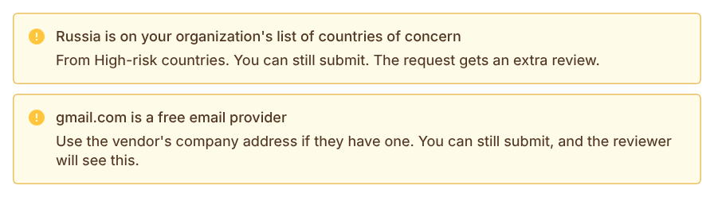
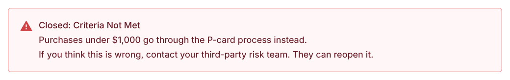
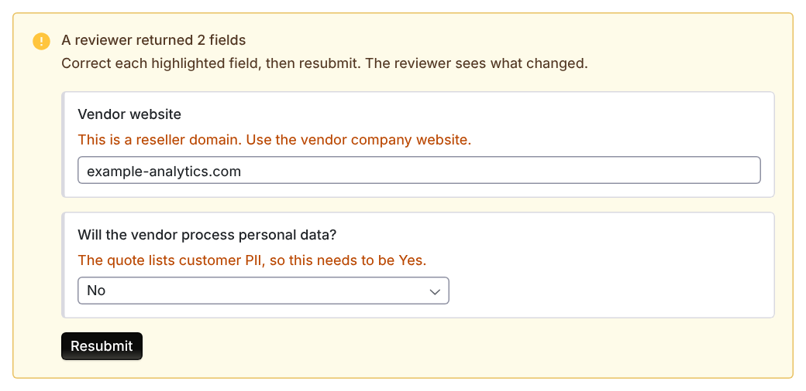

import AgentDirective from "/snippets/agent-directive.mdx";

<AgentDirective />

<Info>
  This guide is part of the [User Guides](/user-guides/overview) collection. It is for the person who wants to start using a new tool or vendor, not for the risk team reviewing the request. If you are on the reviewing side, see the [Analyst and reviewer guide](/user-guides/analyst-reviewer).
</Info>

Before anyone signs anything, your organization needs to know who the vendor is, what data they will touch, and whether you already pay for something that does the same job. That is what a vendor intake request is for, and it takes a few minutes.

Coverbase does most of the typing. You confirm, correct, and decide.

## Read this part first

<Warning>
  **Submitting a request is not approval.** It does not authorize you to buy, sign, expense, or deploy anything.
</Warning>

When you finish, your request goes to your security or due diligence team, and they decide it. A vendor record may appear in Coverbase with your request attached, but it sits in **Created** status. It is not an approved vendor until someone reviews and accepts it.

A completed intake form means "asked", not "allowed". Wait for the decision before you commit spend or send data.

## Two ways to file one

<CardGroup cols={2}>
  <Card title="The portal" icon="browser">
    A three-step form: **Select Vendor**, **Additional Information**, **Review Questionnaires**. Use the link your admin gave you.
  </Card>

  <Card title="Chat" icon="comments" href="/mcp/vendor-intake">
    Ask an AI assistant connected to Coverbase. Same request, same queue, no form.
  </Card>
</CardGroup>

They produce the same thing. Pick whichever you are already using.

To file in chat, say what you want in ordinary language. You do not need to use the word "intake":

> I want to start using Northwind Analytics for product analytics.

> My team needs a load testing tool and we're looking at Loadspin. Can we buy it?

> Is Acme approved for us to use?

That last one checks first and offers to file a request only if there is not already an approved record.

## What you'll be asked

<Steps>
  <Step title="Which vendor, exactly">
    Coverbase researches the company and shows you what it found: what they do, their website, their headquarters, their trust center. Check it. Two companies called Acme is common, and a request filed against the wrong one is sent back to you. If it is wrong, say so and correct it.
  </Step>

  <Step title="Whether you already have something that does this">
    You are shown existing vendors in your portfolio that cover the same job, and any prior relationship with this vendor. Depending on how your admin configured things, you may also see alternatives found on the web.

    If an approved vendor already does what you need, using it means no review, no procurement cycle, and no new contract.
  </Step>

  <Step title="What you'll use it for">
    You get a short list of use cases this vendor is commonly bought for, rather than a blank box. Pick one, or type your own if none fit.
  </Step>

  <Step title="Which services are in scope">
    A list of candidate services. You can add one that is not listed.
  </Step>

  <Step title="The inherent risk questionnaire">
    Coverbase does most of this one for you. It answers what it can from public sources and whatever context you provided, then shows you each answer with the reasoning behind it.

    Check them. Answers Coverbase was confident about are marked as such; the ones it was not are flagged for you to look at first. Anything about *your* intended use, the data you will send, or your internal owner is yours to answer, because public research cannot find it.
  </Step>
</Steps>

Behind the scenes, Coverbase also screens the vendor's financial stability, security posture, and sanctions status, and checks whether the request duplicates something you already have. You do not have to ask for any of that. It runs as part of the flow, and you see the results.

<Note>
  Which of these steps you see depends on how your organization configured its intake portal. Some orgs turn off web alternatives, or pre-qualification, or prior assessment history. If a step described here does not appear for you, your admin turned it off.
</Note>

## What the labels on a vendor mean

When you search for the vendor, each result that is already in your organization's records carries a label:

| Label | What it means |
| --- | --- |
| **Approved supplier** | Your organization has already approved this vendor. **Owned by** names the people or teams who own it. Ask them about using it before you start a new request. |
| **Onboarding in progress** | Another request for this vendor is open, or its assessment is still running. **Onboarding owned by** names who has it. |
| **New supplier** | Your organization has no record of this vendor yet. |

Your organization can block new requests for vendors it already has. When it does, an approved vendor or one being onboarded shows a lock line under its label, **Already approved, so you can't start a new request for it** or **Already being onboarded, so you can't start another request for it**, and you cannot choose it. If you pick it anyway, the form explains why and, where it can, names the owner to ask. Use the vendor you already have, talk to its owner, or choose another vendor.

## A vendor contact may be required

Your organization can ask you for at least one contact at the vendor, with an email address. If it does, you cannot continue past **Additional Information** until you add one, and the form says **Add at least one vendor contact with an email before continuing.**

## Getting through it faster

<AccordionGroup>
  <Accordion title="Give context up front" defaultOpen icon="lightbulb">
    Anything you already know: the use case, the data types involved, a link to their security page, the team that will own it. Coverbase feeds that into the drafting, so more context up front means fewer questions for you later.
  </Accordion>

  <Accordion title="Work the flagged answers first" icon="triangle-exclamation">
    Drafted answers come with a confidence signal. The low-confidence ones usually name what was missing, and they are where your knowledge adds the most. The high-confidence ones mostly need a glance.
  </Accordion>

  <Accordion title="Finish it in one sitting if you can" icon="clock">
    A partially answered request is not in anyone's queue. It sits open until you come back to it. If you do have to stop, you can pick it up later, in the portal or by asking the assistant where your request got to.
  </Accordion>

  <Accordion title="Do not guess on data questions" icon="shield-halved">
    Questions about what customer data flows to the vendor drive the whole depth of the review. An optimistic answer here means a review scoped too shallow. If you do not know, say so.
  </Accordion>
</AccordionGroup>

## After you submit

Your request lands in the risk team's review queue with everything attached: your answers, the enrichment, the screening results, and the duplicate check.

From there one of three things happens:

- **Approved.** Onboarding starts and an assessment is created against the right control set, sized to the risk your answers indicated.
- **Sent back.** A reviewer needs something clarified. You get a specific question rather than a rejection.
- **Rejected.** Usually because an approved vendor already covers the need, or the screening surfaced something disqualifying.

Once you submit, your answers are read-only to you, whatever your role, even if you could otherwise edit questionnaires. The questionnaire says **You submitted this request, so its answers are read-only**. Reviewers can still see and change answers while they review. If something needs to change on your side, a reviewer sends the request back to you, and only then can you edit your answers again. A reviewer can also return just the fields that need fixing (see [If a reviewer returns fields](#if-a-reviewer-returns-fields)).

### Following a request through review stages

Your organization may have your request reviewed by several teams in turn, for example a category manager first and then the risk team. If so, the request shows **Your request** with each stage by name:

- **With** a team means that team is reviewing it. You are emailed when it moves on or if they need something.
- **Waiting on you since** a date means a stage sent it back. Click **Make changes**, update your answers and resubmit. Nothing moves until you do. Your resubmission goes straight back to the stage that sent it, and earlier approvals stand unless you change an answer they depend on.
- **Denied at** a stage means the request ended there. Any note the reviewer wrote for you is shown.
- **Accepted** means the vendor is approved for use.

You see stage and team names and notes written to you, not reviewers' internal notes.

## Notices while you fill it in

The form warns you as you type when your organization screens requests:

- **A country of concern.** The vendor's headquarters, or an answer about where data is stored or where an entity sits, names a country on your organization's list. You can still submit. The request gets an extra review.
- **A free email provider.** A vendor contact's address is on a free email domain, such as Gmail. Use the vendor's company address if they have one. You can still submit, and the reviewer sees the warning.

<Frame caption="The two screening notices on the request form.">
  
</Frame>

## If your request is closed: Criteria Not Met

Some requests belong in another process, for example small purchases. Your organization can set rules that close those requests as soon as you submit them. You are notified with the reason, and the request shows **Closed: Criteria Not Met** with the same reason.

<Frame caption="A request closed by a rule, as the requester sees it.">
  
</Frame>

If you think the close is wrong, contact your third-party risk team. They can reopen the request, and it goes into review without you filing it again.

## If a reviewer returns fields

A reviewer can return specific fields for you to correct, each with a comment. You are notified, and the request shows **A reviewer returned** with the number of fields.

1. Open the request. Each returned field is highlighted with the reviewer's comment.
2. Correct each field. A field that needs an answer cannot be left empty.
3. Click **Resubmit**.

<Frame caption="Two returned fields, each with the reviewer's comment, ready to correct and resubmit.">
  
</Frame>

The reviewer sees each value before and after your change. Your request cannot be approved until you resubmit the returned fields.

## File a request from MCP or the API

You can file a request from an MCP client by describing what you need. The assistant opens it with `mutate(entity="intake_session", action="create")`, records your answers with `mutate(entity="intake_session", action=...)` and submits it with `mutate(entity="intake_session", action="submit")`. See [Vendor intake through MCP](/mcp/vendor-intake).

An integration files one with an API key through `POST /v1/intake/api/sessions` and reads its status with `GET /v1/intake/api/sessions/{session_id}`. See the [Intake API](/api-reference/intake).

Before an MCP client sends a write, it shows you the change and waits for you to confirm it. The [MCP tool reference](/mcp/tool-reference#questionnaires-portals-and-intake) lists every field.

Approving or rejecting a request stays with a reviewer.

## Troubleshooting

| What you see | Cause | What to do |
| --- | --- | --- |
| You cannot choose a vendor in the search results | Your organization blocks new requests for vendors it has already approved or is onboarding. | Ask the owner the result names, or choose another vendor. |
| You cannot continue past **Additional Information** | Your organization requires a vendor contact with an email. | Add a contact at the vendor with their email address. |
| Your answers are read-only after you submitted | Submitted answers are locked to the requester. | Wait for a reviewer. If something must change, ask them to send the request back. |
| The request shows **Waiting on you since** a date | A review stage sent it back. | Click **Make changes**, update your answers and resubmit. |

## Related

<CardGroup cols={2}>
  <Card title="Vendor intake in chat" icon="comments" href="/mcp/vendor-intake">
    The full conversational flow, step by step, including what your assistant will and will not do on its own.
  </Card>

  <Card title="Analyst and reviewer guide" icon="user-check" href="/user-guides/analyst-reviewer">
    What happens to your request on the other side, and what reviewers are looking for.
  </Card>
</CardGroup>
