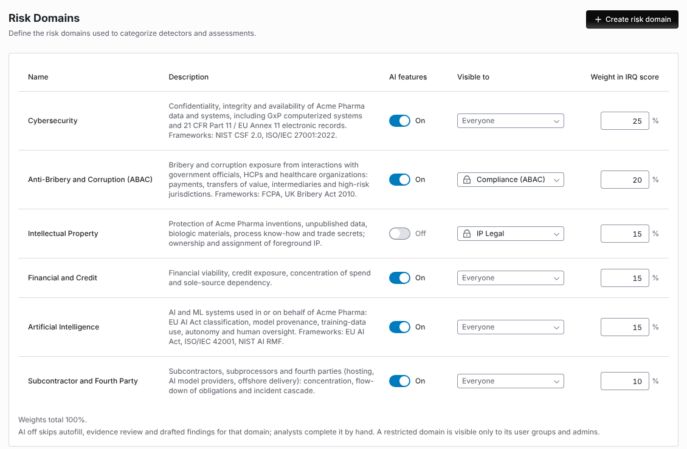
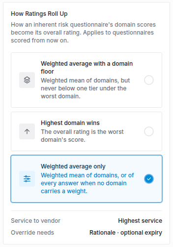
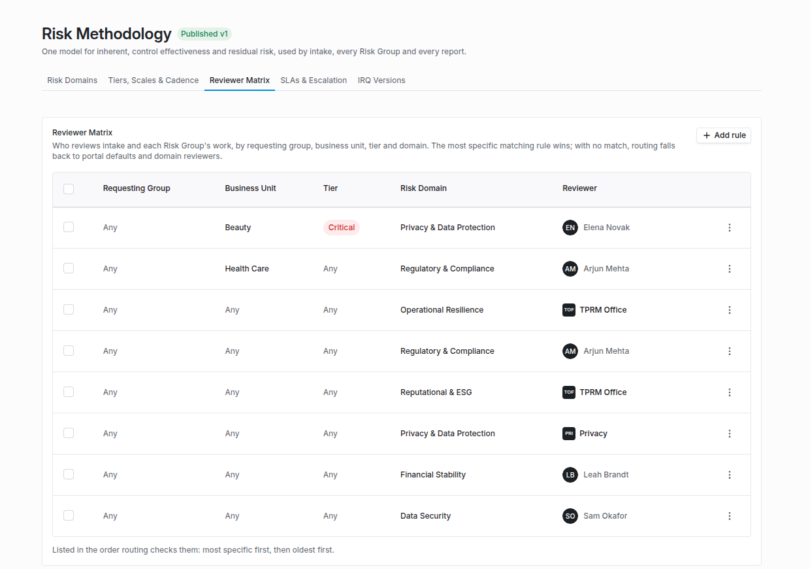
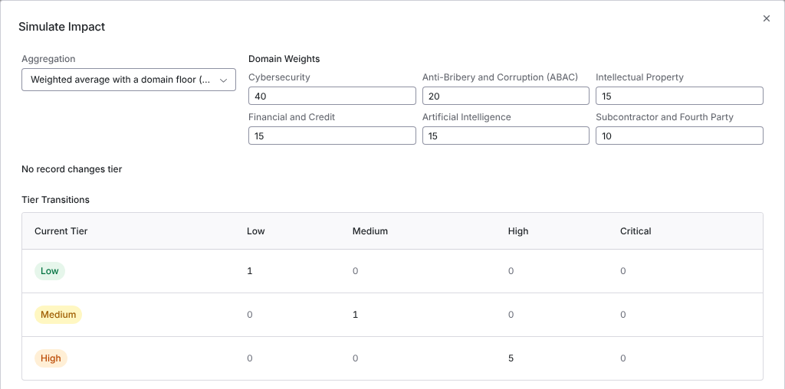
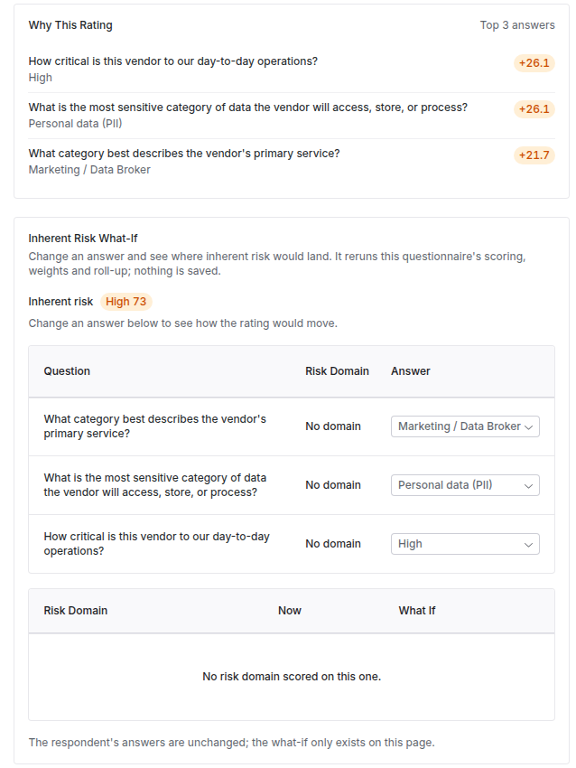

import AgentDirective from "/snippets/agent-directive.mdx";

<AgentDirective />

<Info>
  This guide is part of the [User Guides](/user-guides/overview) collection. It covers **Configuration → Risk Methodology** and the score editor's override fields. It sits beside [Configuring your data model](/user-guides/data-model-configuration), where risk domains and scales are created, and [The IRQ library](/user-guides/irq-library), where inherent risk questionnaires start. For what the module is, see [Risk methodology](/products/risk-methodology).
</Info>

The **Risk Methodology** page is one place for the rules inherent risk follows: how domains roll up, who reviews what, when overdue work escalates, and which questionnaire version is live. It has five tabs: **Risk Domains**, **Tiers, Scales & Cadence**, **Reviewer Matrix**, **SLAs & Escalation** and **IRQ Versions**.

Your Coverbase representative turns on the third-party lifecycle features for your organization.

The mistake people make most often is changing the aggregation method and expecting existing vendors to be re-rated. The method applies to questionnaires scored from then on. Scores already recorded stay as they are until the questionnaire is scored again.

Open **Configuration** and choose **Risk Methodology**. Changing settings needs a role that can change organization settings.

## Step 1: Weight your domains

The **Risk Domains** tab lists each domain with its **Weight**, its share of the roll-up, and its **Risk Group** (its reviewers). A domain with no weight reads **Not weighted** and is left out of the weighted roll-up. Click **Edit risk domains** to change them on the risk domains page.

- Leave every weight empty to keep the questionnaire's flat score. Weighting turns on only when at least one active domain has a weight.
- Weights are relative. They do not need to add up to 100, because the score is normalized by the weights of the domains that scored.
- A questionnaire section must name a risk domain for its answers to count toward that domain. Answers in sections without a domain, or in a domain without a weight, are counted and shown on the review as unweighted answers.

## Turn AI off or restrict a domain

Each risk domain has two access settings on **Configuration → Risk Domains**: **AI features** and **Visible to**. Use them for a domain whose content AI must not read, or whose results only one team may see. Both save as soon as you change them, and both are also in the domain's create and edit dialog.

<Frame caption="Configuration → Risk Domains, with AI features off for Intellectual Property and two domains visible only to their own user groups.">
  
</Frame>

**AI features.** With the switch off, AI does not act on that domain's content. Analysts complete the domain by hand. In that domain:

- Questionnaire answers are not autofilled.
- Evidence is not reviewed by AI, in an assessment or a Zero Touch assessment.
- Findings are not drafted.
- The [IRQ answer check](/user-guides/front-door-triage#check-the-irq-answers) skips the domain's questions.

Content with no domain keeps AI on.

**Visible to.** Pick one or more user groups. A restricted domain is visible only to members of those groups and to admins, and its picker shows a lock. Everyone else does not see the domain's findings or its domain scores on assessments, engagements, services and vendors. Leave the picker empty so everyone can see the domain.

## Step 2: Choose how ratings roll up

On **Tiers, Scales & Cadence**, under **How Ratings Roll Up**, choose one:

| Method | Overall rating |
| --- | --- |
| **Weighted average only** | The weighted mean of the domains, or of every answer when no domain carries a weight. The default. |
| **Highest domain wins** | The worst domain's score. |
| **Weighted average with a domain floor** | The weighted mean, but never below one tier under the worst domain. A Critical domain makes the overall rating at least High. |

<Frame caption="How Ratings Roll Up on the Tiers, Scales & Cadence tab, with Weighted average only chosen.">
  
</Frame>

The change saves at once. An answer option with a minimum score still lifts the whole questionnaire afterwards, whichever method you choose.

**Scale Normalization** shows how each domain's scoring scale maps onto your 0 to 100 risk bands, so a three-tier and a five-tier scale read side by side. Select a domain to see each level's **Normalized Score**, and use the preview to see the residual risk a given assessment score leaves at a given inherent risk.

**Monitoring Cadence by Tier** shows how often each monitoring activity runs at each tier. **Edit cadence** changes it; see [Monitoring plans](/user-guides/monitoring-plans#step-1-set-the-methodology).

## Step 3: Route reviews with the reviewer matrix

On **Reviewer Matrix**, click **Add rule** and fill in the **Add Reviewer Rule** dialog:

| Field | Matches |
| --- | --- |
| **Requesting Group** | The user group of the person who asked for the vendor. |
| **Business Unit** | The engagement's business unit, when there is an engagement. |
| **Tier** | The inherent risk tier. |
| **Risk Domain** | The domain being reviewed. |
| **Reviewer** | The user or group who reviews when the rule matches. |

Leave a criterion on **Any** to match everything. The most specific matching rule wins, and the table lists rules in the order routing checks them: most specific first, then oldest first. A rule with exactly the same criteria as another is refused. With no rule matching, reviews go to the domain's own reviewers and the portal defaults.

<Frame caption="The Reviewer Matrix, listed in the order routing checks the rules.">
  
</Frame>

Intake review is routed before a tier is known, so only rules with no **Tier** and no **Risk Domain** apply to intake. When an IRQ is approved, every domain it scored gets a review task, routed by these rules.

## Step 4: Escalate overdue work

On **SLAs & Escalation**, **SLA Targets** lists how long each stage of an assessment may take before it is overdue: the **Organization default**, and any risk domain that overrides it. **Edit SLA targets** changes them. These targets drive the engagement's expected decision date.

Under **Escalation Rules**, click **Add rule** and fill in the **Add Escalation Rule** dialog:

1. **Name** the rule, for example "Overdue Risk Group review".
2. Choose the **Work** it applies to. Leave it empty to escalate every kind of work.
3. Set **Days Overdue**.
4. Choose who it escalates to: a **User**, a **Group**, or a **Group lead** (the group's lead at the time the item escalates).
5. Choose **Notify**, so the target gets their own copy and the assignee keeps the item, or **Reassign**, so the item moves to the target.

Escalation runs once a day. Each rule escalates an item once. A copy closes when the original's record resolves, and never escalates again itself. The **Escalation Log** lists every item a rule escalated, newest first, with the rule, when, who it went to and how overdue it was; filter it by rule.

## Step 5: Version your inherent risk questionnaires

**IRQ Versions** lists each inherent risk questionnaire with its **Version**, **Published** date and **Content Review Due**. Use the row's actions to **Open template** or **View changelog**: every change across all of its versions.

<Steps>
  <Step title="Draft">
    Click **Draft next version**. The draft copies the published version and is not sent to anyone.
  </Step>
  <Step title="Edit">
    Open the draft and change its questions. Drafting, edits, publishing, retiring, content reviews and cadence changes are recorded in the changelog with the version and who acted.
  </Step>
  <Step title="Publish">
    Click **Publish** and confirm. The draft becomes the published version, and the previous version is retired for new sends. Questionnaires already out finish on the version they were sent with.
  </Step>
  <Step title="Set a review cadence">
    Click **Review cadence**, choose **Review Every** (in months) and an **Owner**. The owner is reminded when the published version is due for review. **Mark reviewed** restarts the clock.
  </Step>
</Steps>

A published or retired version is read-only: its questions, sections, options and conditions cannot change, and the editor's banner offers **Draft new version** instead. The name, reviewers and applicability stay editable. To see what changed between two versions, use **Compare** (below).

### Compare two versions

From a version's actions, choose **Compare with previous version** or **Compare with published**, or **Compare** to pick any two. The page shows both side by side: **Sections** and **Questions** **Added**, **Removed** or **Changed**, with answer options, weights, risk domains, answer types and review flags. **Swap versions** reverses them, and **Show unchanged questions** shows everything.

### Retire versions

Select versions and choose **Retire**, or use **Discard draft** on one draft. A retired draft can no longer be published. Retiring the published version stops new sends of that questionnaire until a new version is published; questionnaires already sent finish on their version.

## Step 6: Override a score with a rationale

Anywhere you edit an inherent or residual score by hand (**Edit Inherent Risk Score**, **Edit Residual Risk Score** or **Edit Assessment Score**), the editor asks for a **Rationale**, recorded with the override in the score history, and **Override Expires**: **Never**, or **After 30 days**, **90**, **180** or **365**. The rationale is required. With an expiry, the editor says when the calculated score returns.

While it is active, a chip beside the score reads **Override ends in N days** (or **Override ends today**). When an override expires, a daily job restores the last calculated score for each risk type the override changed, and the risk profile shows **Override expired**. If someone or something has replaced the override in the meantime, the newer score stands.

## Set how far residual risk can fall

Residual risk starts from the formula under **Configuration → Scoring → Risk Scoring → Residual Risk Formula**: inherent risk reduced by the assessment score, weighted by **Assessment score weight**. **Residual Risk Step Down** then decides how far below inherent risk the result may land.

- **No limit**: residual risk follows the formula, however many levels it drops.
- **Cap the step down**: the formula still sets the score, but residual risk lands at most **Most Levels Below Inherent** levels below inherent risk. With a one level cap, Critical inherent risk ends no better than High.
- **Set by rating**: residual risk lands exactly one level below inherent when the assessment's rating is one you tick under **Ratings That Step Down One Level**, and stays at inherent for any other rating. A qualifying rating moves residual risk one level down even when the formula would have left it at inherent. Inherent risk already at your lowest level stays there.

**Set by rating** reads your assessment rating scale (the **Assessment Scoring** tab), so set that scale up first. The rating is the band the assessment score falls in. The overall residual uses the overall rating, and each risk domain uses its own domain rating. While the rule uses a rating, that rating cannot be removed from the scale, and the scale cannot be turned off. Choose another step down first.

A change applies the next time an assessment's residual risk is calculated. Completed assessments and current vendor scores keep their values. When the rule moves a score, the assessment's **Summary** tab shows the score the formula gave, the level the rule set, and under **Set by rating** the rating that decided it. Significant deficiency floors still apply on top, and the higher of the two wins.

## Try a what-if

- On a submitted inherent risk questionnaire, **Inherent Risk What-If** lets you change answers and shows where each domain and the overall rating would land, for example "With 2 changed answers, inherent risk moves from High 72 to Medium 48". **Reset** puts the answers back. Nothing is saved; the respondent's answers are unchanged.
- On an assessment's summary, **Residual Risk What-If** lists the open issues. Turn on **Remediate** for the ones to fix and read the **Domain Change** and **Overall Change**, for example "Remediating ISS-311 drops Privacy residual risk from High 61 to Medium 44". A significant deficiency floor stays in force, so a floored score may not move until the deficiency itself is resolved.

## Simulate a rule change

To see what a scoring change would do before you make it, click **Simulate impact** on **How Ratings Roll Up** (the **Tiers, Scales & Cadence** tab). Nothing is saved.

<Steps>
  <Step title="Propose the change">
    In **Simulate Impact**, pick an **Aggregation** method, change one or more **Domain Weights**, or both. Your current method is marked **(current)**.
  </Step>
  <Step title="Run it">
    Click **Run simulation**. Coverbase scores every live inherent risk questionnaire twice, once with today's settings and once with your change, so an unchanged setting moves nobody.
  </Step>
  <Step title="Read the result">
    The summary says how many of the scored records change tier, or **No record changes tier**. **Tier Transitions** counts moves from each **Current Tier** to each simulated tier. **Records That Change Tier** lists each vendor and engagement with its tier **Now** and **Simulated**. **Domain Changes** gives each domain's **Average Now**, **Average Simulated**, and how many records **Moved Up** and **Moved Down**.
  </Step>
</Steps>

<Frame caption="Simulate Impact after raising the Cybersecurity weight from 25 to 40. No record changes tier.">
  
</Frame>

To make the change, set it on the page as usual. The API route `POST /v1/risk_methodology/simulation` also simulates new scores for answer options and a new supplier tier rule. It needs organization settings permission.

## Reading an IRQ result

<Frame caption="Why This Rating and the Inherent Risk What-If on a submitted IRQ.">
  
</Frame>

On a submitted inherent risk questionnaire, **Why This Rating** explains the score: the answers that moved it most, whether the highest domain rated it (**Rated by the highest domain**) or a floor lifted it (**lifted to ... by the ... floor**), and any answers flagged for review. Answer options can be flagged so the reviewer's attention goes to them.

## Configure methodology from MCP or the API

You can read and change the methodology from an MCP client or with an API key, as well as on this page. An MCP client reads with `query_platform(kind=...)` (`risk_methodology`, `risk_domains`, `reviewer_matrix_rules`, `escalation_rules`, `vendor_tier_rule`). It writes with `mutate(entity="risk_methodology", action="update")`, `mutate(entity="risk_domain", action=...)`, `mutate(entity="reviewer_matrix_rule", action=...)`, `mutate(entity="escalation_rule", action=...)` and `mutate(entity="vendor_tier_rule", action="update")`.

The API routes are `/v1/risk-methodology`, `/v1/risk-domains`, `/v1/reviewer-matrix-rules`, `/v1/work-queue-escalation-rules` and `/v1/vendor-tier-rule`. See [Change configuration and methodology](/api-reference/risk#change-configuration-and-methodology).

Before an MCP client sends a write, it shows you the change and waits for you to confirm it. The [MCP tool reference](/mcp/tool-reference#risk-register-and-risk-settings) lists every field.

Risk domains need `risk` permission, which API keys hold. The other routes need organization settings permission, which they do not, so use a key created by a person whose role holds it. A rating override that needs approval is a change request. A member of the approver group decides it with `mutate(entity="change_request", action="decide")`. With an API key you can read, create and withdraw change requests at `/v1/change-requests`, but not decide them. See [Change requests](/api-reference/contract-administration#change-requests).

## Troubleshooting

| What you see | Cause | Fix |
| --- | --- | --- |
| The weighted score ignores a section | The section has no risk domain, or its domain has no weight. | Give the section a domain and the domain a weight. The review's unweighted count shows how many answers this affects. |
| Changing the aggregation method did not change a vendor's rating | The method applies to questionnaires scored after the change. | Score the questionnaire again, or send a new one. |
| A reviewer rule does not apply to intake review | The rule names a **Tier** or a **Risk Domain**. | Add a rule with neither for intake. |
| Reviews still go to the domain's reviewers | No rule matches the request's group, business unit, tier and domain. | Widen a criterion to **Any**. |
| An overdue item was not escalated a second time | Each rule escalates an item once. | Add a second rule with a larger **Days Overdue**. |
| Editing a question fails with a message that the version is locked | The version is published or retired. | Click **Draft new version** and edit the draft. |
| Saving a score override fails | The **Rationale** is empty. | Write a rationale. |
| A user cannot see a domain's findings or scores | The domain's **Visible to** names user groups the user is not in. | Add them to one of the groups, or clear **Visible to**. |
| Autofill or AI evidence review skipped a domain | The domain's **AI features** are off. | Expected. Complete the domain by hand, or turn the switch on. |
| **Run simulation** is unavailable | Nothing is changed from today's settings. | Change the aggregation or a domain weight. |
| A score went back to an older value on its own | An override with an expiry lapsed. | Expected. Override again with a rationale if the calculated score is still wrong. |

## Related

<CardGroup cols={2}>
  <Card title="Configuring your data model" icon="table-columns" href="/user-guides/data-model-configuration">
    Risk domains, scales and statuses.
  </Card>
  <Card title="The IRQ library" icon="clipboard-list" href="/user-guides/irq-library">
    The packaged inherent risk questionnaires.
  </Card>
  <Card title="Front Door triage" icon="door-open" href="/user-guides/front-door-triage">
    IRQ scoping rules on intake.
  </Card>
  <Card title="Reviews, approvals and gates" icon="gavel" href="/user-guides/reviews-and-approvals">
    Domain-scoped reviews on an assessment.
  </Card>
</CardGroup>
