import AgentDirective from "/snippets/agent-directive.mdx";

<AgentDirective />

<Info>
  This guide is part of the [User Guides](/user-guides/overview) collection. Screening is a tab in every vendor's [Vendor Intelligence](/products/vendor-intelligence) section, plus a queue of its own. For every source, list and category screening checks, see [Screening coverage and sources](/user-guides/screening-coverage).
</Info>

Corporate registrations tell you the company is real. People intelligence tells you who runs it. This page tells you whether the company or those people appear on a sanctions, watchlist, criminal or legal source. Not once at onboarding, but on a schedule, for as long as you keep the vendor.

Two things make it different from the rest of Vendor Intelligence.

**Every screen is recorded, including the clear ones.** "We screened this vendor on this date, against these sources, and found nothing" is the record an examiner asks for. A missing record proves nothing, so the vendor page shows the run history whether or not there is anything to review.

**The score is about identity, not severity.** It is easy to misread, so it has its own section below.

## Where it lives

Screening appears in two places, and they are for two different jobs.

**On a vendor**: open a vendor, go to **Vendor Intelligence**, and pick the **Screening** tab. This is the view when you already care about one supplier.

<Frame caption="1 Open matches, worst source first. 2 Identity confidence. 3 The run history, including clear screens.">
  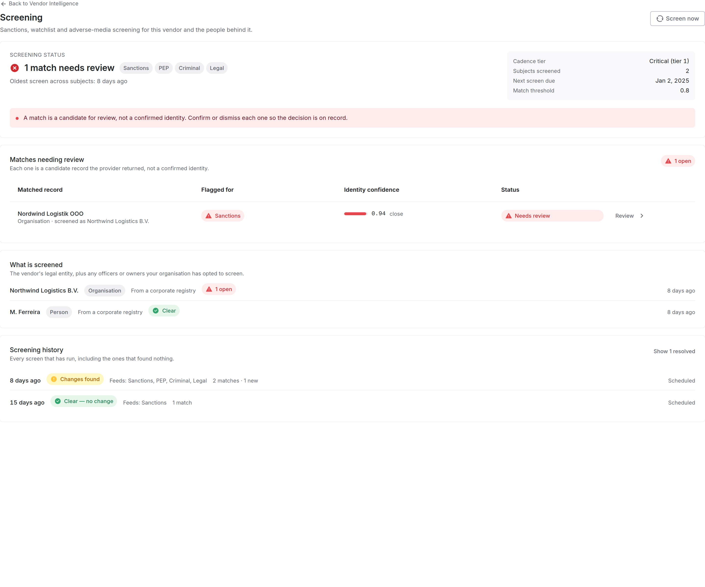
</Frame>

**In the review queue**: **Screening** in the left navigation. Every open match across every vendor, oldest first. This is the view when your job is to clear the queue rather than to look at one vendor. **Needs review**, **Confirmed** and **Resolved** switch between open and decided matches, and the source buttons beside them filter the list.

<Frame caption="The org-wide queue. Matches from different vendors in one list, oldest first.">
  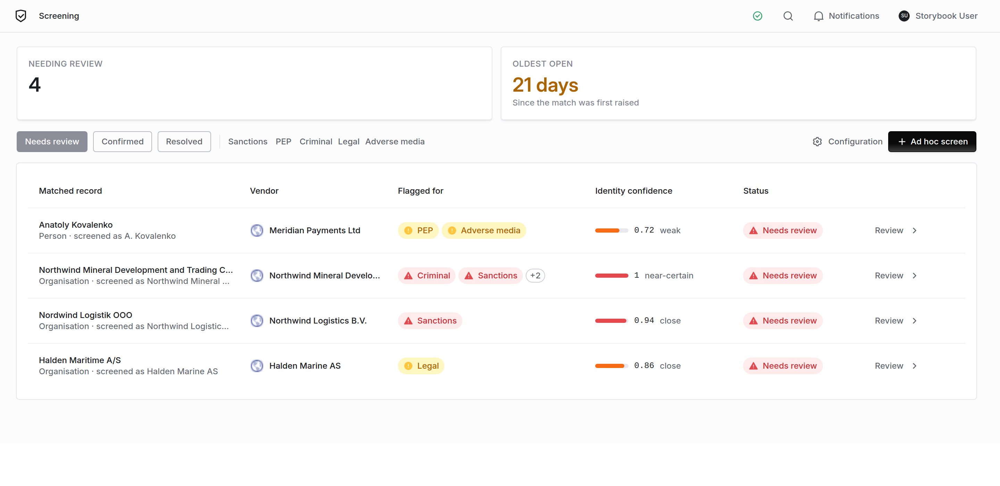
</Frame>

The queue is separate from Findings. A screening match is triaged on a different question from the rest of your work (*is this listed record this vendor?*), and mixing it into a general work queue buries the one kind of alert that carries a regulatory deadline. Each new match also opens a finding by default, so it has an owner and a due date while it waits. See [Deciding](#deciding).

## Identity confidence is not severity

Every match carries a score. It answers one question: **how confident are we that this listed record is this vendor?**

It does not tell you how serious the listing is. A match at 0.95 against an adverse-media article means we are confident the article is about this subject, not that the article is damning. A confirmed sanctions listing at 0.72 is far more urgent than a high-confidence mention in a news story.

<Warning>
  Read the source, not the score. The score decides whether it is them. The listing decides what it means.
</Warning>

Screening runs on thin identity data: a name, usually a country, sometimes a registration number, almost never a date of birth. That is not much to match on, so **false positives are expected and are not a defect**. A common surname or a generic trading name will produce candidates that are not your vendor. Clearing those is the job, which is why the queue exists.

## Reading a match

Open any match to get the full record.

<Frame caption="The review drawer: what matched, field by field, with the sources behind it.">
  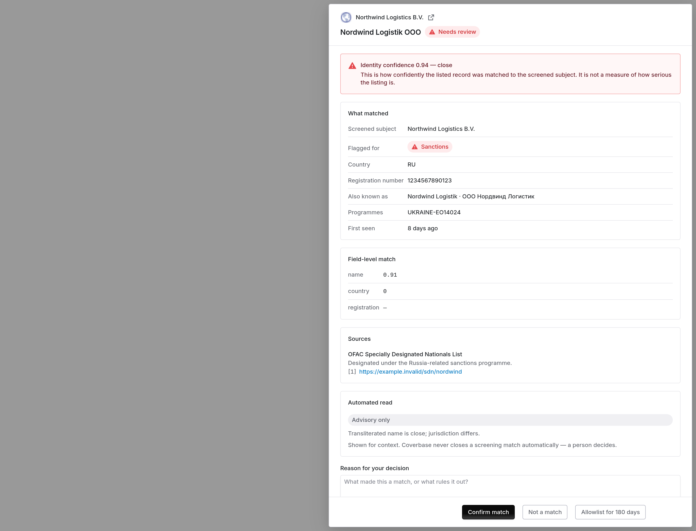
</Frame>

Work down it in this order:

1. **Screened subject vs matched name.** The two names side by side. This is usually enough to rule out an obvious mismatch.
2. **Country and registration number.** The strongest discriminators available. A registration number that matches is close to conclusive; a country that does not match is a strong signal it is a different entity.
3. **Also known as.** Transliterations and former names. A vendor that looks unrelated in English can match exactly in its own script.
4. **Field-level match.** Which attributes agreed, and how strongly. A high overall score built only on the name is weaker than a lower score built on name *and* registration.
5. **Sources.** The listing itself. Follow it before you decide.

The **automated read** is advisory. It is there for context. Coverbase never closes a match on it; a person decides.

## Deciding

Three outcomes. Each one needs a **Reason for your decision**, recorded with your name and the date. Write it for someone reading it in a year with none of your context. An administrator can make the reason optional by turning off **Require a reason for every decision** under **On a new match** in the settings, but a decision without a reason is weak evidence that a review happened.

| Decision | Use it when | What happens |
| --- | --- | --- |
| **Confirm match** | It is your vendor, and the listing is real | The match moves to **Confirmed** and its finding stays open. It is now a compliance matter, not a screening question. |
| **Not a match** | The listed record is a different party | The match closes as a false positive, and its finding is archived with your reason. |
| **Allowlist for 180 days** | It is a known, accepted match you do not want raised every cycle | Suppressed for 180 days, then re-raised for a fresh look. Its finding is archived with your reason. |

<Note>
  An allowlist expires so the match gets a fresh look. Circumstances change, and a permanent suppression can leave a real listing unnoticed for years.
</Note>

With **Open a finding** on in the settings (the default), every new match opens a finding the moment it is raised, assigned to the vendor's relationship owner or risk analyst. It picks up a due date, SLA reminders and the rest of the findings workflow. Confirming leaves it open; the other two decisions archive it. A match the source stops listing moves to **No longer listed** under **Resolved** on its own. Screening raises the alert; it does not decide what you do about it, and it never blocks a payment or an onboarding on its own.

## What "clear" looks like

A vendor with nothing to review still shows its run history.

<Frame caption="No open matches. The screens still show, with their dates and sources.">
  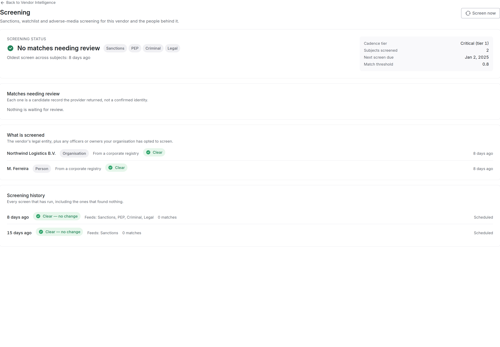
</Frame>

<Warning>
  An empty match list and a vendor that was never screened look similar and mean opposite things. Check the run history before you write "no sanctions exposure" into an assessment.
</Warning>

## Prove a vendor was screened

An auditor usually asks two things: when did you start screening this vendor, and when did you last screen it. A vendor's **Screening** tab answers both in **First screened** and **Last screened**. A vendor that is enrolled but has not finished a screen yet reads **Never screened**.

Each screen in the run history shows **Lists as of**: the date and time the provider screened against its sanctions and watchlists, which it refreshes from each source at least daily. Where the provider reports a list version, it shows beside the date.

To answer for every enrolled vendor at once, click **Download evidence** on the queue. You get a CSV with one row per enrolled vendor:

| Column | What it holds |
| --- | --- |
| **Vendor**, **Vendor ID** | The vendor, as named in Coverbase |
| **External ID** | Your own identifier for the vendor, such as its ERP or vendor master ID, from the vendor record |
| **First screened** | The date of the vendor's earliest completed screen |
| **Last screened** | The date of its latest completed screen |
| **Last outcome** | **Clear**, **Matches found** or **Failed** for its latest screen |
| **Open matches**, **Confirmed matches** | How many of its matches are waiting for a decision, and how many were confirmed |

The dates count only screens that completed, but **Last outcome** reads the latest screen whatever happened to it. So a vendor can show a **Last screened** date from last month beside a **Last outcome** of **Failed**: its latest screen failed, and last month's is the last one that completed. A vendor that has not been screened yet has empty dates and outcome. Check for **Failed** and empty rows before you hand the file over.

A vendor that is not enrolled, such as one in a risk level you do not monitor, is not in the file. The two dates show the first and the latest screen, not every screen in between. For every screen, use the **Export** menu.

### Every screen, every decision

The **Export** menu, beside **Download evidence** on the queue, has three more exports for an examiner who wants the full record rather than a summary.

**Every screen, last 12 months** downloads one row per screen, clear screens included. **Failed screens, last 12 months** downloads only the screens that failed, so you can check that each was retried. For any other date range, or one batch, use `GET /v1/screening/run-export`.

| Column | What it holds |
| --- | --- |
| **Run ID**, **Batch ID** | The screen, and the batch it ran in |
| **Vendor**, **Vendor ID**, **External ID** | The vendor, by name, Coverbase ID and your own ID |
| **Subject**, **Subject type** | Who was screened: the organization or a person |
| **Trigger** | Why it ran: scheduled, monitoring, manual, ad hoc, intake, vendor renamed, bulk re-screen and so on |
| **Outcome** | **Clear**, **Matches found**, **Failed** or **In progress** |
| **Started**, **Completed** | When the screen ran, in UTC |
| **Lists as of**, **List version** | The date of the lists it screened against, and the provider's list version when it reports one |
| **Sources screened** | Sanctions, PEP, criminal, legal or adverse media |
| **Match threshold** | The threshold the screen used, per source where one was set |
| **Matches**, **New matches**, **Cleared matches** | What it found, and how that changed from the screen before |
| **Triggered by**, **Error** | Who asked for a manual screen, and why a failed one failed |

**Matches and decisions** downloads one row per match: **Vendor**, **Vendor ID**, **External ID**, **Subject**, **Matched record**, **Sources flagged**, **Programs**, **Identity match score**, **First seen**, **Last seen**, **Decision**, **Reviewer**, **Decision date**, **Reason**, **Allowlisted until** and **Finding ID**. It is the disposition record for every match, open and decided.

### Batches

**Recent batches**, on the queue, groups screens by the run that sent them: each hourly sweep, each **Screen now**, each bulk re-screen and each rename. For each batch it shows when it started, what ran it, how many subjects it **Sent**, and of those how many were screened, matched, clear, failed and still in progress. A screen counts as screened once it starts, so **Screened** trails **Sent** while screens are queued. In an hourly sweep, **Sent** counts the vendors checked, and **Screened** counts only those the provider re-screened since the last check. To get one batch's rows, call `GET /v1/screening/run-export` with its `batch_id`.

In the run history, a screen that found something lists each match with the decision recorded on it: who decided, when, and the reason they gave. A match still waiting for a decision says so. That is the record of why you kept working with a vendor after a hit.

## Screen a vendor now, or someone it missed

**Screen now**, at the top of a vendor's Screening tab, screens the vendor straight away instead of waiting for the schedule. It works once a screening provider is connected, even if **Screen vendors on a schedule** is off. In the dialog you choose:

- **Who to screen**: the organization itself, and any officers or owners already screened for the vendor. A vendor nobody has screened yet screens the organization.
- **Screen against**: any of the sources switched on for your organization, such as sanctions, PEP or adverse media. A source switched off in the settings is not offered.
- **Keep re-screening on a schedule**: on by default when your organization screens on a schedule, and off and locked when it does not. Turn it off to screen once without monitoring.

The page opens the result when the provider answers. Each subject under **What is screened** also has its own **Re-screen on a schedule** switch.

**A renamed vendor is screened straight away.** When a vendor's name changes, from the app, the API, an import or an automation, Coverbase screens it under its new name within minutes instead of waiting for the nightly sweep. The run shows the trigger **Vendor renamed**. An administrator can turn this off under **Automation** with **Screen a vendor again when its name changes**.

**People not screened** lists people named in the vendor's leadership research that screening does not cover, either because their identity could not be confirmed automatically or because no registry filing names them. **Confirm & screen** enrolls one of them for continuous screening, and **Add individual** enrolls someone the research did not find. Either records that you vouched for the person's identity, so check who they are first.

## Screening in a Zero Touch assessment

When your organization has a screening provider connected, a Zero Touch assessment screens the vendor itself before it grades. It uses your organization's sources, and it runs whether or not **Screen vendors on a schedule** is on. The screen shows in the vendor's screening history with the trigger **Zero Touch assessment**, and an open match feeds the report's Reputation section.

A Zero Touch assessment reuses a screen of the same subject from the last 24 hours instead of screening again, but only when that screen asked for the same thing. With World-Check One or Dow Jones, that means the same sources and the same match threshold. A screen under different sources or a different threshold is not reused, and the vendor is screened again.

The report's **Screening** section lists who was screened, the sources, every screen on record, including the clear ones, and the decision and reason recorded on each match. A report run without a provider connected has no Screening section.

## Screen a name once

**Ad hoc screen**, on the queue, screens one name a single time without enrolling it for monitoring. Use it for a prospective supplier, a new director, or a name someone asks about.

1. Pick **Organisation** or **Person** and enter the **Legal Name** or **Full Name**.
2. Add any identifying details you have. Each one rules candidates out; a name on its own returns the most to review.
3. Check the **Sources**. They default to what your policy runs, and a source switched off for your organization cannot be picked.
4. Optionally pick a **Linked Vendor**, so the screen also shows on that vendor's record. Left empty, it stands on its own and creates no vendor.
5. Click **Run screen**. The page opens the result when the provider answers, and any match lands in the queue marked ad hoc.

An ad hoc screen raises no finding. Its matches are reviewed and decided like any other.

## Screen a vendor at intake

When someone requests a new vendor, the intake portal's pre-qualification step checks it for sanctions. An administrator sets how under **Configuration → Portal Templates**, on the intake template, under **Pre-qualifications**, below **Enable sanctions check**. Turning **Enable sanctions check** off skips the check entirely.

**Screen Against** picks the source:

- **Coverbase sanctions screening** (the default) screens the vendor with your organization's screening provider once screening is connected. The screen is recorded in the screening history, and a possible match goes to the queue marked ad hoc, like any other match.
- **OFAC list only** matches the vendor's name against the US Treasury's SDN and consolidated lists. Nothing is recorded in the screening history.

With **Coverbase sanctions screening** selected you also choose:

| Setting | Default | What it does |
| --- | --- | --- |
| **Sources** | Sanctions | What the screen covers. A source switched off in your screening settings is skipped here too. |
| **Identity Match Threshold** | Use screening policy | How sure a match must be that a listed party is this vendor before it is raised. |
| **Include headquarters country** | On | Sends the vendor's country with its name. It narrows a common name to the right company, and can miss a listing filed under another country. |
| **Also screen suggested alternatives** | Off | Screens the alternatives intake suggests too. Each screen is billed. Off, the alternatives are checked against the OFAC list. |

What the requester sees:

- A possible match fails the sanctions check and names the listed party. Review it in the queue. A match you mark **Not a match** or allowlist no longer fails the check when the requester runs intake again.
- Until screening is enabled and connected with an API key, intake runs its standard OFAC list check, and the step works as it always has. The same happens if every chosen source is switched off, or if a screen can't complete because the provider is down or rejects the key. A failed screen still shows in the screening history, and a rejected key shows on the Screening settings page.
- If the OFAC lists themselves can't be read, the check says it needs review. It never reads as clear.

Intake runs pre-qualification again when the requester edits the request. A screen of the same vendor with the same settings in the last 24 hours is reused rather than run and billed again.

Coverbase downloads the OFAC SDN and consolidated lists fresh every day and checks them every hour. If a download fails, the check keeps using the last copy rather than an empty one. If that copy is more than a day old, your organization's administrators get a notification, in the app and by email, saying when the copy was taken, and Coverbase's on-call team is alerted.

## Settings

An administrator configures screening once, under **Configuration → Monitoring → Screening**, or from **Configuration** on the queue. It needs the `integration` permission, not the screening one.

<Frame caption="The policy: which sources, who gets screened, which vendors are monitored and how often, and what a new match raises.">
  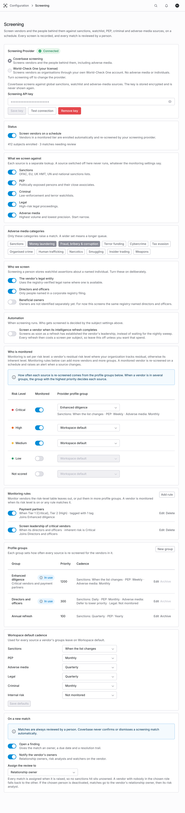
</Frame>

The decisions that matter:

**Which provider.** Under **Screening Provider**, **Coverbase screening** is the default. If your organization has its own LSEG World-Check One license, you can screen through it instead. See [Screen through your World-Check One license](#screen-through-your-world-check-one-license). The rest of this section describes Coverbase screening.

**Which sources.** Sanctions, PEP, criminal and legal are on by default. Adverse media is off, and should stay off until the rest is running cleanly. It is the highest-volume and lowest-precision source, and it will dominate your queue. When you do turn it on, keep the category list narrow.

**Who gets screened.** The vendor's legal entity is screened by default. Directors, officers and beneficial owners are opt-in, because screening a person means storing watchlist assertions about a named individual. Turn them on only when you need them. Under **Automation**, **Screen a vendor when its intelligence refresh completes** screens as soon as a refresh has established the vendor's leadership instead of waiting for the nightly sweep. It is off by default, because every refresh then costs a screen per subject.

Under **Automation**, **Screen a vendor again when its name changes** is on by default. It screens a renamed vendor as soon as the change is saved. It costs one screen per renamed vendor.

**Which risk levels are monitored.** Monitoring is set per risk level: the vendor's residual risk level where your organization tracks residual risk, otherwise its inherent level. A monitored vendor is re-screened on a schedule and raises an alert when a source changes. Each level can also put its vendors in one profile group, which sets how often they are re-screened.

<Frame caption="Monitoring per risk level. A level's profile group shows the cadence it sets for each source.">
  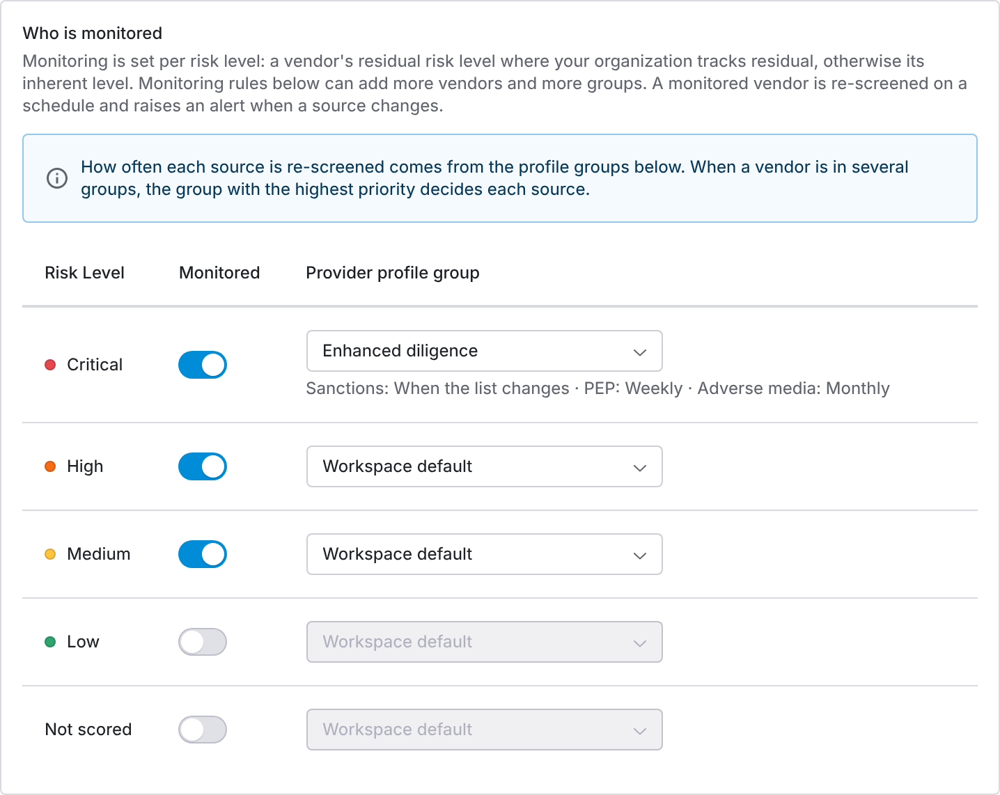
</Frame>

Nothing is monitored until you switch a level on or add a rule, and vendors with no risk score sit in their own **Not scored** row, so switching screening on does not enroll your entire long tail. A monitored vendor is a standing subscription, not a one-off charge. The table lists your risk scale's levels, so set up the scale under Scoring first.

**Monitoring rules.** A rule monitors vendors the risk-level table leaves out, or puts them in more profile groups. Under **Monitoring rules**, click **Add rule**, name it, and set the conditions it applies to:

| Condition | Matches |
| --- | --- |
| **Subject** | **The vendor itself**, **Its directors and officers**, or both |
| **Inherent risk level** | The vendor's inherent risk level, whether or not your organization tracks residual risk |
| **Residual risk level** | The vendor's residual risk level |
| **Supplier tier** | The vendor's tier, from Tier 1 (Critical) to Tier 4 (Low) |
| **Vendor tags** | Any of the tags you pick |

Every condition you set must match, and a condition you leave empty is ignored. A rule needs at least one condition. Under **Add to profile groups**, pick the groups its vendors join, or leave it empty to monitor them on the workspace default cadence.

<Frame caption="A rule that monitors the directors and officers of Tier 1 vendors in their own profile group.">
  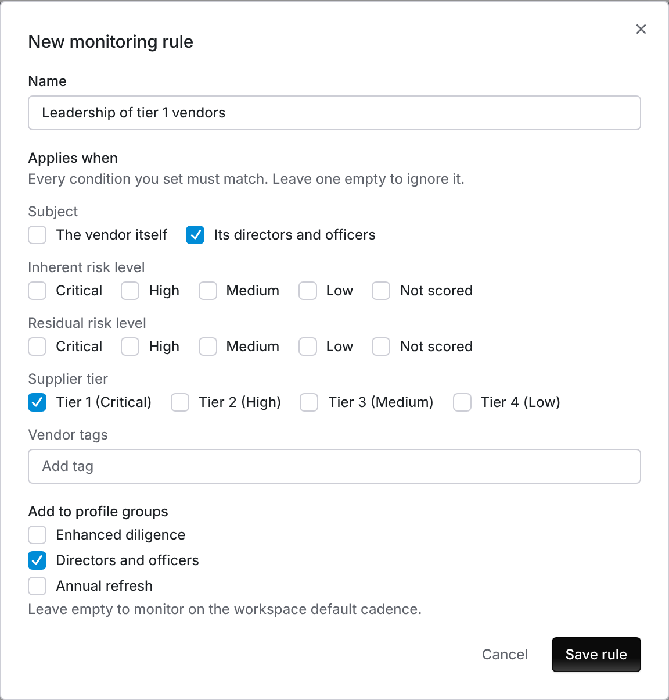
</Frame>

A vendor is monitored when its risk level is switched on or any rule that is on matches it. It joins the level's group and every matching rule's groups. When a vendor's risk score, tier or tags change, the next nightly sweep moves it into or out of the right groups. Use the switch beside a rule to pause it without deleting it.

<Frame caption="Each rule lists its conditions and the groups its vendors join.">
  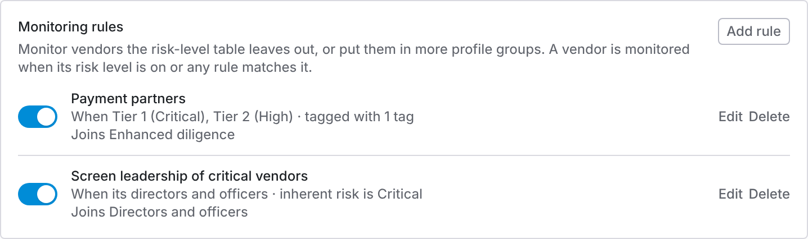
</Frame>

**Profile groups.** A profile group sets how often each source is re-screened for the vendors in it. Under **Profile groups**, click **New group**, or **Edit** on an existing one.

<Frame caption="Each group's priority and the cadence it sets per source. A group a risk level or rule uses is marked In use.">
  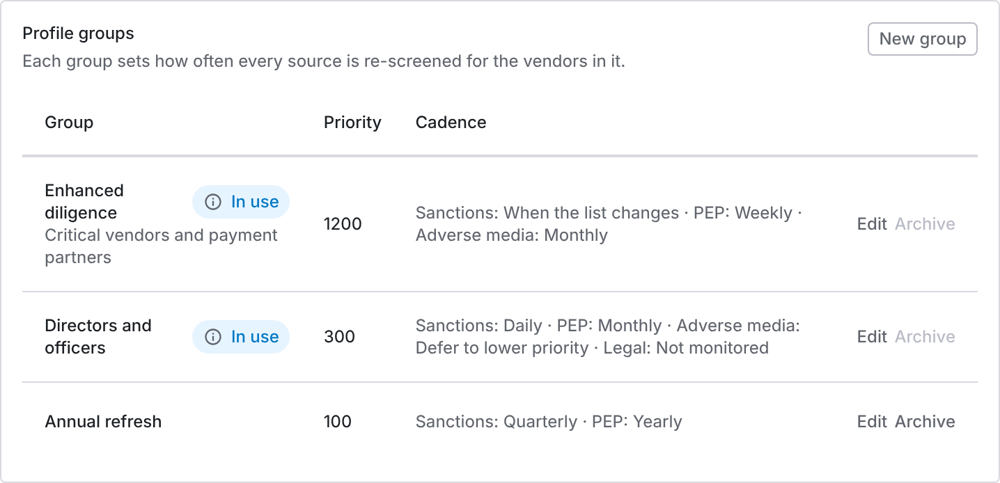
</Frame>

For each source, pick a cadence: **Daily**, **Weekly**, **Monthly**, **Quarterly**, **Every 6 months**, **Yearly**, or **Not monitored**. Sanctions can also use **When the list changes**. Two more choices pass the decision on:

- **Workspace default** uses the workspace default cadence for that source.
- **Defer to lower priority** passes the source to the vendor's next group by priority. If no group sets it, that source is not monitored for the vendor.

<Frame caption="A group's priority and its cadence for each source.">
  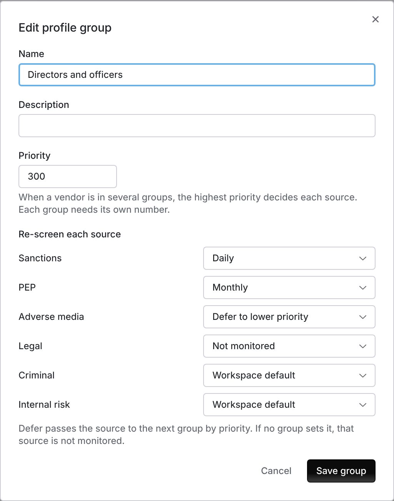
</Frame>

**Priority** decides which group wins when a vendor is in several. For each source, the highest-priority group that sets it decides how often it runs. Each group needs its own priority number. A group that a risk level or a rule still uses can't be archived: move them to another group first.

**Workspace default cadence.** Once Coverbase has connected your screening workspace, **Workspace default cadence** sets the cadence for every source a vendor's groups leave on **Workspace default**. Change a source and click **Save defaults**.

<Frame caption="The cadence every source falls back to.">
  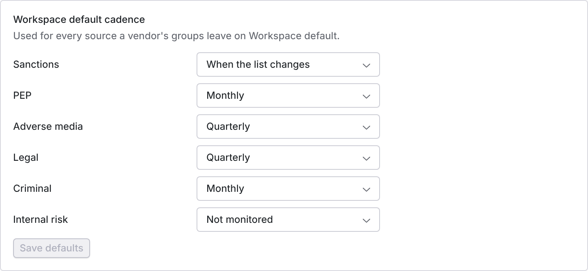
</Frame>

**What a new match raises.** Under **On a new match**, **Open a finding** and **Notify the vendor's owners** are on by default. **Assign the review to** picks the vendor's **Relationship owner** or **Risk analyst**, or **Specific person** to send every match to one named reviewer, such as a central TPRM analyst. A vendor with nobody in the chosen role falls back to the other, so no match sits unowned. If the chosen person is later deactivated, matches go to the vendor's relationship owner, then its risk analyst, and the page shows a warning until you choose someone else.

**The match threshold.** The identity match threshold decides how sure a listed record must be that it is your vendor before it is raised. It is 0.80 by default and shows as **Match threshold** on each vendor's Screening tab. Lower it and you will see more true matches and many more false ones; raise it and you risk missing a real listing on thin data. You can set it at three levels:

| Level | Where | Applies to |
| --- | --- | --- |
| **Overall** | **Match threshold**, under **What we screen against** | Every screen, unless a narrower level sets its own |
| **Per source** | **Threshold by source**, below it | That source only, for example a stricter bar for sanctions than for adverse media. **Same as overall** uses the overall threshold. |
| **Per risk level** | The **Match threshold** column in **Who is monitored** | Screens of vendors at that risk level. **Same as overall** uses the overall threshold. |

A per-source threshold wins over the risk level's for that source. The threshold applies to every screen Coverbase sends: **Screen now**, a bulk re-screen, a renamed vendor, and the search that pulls the details of a match monitoring raised. An intake template's **Identity Match Threshold** and an ad hoc screen's **Match Threshold** apply to that screen alone. Per-source thresholds are Coverbase screening only; World-Check One and Dow Jones use the overall and risk-level thresholds.

**Re-screen every vendor.** **Re-screen every vendor**, on the settings page once a provider is connected, screens every enrolled vendor and person now, against your current sources and thresholds. Use it after you change your policy or when an examiner asks for a fresh screen of the whole book. It shows how many screens it will run, and how many vendors they cover, before you confirm, and it never runs more than you confirmed. Each one is billed. A second re-screen of every vendor is refused for an hour after one starts. The screens run as one batch, paced so a large book takes a while, and show under **Recent batches** on the queue.

**Every change is logged.** Each change on this page is written to the system audit log, under **Configuration → Audit Logs** in the **Configuration** group, with who made it, when, and the old and new values: sources, thresholds, subjects, monitored risk levels, monitoring rules, profile groups and the workspace default cadence. Decisions on matches are recorded on the match and in its finding. See [Audit trails](/security/audit-trails).

<Note>
  A source switched off at the top level is never raised as a match, whatever the monitoring table, rules or profile groups say. One switch turns a source off everywhere, rather than making you clear it in every group.
</Note>

## Screen through your World-Check One license

If your organization already licenses LSEG World-Check One, Coverbase can screen your vendors through your own account. Matches still come to the Coverbase queue, you decide them there, and the evidence above covers them the same way.

The mistake to avoid is switching providers before you check what World-Check One screens. It screens organizations only, so it leaves out the people behind a vendor and adverse media.

### Connect your account

1. Ask your World-Check One administrator for a service account in the group where Coverbase should create vendor cases.
2. In Coverbase, go to **External Integrations** and open the **LSEG World-Check One** tile, under **Risk Intelligence & Analytics**.
3. Paste the **Service Account UUID** and **Service Account Secret**, then click **Save credentials**.
4. Click **Test connection**. A working account lists the groups it can use. If it says the account is not in any group, ask your World-Check One administrator to add it to one.

### Choose it in your settings

1. Under **Configuration → Monitoring → Screening**, pick **World-Check One (your license)** under **Screening Provider**, and confirm the switch.
2. Pick a **World-Check One Group**. Coverbase creates each vendor's case in this group. Changing the group later does not move cases already created.
3. Set **Who is monitored** by risk level, as for Coverbase screening. Monitoring rules, profile groups and the workspace default cadence are Coverbase screening only.
4. Switch on **Screen vendors on a schedule**.

<Warning>
  You can change the provider only while screening is switched off. Once a provider holds cases for your vendors, only Coverbase support can change it.
</Warning>

### What changes with World-Check One

| | Coverbase screening | World-Check One |
| --- | --- | --- |
| **Who is screened** | The vendor's legal entity, and directors, officers and owners if you opt in | The vendor's legal entity only |
| **Sources** | Sanctions, PEP, criminal, legal and adverse media | World-Check One's Sanctions, PEP, Law Enforcement and Regulatory Enforcement categories, shown as sanctions, PEP, criminal and legal. No adverse media. |
| **Identifying details sent** | Name, country, registration number and more | Legal name and country of registration, where Coverbase has them |
| **How often** | Set by the provider profile group | On enrollment, then every 350 days |
| **Ad hoc screen** | An organization or a person, with any identifying details | An organization, by name and country |

A matched record can carry other World-Check One categories too. They show on the match as context, but only the four above raise a match, and only for sources switched on under **What we screen against**.

Coverbase screens each monitored vendor when it is enrolled, then again 350 days after its last completed screen. That leaves 15 days in each year to retry a failed screen. **Next screen due** on a vendor's tab shows the date. To screen a vendor sooner, use **Screen now**.

When you switch on screening, Coverbase works through your monitored vendors in hourly batches. A long vendor list takes a while to screen the first time, and each vendor reads **Never screened** until its first screen completes.

Decisions stay in Coverbase. Confirming, dismissing or allowlisting a match does not change the case in World-Check One.

The pre-qualification sanctions check at intake screens through World-Check One too. On the intake template it shows as **World-Check One sanctions screening**.

If World-Check One rejects the service account, scheduled screening for your organization pauses, and the settings page shows **The last screen failed** with World-Check One's reason. It resumes once you save working credentials on the tile. Removing the service account switches screening off.

## Screen through your Dow Jones license

If your organization licenses Dow Jones Risk & Compliance, Coverbase can screen your vendors through your own Dow Jones account. Screens run through the same run, match and review steps as Coverbase screening: matches come to the Coverbase queue and you decide them there.

Unlike World-Check One, Dow Jones screens the people behind a vendor as well as the vendor, and screens adverse media when you switch that source on.

### Connect and choose Dow Jones

1. In Coverbase, go to **External Integrations** and open the **Dow Jones Risk & Compliance** tile. Save the Dow Jones service account (client ID, user name and password).
2. Under **Configuration → Monitoring → Screening**, pick **Dow Jones Risk & Compliance (your license)** under **Screening Provider**. Confirm **Switch to Dow Jones Risk & Compliance?**. Dow Jones has no provider profile groups, so the switch clears monitoring rules.
3. Set **Who is monitored** by risk level, and switch on **Screen vendors on a schedule**.

<Frame caption="Dow Jones chosen as the screening provider, with its service account saved in External Integrations.">
  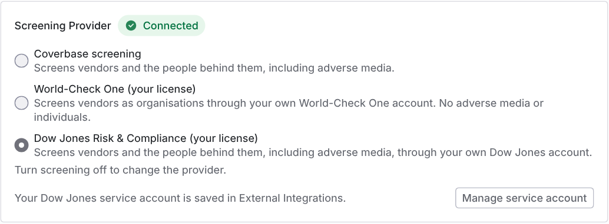
</Frame>

Until the service account is saved, the settings page says **Connect Dow Jones in External Integrations first.**, and **Add service account** opens the tile.

### What changes with Dow Jones

- **Adverse media categories are not offered.** Dow Jones screens every adverse media category, so you cannot narrow matches by category. The settings page shows a note in place of the category controls.
- **Coverbase sets the schedule.** As with World-Check One, Coverbase screens each monitored vendor when it is enrolled, then again 350 days after its last completed screen. Monitoring rules, profile groups and the workspace default cadence are not used.
- **The provider is fixed once vendors are screened.** You can change the provider only while screening is switched off, and once vendors have been screened through Dow Jones, only Coverbase support can change it.

## Who can do what

Screening has its own permission, separate from the vendor record, so the person who reviews matches need not be the person who administers vendors.

| Permission | Allows |
| --- | --- |
| `screening_match:read` | See the queue, the vendor tab, and match detail |
| `screening_match:update` | Confirm, dismiss or allowlist a match; screen a vendor now; enroll a person; run an ad hoc screen |
| `screening_match:export` | Download the evidence, run and match CSVs |
| `integration:update` and `screening_match:update` | **Re-screen every vendor** |
| `integration:read` / `integration:update` | See and change the screening configuration, including monitoring rules, profile groups and the workspace default cadence, and the World-Check One service account |

There is no create or delete. Matches come from the provider and are closed by decision, never removed.

## Work screening from MCP or the API

You can read the queue, screen vendors and record decisions from an MCP client, and read and screen with an API key. An MCP client reads with `query_vendors(kind="screening")`, `query_vendors(kind="screening_matches")` and `query_vendors(kind="screening_match")`. It screens with `mutate(entity="screening", action=...)` (`rescreen_vendor`, `enroll_person`, `ad_hoc`) and records a decision with `mutate(entity="screening_match", action="disposition")`.

The API routes are `GET /v1/vendors/{vendor_id}/screening`, `POST /v1/screening-matches/query`, `POST /v1/vendors/{vendor_id}/screening/rescreen`, `POST /v1/vendors/{vendor_id}/screening/people` and `POST /v1/screening/ad-hoc`. The exports are `GET /v1/screening/evidence-export`, `GET /v1/screening/run-export` and `GET /v1/screening/match-export`, and `GET /v1/screening-batches` returns the batch summary. See [Screening](/api-reference/vendor-administration#screening).

Before an MCP client sends a write, it shows you the change and waits for you to confirm it. The [MCP tool reference](/mcp/tool-reference#vendors-services-and-documents) lists every field.

These routes need `screening_match` permission, which API keys do not hold, so use a key created by a person whose role holds it. Even then, a key cannot decide a match. Clearing a match is a decision for a person.

## Troubleshooting

| Symptom | Fix |
| --- | --- |
| The Screening tab says screening isn't set up yet | No screening provider is connected. An administrator adds the API key (or the World-Check One service account and group) under **Configuration → Monitoring → Screening**. |
| The Screening tab says scheduled screening is off | You can still use **Screen now**. To re-screen vendors automatically, an administrator switches on **Screen vendors on a schedule** under **Configuration → Monitoring → Screening**. |
| A vendor you expected to be monitored has no recent screens | Check the vendor's risk level, and that the level is switched on under **Who is monitored**, or that a monitoring rule that is on matches it. A vendor with no risk score is under **Not scored**. |
| **Screen now** says nobody is enrolled | The settings screen nobody for this vendor. Check **Who we screen**, or use **Add individual** to screen a person. |
| **Adverse media categories** are missing from the settings | Dow Jones is the provider. It screens every adverse media category, so there is nothing to narrow. |
| **Connect Dow Jones in External Integrations first.** | Dow Jones is chosen but no service account is saved. Click **Add service account** and save it on the tile. |
| A Zero Touch assessment screened the vendor again although it was screened today | The earlier screen used different sources or a different match threshold, so it was not reused. |
| A director named on the People tab is not screened | Directors and officers are opt-in, and only people a registry filing names are enrolled automatically. Use **Confirm & screen** under **People not screened**. |
| A dismissed match is back | An allowlist lasts 180 days, then the match is raised again for a fresh look. A match you marked **Not a match** stays closed. |
| A screen says **Could not get this screen's result** | The provider did not return a result. Coverbase retries the screen, and it lands in the queue when it finishes. It never reads as clear. |
| **World-Check One (your license)** cannot be picked | Switch off **Screen vendors on a schedule** first. If the page says to contact support, the current provider already holds cases for your vendors. |
| **Archive** is greyed out on a profile group | A risk level or monitoring rule still uses the group. Move them to another group, then archive it. |
| Saving a profile group says another group uses this priority | Each group needs its own priority. Pick a different number. |
| There is no **Workspace default cadence** card | Coverbase has not connected your screening workspace yet. Contact your Coverbase account team. Profile groups and rules work without it. |
| No **World-Check One Group** to pick | The service account is not in a group. Ask your World-Check One administrator to add it to one, then test the connection again. |
| Scheduled World-Check One screens stopped | World-Check One rejected the service account. Save working credentials on the **LSEG World-Check One** tile and screening resumes. |
| **People not screened** is missing from a vendor's tab | Your organization screens through World-Check One, which screens organizations only. |
| The evidence CSV shows **Failed** for a vendor | Its latest screen failed. Run **Screen now** on the vendor, and check the settings page for a provider error. |
| **Give a reason for this decision** | Your organization requires a reason with every decision. Write one, or ask an administrator about **Require a reason for every decision**. |
| **Re-screen every vendor** says the count has changed | Vendors were enrolled or removed since you opened the dialog. Review the new count and confirm again. |
| An export says to narrow the date range | It has more than 50,000 rows. Use `GET /v1/screening/run-export` with a shorter range, or one batch at a time. |
| A notification says the OFAC lists could not be refreshed | The daily download failed and the copy intake checks against is more than a day old. Coverbase is retrying hourly. Consider holding intake approvals that rely on the OFAC list check until it clears. |

## Related

<CardGroup cols={2}>
  <Card title="Screening coverage and sources" icon="list" href="/user-guides/screening-coverage">
    Every sanctions list, PEP role and adverse media category, and the options Coverbase configures on request.
  </Card>
  <Card title="Corporate registrations guide" icon="building-columns" href="/user-guides/corporate-registrations">
    The legal entity that is screened.
  </Card>
  <Card title="People intelligence guide" icon="users" href="/user-guides/people-intelligence">
    The directors and officers who can be screened alongside it.
  </Card>
  <Card title="Zero Touch Assessments" icon="bolt" href="/user-guides/zero-touch-assessments">
    Open watchlist matches as an input to the score.
  </Card>
  <Card title="Dark web monitoring guide" icon="mask" href="/user-guides/dark-web-monitoring">
    The neighboring Vendor Intelligence tab: leak sites, breach catalogs, infostealer logs and lookalike domains.
  </Card>
</CardGroup>
