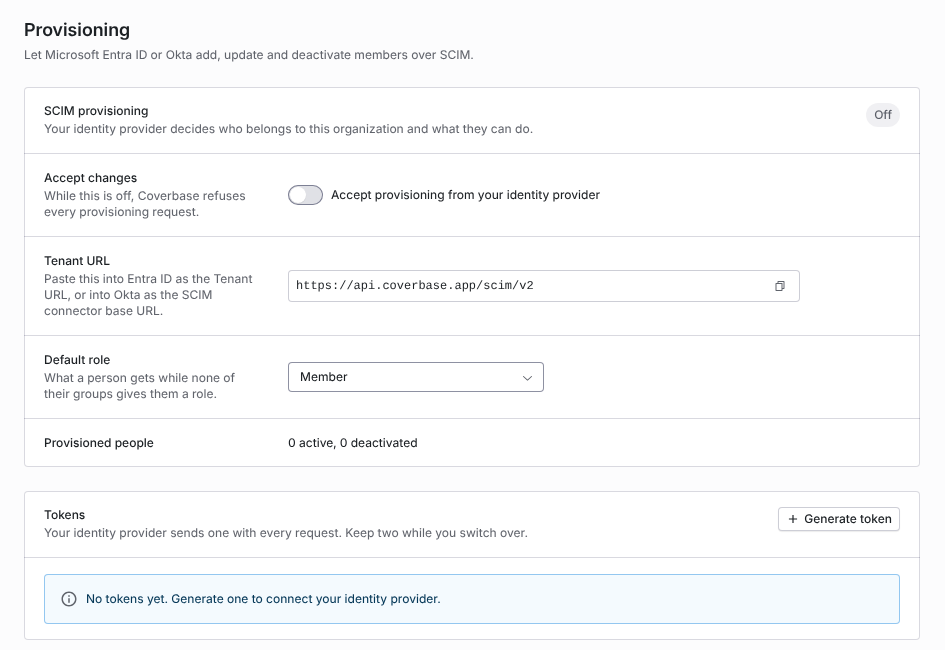
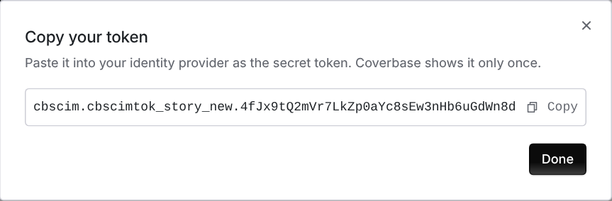
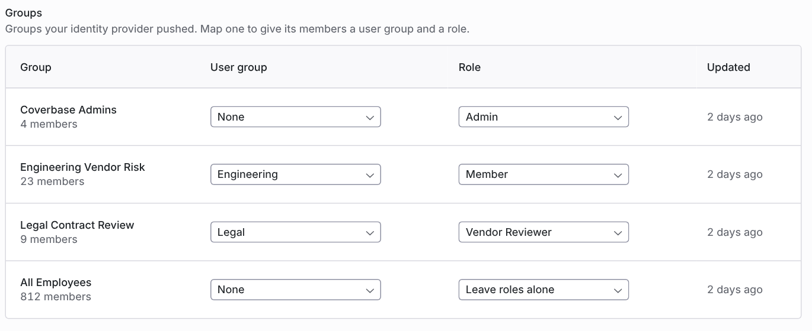

import AgentDirective from "/snippets/agent-directive.mdx";

<AgentDirective />

<Info>
  This guide is part of the [User Guides](/user-guides/overview) collection. It covers **Organization → Provisioning**. It sits beside [Permissions and roles](/user-guides/permissions-and-roles), which explains the roles a group can give, and [Assignment and delegation](/user-guides/assignment-and-delegation), which explains user groups. For single sign-on and the other ways to manage the joiner, mover and leaver lifecycle, see [Identity and access](/security/identity-and-access).
</Info>

Your identity provider (Microsoft Entra ID or Okta) creates, updates and deactivates Coverbase members, and pushes groups that you map to user groups and roles. Coverbase is the SCIM 2.0 service provider. You set it up on one page, without a support ticket.

Your Coverbase representative turns on SCIM provisioning for your organization. You need the Admin role to open the page, because a provisioning token can create admins.

The mistake people make most often is mapping a role to one group as a test. The first role mapping hands every provisioned person's role to the directory at once, not only that group's members. Plan the role mappings for all your groups before you save the first one.

## The Provisioning page

Open **Organization** and choose **Provisioning**, or search the command palette for *Provisioning*.

<Frame caption="Organization → Provisioning before any token is generated. Accept changes is off, so Coverbase refuses every request.">
  
</Frame>

| Row | What it does |
| --- | --- |
| **SCIM provisioning** | Shows **On** or **Off**. |
| **Accept changes** | While **Accept provisioning from your identity provider** is off, Coverbase refuses every provisioning request with `403`. Entra ID reports that as a failed test connection. |
| **Tenant URL** | The SCIM base URL. Paste it into Entra ID as the **Tenant URL**, or into Okta as the **SCIM connector base URL**. |
| **Default role** | What a person gets while none of their groups gives them a role. |
| **Provisioned people** | How many people the directory provisioned, active and deactivated. |

Below the settings are **Tokens**, **Groups** and **Recent activity**. **Recent activity** lists the last 100 changes your identity provider sent, including the ones Coverbase refused, with the status code and the reason for each refusal.

## Step 1: Generate a token

Your identity provider sends a token with every request.

1. Under **Tokens**, click **Generate token**.
2. Click **Copy** in **Copy your token**, then click **Done**.

<Frame caption="The token dialog. Coverbase shows the token only once.">
  
</Frame>

<Warning>
  Coverbase stores only a hash of the token and shows it only in this dialog. If you close it without copying the token, revoke the token and generate another.
</Warning>

The token list shows the last four characters of each token (**Ends in**), who created it and when, and when it was last used.

- **Rotate** stops the current token at once and gives you a new one. Paste the new token into your identity provider right away.
- **Revoke** stops the token. Your identity provider can no longer provision with it.

An organization can hold two active tokens, so you can switch a connection over without a gap: generate the second token, update the identity provider, then revoke the first. With two active tokens, **Generate token** is unavailable until you revoke one.

Each token can make 600 requests a minute. A request past that limit gets `429` with `Retry-After: 60`, and identity providers retry it.

## Step 2: Connect Microsoft Entra ID

<Steps>
  <Step title="Open the application">
    In the Entra admin center, open **Enterprise applications** and choose the Coverbase application you use for single sign-on, or create a new non-gallery application.
  </Step>
  <Step title="Set up provisioning">
    Under **Provisioning**, set **Provisioning Mode** to **Automatic**. Paste the Tenant URL into **Tenant URL** and the token into **Secret Token**. Click **Test Connection**.
  </Step>
  <Step title="Keep the default mappings">
    Under **Mappings**, keep **Provision Microsoft Entra ID Users** and **Provision Microsoft Entra ID Groups** on. The default user mapping works. Remove mappings for attributes your tenant leaves empty. Coverbase ignores attributes it does not use.
  </Step>
  <Step title="Choose who is provisioned">
    Set **Scope** to **Sync only assigned users and groups**, assign the people and groups who use Coverbase, and turn **Provisioning Status** on.
  </Step>
  <Step title="Accept changes in Coverbase">
    On **Organization → Provisioning**, turn on **Accept provisioning from your identity provider**.
  </Step>
</Steps>

Entra ID's first cycle can take up to 40 minutes, and later cycles run every 40 minutes. To push one person at once, use **Provision on demand** in Entra ID.

## Step 2: Connect Okta

Use these steps instead of the Entra ID steps when Okta is your identity provider.

<Steps>
  <Step title="Enable SCIM">
    In the Okta admin console, open the Coverbase application (or create a SAML app integration) and, on the **General** tab, enable SCIM provisioning.
  </Step>
  <Step title="Set up the connector">
    On the **Provisioning** tab, under **Integration**, set:

    - **SCIM connector base URL**: the Tenant URL
    - **Unique identifier field for users**: `userName`
    - **Supported provisioning actions**: **Push New Users**, **Push Profile Updates** and **Push Groups**
    - **Authentication Mode**: **HTTP Header**, with the token as the Bearer value

    Click **Test Connector Configuration**, then save.
  </Step>
  <Step title="Turn on the actions">
    Under **To App**, enable **Create Users**, **Update User Attributes** and **Deactivate Users**.
  </Step>
  <Step title="Assign people and push groups">
    Assign people to the application, and add the groups you want to map under **Push Groups**.
  </Step>
  <Step title="Accept changes in Coverbase">
    On **Organization → Provisioning**, turn on **Accept provisioning from your identity provider**.
  </Step>
</Steps>

## Step 3: Map groups to user groups and roles

A pushed group gives nothing until you map it. Each group your identity provider pushed is listed under **Groups**, with its member count.

<Frame caption="Groups mapped to user groups and roles. All Employees is set to Leave roles alone, so it gives no role.">
  
</Frame>

For each group, choose:

- **User group**: the Coverbase user group its members join. **None** adds them to no user group.
- **Role**: the role its members get. **Leave roles alone** gives no role.

A mapping applies to the group's current members as soon as you save it. When someone joins or leaves the group later, Coverbase applies the mapping again.

### How roles follow groups

Roles follow groups only once at least one group in your organization maps a role. From then on:

- The directory decides the role of every person it provisioned. A person in no role group gets the **Default role**.
- The first role mapping, and any later change to the **Default role**, apply to every provisioned person at once.
- When a person is in several role groups, the strongest role wins: Admin, then any custom role, then Member, Siloed Member, Auxiliary Member and Guest. Between two custom roles, the group whose name sorts first wins.

Until a group maps a role, a person keeps the role they have, and a new person gets the **Default role**.

### Remove the last role mapping

To hand roles back to your admins, set every group's **Role** to **Leave roles alone**. When the last role mapping goes, everyone keeps the role they hold at that moment, and admins manage roles on **Organization → People** again.

### User groups

A user group mapped to a directory group gains the group's members and loses the people who leave it, unless another mapped group keeps them in it. When your identity provider deletes a group, its members leave the user group it was mapped to. The user group itself stays.

## What each change does in Coverbase

| Your identity provider | Coverbase |
| --- | --- |
| Creates or assigns a person | Finds the person by email, or creates them, and makes them an active member with their role. An existing member keeps their role until a mapped group gives them one. |
| Updates a person | Updates the name and the other attributes Coverbase keeps. A changed email address is kept on the provisioning record only. The address the person signs in with does not change. |
| Deactivates or deletes a person | Removes their access to the organization and marks them departed. See [What deactivation does](#what-deactivation-does). |
| Reactivates a person | Makes the same account active again and clears the departure. Coverbase does not create a second account. |
| Changes a group's members | Applies the group's mapping to the people who joined or left. |

If Coverbase cannot give a person access in its sign-in service, the request fails with `503` and nothing changes, so your identity provider retries it. The failure shows under **Recent activity** as **Failed (503)**.

### What deactivation does

When your identity provider deactivates or deletes a person:

- Their membership is set inactive and they can no longer sign in to your organization.
- They are marked departed, so they appear in the **Departed owners** list on **Organization → People**, which raises a reassignment work item when they still own records.
- They leave every user group a directory group gave them. When they return, they get back only what their groups give them then.
- Nothing they own or created is deleted. Their vendors, assessments, findings and comments stay attributed to them.

## Audit trail

Every change the directory makes is in the organization's audit log as a system change, with `source: scim`: people created, updated, deactivated and role changes, user group membership changes, and group changes. Changes an admin makes on the Provisioning page (settings, tokens and group mappings) are recorded with that admin as the actor. See [Audit trails](/security/audit-trails).

## Troubleshooting

| What you see | Cause | Fix |
| --- | --- | --- |
| No **Provisioning** item under **Organization** | SCIM provisioning is not turned on for your organization, or you are not an Admin. | Ask your Coverbase representative, or an Admin. |
| Entra ID **Test Connection** fails | **Accept provisioning from your identity provider** is off, so Coverbase answers `403`. Or the token was revoked or mistyped. | Turn on **Accept changes**. If that does not fix it, generate a new token and paste it again. |
| **Generate token** is unavailable | The organization already has two active tokens. | Revoke the one you no longer use. |
| You closed the token dialog without copying the token | Coverbase does not show a token again. | Revoke it and generate another. |
| **Failed (409)** under **Recent activity** | A user with that `userName` already exists in the directory's records. | Match the person in your identity provider to the existing user, or remove the duplicate assignment. |
| **Failed (503)** under **Recent activity** | Coverbase could not give the person access in its sign-in service. | Nothing. Your identity provider retries the request. |
| Everyone's role changed after you mapped one group | The first role mapping hands every provisioned person's role to the directory. | Map roles for the other groups, or set the **Default role**. To undo it, remove every role mapping. |
| A returning person lost their user groups | Deactivation removes the user groups directory groups gave. | Add them back to the directory groups. The mappings apply again. |

## Related

<CardGroup cols={2}>
  <Card title="Identity and access" icon="id-badge" href="/security/identity-and-access">
    Single sign-on, MFA, and the other ways to manage the member lifecycle.
  </Card>
  <Card title="Permissions and roles" icon="lock-keyhole" href="/user-guides/permissions-and-roles">
    The six default roles and custom roles a group can give.
  </Card>
  <Card title="Assignment and delegation" icon="user-clock" href="/user-guides/assignment-and-delegation">
    User groups and how work is routed to them.
  </Card>
  <Card title="Audit trails" icon="clipboard-list" href="/security/audit-trails">
    Where provisioning changes are recorded.
  </Card>
</CardGroup>
