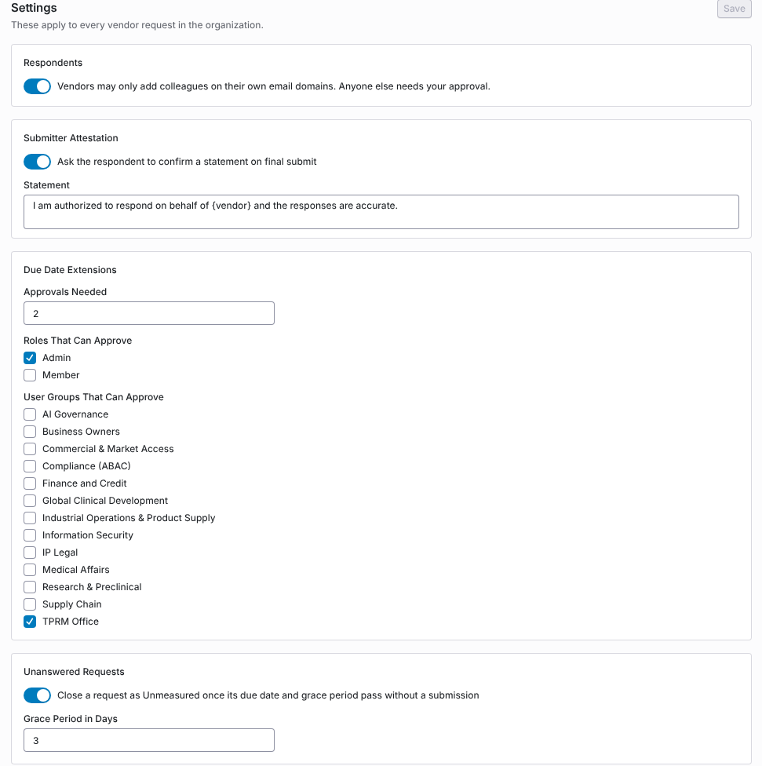
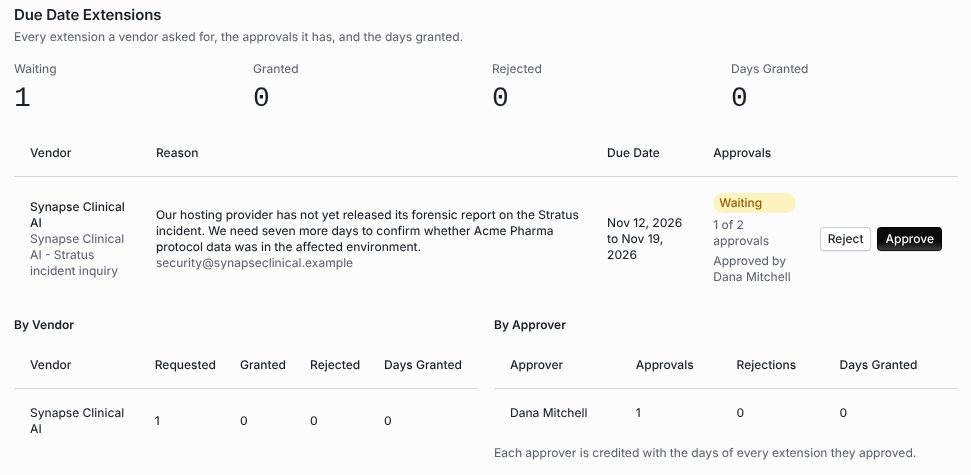

import AgentDirective from "/snippets/agent-directive.mdx";

<AgentDirective />

<Info>
  This guide is part of the [User Guides](/user-guides/overview) collection. It covers **Configuration → Supplier Portal Controls**. It sits beside [Due diligence methods and the portal](/user-guides/due-diligence-methods-and-portal), which covers sending requests, and [The supplier portal, for suppliers](/user-guides/supplier-portal-for-suppliers), which covers the vendor's side.
</Info>

**Supplier Portal Controls** sets four rules for every vendor request in your organization: who may answer it, what the person submitting attests to, how a due date extension is approved, and when an unanswered request closes as Unmeasured.

The mistake people make most often is approving an extension and expecting the due date to move at once. With two approvals needed, the first approval only records itself. The due date moves when the second, different approver approves.

## Before you start

Viewing the page needs organization settings read permission. Saving the settings needs organization settings update permission. Who can decide an extension is set on the page itself.

## Step 1: Choose the settings

Under **Settings**, change what you need and click **Save**.

<Frame caption="The Settings section of Supplier Portal Controls.">
  
</Frame>

| Section | Setting | Default |
| --- | --- | --- |
| **Respondents** | **Vendors may only add colleagues on their own email domains. Anyone else needs your approval.** A vendor's domains are the domains on its saved contacts and the portal owner's own. | On |
| **Submitter Attestation** | **Ask the respondent to confirm a statement on final submit**, and the **Statement**. `{vendor}` is replaced with the vendor's name. | Off. The statement reads "I am authorized to respond on behalf of `{vendor}` and the responses are accurate." |
| **Due Date Extensions** | **Approvals Needed** (1 to 5), **Roles That Can Approve** and **User Groups That Can Approve**. A person with either an approving role or an approving group can approve. | 2 approvals, from the Admin role |
| **Unanswered Requests** | **Close a request as Unmeasured once its due date and grace period pass without a submission**, and the **Grace Period in Days**. | Off, 3 days |

## What the vendor sees

- **Adding a colleague.** With the respondent rule on, a vendor's portal owner who invites someone outside the vendor's domains is told: "This colleague's email domain is not one of the supplier's. Ask the customer to approve them instead." The ask then waits for you under **Respondent Requests**.
- **Submitting.** With the attestation on, the final submit opens **Confirm and Submit**. The respondent confirms the statement and types **Your Full Name**, then clicks **Submit**. Coverbase keeps their name, email address, the time and their IP address with the submission.
- **Asking for more time.** A vendor asks for an extension with a reason and a new due date after the current one. Only one extension per request can wait at a time.

## Step 2: Decide colleague requests

**Respondent Requests** lists each ask with the **Colleague**, the **Vendor**, the **Reason** and when it was **Asked**, and who asked. Click **Approve** to add the colleague to the vendor's portal, or **Reject**.

## Step 3: Decide extensions

**Due Date Extensions** lists every extension a vendor asked for, with counts for **Waiting**, **Granted**, **Rejected** and **Days Granted**.

<Frame caption="An extension waiting on its second approval, with the reports by vendor and by approver.">
  
</Frame>

Each row shows the **Vendor** and request, the **Reason**, the **Due Date** change, and the **Approvals** so far, for example "1 of 2 approvals" with who approved. If you can decide, **Approve** and **Reject** are shown.

- An extension is granted once the required number of different eligible approvers approve it. The due date then moves. The status is **Granted**.
- One rejection ends it. The status is **Rejected**.
- The same person cannot approve twice. A second approval from you is refused with "You already decided this extension. Another approver must decide next."

**By Vendor** totals what each vendor **Requested**, how many were **Granted** and **Rejected**, and the **Days Granted**. **By Approver** totals each approver's **Approvals**, **Rejections** and **Days Granted**; each approver is credited with the days of every extension they approved.

## Requests closed as Unmeasured

With **Unanswered Requests** on, a daily check closes a request whose due date and grace period have passed without a submission. It skips a request your team has put on hold and one with an extension waiting. The request and its assessment close with the outcome **Unmeasured**, so the vendor reads as one that did not respond rather than one that responded well, and the owners are told.

**Closed as Unmeasured** lists each one with the **Vendor**, **Assessment**, when it was **Due** and when it was **Closed**.

## Troubleshooting

| What you see | Cause | Fix |
| --- | --- | --- |
| The due date did not move after you approved | The extension needs more approvals. | Another eligible approver approves it. |
| **Your role and user groups do not allow you to approve due date extensions.** | You have neither an approving role nor an approving group. | Ask an admin to add your role or group under **Due Date Extensions**. |
| **You already decided this extension. Another approver must decide next.** | You approved it already. | Another approver decides. |
| A vendor cannot add a colleague | The colleague's email domain is not one of the vendor's. | Approve the colleague under **Respondent Requests**. |
| A request past its due date did not close | **Unanswered Requests** is off, the grace period has not passed, the request is on hold, or an extension is waiting. | Check the settings and the request. |

## Related

<CardGroup cols={2}>
  <Card title="Due diligence methods and the portal" icon="paper-plane" href="/user-guides/due-diligence-methods-and-portal">
    Sending a request to a vendor.
  </Card>
  <Card title="The supplier portal, for suppliers" icon="store" href="/user-guides/supplier-portal-for-suppliers">
    What the vendor sees.
  </Card>
  <Card title="Centralized supplier portal" icon="building" href="/user-guides/centralized-supplier-portal">
    One portal per vendor across requests.
  </Card>
  <Card title="Email notifications" icon="envelope" href="/user-guides/email-notifications">
    The notifications these controls send.
  </Card>
</CardGroup>
