import AgentDirective from "/snippets/agent-directive.mdx";

<AgentDirective />

<Info>
  This guide is part of the [User Guides](/user-guides/overview) collection. Share it with your suppliers. For signing in and the rest of the portal, see [The supplier portal, for suppliers](/user-guides/supplier-portal-for-suppliers). For the settings behind this page, see [Setting up Payables](/user-guides/payables-setup#what-suppliers-see).
</Info>

Your customer checks every invoice you send against the purchase order and the goods they recorded as received. This part of their supplier portal shows you what they have recorded, what is holding an invoice up, and what they need from you. You can answer here instead of emailing their accounts payable team.

The mistake suppliers make most often is emailing a corrected invoice to accounts payable. Use **Upload corrected invoice** on the invoice instead. It is checked against the PO again within minutes, and the question on it closes by itself when it matches.

Your customer decides which of these pages you see and what you may send. If a page or button described here is missing, your customer has not turned it on, or your role in the portal cannot use it.

## Home

The portal's home page shows what needs you first.

<Tabs>
  <Tab title="Desktop">
    <Frame caption="Home: invoices that need you, the statement to check, expected payments and recent changes.">
      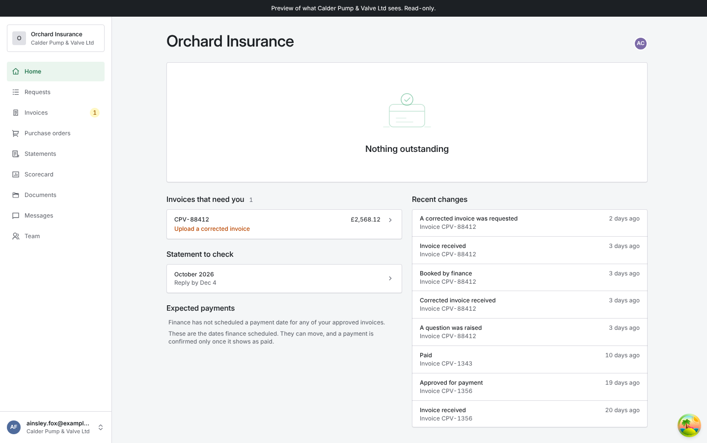
    </Frame>
  </Tab>
  <Tab title="Phone">
    <Frame caption="Home on a phone.">
      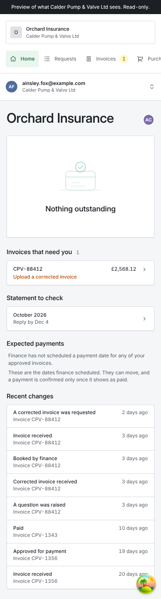
    </Frame>
  </Tab>
</Tabs>

- **Invoices that need you.** Each invoice where your customer is waiting on you, with what to do.
- **Statement to check.** This month's statement and the date to reply by.
- **Expected payments.** Dates your customer's finance team scheduled for approved invoices, when your customer shows them. They can move, and a payment is confirmed only once it shows as paid.
- **Recent changes.** Each invoice event, such as received, booked by finance, approved for payment or paid.

## Your invoices

Open **Invoices**.

<Tabs>
  <Tab title="Desktop">
    <Frame caption="Your invoices to your customer, filtered to the ones that need your action.">
      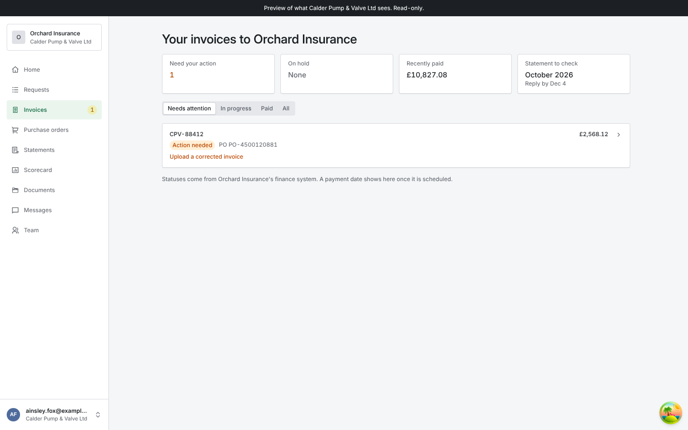
    </Frame>
  </Tab>
  <Tab title="Phone">
    <Frame caption="Your invoices on a phone.">
      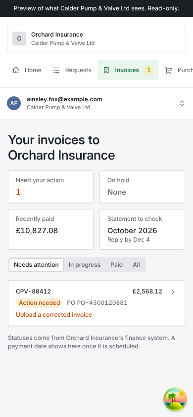
    </Frame>
  </Tab>
</Tabs>

The tiles count invoices that **Need your action** and are **On hold**, show what was **Recently paid**, and link the **Statement to check**. Filter with **Needs attention**, **In progress**, **Paid** and **All**.

| Status | What it means |
| --- | --- |
| **Received** | Your customer has the invoice. |
| **In review** | It is being checked, or your customer's finance team is working on it. |
| **Action needed** | Your customer is waiting on you. The next step is under the invoice. |
| **On hold** | Something on your customer's side is holding it, such as goods not yet recorded as received. Nothing is needed from you unless they ask. |
| **Approved for payment** | Your customer's finance team approved it. |
| **Paid** | Your customer's finance team reported it paid. |
| **Rejected** | Rejected or voided by their finance team, or a duplicate of an invoice already received. |

Statuses come from your customer's finance system. A payment date shows once it is scheduled, if your customer shows them.

## An invoice that needs action

Open the invoice.

<Tabs>
  <Tab title="Desktop">
    <Frame caption="An invoice that needs action: the message from your customer, the invoice against the PO, and its history.">
      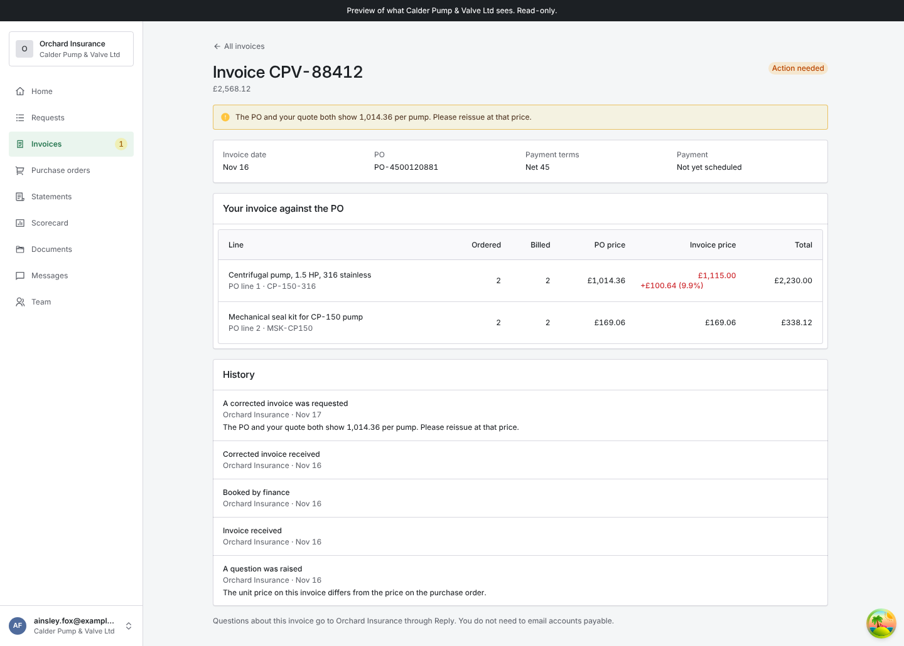
    </Frame>
  </Tab>
  <Tab title="Phone">
    <Frame caption="The same invoice on a phone. Each line shows what you billed and the PO price.">
      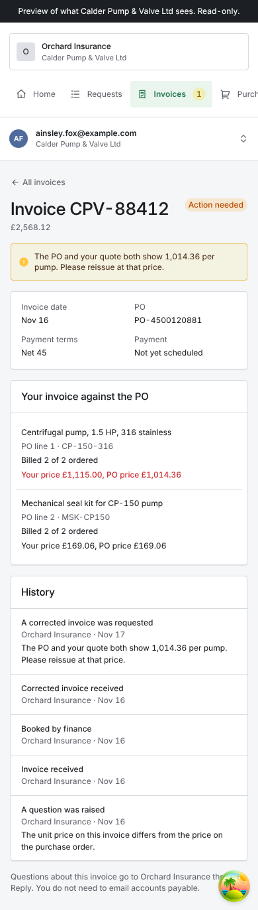
    </Frame>
  </Tab>
</Tabs>

The banner says what your customer needs. **Your invoice against the PO** shows, line by line, what you billed and what the PO says, with any difference highlighted. **History** lists everything that happened to the invoice, and every version you sent.

What your customer never shows you: their internal notes, the names of the people working on it, and how their checks work.

### Send a corrected invoice

<Steps>
  <Step title="Open the upload">
    Click **Upload corrected invoice**.
  </Step>
  <Step title="Attach the corrected invoice">
    Drop in the PDF, PNG or JPG of the corrected invoice and give its **Invoice number**.
  </Step>
  <Step title="Restate the corrected lines">
    Each PO line is listed with its **Quantity** and **Unit price**. Change the ones you corrected. Your customer's checks read these values, not the PDF, so a correction that only attaches a new PDF is checked with the old figures.
  </Step>
  <Step title="Send it">
    Add a **Note** if it helps, then click **Send corrected invoice**.
  </Step>
</Steps>

Your original invoice stays on record. The corrected one becomes the current version and is checked against the PO again, usually within minutes. If it now matches, the question closes and the invoice shows "Resolved. The invoice now matches the purchase order."

### Reply

Click **Reply** and choose what you want to tell your customer:

- **We will send a corrected invoice.**
- **The invoice is right. The price or quantity was agreed with the buyer.** Say why in the message. This is required.
- **Something else.**

You can attach files. Your reply goes to whoever owns the question on your customer's side.

### When nothing is needed from you

Some invoices say "Waiting for delivery to be recorded. Nothing needed from you." or "We are confirming which purchase order lines this invoice bills. No action is needed from you." Those are your customer's to resolve. You do not need to resend anything.

Your customer may also ask you for a document, such as a proof of delivery. Send it with **Reply**, with the file attached. When a question is yours to answer and time is running out, you may get a reminder in the portal and by email.

## Submit an invoice

If your customer takes invoices in the portal, **Submit an invoice** appears on **Invoices**. If it says "Invoices are sent to finance directly. Submitting here is not turned on.", send invoices the way your customer asked you to.

<Tabs>
  <Tab title="Desktop">
    <Frame caption="Submit an invoice. A portal role that may not send invoices sees this message instead of the form.">
      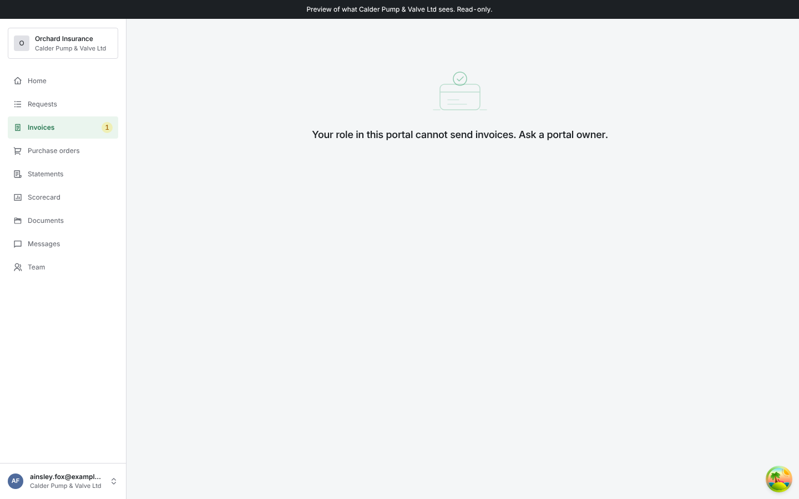
    </Frame>
  </Tab>
  <Tab title="Phone">
    <Frame caption="Submit an invoice on a phone.">
      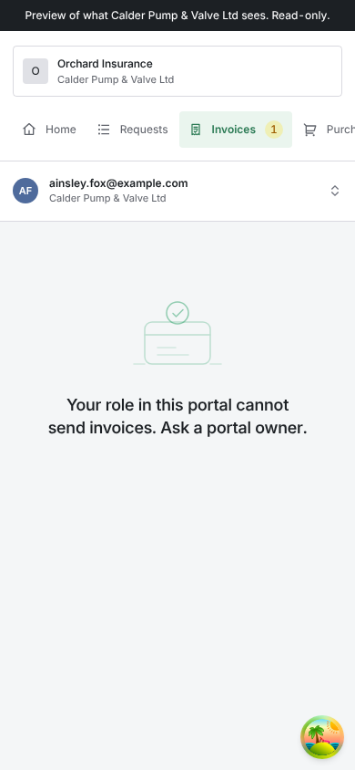
    </Frame>
  </Tab>
</Tabs>

<Steps>
  <Step title="Pick the purchase order">
    Choose it under **Purchase order**. Only POs with something left to bill are listed. If none is, the page says "Every PO is fully invoiced."
  </Step>
  <Step title="Number and date">
    Give the **Invoice number** and **Invoice date**.
  </Step>
  <Step title="Say what you are billing">
    Under **What you are billing**, each PO line shows how much was ordered and already billed. Enter the **Quantity** and **Unit price** for the lines this invoice bills. You cannot bill more than is left on a line. A price different from the PO price is allowed, but the page warns that it will hold the invoice for review.
  </Step>
  <Step title="Tax, freight and the PDF">
    Add **Tax** and **Freight**, and attach the invoice PDF with **Attach the invoice PDF**.
  </Step>
  <Step title="Submit, or save a draft">
    **Submit invoice** sends it. **Save draft** keeps it unsent.
  </Step>
</Steps>

A submitted invoice is checked against the PO, then sent to your customer's finance team to book. It is not approved until then. If an invoice with the same number and total is already on record, the portal refuses it and says so: check the invoice number before submitting again.

**Drafts.** A draft needs only a PO and an invoice number. Saved drafts are listed on **Invoices**. **Open** one to finish it, or discard it. Drafts are never sent to your customer.

If the page says "Your role in this portal cannot send invoices. Ask a portal owner.", your customer has limited sending to some portal roles. Ask the owner of your portal team.

## Purchase orders

**Purchase orders** lists the POs your customer issued to you, copied from their procurement system, so you can see what was billed against each. You still manage POs in your customer's procurement system as you do today.

<Tabs>
  <Tab title="Desktop">
    <Frame caption="Purchase orders, each with its status, issue date, where it ships and how many invoices bill it.">
      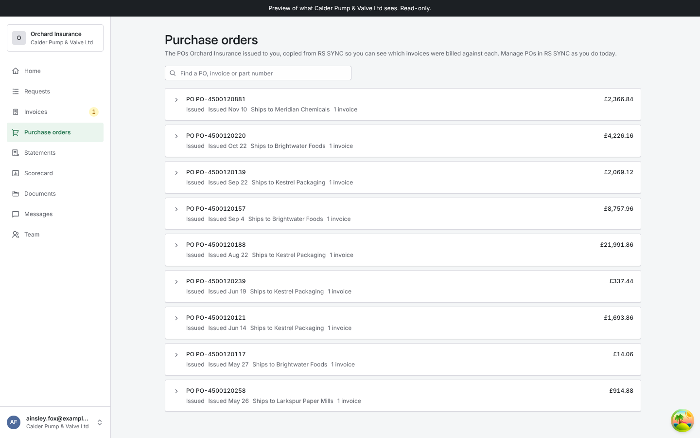
    </Frame>
  </Tab>
  <Tab title="Phone">
    <Frame caption="Purchase orders on a phone.">
      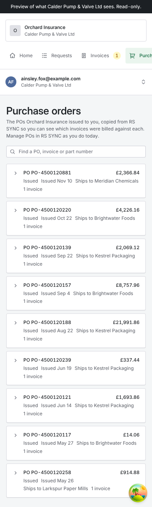
    </Frame>
  </Tab>
</Tabs>

Search by PO, invoice or part number. Open a PO to see each line's **Ordered** quantity, what is **Left to bill** and the **Unit price**, and the invoices against it. Billing a line by its PO line number or part number is the surest way for your invoice to match.

## Checking your monthly statement

Each month your customer lists the invoices they have from you, one statement per currency and billing entity. Check it against your records and say what differs. You are emailed when a statement is ready.

<Tabs>
  <Tab title="Desktop">
    <Frame caption="Your monthly statements.">
      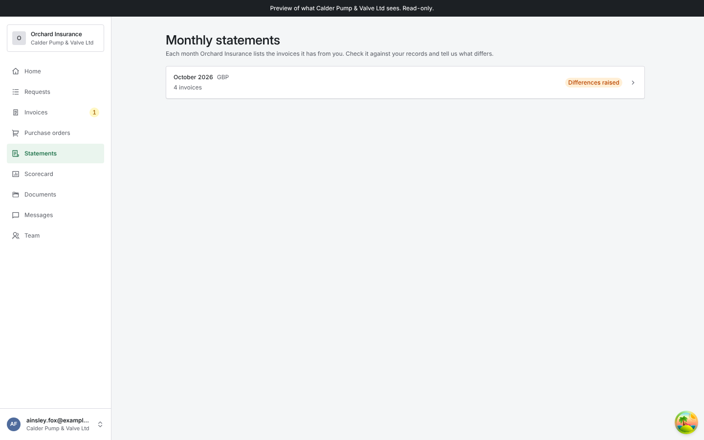
    </Frame>
  </Tab>
  <Tab title="Phone">
    <Frame caption="Monthly statements on a phone.">
      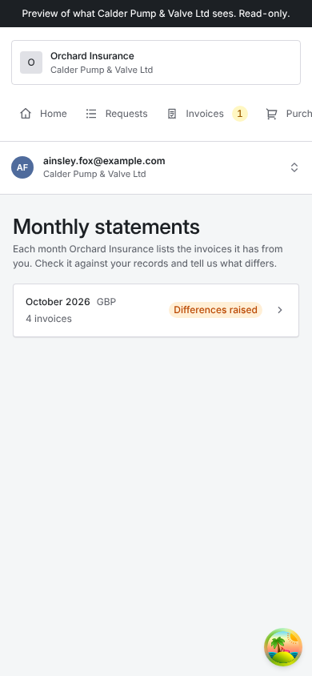
    </Frame>
  </Tab>
</Tabs>

Open a statement. It shows the totals invoiced, paid, outstanding and on hold, and each invoice with its amount, status and payment. It lists the invoices your customer has recorded. It is not a promise of payment.

<Tabs>
  <Tab title="Desktop">
    <Frame caption="A statement with your response on each line, including an invoice you added as missing.">
      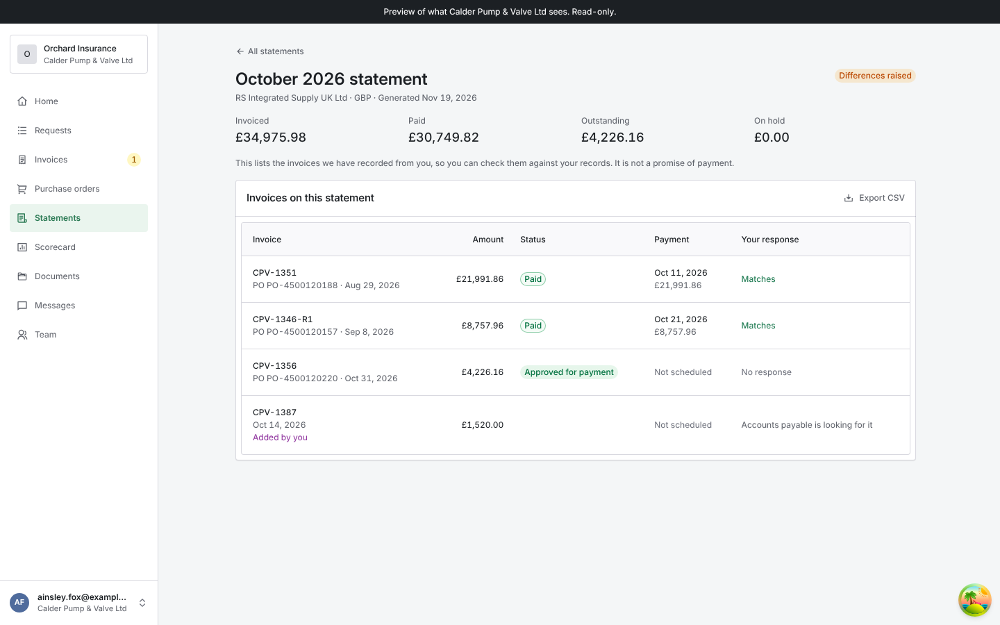
    </Frame>
  </Tab>
  <Tab title="Phone">
    <Frame caption="A statement on a phone.">
      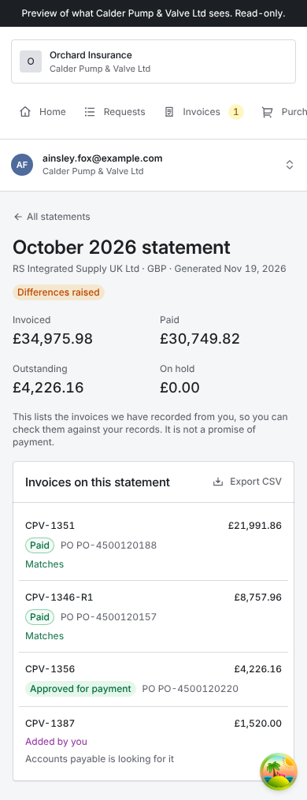
    </Frame>
  </Tab>
</Tabs>

<Steps>
  <Step title="Answer each line">
    Click **Matches** when a line agrees with your records, or **Differs** when it does not. For a difference, choose **The amount is different in our records** (and give the amount), **The status is wrong, for example we were already paid**, or **This is not our invoice**, add **Details** and any files, then **Send**.
  </Step>
  <Step title="Add what is missing">
    If you sent an invoice that is not listed, click **Add an invoice we don't have**. Give its number, PO, date, amount and how and when you sent it, and attach it if you can. Accounts payable looks for it and replies here. The line shows "Accounts payable is looking for it" until they do.
  </Step>
  <Step title="Finish">
    **Mark the rest as matching** answers every line you have not answered. Then **Confirm statement**, or **Send responses** when you raised a difference.
  </Step>
</Steps>

Reply before the date shown. After it, the statement closes: lines you did not answer are not taken as agreement, and you raise anything still open with your contact or on next month's statement. **Export CSV** downloads the statement with your answers.

If your customer records something late, such as a payment or a credit, while you can still answer, you get an amended statement. Your answers on unchanged lines carry over.

## Your invoice scorecard

**Scorecard** shows how often your invoices match the PO the first time, over the last six months. Open a figure to see how it is measured.

<Tabs>
  <Tab title="Desktop">
    <Frame caption="Your invoice scorecard.">
      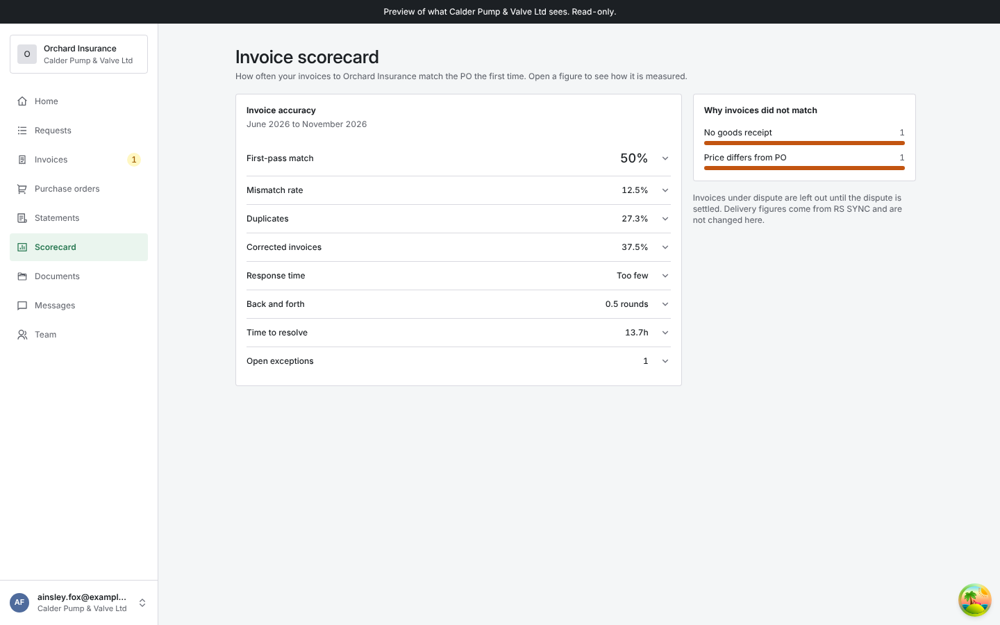
    </Frame>
  </Tab>
  <Tab title="Phone">
    <Frame caption="Your invoice scorecard on a phone.">
      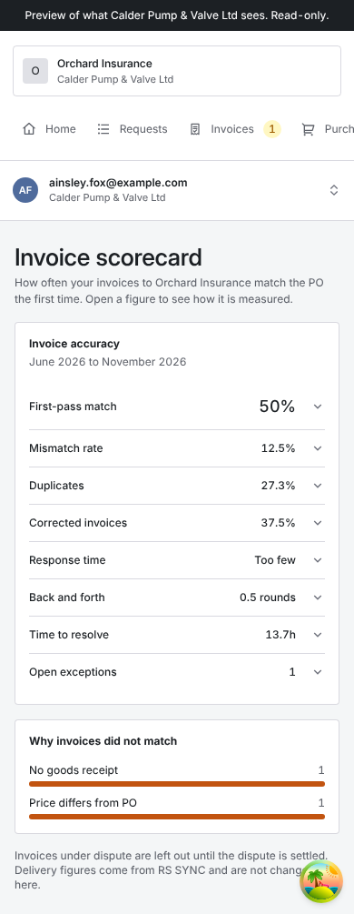
    </Frame>
  </Tab>
</Tabs>

A goods receipt your customer had not recorded is their delay, not yours, and does not count against your first-pass match. A figure built on fewer than 5 invoices or replies shows **Too few**. Delivery figures, when shown, come from your customer's procurement system and are not changed here.

### Dispute a figure

<Steps>
  <Step title="Open the figure">
    Open the figure and click **Dispute this figure**.
  </Step>
  <Step title="Say what is wrong">
    Pick the **Month**. Tick the invoices you think were counted wrongly, if any. Explain under **Why the figure is wrong**, and attach anything that shows it, such as your own invoice records.
  </Step>
  <Step title="Send it">
    Click **Send dispute**.
  </Step>
</Steps>

Accounts payable reviews it. The invoices you named are left out of your score until they reply, and that month reads as under review. **Your challenges** lists each dispute as **In review**, then **Answered**. You can dispute one figure once per month at a time.

## Onboarding

If your customer is onboarding you, **Onboarding** lists what they need from you, each with a due date and a target date to finish.

<Tabs>
  <Tab title="Desktop">
    <Frame caption="Onboarding. When your customer has not asked you for anything, the page says so.">
      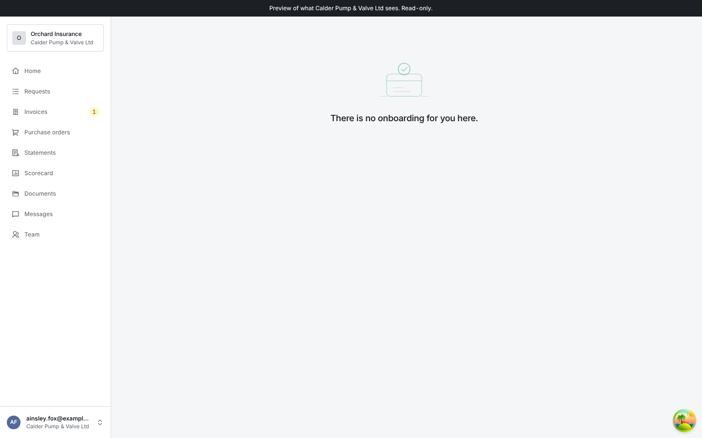
    </Frame>
  </Tab>
  <Tab title="Phone">
    <Frame caption="Onboarding on a phone.">
      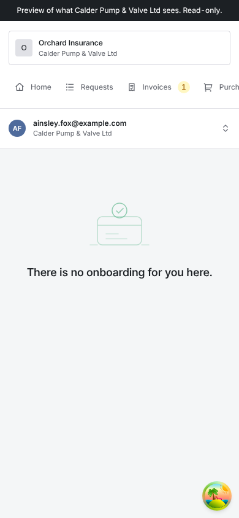
    </Frame>
  </Tab>
</Tabs>

For each item, click **Send**, attach the documents, add a **Note for the reviewer** if it helps, then **Send files**. An item reads **Needed**, **Sent, in review**, **Accepted**, **Not needed** or **Sent back**. When an item is sent back, the reason is shown: send a new file. An item that is an assessment opens as a request in your portal.

Onboarding is separate from your invoices. An open item here does not hold up payment of an invoice your customer already approved.

## Troubleshooting

| Problem | What to check |
| --- | --- |
| There is no **Invoices** page | Your customer has not turned it on for their portal. |
| **Submit an invoice** is missing or says submitting is not turned on | Your customer takes invoices another way. Send them as you do today. |
| "Your role in this portal cannot send invoices" | Ask the owner of your portal team, or your customer. |
| "Only ... left to bill on this line" | Earlier invoices already billed most of that line. Check the PO under **Purchase orders**. |
| "Invoice ... is already on record" | An invoice with that number and total was already received. Do not send it again. |
| My corrected invoice still shows the old price | Restate the corrected **Unit price** on the line when you upload. The PDF alone is not read for the new figures. |
| An invoice shows **Rejected** but I sent it once | Your customer received it twice, by two routes, and kept one copy. The other copy is the invoice. |
| I cannot answer the statement any more | The response window closed. Raise it with your contact, or on next month's statement. |

## Related

<CardGroup cols={2}>
  <Card title="The supplier portal, for suppliers" icon="user-group" href="/user-guides/supplier-portal-for-suppliers">
    Signing in, your team and the rest of the portal.
  </Card>
  <Card title="Portal languages" icon="language" href="/user-guides/portal-languages">
    Reading the portal in your own language.
  </Card>
</CardGroup>
