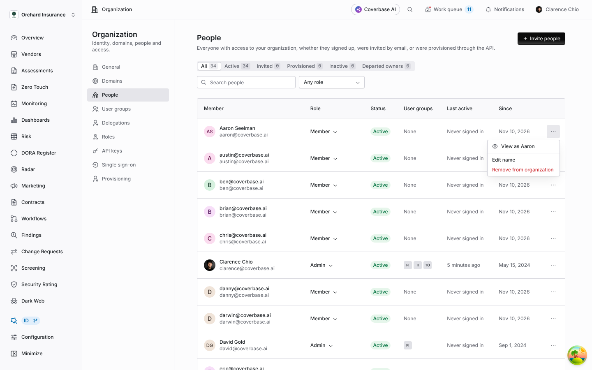
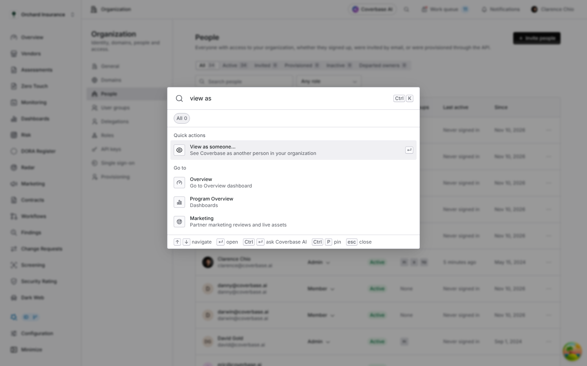
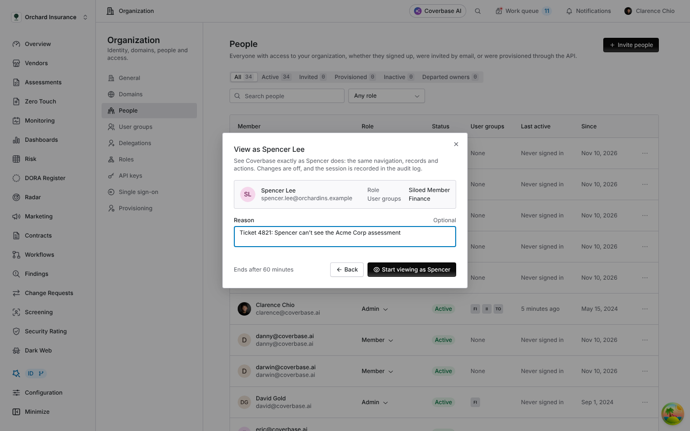
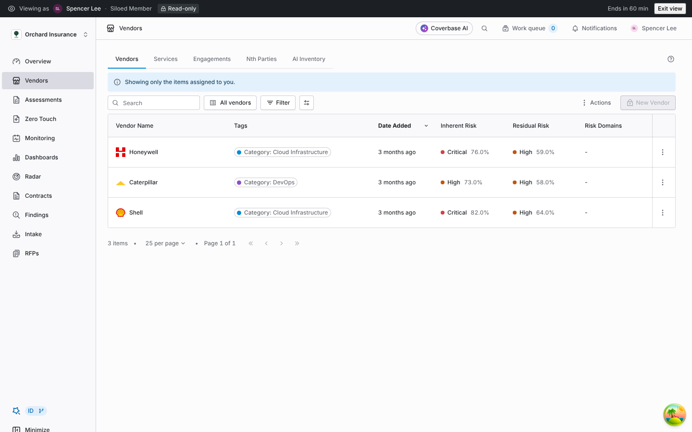
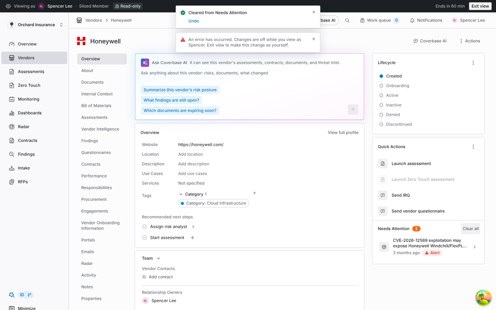
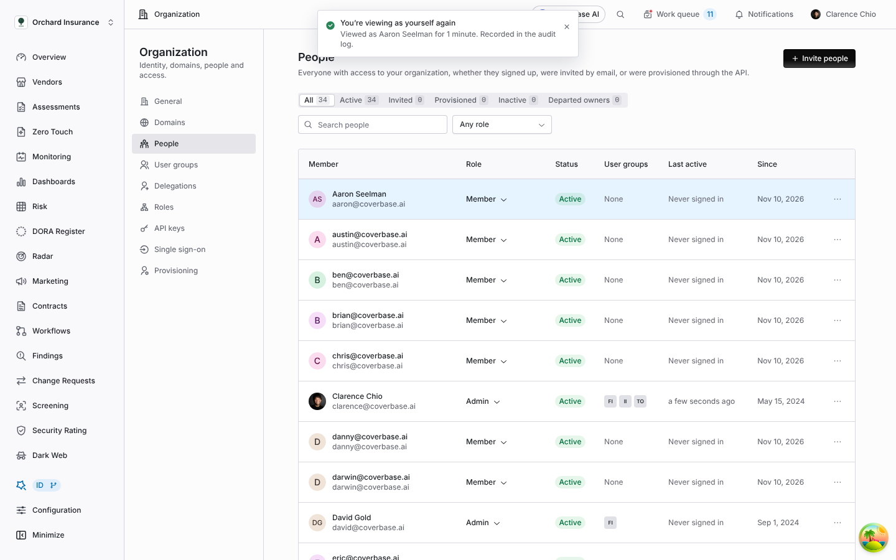
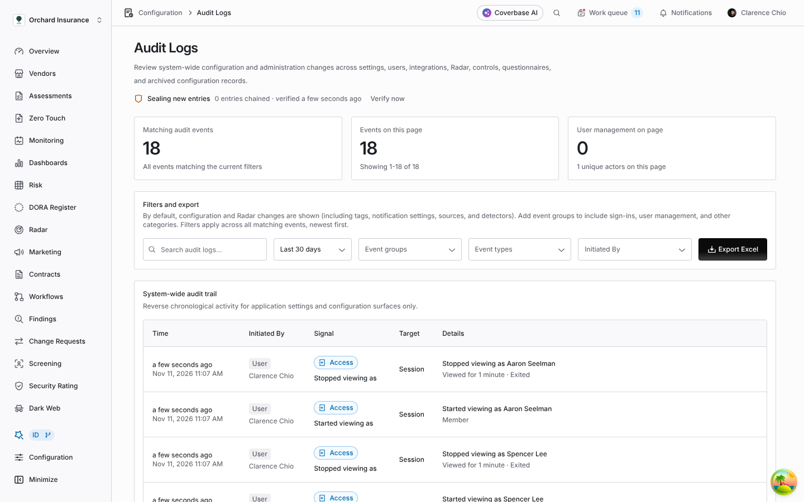

import AgentDirective from "/snippets/agent-directive.mdx";

<AgentDirective />

<Info>
  This guide is part of the [User Guides](/user-guides/overview) collection. It covers **Organization → People** and the command palette. It sits beside [Permissions and roles](/user-guides/permissions-and-roles), which explains what each role can do, and [Assignment and delegation](/user-guides/assignment-and-delegation), which explains how owning a vendor narrows what a siloed member sees.
</Info>

When someone reports that they cannot see a vendor, or can see something they should not, you can check it yourself. **View as** shows you Coverbase with that person's role, permissions, user groups and owned vendors, without changing your role or theirs.

You need the Admin role. A view is read-only: you can open anything the person can open, but nothing is saved, sent or marked as read on their behalf.

## Start a view

From **Organization → People**, open the menu at the end of the person's row and choose **View as**.

<Frame caption="The People row menu. View as appears for active members you can view as.">
  
</Frame>

From anywhere, press **Ctrl+K** (**Cmd+K** on a Mac), type *view as*, press **Enter**, then type the first letters of the person's name and press **Enter** again.

<Frame caption="The command palette with View as someone under Quick actions.">
  
</Frame>

Either way, a dialog shows the person's role and user groups. Add a reason if you like, such as a ticket number. It is saved with the view in the audit log. Choose **Start viewing as** to begin.

<Frame caption="The confirmation step, with an optional reason.">
  
</Frame>

You can view as members, siloed members, guests and people with a custom role. Admins, pending invitations, API accounts and supplier contacts are not listed.

## While you view

Coverbase opens the **Overview** page as the person sees it. A dark bar across the top names the person and their role, shows **Read-only**, and counts down the time left.

<Frame caption="Viewing as a siloed member: only the vendors they own are listed, and New Vendor is unavailable.">
  
</Frame>

Navigation, pages, records, buttons and the work queue all follow the person's access. If a button is there for them, it is there for you. If you choose something that would change data, Coverbase does not do it and tells you changes are off.

<Frame caption="A change refused while viewing.">
  
</Frame>

Other tabs in the same browser view as the same person. A view ends after 60 minutes. Starting another view ends the one before it.

## Exit and fix access

Choose **Exit view** in the bar. Coverbase returns you to the page you started from. When that is **People**, the person's row is highlighted so you can change their role or user groups straight away.

<Frame caption="Back on People after exiting, with the viewed person's row highlighted.">
  
</Frame>

## Audit log

Every view writes two events to **Configuration → Audit Logs** under the **Access** group: **Started viewing as** with the person, their role and your reason, and **Stopped viewing as** with how long the view lasted and how it ended (exited, expired or replaced).

<Frame caption="View events in the audit log.">
  
</Frame>

## Things to know

- A view ends early if the person loses a viewable role or leaves the organization, or if you stop being an admin.
- What you see includes the person's own work queue and notifications. Opening them does not mark anything as read.
- The view applies to this browser only. Another device stays signed in as you.
